**English** | [Deutsch](README.md)

<p align="center">
  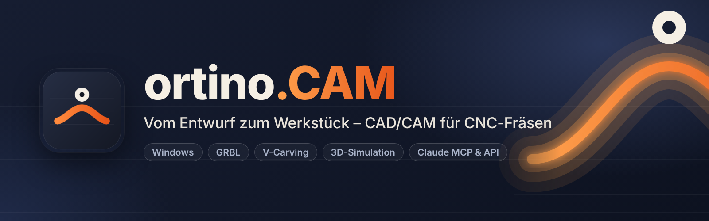
</p>

<p align="center">
  <a href="https://github.com/KlapSC/ortino-cam/releases/latest"></a>
  <a href="https://github.com/KlapSC/ortino-cam/issues/new/choose"></a>
</p>

<p align="center">
  
  
  
  
  
  
</p>

<h3 align="center">
  <a href="#at-a-glance">At a glance</a> ·
  <a href="#features">Features</a> ·
  <a href="#new-in-0160-word-and-logo-collage-typeface-phone-navigation">New in 0.16.0</a> ·
  <a href="#new-in-0150-custom-templates-cutting-online-generator">New in 0.15.0</a> ·
  <a href="#new-in-0140-patterns-reliefs-wall-picture-motifs-decoration">New in 0.14.0</a> ·
  <a href="#new-in-0130-creator-order-of-the-depth-passes-ai-models-home-page">New in 0.13.0</a> ·
  <a href="#community-portal-and-designs">Portal</a> ·
  <a href="#controlled-by-claude-mcp-server-and-local-api">Claude &amp; API</a> ·
  <a href="#ortinocam-and-vectric-aspire">Comparison</a> ·
  <a href="#installation-windows-1011-64-bit">Installation</a> ·
  <a href="#frequently-asked-questions">Questions</a> ·
  <a href="#contributing">Contributing</a> ·
  <a href="#disclaimer">Disclaimer</a>
</h3>

**ortino.CAM** is **CAD/CAM software for CNC routers** on Windows: draw, calculate toolpaths (profile, pocket, V-carving, 3D relief), simulate in 3D, check, and send straight to a **GRBL controller** such as the one on the Ultimate Bee (CNC xPRO V5), all in one application. With an **MCP server and a local API** it can be driven by **Claude** and by your own scripts.

<p align="center">
  <picture>
    <source media="(prefers-color-scheme: light)" srcset="docs/bilder/entwurf-light.png">
    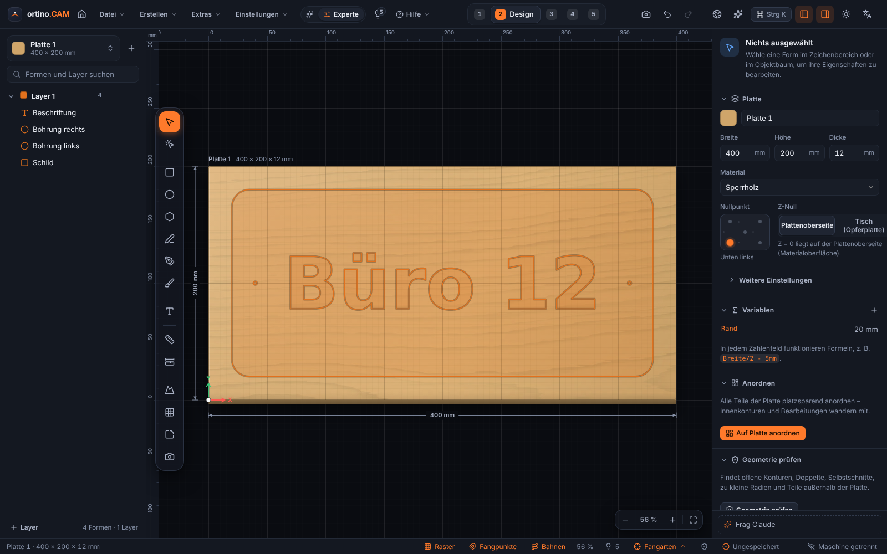
  </picture>
</p>

> [!WARNING]
> **Early version (0.x): not everything has been tested on a real machine.** So far, milling has been done on one machine (Ultimate Bee with xPRO V5, GRBL); everything else has only run against tests and the simulator. Always test without tool and material first, with the emergency stop within reach. What exactly has been tested is on [Testing status](https://github.com/KlapSC/ortino-cam/wiki/Testing-Status).

## At a glance

* **Everything in one application:** draw, calculate toolpaths, simulate in 3D, check and run the machine, with no files passed back and forth between several programs.
* **Checks before it cuts:** a checklist with suggested fixes and a pre-flight check before every run; if there are errors, export and machine start are blocked.
* **For beginners and experienced users:** easy mode suggests the tool, depths and cutting values and explains them; expert mode shows all settings. A **example gallery**, a **guided tour** and **lessons** help you get started.
* **Straight to the machine:** GRBL controllers over USB/COM or network, with manual control, homing, probing and a tool-change assistant; plus a **phone remote control** via QR code (own Wi-Fi only).
* **Design without detours:** 2D drawing with formulas and variables, **parametric sketches with constraints and a history**, text on a path and single-line fonts, import of SVG, DXF (splines stay curves), PDF, EPS/AI, images and **3D models (STL, STEP)**, export also as **STL and 3MF**, plus **40 perforation pattern kinds with 80 templates**, **3D relief** from patterns, images and photos (**Photo → relief** with local AI depth estimation), **modelling** of reliefs with a brush, and **components** (layers from a profile, pattern or image).
* **Furniture and sheets:** a sheet planner with free-form nesting, **sheet cutting with an optimiser** (saw plan for the panel saw), finger joints, a kitchen and cabinet designer with parts list, colours, handles and 3D reliefs on fronts, a **Furniture Designer** (tables, sideboards, shelves, seating) and **rendering** as an image; since 0.5.0 also **in the browser in the portal** (Web Designer, designs in your own account).
* **Wall pictures in wood:** the **Art Designer** (menu “Create”) turns 14 motifs (leaf stream, leaf spray, monstera, ginkgo, fern, palm frond, feather fan, flowing bands and, new in 0.14.0, layered mountains, sunrise, moon and clouds, moon phases, olive branch, grasses and pampas) into a wall picture, either as a carved relief or as a **layered plywood picture** made of stacked plywood layers with an assembly plan, and since 0.10.0 it also takes **your own image**, which can fade into the pattern on one side. *(Calculated, not milled or glued.)*
* **From design to quote:** a setup sheet as PDF with tool list and time estimate, cost calculation with quantity and price tiers, **customer records, quote numbers and payment terms** (all local), series from CSV, and a **workshop folder with roles and a dashboard** for small teams (local).
* **Together:** a community portal with milling designs to load and share, plus an MCP server with which **Claude** can operate the program. Your machine profiles, bits and settings can be **backed up privately in the portal** and restored on a second computer.
* **Workpieces from a few inputs (since 0.13.0):** the **Creator** (Create ▸ Creator …) with **22 generators in six groups**: box with finger joints, birdhouse, shadow box, gears, puzzle, rosette, door sign, ruler and more; **new in 0.14.0** the group “Festive and seasonal” with advent calendar, wreath and border, lantern and garland, and seasonal decoration with 35 instead of 8 motifs. Parts, parts list and assembly notes from one form, in a single undo step together with the milling operations in the project. *(Nothing milled or glued; the clearance is a rule of thumb.)* [More](#new-in-0140-patterns-reliefs-wall-picture-motifs-decoration)
* **Quick start (new in 0.13.0):** a **home page with quick-access tiles** and a home button, on which your own photos and images come before the generators, and an **AI models** dialog in which you load, check or remove the depth model for “Photo → relief” only on a click.
* **More patterns, reliefs and decoration (new in 0.14.0):** the Pattern Studio with **39 kinds and 76 templates** (as of 0.14.0; since 0.16.0 it is 40 and 80; search field, new category Ornament), **62 relief templates** in 9 categories, **14 motifs** in the Art Designer and **35 motifs** in seasonal decoration. *(Calculated and simulated, nothing milled.)* [More](#new-in-0140-patterns-reliefs-wall-picture-motifs-decoration)
* **Word and logo collage (new in 0.16.0):** in the Pattern Studio and in the online generator, the new kind **“Word and logo collage”** fills an area densely with up to four words or logos, in many sizes and rotations; plus the slim typeface **Montserrat** and a new navigation of the portal on the phone. The Pattern Studio thus has **40 kinds and 80 templates**. *(Calculated and simulated, nothing milled.)* [More](#new-in-0160-word-and-logo-collage-typeface-phone-navigation)
* **Custom templates, better cutting, online generator (new in 0.15.0):** the tab **“Own”** in the Pattern Studio and the Relief Studio (save the current state, rename, back up as a file, import) and the **“Shapes”** dialog with ten basic shapes; in the Furniture and Kitchen Designer the cutting method **“Optimised”** and a separate button for the saw plan; plus, in the portal, a free **shapes and pattern generator in the browser** ([ortino-cam.com/tools/generator](https://ortino-cam.com/tools/generator), no account, SVG and DXF in millimetres, **no G-code**). *(Calculated and simulated, nothing milled or sawn.)* [More](#new-in-0150-custom-templates-cutting-online-generator)
* **Order of the depth passes (new in 0.13.0):** for profile and pocket you can choose whether each part is milled to its final depth (**part by part**) or all parts level by level (**level by level**); existing projects give the same G-code byte for byte.
* **Free** for private and commercial use, **Windows 10/11 (64-bit)**. Honest about the state: this is an early version, and what has been tested on a real machine and what has not is stated in the warning at the very top, on [Testing status](https://github.com/KlapSC/ortino-cam/wiki/Testing-Status), under [Machines and controllers](#machines-and-controllers) and in the [Disclaimer](#disclaimer).

## In three steps to the workpiece

| 1 · Machining | 2 · Check | 3 · Cut |
|:--:|:--:|:--:|
| <picture><source media="(prefers-color-scheme: light)" srcset="docs/bilder/bearbeitung-light.png">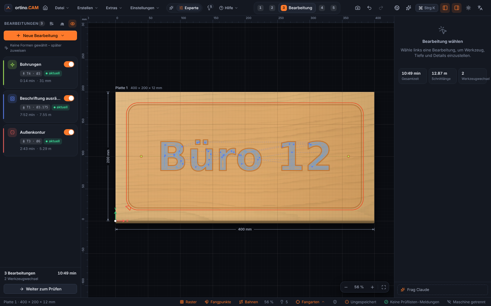</picture> | <picture><source media="(prefers-color-scheme: light)" srcset="docs/bilder/simulation-light.png">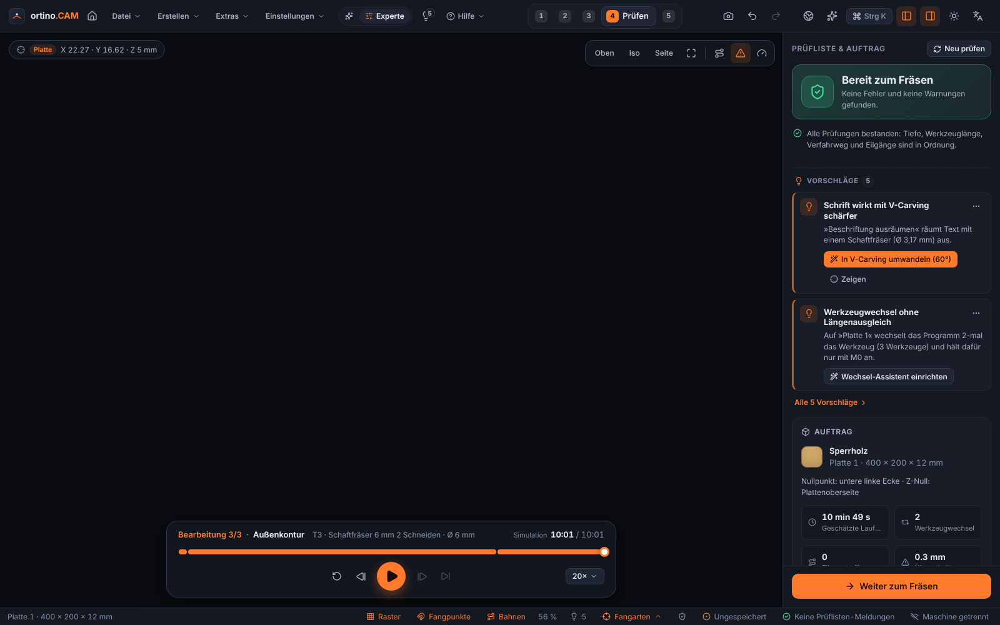</picture> | <picture><source media="(prefers-color-scheme: light)" srcset="docs/bilder/fraesen-light.png">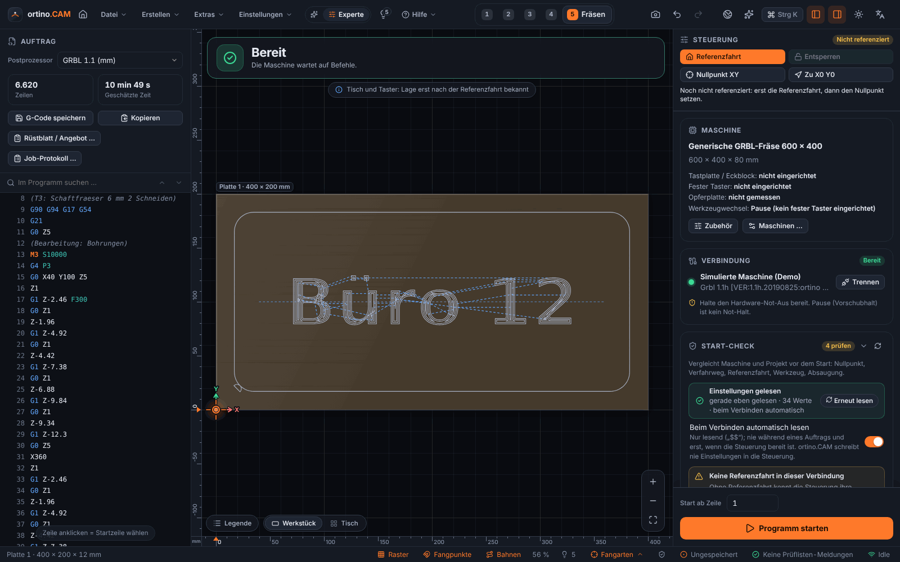</picture> |
| Define toolpaths, with guide values for feed rate and spindle speed | Material removal in 3D, collisions, checklist with solutions | Connect, work zero, pre-flight check, pause and stop |

### More from the program

| Setup sheet &amp; quote | Setting up the machine | Furniture &amp; kitchen |
|:--:|:--:|:--:|
| <picture><source media="(prefers-color-scheme: light)" srcset="docs/bilder/ruestblatt-light.png">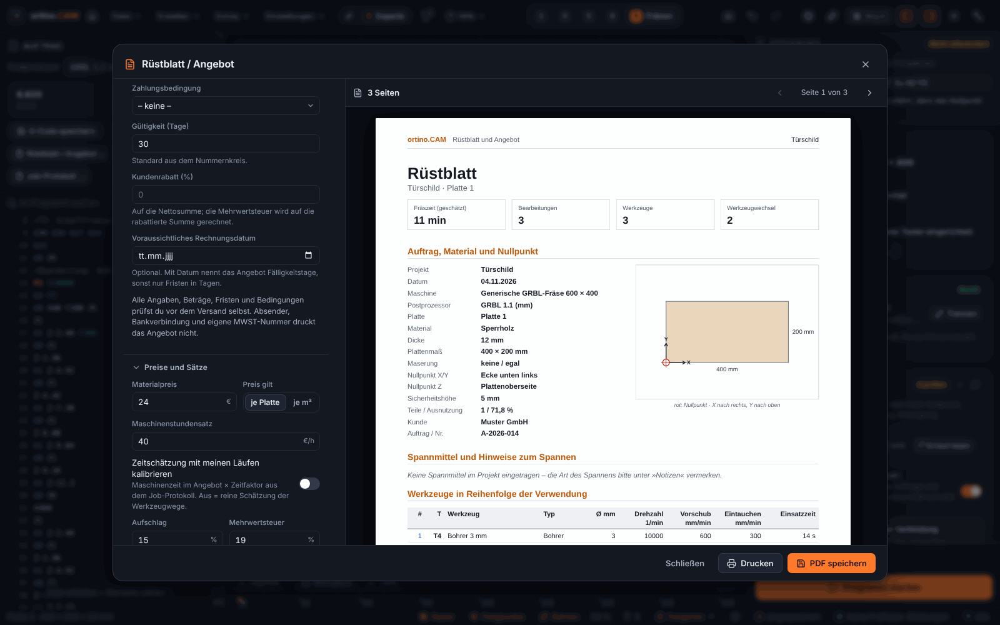</picture> | <picture><source media="(prefers-color-scheme: light)" srcset="docs/bilder/einrichtung-light.png">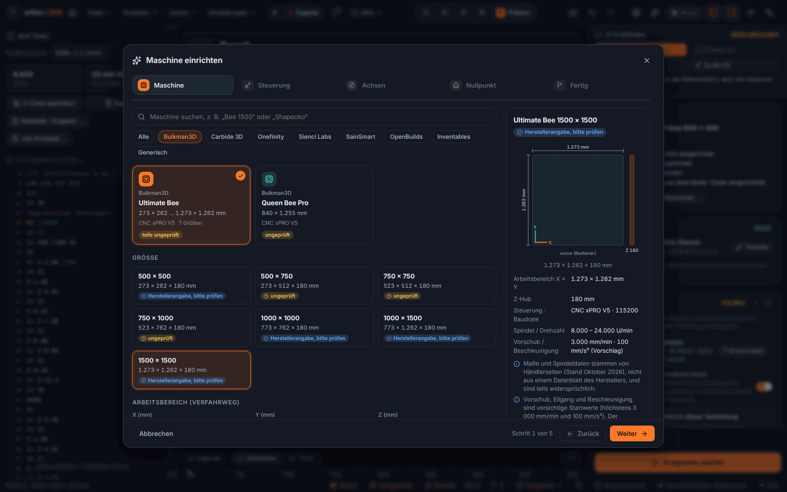</picture> | <picture><source media="(prefers-color-scheme: light)" srcset="docs/bilder/moebel-light.png">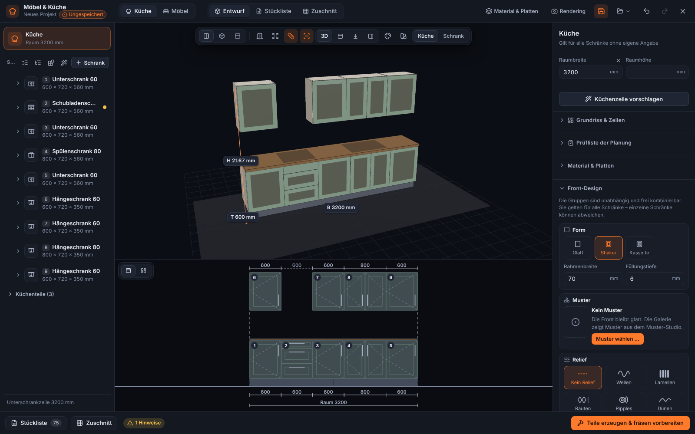</picture> |
| Preview of the PDF with tool list, sequence and time estimate, plus cost calculation | Catalogue with sizes; dealer values are flagged “unverified” or “Manufacturer data, please check” | Kitchen row in 3D and front view, with parts list and cutting plan (example) |

### New in 0.16.0: word and logo collage, typeface, phone navigation

These functions exist since version 0.16.0; they are not in 0.15.0 and earlier versions. In full: [release notes 0.16.0](release-notes/0.16.0.md) (in German).

#### Word and logo collage and the Montserrat typeface

* **Word and logo collage:** an area (for example a wall panel of 1200 × 600 mm) is filled densely with up to **four words, texts or logos**, in many sizes and rotations and interlocked; small parts also sit in the inner areas of large letters (“o”, “A”, “0”). In the Pattern Studio the form **“Words and logos”** has four entries (Off, Word, Logo): words with text (at most 40 characters), typeface and bold, logos from a PNG or JPEG file, plus the frequency (1 to 5) and “Swap light and dark”. The same inputs and the same seed give the same picture. Four new templates (*Name collage*, *Two words, dense*, *Word and logo*, *Four brands mixed*) make **40 kinds and 80 templates**.
* **Montserrat typeface:** slim, supplied in Regular and Bold (SIL Open Font License 1.1), reduced to the characters of Western Europe. It is the default for **newly created** words; the other choices are DejaVu Sans (strong), DejaVu Serif (with serifs) and, in the program, any system font. If a typeface lacks a character (Cyrillic or Greek in Montserrat), the collage reports it with a solution. Older files stay as they were (a word without a typeface setting is still set in DejaVu Sans).
* **In the online generator:** the collage is available there too ([ortino-cam.com/tools/generator](https://ortino-cam.com/tools/generator)), with words and logos, the three supplied typefaces, an area up to 1200 × 600 mm and parts from 4 mm in height. The generator thus offers **38 of the 40 kinds and 78 of the 80 templates** (*Text from holes* and *Image as hole grid* are missing). For the preview, texts and logo images go to the portal’s server for calculation; it does not store them and does not write them to the operating log. Guide: [Shape and Pattern Generator](https://github.com/KlapSC/ortino-cam/wiki/Shape-and-Pattern-Generator) in the wiki.
* **Custom templates:** from the collage they save only the words, never an image; a pattern with a logo cannot be saved as a template, but it can be saved as a project (program) or as SVG and DXF (generator). For this, the exchange format `ortino-vorlage` gets the optional field `items`; program 0.15.0 rejects such files on import.
* **Rights to images:** at the logo slot the program and the generator say: “Only use logos and images you have the rights to.” Anyone who enters their own names and logos is responsible for the rights.
* **Millability:** letters with inner areas produce islands that fall out when cut through; the traffic light therefore does not show green for words (“Bridges for islands” sets tabs). The four collage templates are the only ones that are not green. The slim typeface has thin strokes, and for a 3.175 mm bit many openings are too narrow; the collage is meant more for fine tools (V-bit, engraving). Guide: [Drawing and Importing](https://github.com/KlapSC/ortino-cam/wiki/Drawing-and-Importing) (Pattern Studio) in the wiki.
* **Limits:** files with a collage cannot be opened in older program versions. The distribution of the parts has been compared with a single model in numbers and images; whether webs of about 1 mm and small parts hold in the wood has not been tested.

#### Portal on the phone

* **New navigation (server version 0.16.0):** at the bottom there are always five entries (Home, Explore, Plus in the middle, Shop or Machines, Profile or Sign in). Activity is no longer an entry of its own but a number on the profile picture. The “Tools” icon in the top bar combines kitchen, furniture and patterns; kitchen and furniture open the Web Designer straight in the right area. More: [Community Portal](https://github.com/KlapSC/ortino-cam/wiki/Community-Portal-en) in the wiki.
* **The portal’s privacy policy:** it now mentions the generator and the custom templates in the browser.

#### Correction and status of 0.16.0

* **Workshop folder on Windows:** if Windows reports “Access denied” when the lock file is created because the file is deleted at the same moment, the program now waits briefly and tries again (as with “busy”). Effective only on Windows, and not run there since the change.
* **Testing status:** none of it has been milled. What has been tested on a real machine and what has not is on [Testing status](https://github.com/KlapSC/ortino-cam/wiki/Testing-Status). There are no recordings of its own yet for the new features of 0.16.0.

### New in 0.15.0: custom templates, cutting, online generator

These functions exist since version 0.15.0; they are not in 0.14.0 and earlier versions. In full: [release notes 0.15.0](release-notes/0.15.0.md) (in German). The numbers in this section give the state of 0.15.0 (generator: 37 of 39 kinds, 74 of 76 templates); since 0.16.0 it is 38 of 40 kinds and 78 of 80 templates.

#### Custom templates and the “Shapes” dialog

* **The “Own” tab:** in the Pattern Studio and the Relief Studio, **“Own”** is the first tab of the gallery. **“Save as own template”** remembers the state of the studio (for a pattern the kind, random seed, all settings and the area; for a relief the size, depth, sliders, post-processing, edge and the layers with their settings). The cards show the preview live from the core; plus **Rename**, **Delete** (with confirmation), **Save as file** (`*.ortino-vorlage.json`), **Save all** and **Import** (file selection or dragging a file onto the tab). The button **“Create new”** starts with the default values.
* **“Shapes” dialog** (command palette `Ctrl+K`: “Shapes: basic and own …” and an icon in the header of the pattern gallery): **ten basic shapes** (rectangle, rounded rectangle, circle, ellipse, polygon, star, heart, gear, rosette and slot) with dimensions, preview and “Add to sheet”. Roundings stay true circular arcs; the gear is an ornamental shape, not a transmission gear. Shapes can also be saved as a custom template.
* **Files from the online generator** (below) can be imported in the “Own” tab; shapes stay true shapes, and patterns are resolved against the pattern kinds of the program.
* **Limits:** patterns from an **image** cannot be saved. Of the 62 supplied reliefs, 60 can be saved (not “Image” and “Dome shapes”); reliefs from a photo, height image, 3D model, mask, components or brush strokes are rejected (the button is locked and names the cause). On use, values outside the ranges are limited and unknown items are left out (“Not applied: …”).
* **Where the templates are stored:** in the storage of the interface (up to 200 templates), **not** in the data folder and **not** in the portal backup. **Whether they survive a restart, an update or a Windows clean-up in the installed Windows program (WebView2) has not been tested**, nor whether the file download shows a Save dialog there and whether dropping files works there. Anyone who wants to be safe uses “Save all” and keeps the file. Guide: [Custom Templates](https://github.com/KlapSC/ortino-cam/wiki/Custom-Templates) in the wiki.

#### “Optimised” cutting in the Furniture and Kitchen Designer

* The button **“Optimise cutting”** now stays in the designer (before, it opened the sheet cutting dialog instead of the designer, and its result did not come back into the cutting view). It sets the new method **“Optimised”** (next to MaxRects and Guillotine), recalculates and reports before and after. “Optimised” tries both methods with the fixed sort orders and 48 perturbed orders each, takes the layout with the fewest sheets and, in a tie, the one with the emptier last sheet (larger offcut); the same input gives the same result. “Create parts” uses the same layout. You now open the **saw plan** (sheet cutting with cut sequence) with its own button **“Saw plan …”**; closing it returns to the designer.
* **Measured** on 30 random cases (on the computer, not on wood): never worse than the fixed methods, once one sheet fewer, 15 times an emptier last sheet. The gain is usually small.
* **Limits:** “Optimised” can choose a layout that cannot be sawn with through cuts; for the panel saw, the Guillotine method and the saw plan apply. **Files with the “Optimised” method cannot be opened in older program versions.** Never tested on a real saw.

#### Shape and pattern generator in the browser (portal)

* **[ortino-cam.com/tools/generator](https://ortino-cam.com/tools/generator):** free, without an account and without installation. Tab **Patterns** (37 of the 39 kinds, templates with a preview image, millability traffic light with bit and minimum web) and **Shapes** (the ten basic shapes). Download as **SVG** and **DXF** at original size (millimetres, arcs stay arcs) and as PNG. The page saves custom templates in the browser; the exchange format is the same as in the program.
* **Produces no G-code:** G-code is only created in ortino.CAM (import the file, choose bit and operation). Text and image patterns exist only in the program.
* **Measured, not milled:** the traffic light measures the geometry on the computer. A test reads the files back in with the import of ortino.CAM (dimensions, area and arcs match); in other CAM software or on a machine they have not been tested. Guide: [Shape and Pattern Generator](https://github.com/KlapSC/ortino-cam/wiki/Shape-and-Pattern-Generator) in the wiki.

#### Honest about the state and limits of 0.15.0

* **None of it has been milled, assembled, glued or sawn.** Everything new has been tested only with Rust, Vitest and browser tests (Chromium). On a real machine the operator has so far milled one run of version 0.12.0 (pocket and contour in birch, about an hour); that says nothing about the new features.
* **Not tested:** the installed Windows program (WebView2), in particular the custom templates in it (restart, update, clean-up of the WebView2 data, file download, dropping files); the real portal and the load on the generator (the limits were measured only on a development computer); the generator’s files in other CAM software and on the machine; the cutting on a real panel saw.
* **Patterns: time limit.** The pattern calculation (millability check) now ends by itself with a message for outliers after the program’s time limit (default 180 s); before, the limit had never taken effect for patterns (individual cases took over 38 s on the development computer, over 60 s on very large areas). Patterns that finish within the limit calculate as before.
* **Recordings:** there are no recordings of their own yet for the new features of 0.15.0. The guides are in the wiki: [Custom Templates](https://github.com/KlapSC/ortino-cam/wiki/Custom-Templates), [Shape and Pattern Generator](https://github.com/KlapSC/ortino-cam/wiki/Shape-and-Pattern-Generator), [Furniture Designer](https://github.com/KlapSC/ortino-cam/wiki/Furniture-Designer) (cutting) and [Drawing and Importing](https://github.com/KlapSC/ortino-cam/wiki/Drawing-and-Importing) (Pattern Studio).

### New in 0.14.0: patterns, reliefs, wall-picture motifs, decoration

These functions exist since version 0.14.0; they are not in 0.13.0 and earlier versions, or only in the smaller form named below in each case. In full: [release notes 0.14.0](release-notes/0.14.0.md) (in German). The numbers of the Pattern Studio (39 kinds, 76 templates) give the state of 0.14.0; since 0.16.0 it is 40 kinds and 80 templates.

#### Pattern Studio: 39 kinds and 76 templates

* **14 new kinds, now 39 kinds and 76 templates in six categories** (before: 25 kinds and 37 templates in five; the category *Ornament* is new). New are **chevron slats, argyle, cross parquet, Penrose tiling, ogee lantern, fish scales (seigaiha), kagome, quatrefoil tracery, overlapping circles (shippo), art deco fans, spirals, sunflower (Fibonacci arrangement), snowflakes and wave lines**; plus eleven new templates for the existing kinds. Where a kind has arcs (ogee, fish scales, quatrefoil, shippo, fans, spirals, cross parquet), they stay arcs instead of many small segments.
* **Also new:** a **search field** in the gallery (name, description, kind and category; `Esc` clears it), the option **`trim`** under “Advanced” (cells cut at the edge below a chosen share are dropped, so no more narrow slits appear) and, for the flowers, an offset, centred grid. Saved patterns do not change.
* **Millability:** all 76 templates are **green** according to the traffic light with the studio’s defaults (3.175 mm bit, 1.5 mm minimum web, no islands). That is **measured, not milled**; whether fine webs (fish scales, shippo, spirals) and thin points (ogee, snowflakes, Penrose) hold in the wood has not been tested.

#### Reliefs and wall-picture motifs

* **22 new relief templates, now 62 in 9 categories** (before: 40 in 7; *Ornaments* and *Panels & fronts* are new): waves with foam crests, bamboo, reeds, growth rings, contour lines, ashlar wall, rubble wall, mandala, wooden rosette, star facets, snowflake, snowflake field, drop wreath, cassette panelling, pillow panels, diamond points and the six wall-picture motifs below. For these there are **six new generators and two new leaf styles** (rosette, growth rings and contour lines, masonry, cassettes, bamboo and reeds, landscapes, and olive branch and grasses as two new leaf styles).
* **Existing reliefs calculate as before:** a test compares the 38 templates of 0.13.0 cell by cell with checksums. Only the start values of five templates (rolling hills, mountains, flower, pillows, scales) are changed, for newly inserted reliefs. The steepest flank of the new templates is below 70°; the narrowest throats (mortar joints, reeds, wooden rosette, star notches) are only just reached by a ball-nose bit of Ø 3 mm (calculated, not milled).
* **Art Designer: 14 instead of 8 motifs.** New are **layered mountains, sunrise, moon and clouds, moon phases, olive branch and grasses and pampas**, each with a recommended format and orientation, for 3 to 24 layers of layered plywood (the landscapes are designed so that each step gives one layer). Like all motifs they are **own patterns generated on the computer**.

#### Seasonal decoration and four new creators

* **Seasonal decoration: 35 instead of 8 motifs.** To snowflake, star, Christmas tree, Easter egg, Easter bunny, autumn leaf, pumpkin and heart come 27 new ones: winter and Advent (bell, moon and stars, candy cane, pine cone, gift, snowman, gingerbread man, candle, reindeer), spring and Easter (tulip, daisy, butterfly, ladybird, bee, bird), summer (sun, sunflower, scallop shell, starfish, anchor), autumn (acorn, fly agaric, owl, ghost, bat) and love (double heart, bow). The inner drawing is available as cut-outs, as engraving lines or both. **The Easter bunny and the autumn leaf (now a maple leaf) are redrawn:** the same inputs give a different outline than in 0.13.0; parts already created stay unchanged.
* **Four new creators in the new group “Festive and seasonal”: now 22 creators in six groups** (0.13.0: 18 in five). In the gallery, seasonal decoration is also listed under the category “Festive and seasonal”.

| Creator | What it makes |
|---|---|
| **Advent calendar** | 1 to 60 numbered doors as a circle, rounded square, tag or figure (each engraved with its number), plus a board with rows or a tree with hook holes |
| **Wreath and border** | Door wreath round, oval or as a heart, or a straight border: a band with leaves, stars, hearts, flowers or berries |
| **Lantern / tealight holder** | Four walls that slot together (like the strokes of a # sign) with windows made of shapes, perforation pattern or slits; a base with a recess for the tealight, a roof on request |
| **Garland / bunting** | Pennants as a triangle, swallowtail, rectangle or semicircle, one letter per pennant or blank pennants; two holes or a slot for the string |

* **Lantern and open flame:** wood burns. The creator assumes an LED tealight; if you choose an open flame, it warns about a wooden roof and about low walls. It **does not check, however, whether a flame is safe**: you are responsible for that yourself.

#### Honest about the state and limits

* **None of it has been milled, assembled or glued.** Everything new has been tested only with Rust, Vitest and browser tests (Chromium) and the simulator; millability, flanks, webs and bit radii are calculations on the screen, no proof on wood. On a real machine the operator has so far milled one run of version 0.12.0 (pocket and contour in birch, about an hour); that says nothing about the new features. **Not tested:** the installed Windows program (WebView2) and the durability of fine webs and pointed teeth (maple leaf, stars).
* **Patterns at the edge:** with rotated grids and with ellipses as the outline, edge cells are cut off (segments instead of arcs there). Spirals, snowflakes and sunflower place only whole elements, so the edge is unevenly wide. Shippo is the circle arrangement of that name, not the “flower of life”.
* **Relief:** the ashlar wall looks more like bricks despite different heights, the landscapes look more graphic than sculptural in the preview (flat steps), the olive branch is schematic and in layered plywood consists of many small islands. Feathers, tracery and laurel wreath as a relief do not exist yet.
* **Creator:** reindeer face, bee and bow are mediocre as drawings. The advent calendar tree with 24 doors does not fit on a sheet of 600 × 400 mm (the program reports it with a solution button). A wreath with motifs on the inside as well needs a very long time for the path calculation; the default is “outside only”.
* **Recordings:** there are no recordings of their own yet for the new features of 0.14.0. The guide is in the wiki: [Creators](https://github.com/KlapSC/ortino-cam/wiki/Creators), [Art Designer](https://github.com/KlapSC/ortino-cam/wiki/Art-Designer-en), [Drawing and Importing](https://github.com/KlapSC/ortino-cam/wiki/Drawing-and-Importing) (Pattern Studio) and [Operations](https://github.com/KlapSC/ortino-cam/wiki/Operations) (Relief Studio).

### New in 0.13.0: Creator, order of the depth passes, AI models, home page

These functions exist since version 0.13.0; they are not in 0.12.0 and earlier versions. **The numbers in this section (18 creators in five groups, eight decoration motifs) give the state of 0.13.0;** what has come since 0.14.0 is in the section [New in 0.14.0](#new-in-0140-patterns-reliefs-wall-picture-motifs-decoration) above. In full: [release notes 0.13.0](release-notes/0.13.0.md) (in German).

#### Creator: workpieces from a few inputs

<p align="center">
  <picture><source media="(prefers-color-scheme: light)" srcset="docs/bilder/creator-light.png">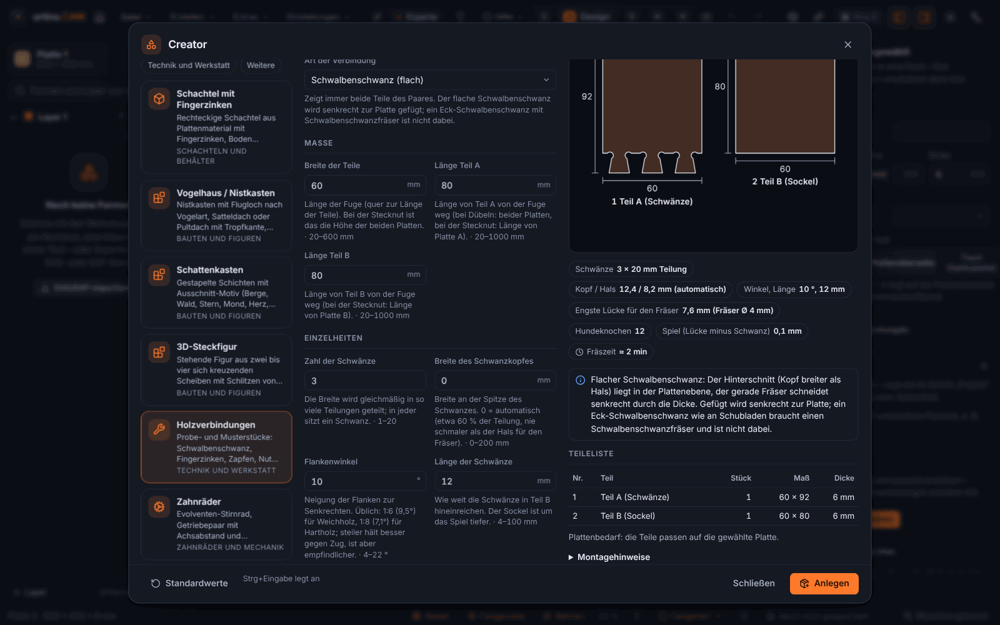</picture>
</p>

* **Create ▸ Creator …** (or `Ctrl+K` “Creator”, or the tile on the home page) opens **one dialog for all creators**: on the left the gallery with search and categories, in the middle a form built from the creator’s description (dimensions, choices, switches, text; numbers also as a **formula**, unit and limits on the field), on the right the preview with dimension lines and numbers, a **parts list** with sheet requirement, **assembly notes** and **notes in the style of the checklist** with a solution and often a solution button.
* **Create** (`Ctrl+Enter`) puts sheets, shapes and operations into the project, **in one undo step**. The creator takes sheet thickness, bit and **clearance** (the variable `Spiel` from the fit assistant, otherwise 0.1 mm) from the project. After that it goes on as usual: checklist, simulation, cutting. Claude can use creators too (`call_api`); they do not exist in the portal’s Web Designer.

| Group | Creators |
|---|---|
| **Box** (1) | **Box with finger joints**: dimensions outside or inside, floor laid on or in a groove, lid laid on or sliding lid, dividers, handle, lettering |
| **Structures and figures** (3) | **Birdhouse / nest box** (entrance hole by bird species, gable or mono-pitch roof, drainage, flap; also a feeding house) · **Shadow box** (layers, spacer frame, LED channel) · **3D slot figure** (star, tree, snowflake from crossed discs) |
| **Technology** (5) | **Wood joints** (flat dovetail, finger joint, tenon, tongue and groove, half-lap, dowel, slot) · **Gears** (spur gear, pair, rack) · **Timing pulley** (GT2, HTD 3M/5M) · **Ventilation grille** · **QR code** (address, text, Wi-Fi, contact) |
| **Ornament** (3) | **Jigsaw puzzle** · **Rosette / mandala** · **Seasonal decoration** (snowflake, star, tree, Easter egg, bunny, autumn leaf, pumpkin, heart) |
| **Lettering and scales** (6) | **Name sign / door sign** (also house number) · **Birth letter** · **Letter topper** · **Word tiles** · **Ruler** (mm and inches) · **Wall clock dial** |

| Box | Birdhouse | Gears |
|:--:|:--:|:--:|
| <picture><source media="(prefers-color-scheme: light)" srcset="docs/bilder/creator-schachtel-light.png">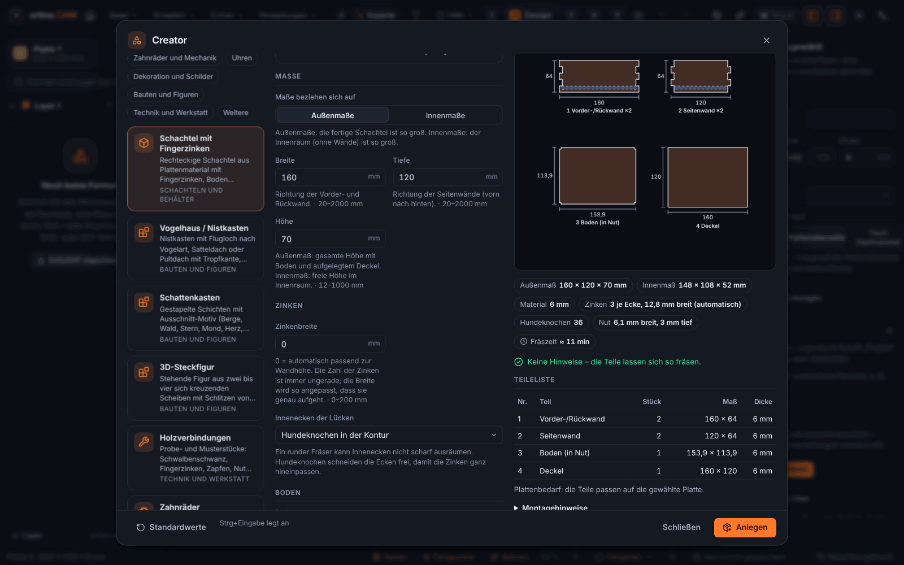</picture> | <picture><source media="(prefers-color-scheme: light)" srcset="docs/bilder/creator-vogelhaus-light.png">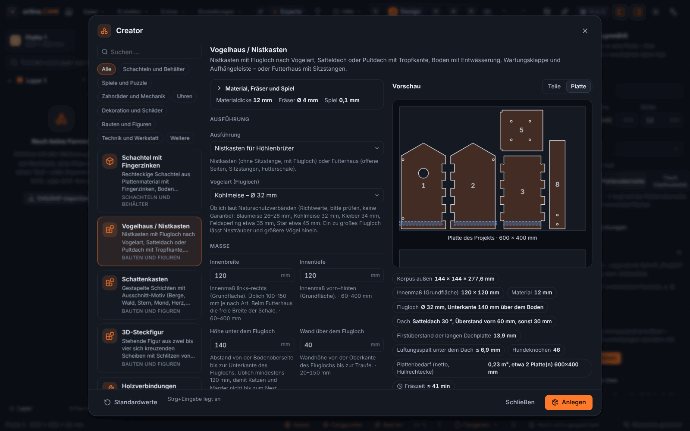</picture> | <picture><source media="(prefers-color-scheme: light)" srcset="docs/bilder/creator-zahnrad-light.png">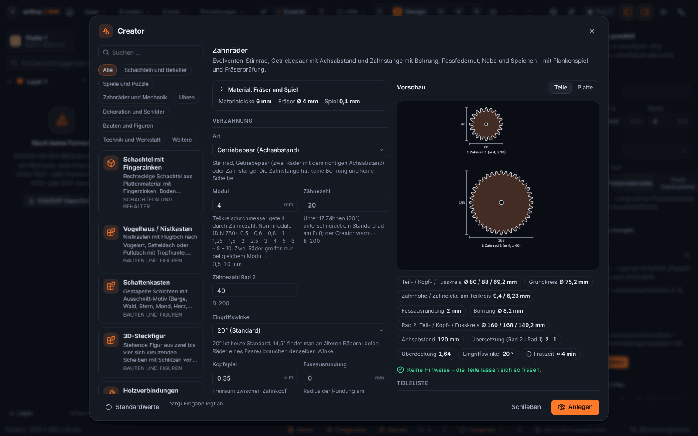</picture> |
| Finger joints, floor in a groove, sliding lid, dividers | Entrance hole by bird species (guide value, no guarantee), roof, drainage | Involute gearing, bore with keyway, spokes |

| Rosette | Door sign |
|:--:|:--:|
| <picture><source media="(prefers-color-scheme: light)" srcset="docs/bilder/creator-rosette-light.png">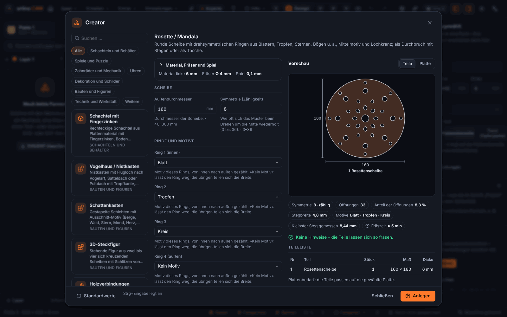</picture> | <picture><source media="(prefers-color-scheme: light)" srcset="docs/bilder/creator-schild-light.png">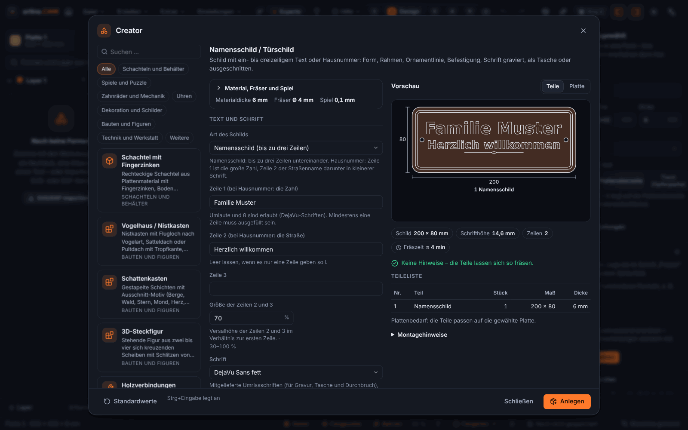</picture> |
| Rotationally symmetric rings, cut-out with bridges so that nothing falls out | Text, frame line, ornament, mounting; engraved, as a pocket or cut out |

* **Honest about the state:** all creators have been tested **only with Rust tests, Vitest tests, the simulator and Chromium**. **No part has been milled, glued, assembled or hung up.** The **clearance** (guide value 0.1 mm), web widths, gear flanks, belt grooves, the ruler’s graduation and the legibility of the QR code are calculated values, **not tested on real material**; a test cut in an offcut and the fit test coupon come first. The **bird dimensions** are guide values as conservation associations usually give them (please check), **with no guarantee** that a species will move in. The milling time is a rough estimate. Not included: animals as slot figures, the corner dovetail as on drawers, helical gearing. The guide is in the [wiki](https://github.com/KlapSC/ortino-cam/wiki/Creators).

#### Order of the depth passes: part by part or level by level

<p align="center">
  <picture><source media="(prefers-color-scheme: light)" srcset="docs/bilder/zustellung-light.png">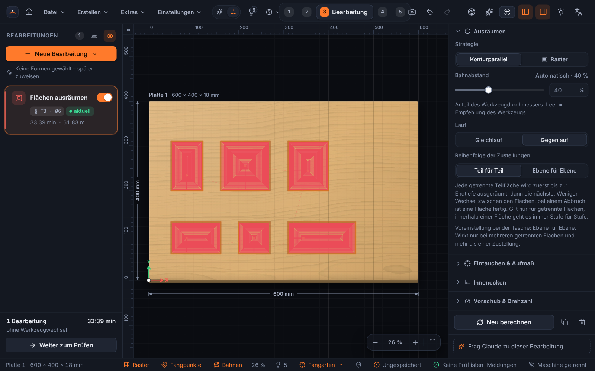</picture>
</p>

* With **several parts and more than one depth pass**, for **profile and pocket** you choose under “Advanced” (in easy mode behind “More settings”) whether each part is milled to its final depth before the next one follows (**part by part**), or whether all parts first get the first depth pass, then the second and so on (**level by level**). The default stays the previous behaviour: part by part for the profile, level by level for the pocket.
* **Why level by level:** until the last step all parts stay attached to the material; with tabs or a remaining layer the sheet stays stable, and nothing comes loose while the other parts are still to follow. **What it costs:** more idle moves, and if you abort, no part is finished. **Measured** on three parts of 40 × 30 mm, four depth passes, bit Ø 6 mm: rapid travel in the G-code **1053 instead of 2006 mm**, estimated time **70 instead of 89 seconds** (calculation in the program, not milled).
* **Existing projects do not change:** the default value is not in the file; a test on eleven supplied examples and on the example project `tuerschild.ocam` shows the same G-code **byte for byte**. The material removal in the simulation is the same at the end for both orders.
* *Tested only against Rust tests, the program’s own simulation and Chromium, not on a machine; with tiling and double-sided milling covered only by review.* More in the [wiki](https://github.com/KlapSC/ortino-cam/wiki/Operations).

#### Home page with quick-access tiles and the AI models dialog

| Home page |
|:--:|
| <picture><source media="(prefers-color-scheme: light)" srcset="docs/bilder/startseite-light.png">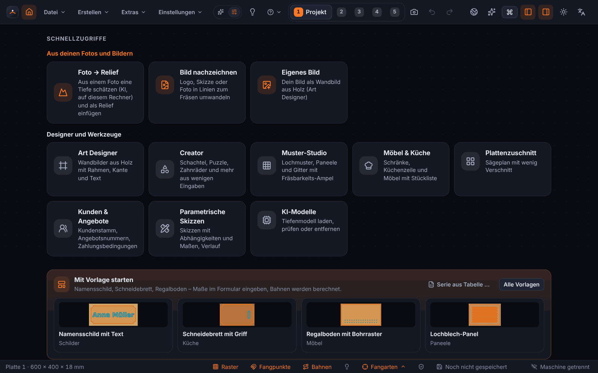</picture> |
| Home button (`Alt+Home`), card “Your project”, 11 quick-access tiles |

* **Home page:** the **home button** (house next to the File menu, `Alt+Home`) always leads back, even over a project in progress (then with the card “Your project” and “Continue”); nothing changes in the project. **11 quick-access tiles** in two groups: **From your photos and images** (Photo → relief, trace an image, your own image) and **Designers and tools** (Art Designer, Creator, Pattern Studio, Furniture & Kitchen, sheet cutting, Customers & quotes, parametric sketches, AI models). The rule **“Your own first”**: wherever you choose a source (Relief Studio, Pattern Studio, Art Designer, the “Create” menu, the command palette), your photos, images and own building blocks come before the generators. This only changes the order of display.
* **AI models** (Extras ▸ AI models …): the depth model for “Photo → relief” and your own image in the Art Designer are calculated on your computer. The dialog shows state, size, licence, origin and location, and offers **Download** (with progress, cancel and resume), **Check again**, **Import model file** and **Remove**. **Nothing is ever downloaded without your click**, and your photo never leaves the computer.
* *Tested only with Vitest and Chromium against the real core, with a substitute model and a substitute for the portal.* **The download of the real model (47.3 MB) from the real portal has not been tested**, nor anything of it under Windows (WebView2); whether `Alt+Home` arrives there is open (the button and the command palette work in any case). More in the [wiki](https://github.com/KlapSC/ortino-cam/wiki/AI-Models-and-Start-Page).

#### Correction: arcs over 180°

* **Fixed:** the bounding box (size and position on the sheet) and the resolution into lines calculated arcs with an opening angle of more than 180° wrongly. Such arcs are now first split into two equal halves on the same circle; shape and area do not change as a result. It became visible with the creator parts (circular segments), but it affects every outline with such an arc. Whether projects from 0.12.0 were affected has not been investigated.

### New in 0.12.0: sketches with constraints, relief components, workshop

* **Parametric sketches with constraints and a history** (menu “Create”): points, lines, circles and arcs with 11 constraints (horizontal, vertical, parallel, perpendicular, tangent, fixed …) and dimensions as a number or **formula**; the solver reports degrees of freedom and redundant and conflicting constraints, with a suggested solution. A history to rename, switch off and roll back. A dialog of its own (no sketching in the main canvas, no splines).
* **Components for reliefs** (Relief Studio, third mode): layers from a profile (dome, cone, pyramid, ramp, wave, round rod), pattern or image, combined by add, subtract, maximum, minimum, blend or multiply; position with the mouse, edge smoothing, groups.
* **Workshop folder, roles and dashboard** (menu “Extras”): a shared folder (for example on the NAS) with people and roles (View, Operate, Manage), a shared library (cutting data, bits, offcuts) and a dashboard from the job log, maintenance and stock. **All local, nothing in the portal.** Roles protect against operating errors, not against file access.

| Parametric sketches | Components | Workshop dashboard |
|:--:|:--:|:--:|
| <picture><source media="(prefers-color-scheme: light)" srcset="docs/bilder/skizzen-light.png">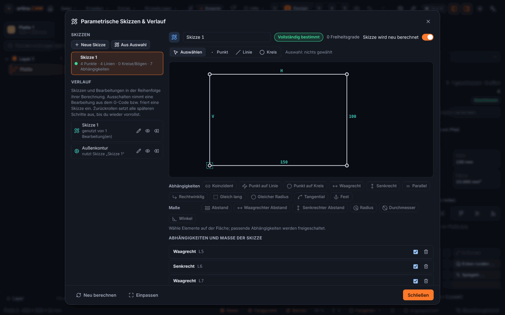</picture> | <picture><source media="(prefers-color-scheme: light)" srcset="docs/bilder/komponenten-light.png">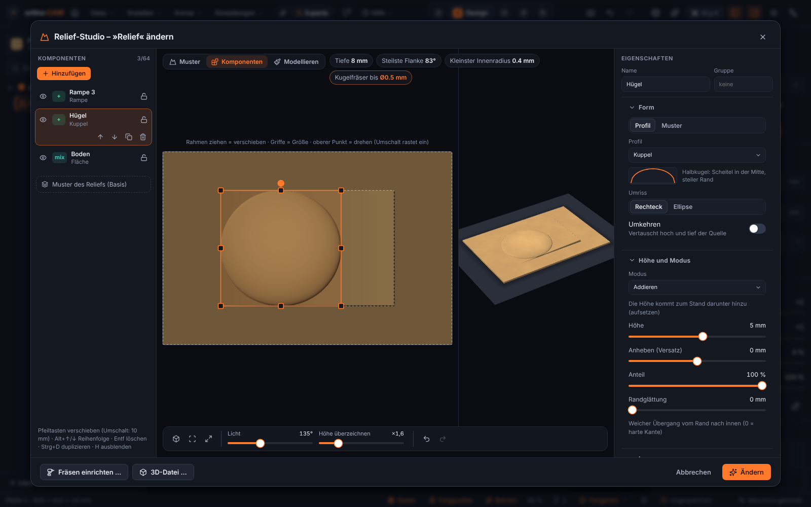</picture> | <picture><source media="(prefers-color-scheme: light)" srcset="docs/bilder/werkstatt-light.png">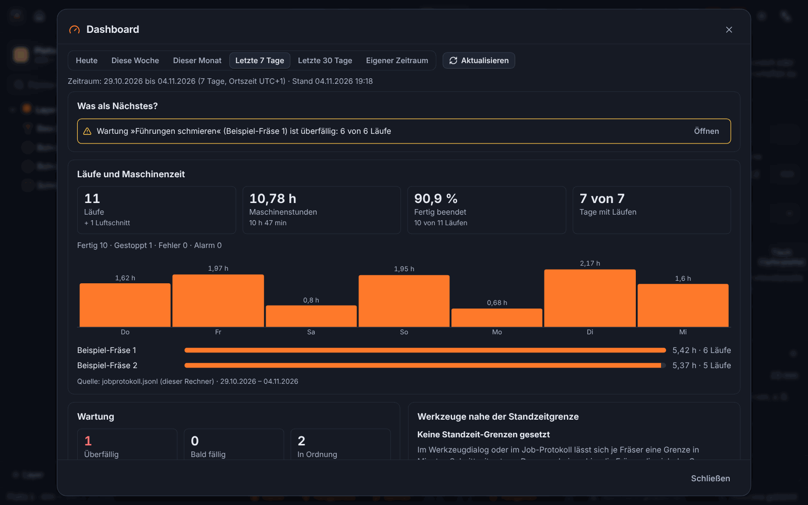</picture> |
| Drawing area, constraints and dimensions, degrees of freedom, history | List of layers with source and mode, placement in the top view | Runs, machine hours, maintenance, stock, open quotes (made-up sample data) |

* **Honest about the state:** **Nothing milled.** Tested only against tests and the browser (Chromium); sketches not compared with a CAD program, the workshop folder not on a real network drive and not under Windows (WebView2). In full: [release notes 0.12.0](release-notes/0.12.0.md) (in German).

### New in 0.11.0: export, stencils, quotes and saw plan

* **3D export (STL and 3MF)** for imported models, furniture parts (as sheet bodies, without holes and handles) and relief sheets, also the Art Designer’s picture; File menu, Furniture Designer, Relief Studio, command line `ortino export --format 3mf`. **DXF splines stay curves** (Béziers with knots, maximum deviation 0.01 mm), and the DXF export writes Bézier outlines back as SPLINE when the way back is lossless.
* **Stencil lettering with bridges:** islands in O, A, B, D, P, Q, R, 8 stay attached to their surroundings by narrow bridges; width, number of bridges and direction can be set, and every result is checked afterwards.
* **Customer records, quote numbers, payment terms:** customers with number and address, consecutive quote numbers with revisions, due date, cash discount and deposit, quote PDF with address block. **Everything stays on the computer** (nothing in the portal, nothing at Claude).
* **Sheet cutting with an optimiser (saw plan):** distribute parts with grain, kerf, trimming margin, sheet stock with prices and offcuts so that everything can be sawn with through cuts. The optimiser is never worse than the simple cutting; in a calculation with 24 random tasks it saved 7 of 97 sheets.

| Customers &amp; quotes | Sheet cutting | Stencil with bridges | Export STL/3MF |
|:--:|:--:|:--:|:--:|
| <picture><source media="(prefers-color-scheme: light)" srcset="docs/bilder/kunden-light.png">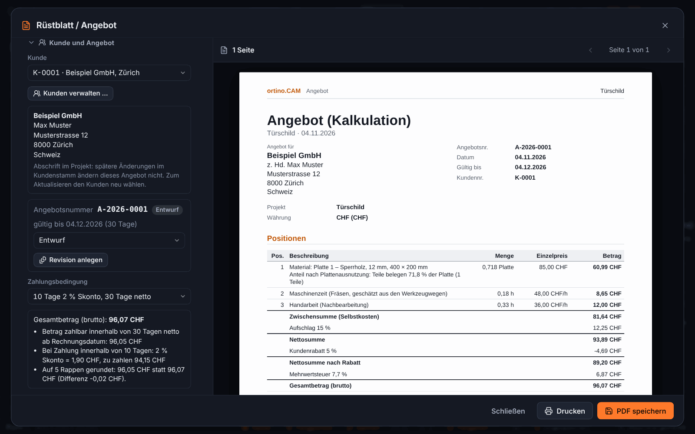</picture> | <picture><source media="(prefers-color-scheme: light)" srcset="docs/bilder/zuschnitt-light.png">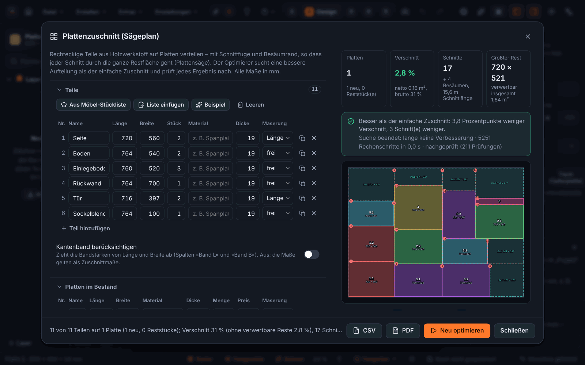</picture> | <picture><source media="(prefers-color-scheme: light)" srcset="docs/bilder/schablone-light.png">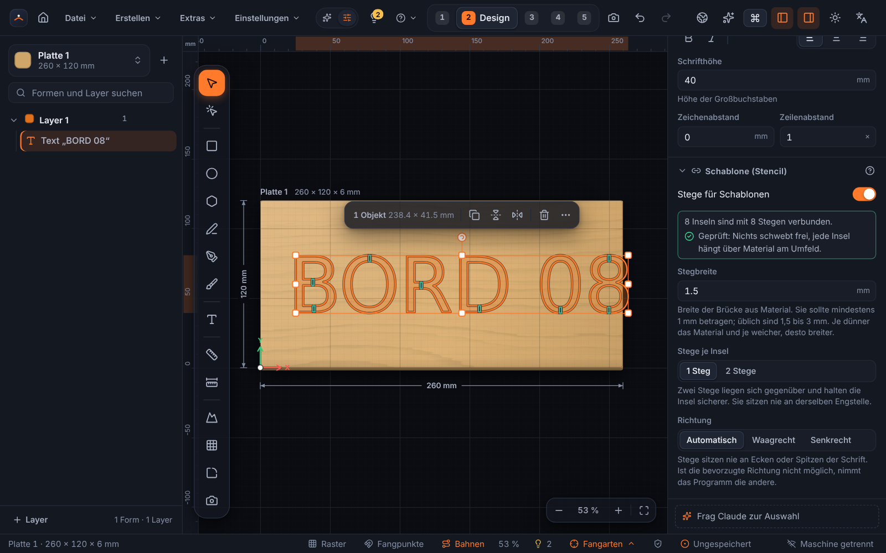</picture> | <picture><source media="(prefers-color-scheme: light)" srcset="docs/bilder/export-light.png">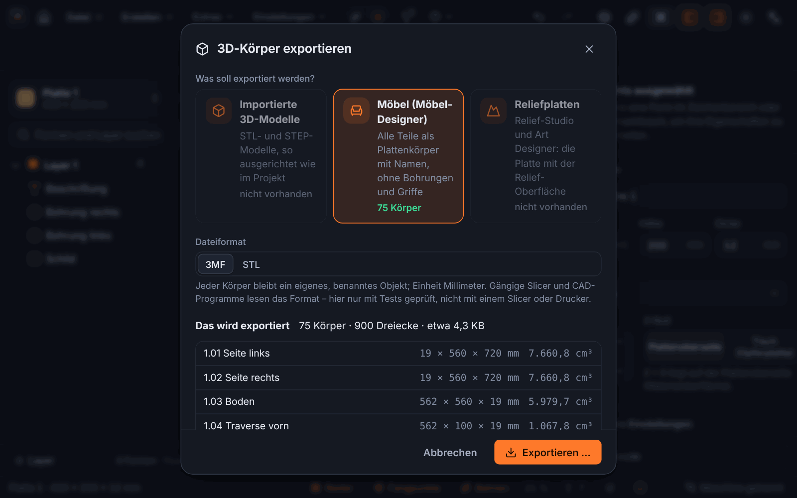</picture> |
| Customer records, quote numbers, payment terms (made-up data) | Saw plan with cut sequence and optimiser | Islands stay attached through bridges | Choose the source, check bodies and notes, save |

* **Honest about the state:** **Nothing milled, sawn or printed.** Tested only against tests and the browser (Chromium); 3MF/STL not with a slicer, the saw plan not on a real saw, CSV not in Excel, not under Windows (WebView2). In full: [release notes 0.11.0](release-notes/0.11.0.md) (in German).

### New in 0.10.0: your own image in the Art Designer

* **Your own image** (step “Motif”, section “Your own image”): choose a PNG, JPEG or WebP or drag it onto the dialog. The image’s brightness is the height (light = high). **Position, size and rotation** by slider, in the top view also with the mouse and mouse wheel. **Fading into the pattern:** the whole image, the left, right, upper or lower half, or the centre, with an adjustable boundary, softness and image share. Plus contrast, gamma, blur and invert. In Carved and Layered plywood mode; for photos optionally “Estimate depth (AI)” if the depth model of “Photo → relief” is present. Can be operated with the assistant (Claude) (`motif.image`).
* **Fixed:** on Windows, the phone remote control could fail to start at random with “Windows or security software does not allow the program to listen …” (a random port in a range reserved by Windows); damaged Vectric tool files (`.vtdb`) led to an abort.
* **Honest about the state:** **Nothing milled or glued.** Tested only against tests, the browser (Chromium) and the real core, **not under Windows (WebView2), not the AI estimate with a real model, not with real photos or faces.** A face from the front gives only a flat relief as brightness; side views and images with clear light and dark areas work better. For photos of people you need the consent of the people shown, for other people’s images the permission of the author.

### New in 0.9.0: Art Designer (wall pictures in wood)

* **Art Designer** (menu “Create → Art Designer …”): a dialog in five steps that makes a millable **wall picture** from **format** (A series, poster, square, panorama, custom dimensions), **motif**, **frame and edge**, and **text and signature**, with a 3D preview of the whole sheet. Eight motifs: **leaf stream, leaf branch, monstera, ginkgo, fern, palm fronds, feather fan** and **flowing ribbons**; sliders for size, density, softness, variation, randomness and depth. Notes under the preview, for example on steep flanks and on the ball-nose bit (“up to Ø …”). “Insert” is one undo step; “Add and set up machining” creates roughing and finishing.
* **Layered plywood mode:** the motif is split into 3 to 24 layers of plywood (3, 4 or 6 mm), plus a back panel; dowels, numbers, optionally a gluing aid, distribution of the parts onto plywood sheets and an **assembly plan** (copyable). Run-out and chamfer are dropped, the lettering stays. If a part does not fit on the chosen sheet, the program reports an error with a solution and locks “Insert”.
* **Only in the program,** not in the portal’s Web Designer. Can be operated with the assistant (Claude) and the local interface (`art.*`).
* **Honest about the state:** millability is **calculated, not milled**; nothing has been glued. Tested only against tests, the simulator and Chromium, **not under Windows (WebView2), not on a real machine**. The motifs are own patterns generated on the computer and not all equally successful (monstera weakest; ginkgo and fern have very thin webs in layered plywood; the top layer is usually only the frame). More in the [wiki](https://github.com/KlapSC/ortino-cam/wiki/Art-Designer-en).

### New in 0.8.2: English interface more complete, tool number 0 fixed, video tutorials in the help

* **English interface in the core too.** Names and notes of the supplied machines, descriptions of the post-processors, default names (project, sheet, operations, tools), labels of the undo list, comments in the G-code, frequent console messages, alarm texts of the controller and the checklist messages follow the language of the interface. German stays unchanged, including the German G-code. Names that were already saved are never translated. **Not everything is translated:** most error messages of the Kitchen Designer, warnings of the operations, many error texts and individual partial checks stay in German.
* **Tool number 0 fixed:** bits from the library and default bits came into the project as “T0”, which does not exist on the machine; they now get the next free number.
* **Smaller corrections** of the English interface (number formats, notice bar, tiling, Relief Studio at 1280 px width, lettering on the phone page).
* **Help → “Video tutorials”:** 36 short videos (5 to 20 seconds, captioned in English, without sound); they play only after a click, from the internet. The same videos are in the [wiki](https://github.com/KlapSC/ortino-cam/wiki/Videos-en).
* **Honest about the state:** tested only against tests, the simulator and Chromium, **not under Windows (WebView2), not on a real machine**. The videos were recorded before these corrections and partly still show German names or “T0”.

### New in 0.8.0: marketplace in the portal (off by default), findability and visitor statistics, interface for the phone app

* **Marketplace in the portal (points).** Designs and new **cutting data sets** (feed rate, spindle speed, depth per pass for each bit and material) can be sold for **points**. Points are **not a currency** (no money, no payment provider); 10 % expire, no returns, refund only for a defect after review. Only activated accounts may sell, and every paid offer is checked beforehand. **The marketplace is switched off** and can be switched on only once the operator has confirmed the legal texts (so far drafts not reviewed by a professional). The Windows program cannot buy paid designs; it shows a readable message with a link to buy in the browser.
* **Findability and visitor statistics in the portal:** sitemap as an index, `llms.txt`, webmaster codes, structured data, IndexNow (for Bing and others, not for Google) and **visitor statistics without cookies** (Plausible or Matomo), all off or empty by default and only after an explicit setting by the operator.
* **Interface for the coming phone app:** the phone remote control can **send a design from the portal to the computer** (it opens only after your confirmation on the computer) and **only read** the **setup sheet** (material, work zero, tools, clamping notes); both can be switched off per phone. There is no phone app yet that uses this; the interface is tested only with tests and the simulator.
* **Honest about the state:** everything new is tested only against local servers with PostgreSQL, the portal’s mock server, the simulator and Chromium; **not with real users, not with real payment of points, not with Plausible, Matomo, IndexNow or Google Search Console, not on a real machine**. There are no changes to drawing, calculating and milling.

### New in 0.7.0: extended snapping, dimensioning, modelling, tiling, machine profiles from the community, boosts, home page and live editing in the portal

* **Extended snapping in the 2D editor.** The pointer now also snaps to intersections, extensions (briefly overshooting an end point), perpendicular foot, tangents, vertical and parallel tracks, polar 45° with angle, and to the outline; each kind has its own shape, colour and short text and can be switched off individually. Seen only in tests and Chromium, never with touch or pen.
* **Dimensioning** (tool `D`): horizontal, vertical, aligned, radius, diameter, angle and arc length dimensions, bound to shapes (they follow when moving and scaling), export to SVG and DXF. Pure labelling without toolpaths; not in the setup sheet and the PDF; the exports have not been opened in any other CAD program.
* **Modelling of reliefs** with the brush (build up, remove, smooth, level, sharpen) on up to 8 modelling layers above the parametric relief, undo per stroke, baking. Never milled; locked in the Web Designer. Guide: [Modelling Reliefs](https://github.com/KlapSC/ortino-cam/wiki/Modelling-Reliefs).
* **Tiling of large parts:** sheets larger than the travel are split into tiles with overlap, with one program per tile and two registration marks for the work zero of the next tile; the pre-flight check checks the zeroing. **Never milled on a real machine**, the seam is not tested. Guide: [Tiling Large Parts](https://github.com/KlapSC/ortino-cam/wiki/Tiling-Large-Parts).
* **Machine profiles from the community** to load and share (technical details only, never overwriting, flagged as “unverified”; “confirmed by n users” is a statement by accounts, not a check).
* **Portal:** a new home page as a product page (the community overview is at `/designs`), **boosts and points** (4 boosts per calendar month, points for creators, no money, no shop yet), community machine profiles and **live editing** of shared designs (only if the owner allows it). Plus corrections from the portal’s own security review (not a penetration test). Everything tested only against local servers, mock and Chromium, never with real users.
* **Smaller improvements:** diagonal moves (X and Y at the same time) on the phone remote control, a quick access “Control” (homing, unlock, work zero XY, go to X0 Y0) in the “Cut” step, and corrections in the kitchen planner (drawer parts, handle rail in 3D and front view).
* **New portal address:** from 0.7.0 the program queries the portal and updates at `https://ortino-cam.com`.

### New in 0.6.0: sharing designs, Photo → relief, EPS import, double-sided with stop, lounge chair and swivel chair

* **Portal: sharing designs and editing them in turns.** Invitation to an existing account (view or edit), only one person writes at a time (lock with hand-over), conflict protection instead of silent overwriting, a link to view for customers, viewers may download and copy. Plus a “Web Designer” card in the administration (load, counters, recommendations). Guide: [Web Designer in the Portal](https://github.com/KlapSC/ortino-cam/wiki/Web-Designer-in-the-Portal). Never used by several real people; needs a portal with server image 0.6.0.
* **Photo → relief.** A small AI model (Depth Anything V2 Small) estimates the depth of a photo **on your computer** (the photo never leaves it) and creates a relief. The model (47 MB) is downloaded from the portal on first use. **An estimate, not real geometry**; weak for flat subjects photographed from the front; tested only with scenes built for the purpose. Guide: [Photo to Relief](https://github.com/KlapSC/ortino-cam/wiki/Photo-to-Relief).
* **Import of EPS, PostScript and old Illustrator files** (`.eps`, `.ps`, `.ai` without a PDF part) with a PostScript reader of its own, with limited scope; DWG is still not read (note: save as DXF). No real Illustrator file was available.
* **Double-sided milling:** the simulation calculates both sides together, and turning over also works **against a stop edge** instead of with dowels. Simulator and tests only.
* **Lounge chair and swivel chair** in the Furniture Designer: the lounge chair from plywood outlines (cushions only as a bought part), the swivel chair with seat and back from sheet and **bought parts** (swivel base, gas lift, castors; generic, unverified entries in the fitting library). The checks are notes, not a strength proof; nothing of it built or loaded.

### New in 0.5.0: Kitchen and Furniture Designer in the browser (Web Designer in the portal)

* **New:** the Kitchen and Furniture Designer also run **in the community portal, in the browser and without installation** (entry *Design kitchen & furniture*, address `/designer/` of the portal). The same designer as in the program, with 3D preview, rendering, checklist, parts list (CSV/HTML), cutting, variants and customer sheet. Plus an account with a confirmed e-mail address.
* **Designs in the account:** save, open, rename, download and delete privately in your own account (up to 30 designs, 40 MB together). **Download as `.ocam`** and keep working on it in the program, mill it, and conversely open an `.ocam` in the browser. Milling, machine, G-code and file access do **not** exist on the web. Guide: [Web Designer in the Portal](https://github.com/KlapSC/ortino-cam/wiki/Web-Designer-in-the-Portal) in the wiki.
* **The Windows program is unchanged from 0.4.2;** the Web Designer needs a portal with **server image 0.5.0**. The server calculates in a sealed-off environment per user (fixed list of allowed calls, size and time limits).
* **Honest about the state:** tested only against tests and in Chromium; not with several users at the same time, not on the operator’s NAS under load, not in other browsers, not with a real mail server. Nothing from the designers has been milled or built.

### New in 0.4.2: three corrections (drawers in the 3D preview, bit choice and height when surfacing the spoilboard)

* **Fixed:** in the 3D preview of the kitchen (with “Create drawers”) and of the furniture (bedside table, chest of drawers, highboard, sideboard, desk pedestal), the drawer sat **offset from the front**: not centred between the sides and too low, partly in the intermediate shelf. The parts, dimensions, parts list and milling data were right, only the display. Tested only in Chromium, not under Windows (WebView2).
* **Fixed:** for **surfacing** and for **“Surface the spoilboard”**, the assistant now first suggests **your own surfacing bit** (created as a surfacing bit, with “surfacing” in the name or from 12 mm diameter); before, a catalogue surfacing bit (for example from Amana) was often preferred. Tested only against tests and the simulator.
* **Fixed:** **“Surface the spoilboard” with a fixed probe:** the bit stood too high by the sheet thickness (with a 16 mm sheet and 0.5 mm removal at 15.5 mm instead of −0.5 mm); depths for the spoilboard now always count from its top. Not tested on a real machine: first check in an air cut without a bit.

### New in 0.4.1: marking the spoilboard, new table view, appliances and room in the kitchen, more furniture

* **Marking the spoilboard:** an assistant mills a **work zero cross and frame, a ruler with numbers, stop lines and a hole grid** into the spoilboard, so that workpieces can be laid by eye and clamps placed. **Engraving and hole depth are freely adjustable** (for example “spot drill only” with 2 mm); every depth is checked against the measured thickness of the spoilboard and a minimum remainder, and the program does not allow cutting through into the table. The position refers to the machine (reference position), and the pre-flight check demands XY zero there. Guide: [Marking the Spoilboard](https://github.com/KlapSC/ortino-cam/wiki/Marking-the-Spoilboard) in the wiki.
* **Table view redesigned:** table, spoilboard, workpiece, ruler, reference position, probe, tool with trace and target, legend; also the spoilboard markings (planned dashed, milled bold). The position remains exact to the calculation.
* **Kitchen Designer:** **appliance niches** (dishwasher, oven, fridge, microwave, extractor hood), **room & survey** (walls, windows, doors, connections), **L/U-shaped kitchen and cooking island**, plus a **checklist** (appliance fits, clearances, door swing, passage, wall cabinet in front of a window ...).
* **Furniture Designer:** six new kinds (chest of drawers, highboard, bedside table, desk, wardrobe unit, shoe bench, now 19 kinds), **finger joints**, new checks (tip-over protection, drawers, desk ergonomics, wall fixing, racking).
* **Fixed:** V-carving and inlay on large shapes no longer run far beyond the time limit.
* *(Everything new tested only against tests, simulator and Chromium: **no marking milled, no piece of furniture built, no kitchen with appliances installed**; dimensions, clearances and guide values of the checks are assumptions, not proof.)*

### New in 0.4.0: 3D import, Furniture Designer, saving and continuing a kitchen

* **Import 3D models (STL, STEP):** *File ▸ Import 3D model …* or drag the file into the window. View in 3D on the sheet, choose the top side, rotate, mirror, unit and scale, fit. Conversion as a **3D relief** (height field from above, calculated directly from the mesh), **outline as a shape** (shadow from above, with a profile on request) or **layered model** (layers in sheet thickness). A checklist with solutions reports too large, too tall, undercuts and holes in the mesh. The **STEP import is code of its own** and shows a report of which faces arrived. Guide: [Importing 3D Models](https://github.com/KlapSC/ortino-cam/wiki/Importing-3D-Models) in the wiki.
* **Furniture Designer:** besides the kitchen, dining table, coffee table, side table, nesting tables, sideboard/lowboard, bookcase, ladder shelf, modular shelf and wall shelf, stool, sheet stool, bench and plywood chair, **glueless slot-together** or classically joined, with six style templates, a dining-set assistant, placement in the floor plan, checks (tipping, deflection, webs) with stated assumptions and a furniture scene in the rendering.
* **Saving, opening, continuing a kitchen:** save state in the designer, file menu, continuing after opening; **variants** in one file, whole kitchen as a template, copying cabinets between projects, **customer sheet** for printing or as PDF.
* **Fitting library:** 41 entries (handles, hinges, drawer slides, shelf supports, plinth feet, connectors) with sources at Jumbo, Bauhaus.ch and Hettich; in the parts list with source and own price. The entries are mostly **unverified** and no datasheet comparison.
* **Fixed:** patterns that cut into a hinge’s cup hole (now a check), values of the old handle kind after switching, placeholder handles for fixed fronts in the parts list, pattern groups in building blocks.
* *(Everything new tested only against tests, simulator and Chromium: **no imported model and no piece of furniture was milled or built, the STEP import has never read a real CAD file**, the furniture checks are notes from simple formulas and no strength proof.)*

### New in 0.3.14: kitchen planner (colours, handles, reliefs, rendering) and touch

* **Hinge side for tall cabinets** selectable separately for the lower and the upper door.
* **Colours and surfaces:** colour and gloss level (matt, satin, high gloss) for the whole kitchen, or one or several marked cabinets; thirteen colour swatches with dark tones (black, anthracite, graphite …) and a free hex colour. The “True colours” view shows them in 3D and front view, the surface appears in the parts list, cutting and setup sheet.
* **Handles:** bar handle, rod handle, knob, shell handle and profile handle with orientation, position and surface; as bodies in the 3D preview, as bought parts in the parts list, with checks.
* **3D reliefs on fronts:** parametric **waves** (direction, wavelength, depth, profile, phase, meander, cross waves), **slats, diamonds, ripples, dunes**. **“Pattern across selection”** lays a relief over several fronts, for example three tall cabinets: one continuous pattern without repetition per front. Production runs through the normal 3D operation.
* **Export rendering:** an image of the kitchen with **light** (daylight, evening, studio, LED strip under the wall cabinets), **soft shadows**, **gloss** of lacquered fronts, a built-in **sink with tap**, floor, walls and splashback; PNG or JPEG up to 4K and more. A fast WebGL image, **not a photorealistic render**; screen colours are not colour samples. Guide: [Kitchen Rendering](https://github.com/KlapSC/ortino-cam/wiki/Kitchen-Rendering) in the wiki.
* **Touch and pen:** setting *Appearance & language ▸ Touch control*; tap, drag, long-press menu, pinch and pan, large controls; **at the machine all locks remain, there is no continuous jogging by finger**. The window may now be 760 px narrow (tablet in portrait). Guide: [Touch and Pen](https://github.com/KlapSC/ortino-cam/wiki/Touch-and-Pen) in the wiki.
* *(Everything new tested only against tests, simulator and Chromium: milled reliefs and handle holes have not been milled, the rendering never ran on a real graphics card, touch only as emulation in Chromium.)*

### New in 0.3.12: backup in the portal, tool change “Automatic”, “My machine”

* **Backup in the portal** (menu **Settings ▸ Backup in the portal …**): your own **machine profiles**, **My bits** and a fixed selection of the **program settings** can be backed up privately to your own portal account at the press of a button and restored on the same or another computer, after a reinstallation or to synchronise office and workshop. Restoring first shows a **preview**; *Merge* takes only what is new, *Replace* first makes a local copy. Up to 10 versions of each kind. Passwords, keys, connections, addresses and file paths are **never** backed up. Needs a portal from version 0.3.12. Guide: [Backup in the Portal](https://github.com/KlapSC/ortino-cam/wiki/Backup-in-the-Portal) in the wiki. *(Tested against a real portal server with a database and in the browser (Chromium); not yet against the portal on the internet and not under Windows.)*
* **Tool change “Automatic”:** anyone who has set up the **fixed probe** changes the tool at the probe without entering location and search values again; without a probe it stays at the pause. An explicitly saved choice (also “Pause”) stays unchanged; the pre-flight check shows what applies, and “Use pause instead” switches over for the project. *(Tested only against tests and the simulator; the change at the fixed probe in the middle of a program has never been tested on a real machine.)*
* **“My machine”:** fixed probe, spoilboard, camera calibration and accessories belong to the machine, not to the project. If the machine is in your list and is the default machine, **every new project** gets the set-up. For a supplied template there is the button **“Save as my machine”**, for older projects **“Adopt the machine’s set-up from the list”**.
* **A design from the community no longer overwrites your machine.** On opening, **your own machine** applies by default; anyone who wants the design’s machine chooses it explicitly. Probe, change and height map data of a foreign machine are never taken over. When **sharing**, the set-up of your machine and the machine’s free-text note no longer go into the package (packages already published cannot be changed).

### New in 0.3.11: Z zero, menus, double-sided milling

* **With a fixed probe, Z zero lies on the spoilboard by itself.** New projects then begin with “Table (spoilboard)”; without a fixed probe it stays at the top of the sheet. Anyone who wants it otherwise sets it under **Settings ▸ Machine & Z zero**. Existing projects never change; one click (“Set to spoilboard”) converts an older project, with a confirmation, because the depths in the G-code change.
* **Split menu bar and a Settings menu of its own:** *File*, *Create*, *Extras* and *Settings* (machine, bits, post-processor, appearance). The Settings dialog also opens with **Ctrl+,** and needs no open project. Menus that are too long scroll instead of being cut off.
* **Double-sided milling with dowels:** mill side A, turn over, mill side B. The program for side A drills two registration holes in the waste margin down into the spoilboard; turning axis left ↔ right or top ↔ bottom. With checks, a section in the setup sheet and confirmation in the pre-flight check. Guide: [Double-Sided Milling](https://github.com/KlapSC/ortino-cam/wiki/Double-Sided-Milling) in the wiki. *(Tested only against tests, simulator and Chromium, not on a real machine; there is no joint simulation of both sides.)*
* **Confirmed on a real machine** (the operator’s report, version 0.3.10, Ultimate Bee with xPRO V5): setting up the fixed probe and measuring a tool on it. Everything else new stays marked in the list below and in the warning at the very top as not tested on a machine.

### New in 0.3.9: getting started and quantity

| Example gallery | Guided tour | Quantity &amp; price tiers |
|:--:|:--:|:--:|
| <picture><source media="(prefers-color-scheme: light)" srcset="docs/bilder/galerie-light.png">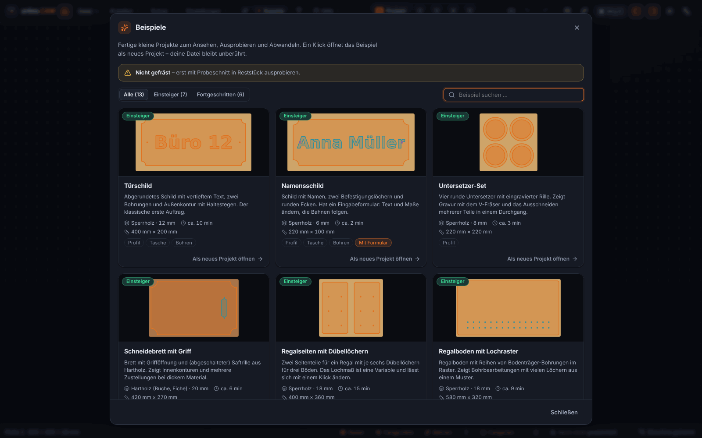</picture> | <picture><source media="(prefers-color-scheme: light)" srcset="docs/bilder/einfuehrung-light.png">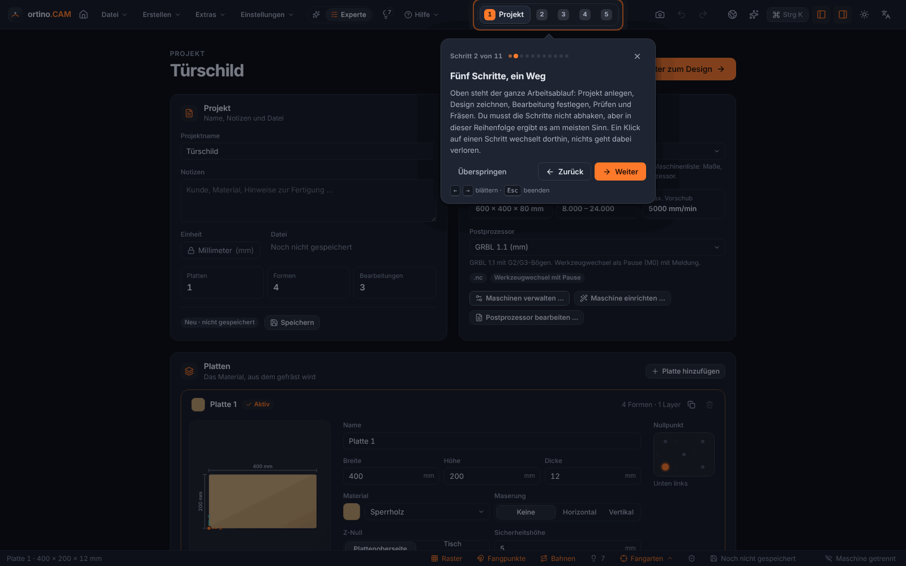</picture> | <picture><source media="(prefers-color-scheme: light)" srcset="docs/bilder/stueckzahl-light.png">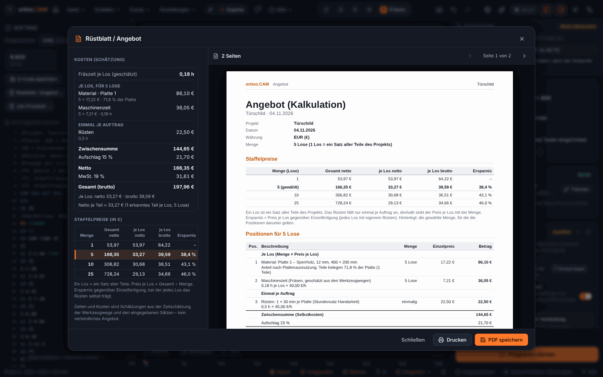</picture> |
| 13 example projects to open and adapt; they are **not milled** | A walk through the five steps; plus 6 lessons with tasks that tick themselves off | Quantity, price tiers and scrap in the quote: setup counts once per job |

<sub>Screenshots of the interface; the machine in the “Cut” step is the built-in simulator; names, prices and values in the examples are made up.</sub>

## Features

The table lists what the program can do, and for every item what has been tested **only against the simulator and tests**. What has been tested on a real machine is in the warning at the very top and under [Machines and controllers](#machines-and-controllers).

| | |
|---|---|
| ✏️ **Design** | Rectangle (with corner radius), ellipse, polygon and star, polyline, **Bézier pen and freehand** (smoothed), node editing. Boolean operations, offset, rounding, **chamfer, trim and extend**, arrays (rectangular, circular, **along a path**), align and distribute, snapping to grid, end points, midpoints, sheet edges and guides, plus **intersections, extension, perpendicular, tangent and polar angle**. **Dimensioning** (horizontal, vertical, aligned, radius, diameter, angle, arc length; the dimensions follow the shapes). **Touch mode** for tablets and pen *(tested only with Chromium’s touch emulation, never on a real touch device)*. **Variables and formulas** with units (`Breite/2 - 5mm`, `1/4in`). **Geometry check:** open outlines, self-intersections, inner radii smaller than the bit, webs that are too thin, shapes outside the sheet, with markers in the drawing area. **Parametric sketches** (11 constraints, dimensions as formulas, solver with degrees of freedom and findings, history to roll back; a dialog of its own, *not compared with a CAD program*). Undo/redo with 200 steps, automatic backup every 30 seconds with recovery after a crash. |
| 🔤 **Text & signs** | Multi-line text with the Windows system fonts and supplied fonts (kerning and ligatures), **text on a path** (stays editable), **eleven single-line fonts** for engraving, **serial numbers and placeholders** (`{n:001}`, date, project name) for series of signs, **stencil lettering with bridges** (islands in O, A, B, 8 stay attached to their surroundings by narrow bridges; *only calculated, nothing milled*). |
| 📥 **Import & export** | Import of SVG, DXF, **PDF and Illustrator files** (`.ai` with a PDF part: layers, curves, embedded fonts), **EPS, PostScript and old Illustrator files** (`.eps`, `.ps`, `.ai` without a PDF part; own, limited reader, tested only with self-made files; DWG is not read) and **images** (trace: threshold, greyscale, colours). **Béziers from SVG and PDF stay curves**, as do **splines from DXF** (maximum deviation 0.01 mm, otherwise polyline) *(tested only with self-made files)*. **3D models (STL and STEP)** can be brought onto the sheet as a relief, outline or layered model *(tested only with self-made bodies and sample files, never with files from real CAD programs)*. Export as SVG, DXF (Bézier outlines back as SPLINE when the way back is lossless) and G-code, plus **STL and 3MF** for imported models, furniture parts (as sheet bodies) and relief sheets *(tested only against tests, nothing with a slicer or printer)*; the project format `.ocam` is open and documented (ZIP with JSON). |
| 🧩 **Patterns & relief** | **40 parametric perforation pattern kinds with 80 templates in six categories** (honeycomb, mashrabiya, Voronoi, stars, slats, waves, text and image as a hole grid …; *since 0.16.0* the word and logo collage with up to four words or logos; *since 0.14.0* also chevron slats, fish scales, kagome, quatrefoil tracery, spirals, snowflakes and more, plus a search field) with a **millability traffic light** (minimum web, minimum opening, islands, corners) and one-click fixes; **3D relief** from generators (waves, weaves, flowers, tiles, textures, ornaments, panels and masonry; 62 templates in 9 categories, 22 of them new in 0.14.0, including 14 landscape, leaf and ribbon motifs for the Art Designer), from shapes (dome), from greyscale images or **from a photo** (“Photo → relief” with a local AI depth model), with studio, 3D preview and key figures (depth, steepness, inner radius → ball-nose bit); roughing and finishing with one click. **Modelling** with the brush (build up, remove, smooth, level, sharpen; up to eight layers). **Components** (layers from a profile, pattern or image with six modes, position with the mouse, groups). You manage the depth model in the **AI models** dialog (Extras ▸ AI models …; *since 0.13.0*; it is never downloaded without your click). **Custom templates** *(since 0.15.0)*: the “Own” tab in both studios (save, rename, back up as a file, import, also files from the online generator) and the **Shapes** dialog with ten basic shapes; [More](#new-in-0150-custom-templates-cutting-online-generator). *(Reliefs, modelling and components not tested on a real machine; no free solid modelling; custom templates not tested under Windows/WebView2.)* |
| 🌐 **Online generator** *(since 0.15.0, in the portal)* | **Shape and pattern generator in the browser** at [ortino-cam.com/tools/generator](https://ortino-cam.com/tools/generator): free, no account; 38 pattern kinds with templates and millability traffic light (since 0.16.0 with the word and logo collage), ten shapes, download as **SVG** and **DXF** (millimetres, arcs stay arcs) and PNG, custom templates in the browser. **No G-code** (that is created in ortino.CAM). *(Measured on the computer, nothing milled; the files not tested in other CAM software.)* [More](https://github.com/KlapSC/ortino-cam/wiki/Shape-and-Pattern-Generator) |
| 🧰 **Creator** *(since 0.13.0)* | Parametric workpiece generators with one dialog for all (Create ▸ Creator …): **22 creators in six groups**: **box with finger joints**; **structures and figures** (birdhouse / nest box, shadow box, 3D slot figure); **technology** (wood joints, gears, timing pulley, ventilation grille, QR code); **ornament** (puzzle, rosette / mandala, seasonal decoration with 35 motifs); **festive and seasonal** *(since 0.14.0)* (advent calendar, wreath and border, lantern / tealight holder, garland / bunting); **lettering and scales** (name sign / door sign, birth letter, letter topper, word tiles, ruler, wall clock dial). Form with formulas, preview with dimensions, parts list, assembly notes, notes with a solution button, creating with operations in one undo step; also for Claude. [More](#new-in-0130-creator-order-of-the-depth-passes-ai-models-home-page) and [New in 0.14.0](#new-in-0140-patterns-reliefs-wall-picture-motifs-decoration) *(Tests, simulator and Chromium only; nothing milled or glued, fit not tested on real wood; for the lantern the creator does not check whether an open flame is safe.)* |
| 🖼️ **Art Designer** | Wall pictures in wood in five steps (format, motif, frame and edge, text and signature, apply): **14 motifs** (six of them new in 0.14.0: layered mountains, sunrise, moon and clouds, moon phases, olive branch, grasses and pampas), formats from the A series through poster to panorama or custom dimensions, frame with run-out and chamfer, lettering; as a **carved relief** from a block or as a **layered plywood picture** (3 to 24 layers of plywood, back panel, dowels, numbers, distribution onto plywood sheets, **assembly plan**). Since 0.10.0 with **your own image** (PNG, JPEG, WebP): position, size and rotation, **fading into the pattern** on one side, tone (contrast, gamma, blur). Only in the program, not in the Web Designer. [More](https://github.com/KlapSC/ortino-cam/wiki/Art-Designer-en) *(Calculated, not milled or glued; a face from the front gives only a flat relief as brightness.)* |
| 🧭 **Toolpaths** | **Profile** (inside, outside, on line; climb/conventional milling, ramps, lead-in arcs, **tabs** automatic or by hand, remaining layer, stock allowance with finishing pass), **pocket** (contour-parallel or raster, islands, helical entry, **rest machining** with a previous tool), **adaptive clearing** (engagement-controlled), **drilling** (deep hole, chip breaking, helical drilling), **thread milling** (metric, internal and external; *simulator only*), **V-carving**, **inlay**, engraving, **surfacing** (also of the spoilboard), **inside corners** (dogbone, T-bone), **clamps and keep-out zones** with collision check *(the geometry of the holders is an assumption)*, **optimise order** (as a suggestion, never silently), plus for profile and pocket the **order of the depth passes** (part by part or level by level; *since 0.13.0, not tested on a machine*). Post-processors for GRBL *(tested on the Ultimate Bee)*, grblHAL, FluidNC, Mach3/4 and LinuxCNC, plus UCCNC, Centroid, ShopBot, MASSO and PlanetCNC *(from manufacturer documentation only)*; custom profiles possible. **Apart from GRBL, none has been tested on a real machine.** |
| 🔧 **Tools & cutting data** | A library with **252 bits from 11 manufacturers** (IDC Woodcraft, SpeTool, Amana, Whiteside, Onsrud, Yonico and others), each with its source and a label *verified / derived / unverified*, without prices; search with facets, comparison and a selection aid (for example cutting length for 18 mm sheets). Own bits in “My library” (create, duplicate, back up, import from Fusion, CSV and Vectric `.vtdb` *(not tested with a real Vectric file)*). **Material database** with 29 woods, boards and plastics, **guide values** for feed rate and spindle speed with a power check against the spindle, remembering **your own proven cutting data**. *(Guide values have not been tested on a real machine.)* |
| 🧊 **Check & simulate** | Material removal simulation in 3D, rapid collision, oversize, **checklist** with suggested solutions (if there are errors, export and machine start are blocked). **56 note rules** on safety, quality, time and workflow, each with “Why?” and a one-click fix as an undo step. Time and cost estimate. |
| 👥 **Team & workshop** | A shared **workshop folder** (for example on the NAS) with people and roles (*View*, *Operate*, *Manage*; optional PIN), **shared library** (proven cutting data, bits, offcuts; changes are shown and confirmed first), a lock and revision number for simultaneous writers and a **dashboard** (runs, machine hours, maintenance, tool life, stock, open quotes without customer data). All local, nothing in the portal. *(Roles protect against operating errors, not against file access; network drive and Windows not tested.)* |
| 🪚 **Sheets & furniture** | **Sheet planner** with free-form nesting (MaxRects, Guillotine, Skyline) for arbitrary parts, **sheet cutting with an optimiser** (saw plan: parts, kerf, trimming margin, grain, sheet stock with prices, offcuts; never worse than the simple cutting, every result checked afterwards; *only calculated, never on a real saw*), in the cutting of the Furniture and Kitchen Designer the method **“Optimised”** *(since 0.15.0; tries MaxRects and Guillotine with many orders: few sheets, large offcut; only calculated)*, **fit assistant** (test coupon with measured sheet thickness), **finger joints, tenons and grooves**, **Kitchen and cabinet designer** (7 cabinet types, fronts, kitchen row with worktop, plinth and fascias, System 32, cup hinges) with parts list and edge banding, **colours and gloss levels**, **handle catalogue** with 3D display, **3D reliefs and wave patterns across several fronts**, **rendering export** (light, shadows, gloss, sink), **saving, opening and variants** of the kitchen, **fitting library** with sources, **Furniture Designer** (19 kinds: tables, sideboard, chest of drawers, desk, shelves, stool, bench, chair, wardrobe unit ...; glueless slot-together, finger joints or classic), **appliance niches, room & survey, L/U-shaped kitchen and island**, own furniture building blocks, **templates with an input form** and **series from CSV**. |
| 🎛️ **Machine connection** | GRBL-compatible over USB/COM or TCP: manual control, homing, probing (touch plate or XYZ corner block), **“Move to position”**, tool-change assistant (length sensor, touch plate or **fixed probe**; automatic with a fixed probe set up), **pre-flight check** before every run (connection, reference, travel, work zeros, Z reserve, tool …), **trace frame and air cut**, pause, stop, overrides, start from line, console. Dust extraction and auxiliary outputs, notifications on done, error and change, **job log**, connection watchdog and sleep block during a job *(tested in the simulator only)*. The **live animation** of the tool position in the “Cut” step matched the milling “perfectly”, according to the operator, in a run of about an hour (version 0.12.0, pocket and contour in birch, without pause, feed change or tool change): an observation, not a measurement. The program only reads the controller’s settings; it **never writes `$n=`**. |
| 🏭 **My machine** | **Set up machine** with a catalogue (Ultimate Bee, Shapeoko, Onefinity, LongMill, Genmitsu, OpenBuilds, X-Carve, 3018/6040 and others; manufacturer data and derived values are flagged) and a travel assistant; export, import and back up profiles. Probe, spoilboard, camera calibration and accessories belong to the **machine** and apply in **every new project**. |
| 🔁 **Double-sided milling** | Side A, turn over, side B, with two dowels in the spoilboard, a selectable turning axis, 15 checks and a setup-sheet section. *(Simulator only, not tested on a real machine.)* |
| 🧱 **Fixed probe & spoilboard** | Set up the fixed probe and measure tools; Z zero lies on the spoilboard. *(Setting up and measuring confirmed on a real machine according to the operator.)* Measure the spoilboard height map and compensate while milling *(simulator only)*. **Marking the spoilboard** (cross, frame, ruler, stop lines, hole grid; depths freely adjustable) and a redesigned **table view** *(simulator and Chromium only)*. |
| 📷 **Camera on the worktable** | Four QR marks in the corners, the camera image is rectified and lies millimetre-exact under the design; detect workpiece outline. *(Tested only with generated images, never with a real camera.)* |
| 🛠️ **Maintenance & tool life** | Tool life limits per tool, maintenance plan per machine, notes in the pre-flight check. *(Guide values, simulator only.)* |
| 📱 **Phone remote control** | Pair by QR code, jog in small steps, set work zeros, pause and stop; off at start, own Wi-Fi only, unencrypted. *(Stop, jogging in X, Y and Z and setting work zeros confirmed on a real machine according to the operator; pause and display not confirmed individually.)* |
| 📄 **Setup sheet & quote** | PDF with tool list, sequence, time estimate, work zero sketch and preview, plus cost calculation (material by sheet utilisation, machine hour, setup, wear, markup, VAT), on request with **quantity, price tiers** (for example 1, 5, 10, 25) and a scrap allowance. **Customer records, consecutive quote numbers** (with revisions) and **payment terms** (due date, cash discount, deposit), quote PDF with address block; everything stays on the computer. German and English. |
| 🌱 **For beginners** | Easy mode (tool, depths and cutting values as a suggestion with a reason), quick start “What would you like to cut?”, **example gallery** with 13 examples, **guided tour** through the five steps, **6 lessons** with tasks that tick themselves off *(examples and lessons are not milled)*, command palette (`Ctrl+K`), **home page with quick-access tiles** and home button (*since 0.13.0*), error messages with explanation and solution. Interface and setup sheet in German and English; **36 short video tutorials** in the help (captioned in English). |
| 🌍 **Community portal** | Discover milling designs, load them with one click and share your own, integrated in the program (globe in the top bar); a design opens with **your** machine by default. Plus a **private backup** of your machine profiles, bits and settings in your own account, to synchronise office and workshop. The Kitchen and Furniture Designer also run **in the browser** (Web Designer; share designs and edit them in turns), plus machine profiles from the community, boosts and a marketplace (off by default). [More](#community-portal-and-designs) |
| 🤖 **Claude, scripts & command line** | **MCP server** (45 tools) and local API with which **Claude** controls the program live, every action one undo step, machine actions only with confirmation in the program; **assistant in the program** with your own API key; **own tools as scripts** (Rhai, in a sandbox without file and network access); command line `ortino` for G-code, checking, export and series (also for CI). [More](#controlled-by-claude-mcp-server-and-local-api) |

### What does not exist (yet)

So that nobody has false expectations, this is what is missing today. The fourth axis is planned for a later version (an intention, not a commitment):

* **Free solid modelling** (shapes from nothing, freeform surfaces). Components for reliefs exist since 0.12.0. Reliefs are created from patterns, shapes, images, photos and imported models (STL, STEP, since 0.4.0, from above only) and can be reworked with the brush since 0.7.0 *(tested only against tests, simulator and Chromium)*.
* **Fourth axis (rotary)** and **laser**.
* **Import of DWG** (the program says so and names a solution: save as DXF). EPS, PostScript and `.ai` without a PDF part are read by the program since 0.6.0 with a reader of its own, with limited scope.
* **A full editing history as in a 3D CAD program** (3D features, reordering steps). Parametric sketches with a history exist since 0.12.0 as a dialog of their own; no splines, no sketching in the main canvas.
* **Mac and Linux** (Windows 10/11, 64-bit only) and further languages besides German and English. **Touch and pen operation** exists since 0.3.14, but has only been tested with Chromium’s touch emulation.
* **Controllers other than GRBL** have not been tested on a real machine.

## Community portal and designs

Alongside the program there is a **community portal**: a website on which milling designs are collected, searched and shared, each with the tools, depths, feed rates and a guide that belong to the design.

* **Discover and search:** categories, search with suggestions, filters by kind, material, sheet thickness, bit and licence, and **“Fits my machine”**, which compares your machine’s travel with the design. Browsing and downloading work without an account.
* **Into the program with one click:** in ortino.CAM you open the community with the **globe in the top bar** (or Ctrl+Shift+D) and load a design with **“Download & open”**. The program checks the package beforehand (checksum, paths, no executable content); scripts from packages are never run. On the website there are also “Open in ortino.CAM” and the file download.
* **Share your own designs:** in the program via “Share design” or on the website via “Upload”, with a free account. You add title, category, images, description and guide yourself; you can publish publicly or unlisted. When sharing from the program, ortino.CAM looks for file paths and your user name in the project and, if you wish, removes them from the package. Templates with an input form can also be shared as a design.
* **Your machine stays yours:** a design from the portal is opened by default with **your own machine** (post-processor, accessories, probe); you choose the design’s machine explicitly if needed. When sharing, the set-up of your machine and the free-text note do not go into the package.
* **Backup in the portal:** back up machine profiles, your own bits and selected settings privately in your account and restore them on another computer, only on a button press, never by itself. See [Backup in the Portal](https://github.com/KlapSC/ortino-cam/wiki/Backup-in-the-Portal).
* **Shape and pattern generator (since 0.15.0):** at [ortino-cam.com/tools/generator](https://ortino-cam.com/tools/generator) you create patterns and shapes for routers and lasers without an account, see the millability and download SVG or DXF. Since 0.16.0 the word and logo collage is part of it. It produces no G-code; files can be imported into ortino.CAM. Measured on the computer, nothing milled; the real portal and the load are not tested.
* **Kitchen and furniture in the browser (since 0.5.0):** the Kitchen and Furniture Designer also run in the portal, with designs in your own account and a download as `.ocam` for the program; since 0.6.0 designs can be shared and edited in turns, and since 0.7.0, at the owner’s wish, also at the same time (live). See [Web Designer in the Portal](https://github.com/KlapSC/ortino-cam/wiki/Web-Designer-in-the-Portal). Needs an account with a confirmed e-mail address and a portal with server version 0.5.0; tested only in Chromium.
* **Rights and licence:** upload only what you made yourself or are allowed to share. Every design carries a licence (CC BY, BY-SA, BY-NC, BY-NC-SA, BY-ND, CC0 or “All rights reserved”). Not allowed under the community guidelines: other people’s work without permission, protected logos and trademarks, weapons or legally restricted parts, dangerous instructions, deliberately wrong settings, malware. Violations can be reported to moderation via “Report”.
* **Catalogue of own designs:** a catalogue of 17 own sample designs is prepared as a starting stock: lamps, wall pictures, chairs and tables. They come from the AI account “Claude”, were **checked on the computer only** (checklist, G-code, simulation) and were **never milled or load-tested**; for furniture, build a prototype first.
* **Address and contact:** [ortino-cam.com](https://ortino-cam.com), already entered in the program. Questions, bugs and wishes about the portal go, as everywhere, through [GitHub Issues](https://github.com/KlapSC/ortino-cam/issues/new/choose). **Data protection requests and legal matters** about the portal (account, access, deletion, suspension) go to the e-mail address in the [portal’s imprint](https://ortino-cam.com/imprint), not into a public issue: no personal data belongs there.
* **State:** the portal is run by **one person** and is **still being built**. The interplay of program and portal has been tested against a local test installation; not everything has been tested in live operation on the internet, for example “Open in ortino.CAM” from the browser under Windows. That also applies to the **backup in the portal**. Cutting values in designs (feed rate, spindle speed, depth) are the creators’ statements and belong to their machine and material: check them in the program before milling and start with an offcut.

| Home page | Search | Design page |
|:--:|:--:|:--:|
| <picture><source media="(prefers-color-scheme: light)" srcset="docs/bilder/portal-startseite-light.png">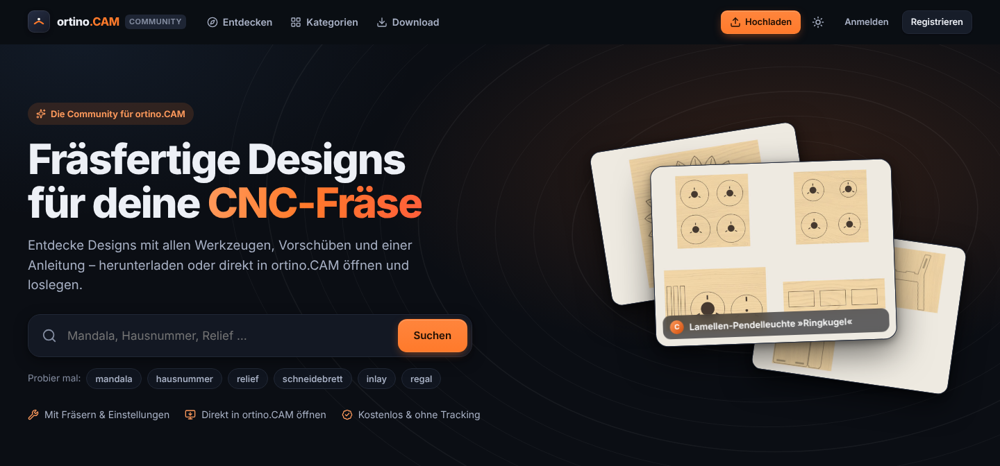</picture> | <picture><source media="(prefers-color-scheme: light)" srcset="docs/bilder/portal-suche-light.png">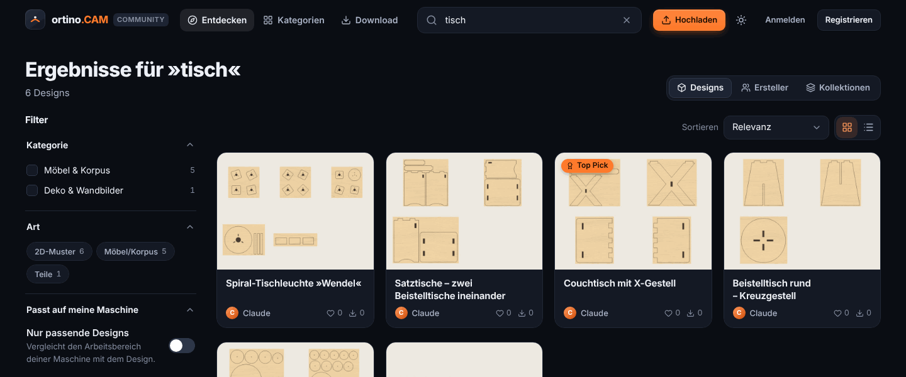</picture> | <picture><source media="(prefers-color-scheme: light)" srcset="docs/bilder/portal-design-light.png">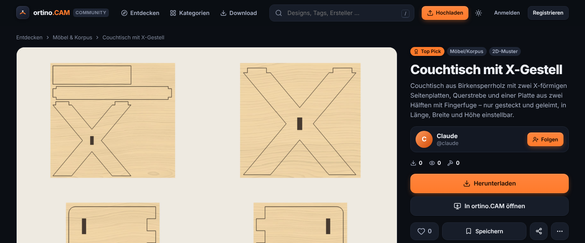</picture> |
| Home page with search | Filters by category, type and machine | Gallery, download, “Open in ortino.CAM” |

| In the program | Upload | Choose a licence |
|:--:|:--:|:--:|
| <picture><source media="(prefers-color-scheme: light)" srcset="docs/bilder/community-im-programm-light.png">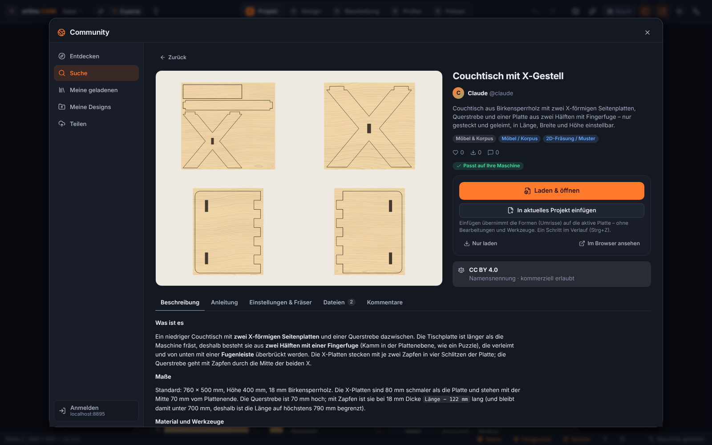</picture> | <picture><source media="(prefers-color-scheme: light)" srcset="docs/bilder/portal-hochladen-light.png">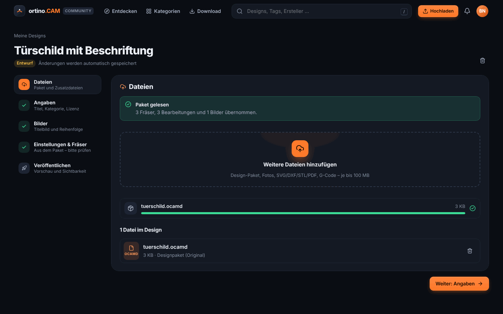</picture> | <picture><source media="(prefers-color-scheme: light)" srcset="docs/bilder/portal-lizenz-light.png">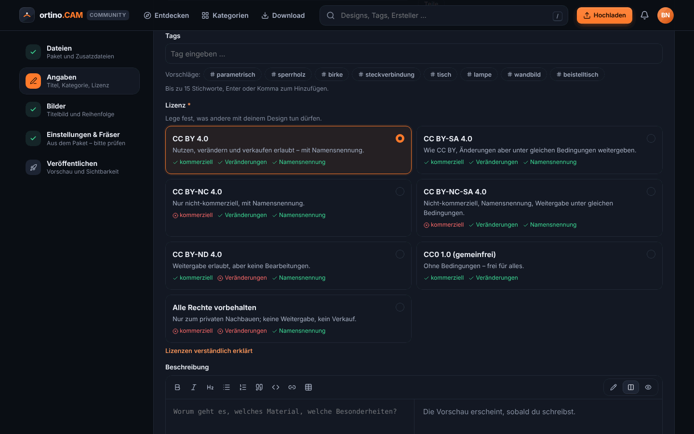</picture> |
| Design page in the community, “Download &amp; open” | The assistant reads the design package from the program | Every design carries a licence |

*The portal images show **sample data from a local installation** (the catalogue designs, without user numbers); the portal on the internet may look different. All images: light or dark depending on your browser’s appearance.*

## Controlled by Claude: MCP server and local API

ortino.CAM comes with an **MCP server** (*Model Context Protocol*): **Claude Desktop**, **Claude Code** and any other MCP client can draw, create operations, work through the checklist and generate G-code, **live in the program window**, every action one undo step (Ctrl+Z).

* **MCP server `ortino-mcp`** for Claude Desktop and Claude Code.
* **Local API** (JSON, `127.0.0.1` only, random access key, switched on only on request) for your own programs and scripts.
* **Command line `ortino`:** generate G-code, check a project, export DXF/SVG, series from CSV, also for CI.
* **Own tools** as Rhai scripts that Claude can use too.
* **Assistant in the program** with your own Anthropic API key (in the Windows Credential Manager, not in files).

| Level | What is allowed | Default |
|---|---|---|
| `read` | Read project, checklist, preview | allowed |
| `edit` | Change the project (one undo step per action) | allowed |
| `machine` | Jogging, spindle, work zero, probing | **locked**, every action with confirmation in the program |
| `danger` | Start a job, overwrite files | **locked**, every action with confirmation in the program |

ortino.CAM writes controller settings (`$…=`) **at no level**, not even through the API.

```jsonc
// claude_desktop_config.json
{
  "mcpServers": {
    "ortino-cam": {
      "command": "C:\\Users\\<Name>\\AppData\\Local\\ortino.CAM\\ortino-mcp.exe",
      "args": []
    }
  }
}
```

The path applies to an installation with the `setup.exe`. ortino.CAM shows the exact path on your computer (also after an installation with the `.msi`) under *Extensions & AI → Connect Claude*, ready to copy.

```bash
ortino check  tuerschild.ocam
ortino gcode  tuerschild.ocam -o tuerschild.nc --post grbl
ortino export tuerschild.ocam --format dxf -o tuerschild.dxf
```

## ortino.CAM and Vectric Aspire

A short, factual comparison with the strengths of both sides. The comparison is with Vectric Aspire, the most expensive program in the Vectric range.

| | ortino.CAM | Vectric Aspire |
|---|---|---|
| **Price** | free | one-off, about €1,800 (according to the manufacturer’s price list; updates included in the first year) |
| **System** | Windows 10/11, 64-bit | Windows (Mac only through Windows virtualisation) |
| **2D design, profile, pocket, V-carving, engraving, inlay** | yes | yes |
| **3D relief** | create reliefs from patterns, height images, shapes and photos (Photo → relief) and calculate toolpaths for them (not tested on a real machine); small scope; import of STL and STEP into a relief (since 0.4.0, from above only, tested only with self-made files); modelling with the brush (since 0.7.0) and relief components from a profile, pattern or image (since 0.12.0), both tested only against tests, simulator and Chromium; no free 3D modelling of solids | extensive 3D modelling (shapes, sculpting, components) – <strong>Aspire is clearly stronger here</strong> |
| **Fourth axis (rotary)** | no, planned for a later version | yes |
| **Nesting** | yes (sheet planner with free-form nesting) | yes |
| **Sending to the machine** | straight from the program to GRBL controllers (USB/COM, TCP), with pre-flight check, probing and tool-change assistant; tested on a real machine only with GRBL on the Ultimate Bee | produces G-code files that a separate control program runs |
| **Post-processors** | GRBL (tested on the Ultimate Bee); grblHAL, FluidNC, Mach3/4, LinuxCNC, UCCNC, Centroid, ShopBot, MASSO, PlanetCNC (not tested on a real machine, the last five only from manufacturer documentation); more controllers ongoing, contributions welcome | very large catalogue, managed online; considerably more controllers |
| **Control by Claude (MCP server, local API)** | yes | no statement from the manufacturer found |
| **Maturity** | young software (0.x), only parts tested on a real machine (one machine, GRBL); what is new in 0.3.9, 0.3.11, 0.3.12, 0.3.14, 0.4.0, 0.4.1, 0.5.0, 0.6.0, 0.7.0, 0.8.0, 0.8.2, 0.9.0, 0.10.0, 0.11.0, 0.12.0, 0.13.0, 0.14.0, 0.15.0 and 0.16.0 (word and logo collage, Montserrat typeface, custom templates, “Optimised” cutting, online generator, more patterns, reliefs, wall-picture motifs and decoration, creators, order of the depth passes, AI models, home page, parametric sketches, relief components, workshop and dashboard, STL/3MF export, stencil bridges, customer records and quotes, saw plan, Art Designer with your own image, Web Designer, Photo → relief, EPS import, snapping, dimensioning, modelling, tiling, marketplace, phone interface) has not been systematically tested under Windows (WebView2) | established for years, large user community |
| **Help** | guides in the repository, questions through GitHub Issues (one person) | manufacturer support, manual, videos, forum |
| **Compatibility** | reads Vectric tool databases (.vtdb; the format is not officially documented, not yet tested with a real Vectric file) | – |

**Aspire is the better choice if you** need a fourth axis (rotary), want to model extensively in 3D (sculpting, components), work on a Mac (through Windows virtualisation), want manufacturer support or rely on long practice and a large user community.

**ortino.CAM fits if you** want to run a GRBL machine straight from the program, are looking for a Furniture and Kitchen Designer with a parts list, want to use the community portal, want to drive your CAM with Claude (MCP) and prefer a free program, and can live with young software.

<sub>Statements about Vectric are based on publicly available manufacturer information and trade sites, as of October 2026, without guarantee; prices and scope change, so please check with the manufacturer ([Aspire product page](https://www.vectric.com/products/aspire/)). Vectric, VCarve and Aspire are trademarks of Vectric Ltd.; ortino.CAM is independent and not affiliated with Vectric. “Planned” is the developer’s intention, not a commitment; scope and timing may change.</sub>

## Installation (Windows 10/11, 64-bit)

1. Under [**Releases**](https://github.com/KlapSC/ortino-cam/releases/latest) download the file `ortino.cam_<Version>_x64-setup.exe` (alternatively the `.msi`, `…_x64_de-de.msi`). The checksum (SHA-256) is in the notes of the version.
2. Start it and install. **Windows warns on the first start** (SmartScreen: “More info → Run anyway”): the installer is signed with a **self-made certificate**, not one from a certificate authority.
3. `.ocam` projects then open with a double click. An example project is attached to the releases.

**Updates** come **in the program** itself: if there is a new version, the top bar shows a notice; it is installed only after your click, with a verified signature and never in the middle of a milling job. For this the program talks to the operator’s official portal, not to GitHub; only the system type, architecture, installation type and the installed version are transmitted. This page only shows the versions to download.

**Android app:** there is an app for ortino.CAM in the Google Play Store: [ortino.CAM at Google Play](https://play.google.com/store/apps/details?id=com.ortinocam.app). What it can do is stated in the listing there; these pages deliberately make no statement about it. The Windows program does not need it.

## Getting started

1. **Install** (see above) and start.
2. **Set up the machine:** the “Set up machine” assistant (step “Project”) offers a catalogue with sizes and controller; custom machines are possible. The dimensions from the catalogue are partly manufacturer data, partly derived, and are flagged as such; please measure once.
3. **Choose something to cut:** pick a starting point via “What would you like to cut?”, open a project from the **example gallery** (File menu or Ctrl+K) or load the example project `tuerschild.ocam` from the releases. If you like, start the **guided tour** first (Help menu) or practise with the **lessons**.
4. **Machining:** create operations (profile, pocket, drilling, V-carving …). In easy mode the tool, depths and cutting values come as a suggestion with a reason.
5. **Check:** look at the 3D simulation and work through the checklist.
6. **Cut:** connect the machine, set the work zero, read the pre-flight check. **Run first without tool and without material**, emergency stop within reach, then start with an offcut.

### Machines and controllers

| | |
|---|---|
| **Connected directly** | GRBL-compatible controllers (GRBL 1.1, grblHAL, FluidNC) over USB/COM or TCP; tested on a real machine only with GRBL (Ultimate Bee) |
| **Machine catalogue** | among others Bulkman3D (Ultimate Bee, CNC xPRO V5), Carbide 3D, Onefinity, Sienci Labs, SainSmart, OpenBuilds, Inventables and a generic GRBL template |
| **G-code for export** | Post-processors for Mach3/Mach4 and LinuxCNC as well as UCCNC, Centroid, ShopBot, MASSO and PlanetCNC (without a direct connection; **none of them tested on a real machine**, the last five only from manufacturer documentation); custom post-processors as a text file possible ([`postprozessoren/`](postprozessoren/)) |
| **Tested on a real machine** | so far only the Ultimate Bee with xPRO V5 (see the note above; most recently, according to the operator, a run of about an hour with 0.12.0, pocket and contour in birch, without pause, feed change or tool change). **Reports from other machines are very welcome** ([template “Test an einer echten Maschine”](https://github.com/KlapSC/ortino-cam/issues/new/choose); the template itself is in German) |

## Safety

* The program **never** writes settings (`$` values) into your controller; it only reads them and compares them with the machine profile.
* The phone remote control is off until you switch it on, and is **not encrypted**: only in your own, trusted Wi-Fi. The stop on the computer remains the actual safeguard.
* Your Anthropic key for the assistant (if you use one) is stored in the Windows Credential Manager.
* Please do **not** report security vulnerabilities as a public issue, but as described in [`SECURITY.md`](SECURITY.md) (in German).

## Disclaimer

**ortino.CAM is provided without any warranty and without any assurance of particular properties (“as is”). You use it at your own risk.**

* CNC machines are dangerous. Errors in the program, in the settings or in the machine can lead to **injury, damage to machine, tool and workpiece, fires and data loss**. You alone are responsible for checking toolpaths, G-code, work zero, tool and clamping before every run, for testing **first without tool and material**, for keeping the **emergency stop within reach** and for **never leaving the machine unattended**.
* Simulation, checklist and pre-flight check are aids and **not a safety function**. They can miss errors. ortino.CAM does not replace an emergency stop, a protective device or your own care.
* The software was **created mostly with AI assistance** and has been tested only in part on real machines (see the note above). Errors are to be expected. Values such as feed rates, spindle speeds, times and costs are guide values or approximations.
* The operator and the contributors are **not liable** for damage arising from the use or unusability of ortino.CAM, **to the extent the law allows**. Liability for intent, for injury to life, body and health and, where mandatory (for example under the Product Liability Act), under the statutory provisions remains unaffected.
* The same applies to the **phone remote control**, the connection to the controller and all help from the assistant and from Claude: you bear responsibility for machine commands, not the program.

The terms of use in [`LICENSE`](LICENSE) are authoritative.

## Frequently asked questions

<details>
<summary><strong>Does ortino.CAM cost anything?</strong></summary>

No. Private and commercial use are allowed free of charge (terms in [`LICENSE`](LICENSE)). The source code is not public.
</details>

<details>
<summary><strong>Does it run on Mac or Linux?</strong></summary>

No, currently only on Windows 10 and 11 (64-bit).
</details>

<details>
<summary><strong>Do I need Claude or an Anthropic key?</strong></summary>

No. Everything essential runs without. You can additionally use the MCP server and the assistant in the program; the assistant needs your own Anthropic key.
</details>

<details>
<summary><strong>Does the online generator produce G-code? Do I need an account for it?</strong></summary>

No and no. The [shape and pattern generator](https://ortino-cam.com/tools/generator) in the portal (since 0.15.0) needs no account and delivers **SVG** and **DXF** in millimetres, no G-code. G-code is only created in ortino.CAM: import the file, choose bit and operation. Whether a pattern holds in your material is not something the page says; its traffic light only measures the geometry on the computer.
</details>

<details>
<summary><strong>Does it work with my machine?</strong></summary>

With GRBL-compatible controllers (GRBL 1.1, grblHAL, FluidNC), yes, straight from the program. So far only the Ultimate Bee with xPRO V5 has been tested; everything else is **not tested on a real machine**. For other controllers (Mach3/Mach4, LinuxCNC, UCCNC, Centroid, ShopBot, MASSO, PlanetCNC) the program produces G-code for export; none of these post-processors has been tested on a real machine, and the last five are written from manufacturer documentation only. Check the dimensions in the machine profile and run first without tool and material.
</details>

<details>
<summary><strong>Why does Windows warn when installing?</strong></summary>

The installer is signed with a **self-made certificate**, not one from a certificate authority. Windows (SmartScreen) therefore shows a warning: “More info → Run anyway”. The checksum (SHA-256) is in the notes of every version.
</details>

<details>
<summary><strong>Are the suggested feed rates and spindle speeds safe?</strong></summary>

No, they are **guide values**. They depend on your machine, your bit and your material. Check them, start carefully and try on an offcut.
</details>

<details>
<summary><strong>Can I take my bit library with me?</strong></summary>

The program comes with over 250 bits and can read in tool databases from other programs (Vectric `.vtdb`, Fusion, CSV). The `.vtdb` format is not officially documented and has not been tested with a real Vectric file so far.
</details>

<details>
<summary><strong>What data does the program send?</strong></summary>

For the update check only the system type, architecture, installation type and the installed version, to the operator’s portal (not to GitHub). You talk to the community portal only when you use it. The assistant talks to Anthropic if you switch it on with your key. The local API is off until you switch it on, and reachable only on `127.0.0.1`.
</details>

<details>
<summary><strong>How can I help?</strong></summary>

Most valuable are **tests on real machines** and bug reports. See [Contributing](#contributing).
</details>

## What comes next?

* **Planned for a later version:** a fourth axis (rotary). Modelling reliefs with the brush exists since 0.7.0, components for reliefs since 0.12.0; free 3D modelling of solids is missing.
* **Ongoing:** tests on real machines, more post-processors (contributions welcome), guides and translations.

*“Planned” is the developer’s intention, not a commitment; scope and timing may change.*

## How ortino.CAM is made

ortino.CAM is developed **for the most part with Claude Code (Anthropic) as co-author**: program code, automatic tests and guides come mostly from this collaboration, including this page. Requirements, decisions, acceptance and publication rest with the operator. Thousands of automatic tests check the calculation, but they come from the same source as the code. That is why **tests on real machines** matter so much and reports about them are so welcome. AI-generated images in the portal are labelled as such there.

## Contributing

**New contributors are welcome.** The source code is not public, but you can still take part in many ways:

* **Tests on real machines:** the most valuable. The template “Test an einer echten Maschine” (test on a real machine; the template is in German) under [Issues](https://github.com/KlapSC/ortino-cam/issues/new/choose); failures help too.
* **Report bugs and voice wishes**, also as an issue.
* **Contributions as files** by pull request: machine profiles, post-processor templates, example projects, translations, corrections to guides. Rules and rights: [`CONTRIBUTING.md`](CONTRIBUTING.md) (in German).
* **Working on the program itself:** write an issue “Mitarbeit am Programm” (contributing to the program) and describe what you are interested in. **The operator grants interested people access to development.**
* **Milling designs** are best shared in the community portal directly from the program, not here.
* **Guides:** the **[wiki](https://github.com/KlapSC/ortino-cam/wiki/Home-en)** explains installation, getting started, setting up the machine, milling, troubleshooting and more; you report errors and gaps in it as an issue.

## Contact

* **Questions, bugs, wishes, machine reports:** through **[GitHub Issues](https://github.com/KlapSC/ortino-cam/issues/new/choose)**. Issues are public: **do not write personal data** into them (name, address, e-mail address, account details).
* **Data protection requests and legal matters about the community portal** (account, access, deletion, suspension): to the e-mail address in the [portal’s imprint](https://ortino-cam.com/imprint).
* **Security vulnerabilities:** not as an issue, but as described in [`SECURITY.md`](SECURITY.md) (in German).

## Licence

ortino.CAM is **not open-source software**: the source code is not public. The terms of use (private and commercial use allowed; passing on, modifying and reselling not) are in [`LICENSE`](LICENSE) (German and English); third-party components with their licences are in [`THIRD-PARTY-NOTICES.txt`](THIRD-PARTY-NOTICES.txt).
