<p align="center">
  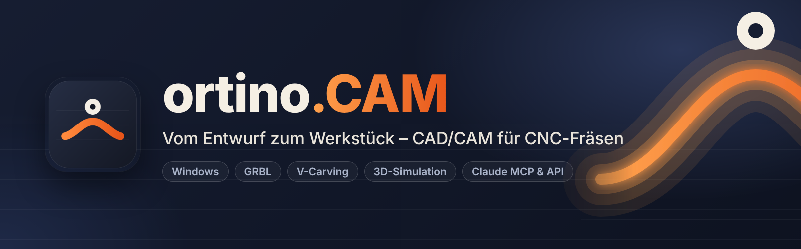
</p>

<p align="center">
  <a href="https://github.com/KlapSC/ortino-cam/releases/latest"></a>
  <a href="https://github.com/KlapSC/ortino-cam/issues/new/choose"></a>
</p>

<p align="center">
  
  
  
  
  
  
</p>

<h3 align="center">
  <a href="#auf-einen-blick">Auf einen Blick</a> ·
  <a href="#funktionen">Funktionen</a> ·
  <a href="#neu-in-0150-eigene-vorlagen-zuschnitt-online-generator">Neu in 0.15.0</a> ·
  <a href="#neu-in-0140-muster-reliefs-wandbild-motive-dekoration">Neu in 0.14.0</a> ·
  <a href="#neu-in-0130-creator-reihenfolge-der-zustellungen-ki-modelle-startseite">Neu in 0.13.0</a> ·
  <a href="#community-portal-und-designs">Portal</a> ·
  <a href="#steuerbar-mit-claude--mcp-server-und-lokale-api">Claude &amp; API</a> ·
  <a href="#ortinocam-und-vectric-aspire">Vergleich</a> ·
  <a href="#installation-windows-1011-64-bit">Installation</a> ·
  <a href="#häufige-fragen">Fragen</a> ·
  <a href="#mitmachen">Mitmachen</a> ·
  <a href="#haftungsausschluss">Haftungsausschluss</a>
</h3>

**ortino.CAM** ist eine **CAD/CAM-Software für CNC-Fräsen** unter Windows: zeichnen, Werkzeugwege berechnen (Profil, Tasche, V-Carving, 3D-Relief), in 3D simulieren, prüfen und direkt an eine **GRBL-Steuerung** wie die der Ultimate Bee (CNC xPRO V5) schicken – alles in einer Anwendung. Mit einem **MCP-Server und einer lokalen API** lässt sie sich von **Claude** und eigenen Skripten steuern.

<p align="center">
  <picture>
    <source media="(prefers-color-scheme: light)" srcset="docs/bilder/entwurf-light.png">
    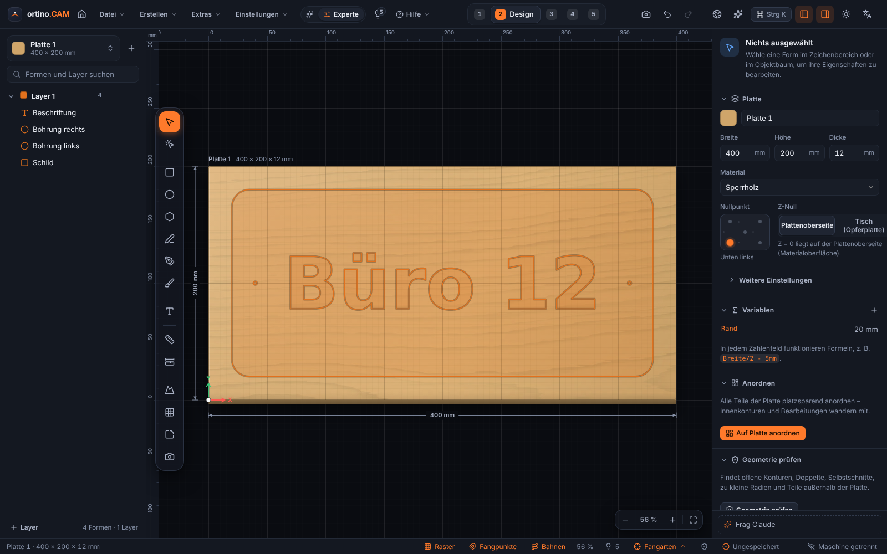
  </picture>
</p>

> [!WARNING]
> **Frühe Version (0.x): nicht alles ist an einer echten Maschine erprobt.** An echter Hardware erprobt sind bisher nur Taschen, V-Carving, Konturen, Referenzfahrt und Werkzeugwechsel mit der Tastplatte (Version 0.3.3, Ultimate Bee mit xPRO V5, **GRBL**); dazu laut Rückmeldung des Betreibers das **Einrichten des festen Tasters und das Einmessen eines Werkzeugs an ihm** (Version 0.3.10, dieselbe Maschine) und an der **Handy-Fernbedienung** das **Stoppen, Verfahren und Setzen der Nullpunkte** (dieselbe Maschine) sowie die **Korrektur des Werkzeugwechsels am festen Taster (0.3.13)**; ebenso lief laut Betreiber ein Projekt von der **Modellierung mit Claude (MCP)** über **»Reihenfolge optimieren«** bis zum Fräsen (Einzelheiten nicht festgehalten). Zuletzt hat der Betreiber mit **Version 0.12.0** an derselben Maschine **Tasche und Kontur in Birke** in einem normalen Lauf von rund einer Stunde gefräst, **ohne Pause, Vorschubänderung oder Werkzeugwechsel**, und alles beobachtet; die **Live-Animation** im Schritt »Fräsen« stimmte laut Betreiber »perfekt« mit dem Fräsen überein. Das ist **ein Testlauf, kein Dauertest**, und er sagt nichts über Pausen, Werkzeugwechsel im Lauf, andere Maschinen, Materialien oder Steuerungen. **Alle anderen Postprozessoren und Steuerungen** (grblHAL, FluidNC, Mach3/4, LinuxCNC, UCCNC, Centroid, ShopBot, MASSO, PlanetCNC) sind **nicht an einer echten Maschine erprobt**. **Nur gegen Simulator und Tests geprüft** sind Messung der Opferplatte, Höhenkarte, die übrigen Teile der Handy-Fernbedienung (Pause, Anzeige), »An Position fahren«, der Längensensor, **Gewindefräsen, Wartungsplan und die Kamera auf der Arbeitsplatte**. **Alles Neue aus 0.3.9, 0.3.11, 0.3.12, 0.3.14, 0.4.0, 0.4.1, 0.5.0, 0.6.0, 0.7.0, 0.8.0, 0.8.2, 0.9.0, 0.10.0, 0.11.0, 0.12.0, 0.13.0, 0.14.0 und 0.15.0 (eigene Vorlagen, Zuschnitt »Optimiert«, Online-Generator, mehr Muster, Reliefs, Wandbild-Motive und Dekoration, Creator, Reihenfolge der Zustellungen, KI-Modelle, Startseite, Parametrische Skizzen, Relief-Komponenten, Werkstatt und Dashboard, Export STL/3MF, Schablonen-Stege, Kundenstamm und Angebote, Sägeplan, Art Designer mit eigenem Bild, Web-Designer, Foto → Relief, EPS-Import, Fangen, Bemaßung, Modellieren, Kachelung, Marktplatz, Handy-Schnittstelle)** (**Opferplatte markieren, neue Tisch-Ansicht, Geräte und Raum im Küchenplaner, neue Möbelarten und Fingerzinken**; **3D-Import von STL und STEP, Möbel-Designer, Speichern und Varianten der Küche, Beschlagbibliothek**; **Farben, Griffe, 3D-Reliefs und Mustergruppen im Küchenplaner, Rendering-Export, Touch- und Stiftbedienung**; Beispielgalerie, Einführung, Lektionen, Array entlang eines Pfads, Béziers, Seriennummern, Stückzahl; **doppelseitiges Fräsen mit Passstiften**, Z-Null »Opferplatte« als Vorgabe bei festem Taster, aufgeteilte Menüleiste, Einstellungen-Dialog; **Sicherung im Portal, Werkzeugwechsel »Automatisch«, »Meine Maschine«, Maschine beim Öffnen eines Designs**) lief nur gegen Tests, Simulator und im Browser (Chromium) und ist **nicht systematisch unter Windows (WebView2)** geprüft; die Teile der **Creator** (neu in 0.13.0, erweitert in 0.14.0) sowie die neuen **Muster**, **Reliefs** und **Wandbilder** (0.14.0) wurden **weder gefräst noch verleimt**; der **Zuschnitt »Optimiert«** (0.15.0) wurde nie gesägt, und die **eigenen Vorlagen** sowie die Dateien des **Online-Generators** (0.15.0) sind nicht unter Windows (WebView2), nicht in fremder CAM-Software und nicht an einer Maschine geprüft. Die **Beispiele** der Galerie und die **Lektionen** sind nicht gefräst, und **Béziers aus SVG und PDF** sind nur mit selbst erzeugten Dateien geprüft. Die **Handy-Fernbedienung ist unverschlüsselt** (nur im eigenen, vertrauenswürdigen WLAN). Immer zuerst **ohne Werkzeug und Material** testen, Not-Aus in Reichweite. Siehe [Haftungsausschluss](#haftungsausschluss).

## Auf einen Blick

* **Alles in einer Anwendung:** zeichnen, Werkzeugwege berechnen, in 3D simulieren, prüfen und die Maschine fahren – kein Dateien-Hin-und-Her zwischen mehreren Programmen.
* **Prüft, bevor es fräst:** Prüfliste mit Lösungsvorschlägen und ein Start-Check vor jedem Lauf; bei Fehlern sind Export und Maschinenstart gesperrt.
* **Für Einsteiger und Erfahrene:** Der Einfach-Modus schlägt Werkzeug, Tiefen und Schnittwerte vor und begründet sie; der Experten-Modus zeigt alle Einstellungen. Eine **Beispielgalerie**, eine **geführte Einführung** und **Lektionen** helfen beim Einstieg.
* **Direkt an die Maschine:** GRBL-Steuerungen über USB/COM oder Netzwerk, mit Handsteuerung, Referenzfahrt, Antasten und Werkzeugwechsel-Assistent; dazu eine **Handy-Fernbedienung** per QR-Code (nur im eigenen WLAN).
* **Entwerfen ohne Umwege:** 2D-Zeichnen mit Formeln und Variablen, **parametrische Skizzen mit Abhängigkeiten und Verlauf**, Text auf Pfad und Einzellinienschriften, Import von SVG, DXF (Splines bleiben Kurven), PDF, EPS/AI, Bildern und **3D-Modellen (STL, STEP)**, Export auch als **STL und 3MF**, dazu **39 Lochmuster-Arten mit 76 Vorlagen**, **3D-Relief** aus Mustern, Bildern und Fotos (**Foto → Relief** mit lokaler KI-Tiefenschätzung) **Modellieren** von Reliefs mit dem Pinsel und **Komponenten** (Ebenen aus Profil, Muster oder Bild).
* **Möbel und Platten:** Plattenplaner mit Freiform-Nesting, **Plattenzuschnitt mit Optimierer** (Sägeplan für die Plattensäge), Fingerzinken, Küchen- und Schrank-Designer mit Stückliste, Farben, Griffen, 3D-Reliefs auf Fronten, **Möbel-Designer** (Tische, Sideboards, Regale, Sitzmöbel) und **Rendering** als Bild – seit 0.5.0 auch **im Browser im Portal** (Web-Designer, Entwürfe im eigenen Konto).
* **Wandbilder aus Holz:** Der **Art Designer** (Menü »Erstellen«) macht aus 14 Motiven (Blattstrom, Blattzweig, Monstera, Ginkgo, Farn, Palmwedel, Federfächer, Fließende Bänder und, neu in 0.14.0, Geschichtete Berge, Sonnenaufgang, Mond und Wolken, Mondphasen, Olivenzweig, Gräser und Pampas) ein Wandbild – als geschnitztes Relief oder als **Schichtholzbild** aus gestapelten Sperrholzlagen mit Montageplan – und nimmt seit 0.10.0 auch ein **eigenes Bild** auf, das an einer Seite ins Muster übergehen kann. *(Gerechnet, nicht gefräst oder verleimt.)*
* **Vom Entwurf zum Angebot:** Rüstblatt als PDF mit Werkzeugliste und Zeitschätzung, Kostenrechnung mit Stückzahl und Staffel, **Kundenstamm, Angebotsnummern und Zahlungsbedingungen** (alles lokal), Serien aus CSV, **Werkstatt-Ordner mit Rollen und Dashboard** für kleine Teams (lokal).
* **Gemeinsam:** Community-Portal mit Fräsdesigns zum Laden und Teilen, dazu ein MCP-Server, mit dem **Claude** das Programm bedienen kann. Deine Maschinenprofile, Fräser und Einstellungen lassen sich **privat im Portal sichern** und auf einem zweiten Rechner abrufen.
* **Werkstücke aus wenigen Eingaben (seit 0.13.0):** der **Creator** (Erstellen ▸ Creator …) mit **22 Generatoren in sechs Gruppen** – Schachtel mit Fingerzinken, Vogelhaus, Schattenkasten, Zahnräder, Puzzle, Rosette, Türschild, Lineal und mehr; **neu in 0.14.0** die Gruppe »Feste und Jahreszeiten« mit Adventskalender, Kranz und Bordüre, Windlicht / Laterne und Girlande, und die Dekoration nach Jahreszeit mit 35 statt 8 Motiven. Teile, Teileliste und Montagehinweise aus einem Formular, in einem Rückgängig-Schritt samt Fräsbearbeitungen im Projekt. *(Nichts gefräst oder verleimt; das Spiel ist ein Richtwert.)* [Mehr dazu](#neu-in-0140-muster-reliefs-wandbild-motive-dekoration)
* **Schneller Einstieg (neu in 0.13.0):** eine **Startseite mit Schnellzugriffen** und Home-Schaltfläche, auf der deine eigenen Fotos und Bilder vor den Generatoren stehen, und ein Dialog **KI-Modelle**, in dem du das Tiefenmodell für »Foto → Relief« nur auf Klick lädst, prüfst oder entfernst.
* **Mehr Muster, Reliefs und Dekoration (neu in 0.14.0):** das Muster-Studio mit **39 Arten und 76 Vorlagen** (Suchfeld, neue Kategorie Ornament), **62 Relief-Vorlagen** in 9 Kategorien, **14 Motive** im Art Designer und **35 Motive** in der Dekoration nach Jahreszeit. *(Gerechnet und simuliert, nichts gefräst.)* [Mehr dazu](#neu-in-0140-muster-reliefs-wandbild-motive-dekoration)
* **Eigene Vorlagen, besserer Zuschnitt, Online-Generator (neu in 0.15.0):** die Sparte **»Eigene«** im Muster-Studio und im Relief-Studio (Stand speichern, umbenennen, als Datei sichern, importieren) und der Dialog **»Formen«** mit zehn Grundformen; im Möbel- und Küchen-Designer das Zuschnittverfahren **»Optimiert«** und ein eigener Knopf für den Sägeplan; dazu im Portal ein kostenloser **Formen- und Muster-Generator im Browser** ([ortino-cam.com/tools/generator](https://ortino-cam.com/tools/generator), ohne Konto, SVG und DXF in Millimetern, **kein G-Code**). *(Gerechnet und simuliert, nichts gefräst oder gesägt.)* [Mehr dazu](#neu-in-0150-eigene-vorlagen-zuschnitt-online-generator)
* **Reihenfolge der Zustellungen (neu in 0.13.0):** bei Profil und Tasche wählbar, ob jedes Teil bis zur Endtiefe gefräst wird (**Teil für Teil**) oder alle Teile Stufe für Stufe (**Ebene für Ebene**); bisherige Projekte liefern denselben G-Code Byte für Byte.
* **Kostenlos** für private und gewerbliche Nutzung, **Windows 10/11 (64 Bit)**. Ehrlich zum Stand: Es ist eine frühe Version, und was an einer echten Maschine erprobt ist und was nicht, steht im Warnhinweis ganz oben, unter [Maschinen und Steuerungen](#maschinen-und-steuerungen) und im [Haftungsausschluss](#haftungsausschluss).

## In drei Schritten zum Werkstück

| 1 · Bearbeiten | 2 · Prüfen | 3 · Fräsen |
|:--:|:--:|:--:|
| <picture><source media="(prefers-color-scheme: light)" srcset="docs/bilder/bearbeitung-light.png">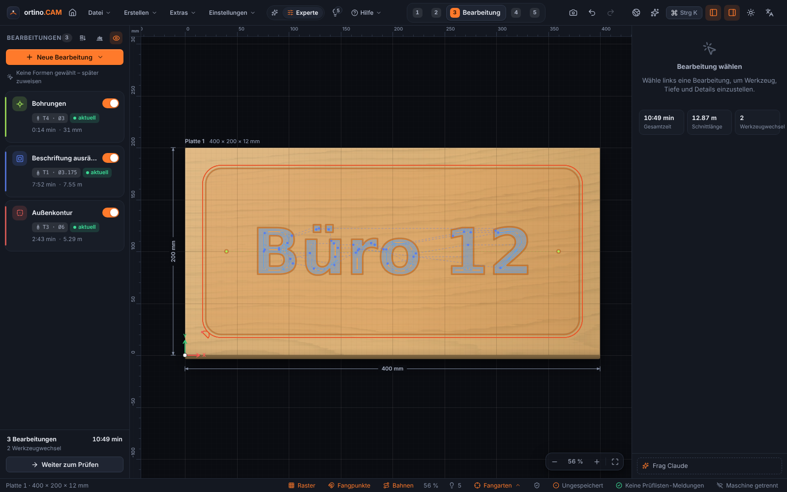</picture> | <picture><source media="(prefers-color-scheme: light)" srcset="docs/bilder/simulation-light.png">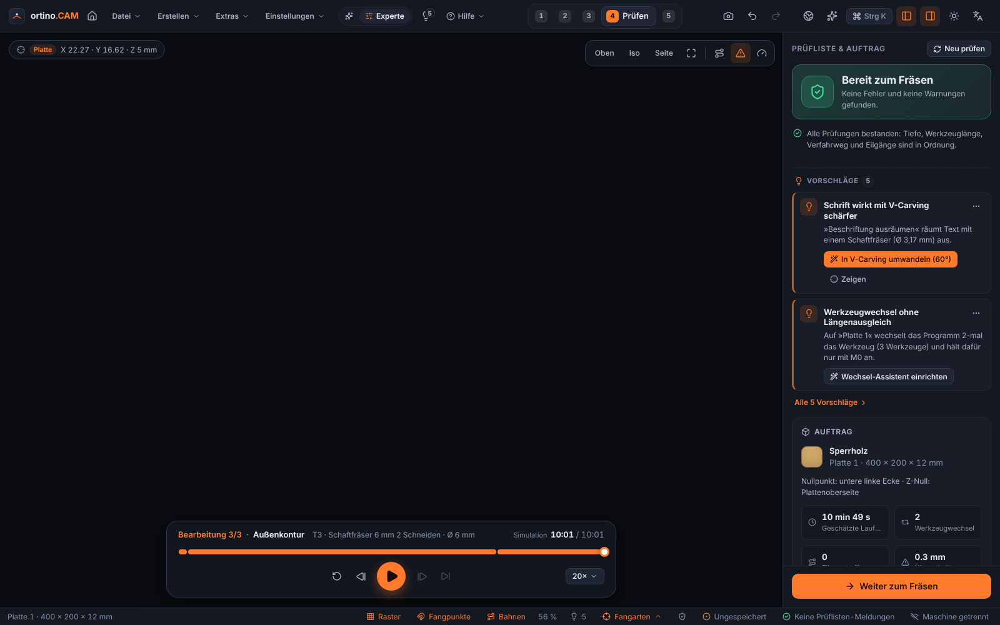</picture> | <picture><source media="(prefers-color-scheme: light)" srcset="docs/bilder/fraesen-light.png">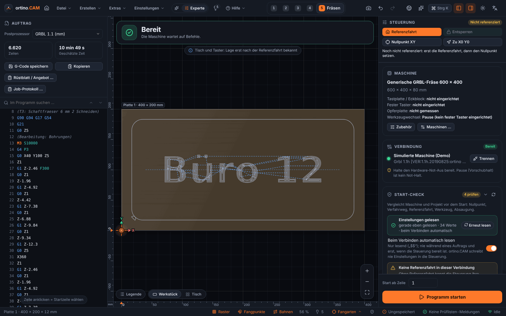</picture> |
| Werkzeugwege festlegen, mit Richtwerten für Vorschub und Drehzahl | Materialabtrag in 3D, Kollisionen, Prüfliste mit Lösungen | Verbinden, Nullpunkt, Start-Check, Pause und Stopp |

### Mehr aus dem Programm

| Rüstblatt &amp; Angebot | Maschine einrichten | Möbel &amp; Küche |
|:--:|:--:|:--:|
| <picture><source media="(prefers-color-scheme: light)" srcset="docs/bilder/ruestblatt-light.png">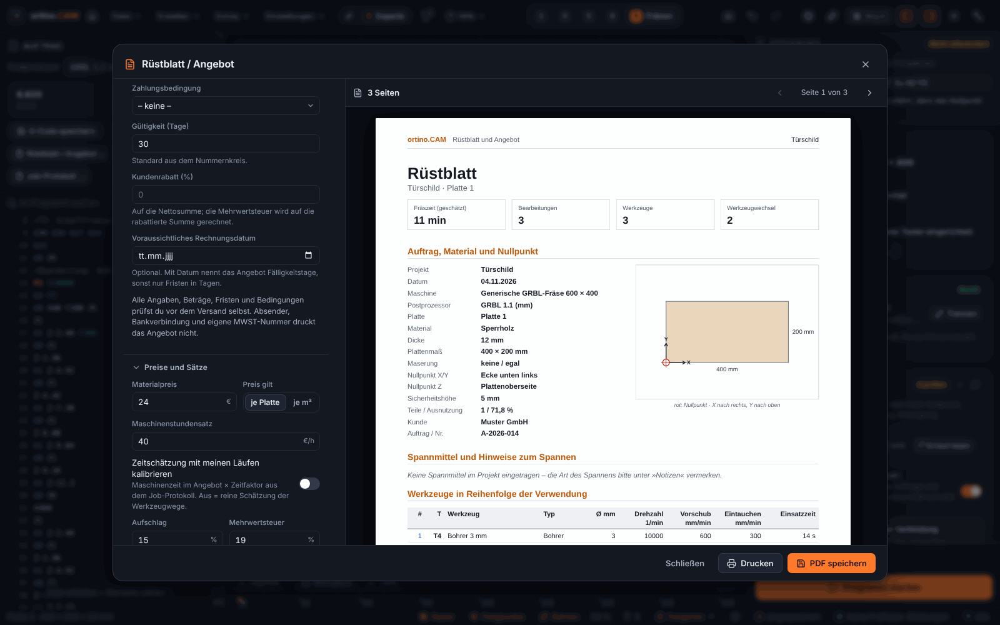</picture> | <picture><source media="(prefers-color-scheme: light)" srcset="docs/bilder/einrichtung-light.png">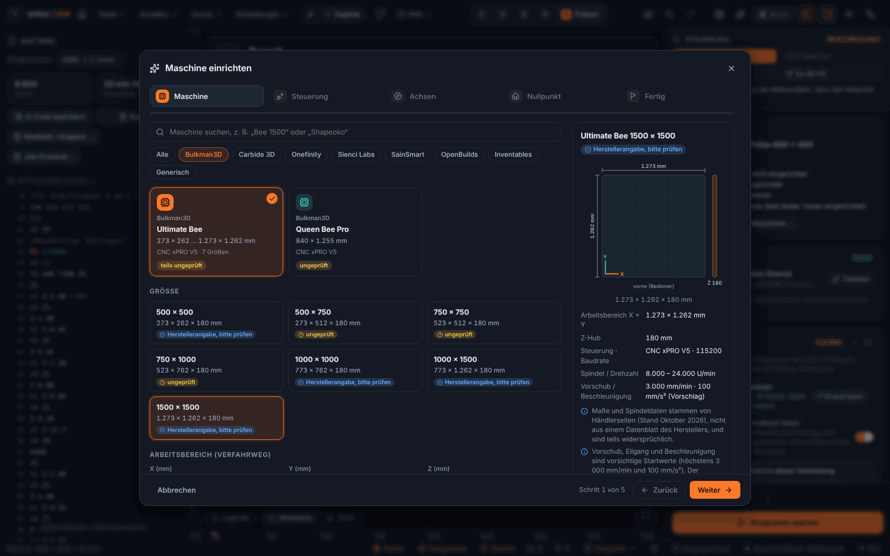</picture> | <picture><source media="(prefers-color-scheme: light)" srcset="docs/bilder/moebel-light.png">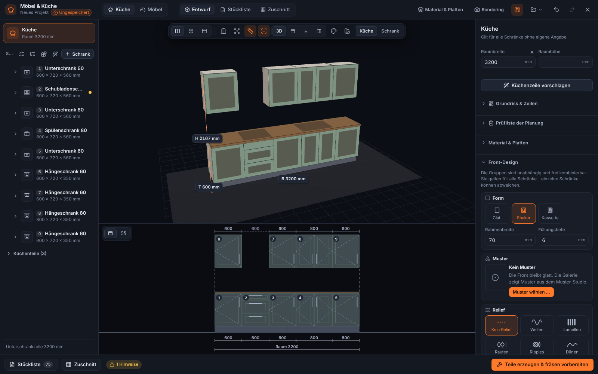</picture> |
| Vorschau des PDFs mit Werkzeugliste, Reihenfolge und Zeitschätzung, dazu Kostenrechnung<br><sub>Setup sheet and quote: PDF preview, tool list, sequence, time estimate, costs</sub> | Katalog mit Größen; Händlerwerte sind als »ungeprüft« oder »Herstellerangabe, bitte prüfen« gekennzeichnet<br><sub>Machine setup: catalogue with sizes; dealer values are flagged</sub> | Küchenzeile in 3D und Frontansicht, mit Stückliste und Zuschnitt (Beispiel)<br><sub>Furniture and kitchen: kitchen row in 3D and front view, parts list and cutting plan</sub> |

### Neu in 0.15.0: Eigene Vorlagen, Zuschnitt, Online-Generator

Diese Funktionen gibt es seit Version 0.15.0; in 0.14.0 und früheren Versionen gibt es sie nicht. Vollständig: [Release-Hinweise 0.15.0](release-notes/0.15.0.md).

#### Eigene Vorlagen und der Dialog »Formen«

* **Sparte »Eigene«:** Im Muster-Studio und im Relief-Studio ist **»Eigene«** der erste Reiter der Galerie. **»Als eigene Vorlage speichern«** merkt dir den Stand des Studios (beim Muster Art, Zufallswert, alle Einstellungen und Fläche; beim Relief Größe, Tiefe, Regler, Nachbearbeitung, Rand und die Ebenen mit ihren Einstellungen). Die Karten zeigen die Vorschau live vom Kern; dazu **Umbenennen**, **Löschen** (mit Rückfrage), **Als Datei sichern** (`*.ortino-vorlage.json`), **Alle sichern** und **Importieren** (Dateiauswahl oder Datei auf die Sparte ziehen). Der Knopf **»Neu erstellen«** beginnt mit den Standardwerten.
* **Dialog »Formen«** (Befehlspalette `Strg+K`: »Formen: Grundformen und eigene …« und ein Symbol im Kopf der Muster-Galerie): **zehn Grundformen** – Rechteck, abgerundetes Rechteck, Kreis, Ellipse, Vieleck, Stern, Herz, Zahnrad, Rosette und Langloch – mit Maßen, Vorschau und »Auf Platte einfügen«. Rundungen bleiben echte Kreisbögen; das Zahnrad ist eine Zierform, kein Getriebezahnrad. Auch Formen lassen sich als eigene Vorlage speichern.
* **Dateien aus dem Online-Generator** (unten) lassen sich in der Sparte »Eigene« importieren; Formen bleiben dabei echte Formen, Muster werden gegen die Musterarten des Programms aufgelöst.
* **Grenzen:** Muster aus einem **Bild** lassen sich nicht speichern. Von den 62 mitgelieferten Reliefs lassen sich 60 speichern (nicht »Bild« und »Formen wölben«); Reliefs aus Foto, Höhenbild, 3D-Modell, Maske, Komponenten oder Pinselstrichen werden abgelehnt (der Knopf ist gesperrt und nennt die Ursache). Beim Verwenden werden Werte außerhalb der Bereiche begrenzt und Unbekanntes weggelassen (»Nicht übernommen: …«).
* **Wo die Vorlagen liegen:** im Speicher der Oberfläche (bis zu 200 Vorlagen), **nicht** im Datenordner und **nicht** in der Portal-Sicherung. **Ob sie im installierten Windows-Programm (WebView2) einen Neustart, ein Update oder eine Windows-Bereinigung überstehen, ist nicht geprüft**, ebenso nicht, ob der Dateidownload dort einen Speichern-Dialog zeigt und ob das Ablegen von Dateien dort geht. Wer sichergehen will, nutzt »Alle sichern« und hebt die Datei auf. Anleitung: [Eigene Vorlagen](https://github.com/KlapSC/ortino-cam/wiki/Eigene-Vorlagen) im Wiki.

#### Zuschnitt »Optimiert« im Möbel- und Küchen-Designer

* Der Knopf **»Zuschnitt optimieren«** bleibt jetzt im Designer (bisher öffnete er den Plattenzuschnitt-Dialog anstelle des Designers, und dessen Ergebnis kam nicht in die Zuschnittansicht zurück). Er stellt das neue Verfahren **»Optimiert«** ein (neben MaxRects und Guillotine), rechnet neu und meldet vorher und nachher. »Optimiert« probiert beide Verfahren mit den festen Sortierungen und je 48 gestörten Reihenfolgen, nimmt die Aufteilung mit den wenigsten Platten und bei Gleichstand die mit der leereren letzten Platte (größeres Reststück); gleiche Eingabe, gleiches Ergebnis. »Teile erzeugen« nutzt dieselbe Aufteilung. Den **Sägeplan** (Plattenzuschnitt mit Schnittfolge) öffnest du jetzt mit dem eigenen Knopf **»Sägeplan …«**; beim Schließen geht es in den Designer zurück.
* **Gemessen** an 30 Zufallsfällen (am Rechner, nicht an Holz): nie schlechter als die festen Verfahren, einmal eine Platte weniger, 15-mal eine leerere letzte Platte. Der Gewinn ist meist klein.
* **Grenzen:** »Optimiert« kann eine Aufteilung wählen, die sich nicht mit durchgehenden Schnitten sägen lässt; für die Plattensäge gelten das Verfahren Guillotine und der Sägeplan. **Dateien mit dem Verfahren »Optimiert« lassen sich in älteren Programmversionen nicht öffnen.** Nie an einer echten Säge erprobt.

#### Formen- und Muster-Generator im Browser (Portal)

* **[ortino-cam.com/tools/generator](https://ortino-cam.com/tools/generator):** kostenlos, ohne Konto und ohne Installation. Reiter **Muster** (37 der 39 Arten, Vorlagen mit Vorschaubild, Fräsbarkeits-Ampel mit Fräser und Mindeststeg) und **Formen** (die zehn Grundformen). Download als **SVG** und **DXF** in Originalgröße (Millimeter, Bögen bleiben Bögen) und als PNG. Eigene Vorlagen speichert die Seite im Browser; das Austauschformat ist dasselbe wie im Programm.
* **Erzeugt keinen G-Code:** G-Code entsteht erst in ortino.CAM (Datei importieren, Fräser und Bearbeitung wählen). Text- und Bildmuster gibt es nur im Programm.
* **Gemessen, nicht gefräst:** Die Ampel misst die Geometrie am Rechner. Ein Test liest die Dateien mit dem Import von ortino.CAM wieder ein (Maße, Fläche und Bögen stimmen); in fremder CAM-Software oder an einer Maschine wurden sie nicht geprüft. Anleitung: [Formen- und Muster-Generator](https://github.com/KlapSC/ortino-cam/wiki/Formen-und-Muster-Generator) im Wiki.

#### Ehrlich zum Stand und Grenzen von 0.15.0

* **Nichts davon wurde gefräst, gesteckt, verleimt oder gesägt.** Alles Neue ist nur mit Rust-, Vitest- und Browser-Tests (Chromium) geprüft. An einer echten Maschine hat der Betreiber bisher einen Lauf der Version 0.12.0 gefräst (Tasche und Kontur in Birke, rund eine Stunde); das sagt nichts über die Neuerungen.
* **Nicht geprüft:** das installierte Windows-Programm (WebView2), insbesondere die eigenen Vorlagen darin (Neustart, Update, Bereinigung der WebView2-Daten, Dateidownload, Ablegen von Dateien); das echte Portal und die Last auf dem Generator (die Grenzwerte sind nur auf einem Entwicklungsrechner gemessen); die Dateien des Generators in fremder CAM-Software und an der Maschine; der Zuschnitt an einer echten Plattensäge.
* **Muster: Rechenfrist.** Die Musterrechnung (Fräsbarkeitsprüfung) endet bei Ausreißern jetzt nach der Rechenfrist des Programms (Standard 180 s) von selbst, mit Meldung; vorher hatte die Frist bei Mustern nie gewirkt (einzelne Fälle brauchten auf dem Entwicklungsrechner über 38 s, auf sehr großen Flächen über 60 s). Muster, die innerhalb der Frist fertig werden, rechnen unverändert.
* **Aufnahmen:** Zu den Neuerungen von 0.15.0 gibt es noch keine eigenen Aufnahmen. Die Anleitungen stehen im Wiki: [Eigene Vorlagen](https://github.com/KlapSC/ortino-cam/wiki/Eigene-Vorlagen), [Formen- und Muster-Generator](https://github.com/KlapSC/ortino-cam/wiki/Formen-und-Muster-Generator), [Möbel-Designer](https://github.com/KlapSC/ortino-cam/wiki/Moebel-Designer) (Zuschnitt) und [Zeichnen und Importieren](https://github.com/KlapSC/ortino-cam/wiki/Zeichnen-und-Importieren) (Muster-Studio).

### Neu in 0.14.0: Muster, Reliefs, Wandbild-Motive, Dekoration

Diese Funktionen gibt es seit Version 0.14.0; in 0.13.0 und früheren Versionen gibt es sie nicht oder nur in der kleineren Fassung, die unten jeweils genannt ist. Vollständig: [Release-Hinweise 0.14.0](release-notes/0.14.0.md).

#### Muster-Studio: 39 Arten und 76 Vorlagen

* **14 neue Arten, jetzt 39 Arten und 76 Vorlagen in sechs Kategorien** (vorher 25 Arten und 37 Vorlagen in fünf; neu ist die Kategorie *Ornament*). Neu sind **Chevron-Lamellen, Argyle, Kreuzparkett, Penrose-Parkett, Ogee-Laterne, Fischschuppen (Seigaiha), Kagome, Vierpass-Maßwerk, überlappende Kreise (Shippo), Art-déco-Fächer, Spiralen, Sonnenblume (Fibonacci-Anordnung), Schneeflocken und Wellenlinien**; dazu elf neue Vorlagen für die bisherigen Arten. Wo eine Art Bögen hat (Ogee, Fischschuppen, Vierpass, Shippo, Fächer, Spiralen, Kreuzparkett), bleiben es Bögen statt vieler kleiner Strecken.
* **Neu außerdem:** ein **Suchfeld** in der Galerie (Name, Beschreibung, Art und Kategorie; `Esc` leert es), die Option **`trim`** unter »Erweitert« (am Rand angeschnittene Zellen unter einem gewählten Anteil entfallen, es entstehen keine schmalen Schlitze mehr) und für die Blumen ein versetztes, mittiges Gitter. Gespeicherte Muster ändern sich nicht.
* **Fräsbarkeit:** Alle 76 Vorlagen sind mit den Voreinstellungen des Studios (3,175-mm-Fräser, 1,5 mm Mindeststeg, keine Inseln) laut Ampel **grün**. Das ist **gemessen, nicht gefräst**; ob feine Stege (Fischschuppen, Shippo, Spiralen) und dünne Spitzen (Ogee, Schneeflocken, Penrose) im Holz halten, ist nicht erprobt.

#### Reliefs und Wandbild-Motive

* **22 neue Relief-Vorlagen, jetzt 62 in 9 Kategorien** (vorher 40 in 7; neu sind *Ornamente* und *Paneele & Fronten*): Wellen mit Schaumkämmen, Bambus, Schilf, Jahresringe, Höhenlinien, Quadermauer, Bruchsteinmauer, Mandala, Holzrosette, Stern-Facetten, Schneeflocke, Schneeflocken-Raster, Tropfenkranz, Kassettenfüllung, Kissenfüllung, Diamantspitzen und die sechs Wandbild-Motive unten. Dafür gibt es **sechs neue Generatoren und zwei neue Blattstile** (Rosette, Jahresringe und Höhenlinien, Mauerwerk, Kassetten, Bambus und Schilf, Landschaften sowie Olivenzweig und Gräser als zwei neue Blattstile).
* **Bestehende Reliefs rechnen unverändert:** ein Test vergleicht die 38 Vorlagen von 0.13.0 Zelle für Zelle mit Prüfsummen. Geändert sind nur die Startwerte von fünf Vorlagen (Sanfte Hügel, Gebirge, Blüte, Kissen, Schuppen) für neu eingefügte Reliefs. Die steilste Flanke der neuen Vorlagen liegt unter 70°; die engsten Kehlen (Mauerfugen, Schilf, Holzrosette, Stern-Kerben) erreicht ein Kugelfräser von Ø 3 mm gerade noch (gerechnet, nicht gefräst).
* **Art Designer: 14 statt 8 Motive.** Neu sind **Geschichtete Berge, Sonnenaufgang, Mond und Wolken, Mondphasen, Olivenzweig und Gräser und Pampas**, jedes mit empfohlenem Format und empfohlener Ausrichtung, für 3 bis 24 Lagen Schichtholz (die Landschaften sind so entworfen, dass jede Stufe eine Lage ergibt). Wie alle Motive sind sie **eigene, am Rechner erzeugte Muster**.

#### Dekoration nach Jahreszeit und vier neue Creator

* **Dekoration nach Jahreszeit: 35 statt 8 Motive.** Zu Schneeflocke, Stern, Weihnachtsbaum, Osterei, Hase, Herbstblatt, Kürbis und Herz kommen 27 neue: Winter und Advent (Glocke, Mond und Sterne, Zuckerstange, Tannenzapfen, Geschenk, Schneemann, Lebkuchenmann, Kerze, Rentier), Frühling und Ostern (Tulpe, Gänseblümchen, Schmetterling, Marienkäfer, Biene, Vogel), Sommer (Sonne, Sonnenblume, Muschel, Seestern, Anker), Herbst (Eichel, Fliegenpilz, Eule, Geist, Fledermaus) und Liebe (Doppelherz, Schleife). Die Innenzeichnung gibt es als Ausschnitte, als Gravurlinien oder beides. **Osterhase und Herbstblatt (jetzt ein Ahornblatt) sind neu gezeichnet:** gleiche Eingaben ergeben eine andere Kontur als in 0.13.0; bereits angelegte Teile bleiben unverändert.
* **Vier neue Creator in der neuen Gruppe »Feste und Jahreszeiten« – jetzt 22 Creator in sechs Gruppen** (0.13.0: 18 in fünf). In der Galerie steht unter der Kategorie »Feste und Jahreszeiten« auch die Dekoration nach Jahreszeit.

| Creator | Was er macht |
|---|---|
| **Adventskalender** | 1 bis 60 nummerierte Türchen als Kreis, abgerundetes Quadrat, Etikett oder Figur (jedes mit seiner Zahl graviert), dazu ein Brett mit Reihen oder ein Baum mit Haken-Bohrungen |
| **Kranz und Bordüre** | Türkranz rund, oval oder als Herz, oder eine gerade Bordüre: ein Band mit Blättern, Sternen, Herzen, Blüten oder Beeren |
| **Windlicht / Laterne** | Vier Wände zum Zusammenstecken (wie die Striche eines #-Zeichens) mit Fenstern aus Figuren, Lochmuster oder Schlitzen; Boden mit Mulde für das Teelicht, auf Wunsch ein Dach |
| **Girlande / Wimpelkette** | Wimpel als Dreieck, Schwalbenschwanz, Rechteck oder Halbrund, ein Buchstabe je Wimpel oder leere Wimpel; zwei Löcher oder ein Schlitz für die Schnur |

* **Windlicht und offene Flamme:** Holz brennt. Der Creator geht von einem LED-Teelicht aus; wählst du eine offene Flamme, warnt er vor einem Holzdach und vor niedrigen Wänden. Er **prüft aber nicht, ob eine Flamme sicher ist**: dafür bist du selbst verantwortlich.

#### Ehrlich zum Stand und Grenzen

* **Nichts davon wurde gefräst, gesteckt oder verleimt.** Alles Neue ist nur mit Rust-, Vitest- und Browser-Tests (Chromium) und dem Simulator geprüft; Fräsbarkeit, Flanken, Stege und Fräserradien sind Rechnungen am Bildschirm, kein Beweis am Holz. An einer echten Maschine hat der Betreiber bisher einen Lauf der Version 0.12.0 gefräst (Tasche und Kontur in Birke, rund eine Stunde); das sagt nichts über die Neuerungen. **Nicht geprüft:** das installierte Windows-Programm (WebView2) und die Haltbarkeit feiner Stege und spitzer Zähne (Ahornblatt, Sterne).
* **Muster am Rand:** Bei gedrehten Gittern und bei Ellipsen als Umriss werden Randzellen angeschnitten (dort entstehen Strecken statt Bögen). Spiralen, Schneeflocken und Sonnenblume setzen nur ganze Elemente, der Rand ist dadurch ungleich breit. Shippo ist die Kreisanordnung dieses Namens, nicht die »Blume des Lebens«.
* **Relief:** Die Quadermauer wirkt trotz verschiedener Höhen eher wie Ziegel, die Landschaften wirken in der Vorschau eher grafisch als plastisch (ebene Stufen), der Olivenzweig ist schematisch und besteht im Schichtholz aus vielen kleinen Inseln. Federn, Maßwerk und Lorbeerkranz als Relief gibt es noch nicht.
* **Creator:** Rentier-Gesicht, Biene und Schleife sind zeichnerisch mittelmäßig. Der Adventskalender-Baum mit 24 Türchen passt nicht auf eine Platte von 600 × 400 mm (das Programm meldet es mit Lösungsknopf). Ein Kranz mit Motiven auch an der Innenseite braucht für die Bahnberechnung sehr lange; Standard ist »nur außen«.
* **Aufnahmen:** Zu den Neuerungen von 0.14.0 gibt es noch keine eigenen Aufnahmen. Die Anleitung steht im Wiki: [Creator](https://github.com/KlapSC/ortino-cam/wiki/Creator), [Art Designer](https://github.com/KlapSC/ortino-cam/wiki/Art-Designer), [Zeichnen und Importieren](https://github.com/KlapSC/ortino-cam/wiki/Zeichnen-und-Importieren) (Muster-Studio) und [Bearbeitungen](https://github.com/KlapSC/ortino-cam/wiki/Bearbeitungen) (Relief-Studio).

### Neu in 0.13.0: Creator, Reihenfolge der Zustellungen, KI-Modelle, Startseite

Diese Funktionen gibt es seit Version 0.13.0; in 0.12.0 und früheren Versionen gibt es sie nicht. **Die Zahlen in diesem Abschnitt (18 Creator in fünf Gruppen, acht Motive der Dekoration) nennen den Stand von 0.13.0;** was seit 0.14.0 dazukommt, steht im Abschnitt [Neu in 0.14.0](#neu-in-0140-muster-reliefs-wandbild-motive-dekoration) darüber. Vollständig: [Release-Hinweise 0.13.0](release-notes/0.13.0.md).

#### Creator: Werkstücke aus wenigen Eingaben

<p align="center">
  <picture><source media="(prefers-color-scheme: light)" srcset="docs/bilder/creator-light.png">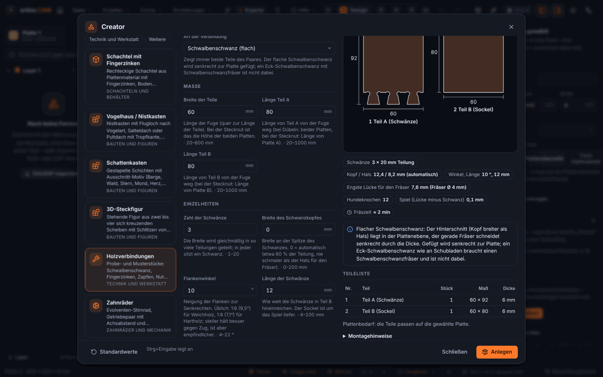</picture>
</p>

* **Erstellen ▸ Creator …** (oder `Strg+K` »Creator«, oder die Kachel auf der Startseite) öffnet **einen Dialog für alle Creator**: links die Galerie mit Suche und Kategorien, in der Mitte ein Formular, das aus der Beschreibung des Creators entsteht (Maße, Auswahl, Schalter, Text; Zahlen auch als **Formel**, Einheit und Grenzen am Feld), rechts die Vorschau mit Maßlinien und Nummern, **Teileliste** mit Plattenbedarf, **Montagehinweise** und **Hinweise im Stil der Prüfliste** mit Lösung und oft einem Lösungsknopf.
* **Anlegen** (`Strg+Enter`) setzt Platten, Formen und Bearbeitungen ins Projekt, **in einem Rückgängig-Schritt**. Der Creator nimmt Plattendicke, Fräser und **Spiel** (die Variable `Spiel` aus dem Passungs-Assistenten, sonst 0,1 mm) aus dem Projekt. Danach geht es wie gewohnt weiter: Prüfliste, Simulation, Fräsen. Auch Claude kann Creator benutzen (`call_api`); im Web-Designer des Portals gibt es sie nicht.

| Gruppe | Creator |
|---|---|
| **Schachtel** (1) | **Schachtel mit Fingerzinken**: Maße außen oder innen, Boden aufgelegt oder in Nut, Deckel aufgelegt oder Schiebedeckel, Trennwände, Griff, Beschriftung |
| **Bauten und Figuren** (3) | **Vogelhaus / Nistkasten** (Flugloch nach Vogelart, Sattel- oder Pultdach, Entwässerung, Klappe; auch Futterhaus) · **Schattenkasten** (Schichten, Distanzrahmen, LED-Kanal) · **3D-Steckfigur** (Stern, Baum, Schneeflocke aus gekreuzten Scheiben) |
| **Technik** (5) | **Holzverbindungen** (Schwalbenschwanz flach, Fingerzinken, Zapfen, Nut und Feder, Überblattung, Dübel, Stecknut) · **Zahnräder** (Stirnrad, Paar, Zahnstange) · **Zahnriemenscheibe** (GT2, HTD 3M/5M) · **Lüftungsgitter** · **QR-Code** (Adresse, Text, WLAN, Kontakt) |
| **Ornament** (3) | **Puzzle (Jigsaw)** · **Rosette / Mandala** · **Dekoration nach Jahreszeit** (Schneeflocke, Stern, Baum, Osterei, Hase, Herbstblatt, Kürbis, Herz) |
| **Schrift und Skala** (6) | **Namensschild / Türschild** (auch Hausnummer) · **Geburtsbuchstabe** · **Letter Topper** · **Wortkacheln** · **Lineal** (mm und Zoll) · **Wanduhr-Zifferblatt** |

| Schachtel | Vogelhaus | Zahnräder |
|:--:|:--:|:--:|
| <picture><source media="(prefers-color-scheme: light)" srcset="docs/bilder/creator-schachtel-light.png">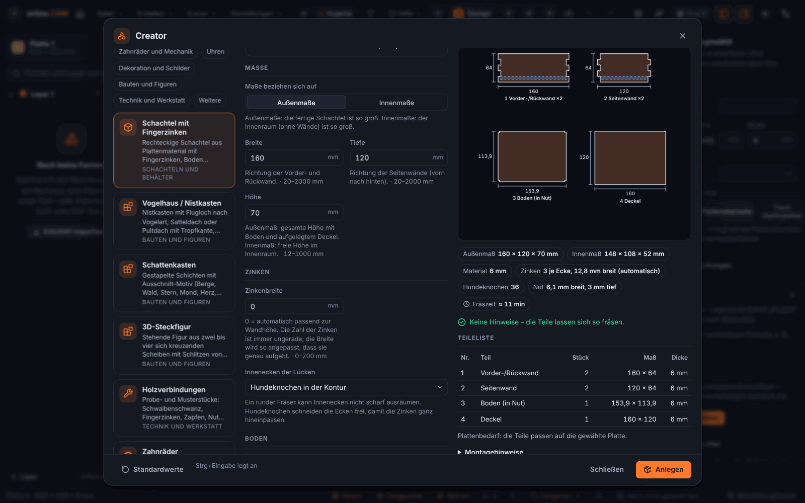</picture> | <picture><source media="(prefers-color-scheme: light)" srcset="docs/bilder/creator-vogelhaus-light.png">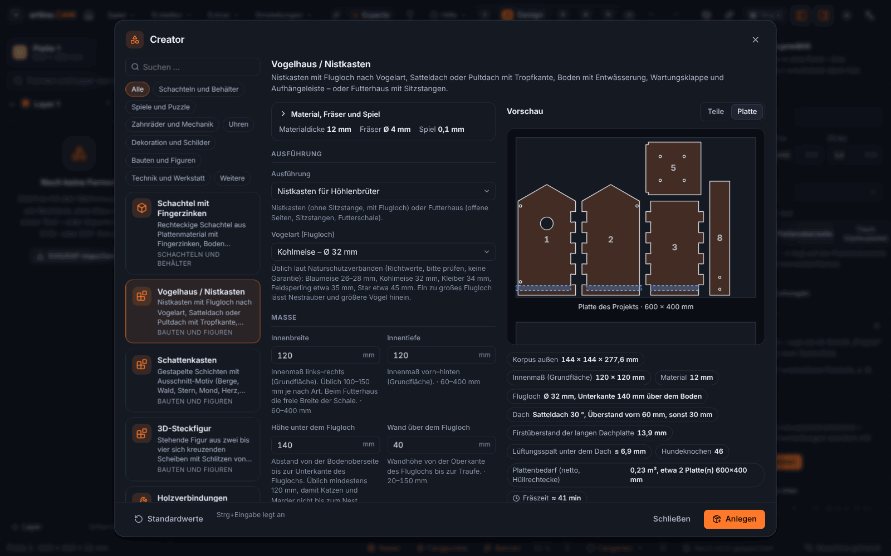</picture> | <picture><source media="(prefers-color-scheme: light)" srcset="docs/bilder/creator-zahnrad-light.png">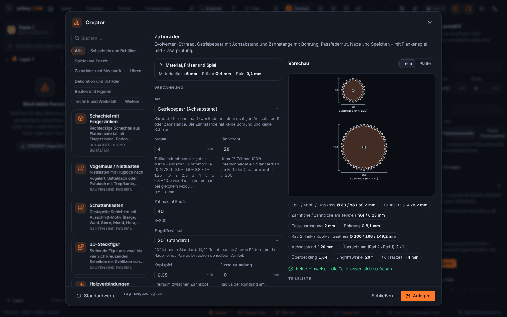</picture> |
| Fingerzinken, Boden in Nut, Schiebedeckel, Trennwände<br><sub>Box with finger joints, floor in a groove, sliding lid, dividers</sub> | Flugloch nach Vogelart (Richtwert, keine Garantie), Dach, Entwässerung<br><sub>Birdhouse with entrance hole by species</sub> | Evolventenverzahnung, Bohrung mit Passfedernut, Speichen<br><sub>Involute gear with keyway and spokes</sub> |

| Rosette | Türschild |
|:--:|:--:|
| <picture><source media="(prefers-color-scheme: light)" srcset="docs/bilder/creator-rosette-light.png">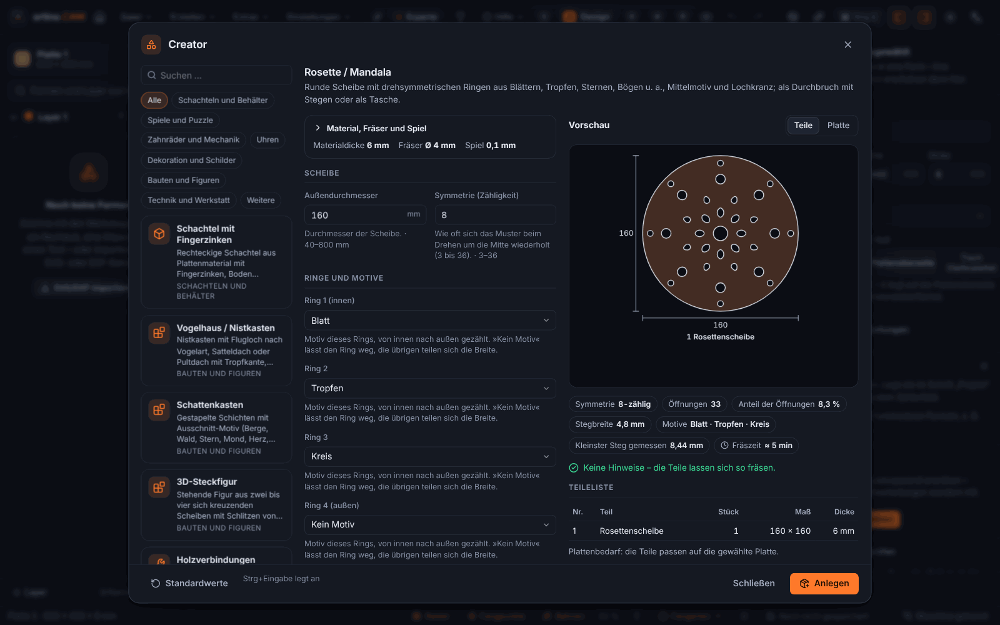</picture> | <picture><source media="(prefers-color-scheme: light)" srcset="docs/bilder/creator-schild-light.png">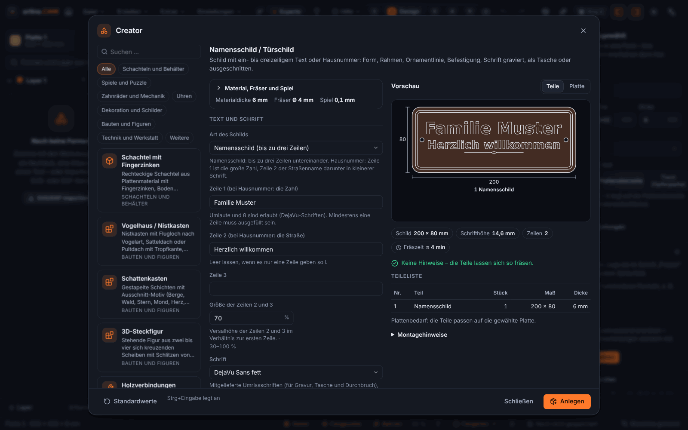</picture> |
| Drehsymmetrische Ringe, Durchbruch mit Stegen, damit nichts herausfällt<br><sub>Rotationally symmetric rings with bridges</sub> | Text, Rahmenlinie, Ornament, Befestigung; graviert, als Tasche oder ausgeschnitten<br><sub>Name sign with frame and mounting</sub> |

* **Ehrlich zum Stand:** Alle Creator wurden **nur mit Rust-Tests, Vitest-Tests, dem Simulator und Chromium** geprüft. **Kein Teil wurde gefräst, verleimt, zusammengesteckt oder aufgehängt.** Das **Spiel** (Richtwert 0,1 mm), Stegbreiten, Zahnflanken, Riemenrillen, die Teilung des Lineals und die Lesbarkeit des QR-Codes sind Rechenwerte, **an echtem Material nicht erprobt**; ein Probeschnitt im Reststück und der Passungs-Testcoupon kommen zuerst. Die **Vogelmaße** sind Richtwerte, wie Naturschutzverbände sie üblicherweise nennen (bitte prüfen), **ohne Garantie**, dass eine Art einzieht. Die Fräszeit ist eine grobe Schätzung. Nicht dabei: Tiere als Steckfiguren, der Eck-Schwalbenschwanz wie an Schubladen, Schrägverzahnung. Die Anleitung steht im [Wiki](https://github.com/KlapSC/ortino-cam/wiki/Creator).

#### Reihenfolge der Zustellungen: Teil für Teil oder Ebene für Ebene

<p align="center">
  <picture><source media="(prefers-color-scheme: light)" srcset="docs/bilder/zustellung-light.png">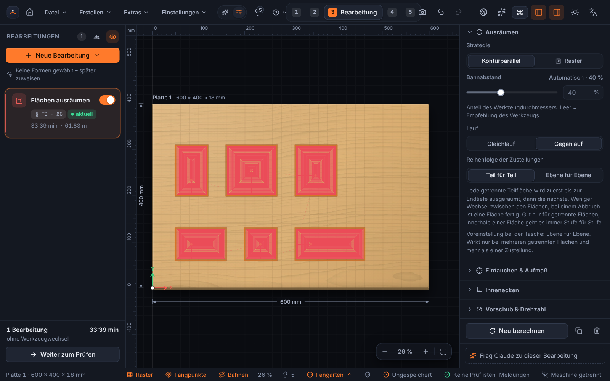</picture>
</p>

* Bei **mehreren Teilen und mehr als einer Zustellung** wählst du bei **Profil und Tasche** unter »Erweitert« (im Einfach-Modus hinter »Mehr Einstellungen«), ob jedes Teil bis zur Endtiefe gefräst wird, bevor das nächste folgt (**Teil für Teil**), oder ob erst alle Teile die erste Zustellung bekommen, dann die zweite und so weiter (**Ebene für Ebene**). Der Standard bleibt das bisherige Verhalten: beim Profil Teil für Teil, bei der Tasche Ebene für Ebene.
* **Warum Ebene für Ebene:** Bis zur letzten Stufe hängen alle Teile am Material; mit Haltestegen oder Restschicht bleibt die Platte stabil, und nichts löst sich, während die anderen Teile noch folgen. **Was es kostet:** mehr Leerfahrten, und bei einem Abbruch ist kein Teil fertig. **Gemessen** an drei Teilen von 40 × 30 mm, vier Zustellungen, Fräser Ø 6 mm: Eilweg im G-Code **1053 statt 2006 mm**, geschätzte Zeit **70 statt 89 Sekunden** (Rechnung im Programm, nicht gefräst).
* **Bisherige Projekte ändern sich nicht:** Der Standardwert steht nicht in der Datei; ein Test an elf mitgelieferten Beispielen und am Beispielprojekt `tuerschild.ocam` zeigt denselben G-Code **Byte für Byte**. Der Materialabtrag in der Simulation ist bei beiden Reihenfolgen am Ende derselbe.
* *Nur gegen Rust-Tests, die eigene Simulation und Chromium geprüft, nicht an einer Maschine; mit Kachelung und doppelseitigem Fräsen nur durch Durchsicht abgedeckt.* Mehr im [Wiki](https://github.com/KlapSC/ortino-cam/wiki/Bearbeitungen).

#### Startseite mit Schnellzugriffen und der Dialog KI-Modelle

| Startseite |
|:--:|
| <picture><source media="(prefers-color-scheme: light)" srcset="docs/bilder/startseite-light.png">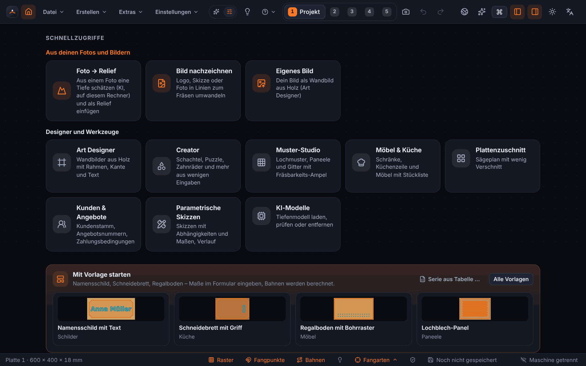</picture> |
| Home-Schaltfläche (`Alt+Pos1`), Karte »Dein Projekt«, 11 Schnellzugriffe<br><sub>Home page with quick access tiles</sub> |

* **Startseite:** Die **Home-Schaltfläche** (Haus neben dem Datei-Menü, `Alt+Pos1`) führt immer zurück, auch über einem Projekt in Arbeit (dann mit der Karte »Dein Projekt« und »Weiterarbeiten«); am Projekt ändert sich nichts. **11 Schnellzugriffe** in zwei Gruppen: **Aus deinen Fotos und Bildern** (Foto → Relief, Bild nachzeichnen, Eigenes Bild) und **Designer und Werkzeuge** (Art Designer, Creator, Muster-Studio, Möbel & Küche, Plattenzuschnitt, Kunden & Angebote, Parametrische Skizzen, KI-Modelle). Die Regel **»Eigenes zuerst«**: Wo du eine Quelle wählst (Relief-Studio, Muster-Studio, Art Designer, Menü »Erstellen«, Befehlspalette), stehen deine Fotos, Bilder und eigenen Bausteine vor den Generatoren. Das ändert nur die Reihenfolge der Anzeige.
* **KI-Modelle** (Extras ▸ KI-Modelle …): Das Tiefenmodell für »Foto → Relief« und das eigene Bild im Art Designer rechnet auf deinem Rechner. Der Dialog zeigt Zustand, Größe, Lizenz, Herkunft und Speicherort und bietet **Herunterladen** (mit Fortschritt, Abbrechen und Fortsetzen), **Erneut prüfen**, **Modelldatei einspielen** und **Entfernen**. **Es wird nie ohne deinen Klick geladen**, und dein Foto verlässt den Rechner nie.
* *Nur mit Vitest und Chromium gegen den echten Kern geprüft, mit einem Ersatzmodell und einem Ersatz für das Portal.* **Der Download des echten Modells (47,3 MB) vom echten Portal ist nicht geprüft**, nichts davon unter Windows (WebView2); ob `Alt+Pos1` dort ankommt, ist offen (die Schaltfläche und die Befehlspalette gehen in jedem Fall). Mehr im [Wiki](https://github.com/KlapSC/ortino-cam/wiki/KI-Modelle-und-Startseite).

#### Korrektur: Bögen über 180°

* **Behoben:** Das Hüllrechteck (Größe und Lage auf der Platte) und die Auflösung zu Linien rechneten Bögen mit mehr als 180° Öffnungswinkel falsch. Solche Bögen werden jetzt vorher in zwei gleiche Hälften auf demselben Kreis geteilt; Form und Flächeninhalt ändern sich dadurch nicht. Sichtbar wurde es bei den Creator-Teilen (Kreisabschnitte), es betrifft aber jede Kontur mit einem solchen Bogen. Ob Projekte aus 0.12.0 davon betroffen waren, ist nicht untersucht.

### Neu in 0.12.0: Skizzen mit Abhängigkeiten, Relief-Komponenten, Werkstatt

* **Parametrische Skizzen mit Abhängigkeiten und Verlauf** (Menü »Erstellen«): Punkte, Strecken, Kreise und Bögen mit 11 Abhängigkeiten (waagrecht, senkrecht, parallel, rechtwinklig, tangential, fest …) und Maßen als Zahl oder **Formel**; der Löser meldet Freiheitsgrade, überflüssige und widersprüchliche Abhängigkeiten mit Lösungsvorschlag. Verlauf zum Umbenennen, Ausschalten und Zurückrollen. Eigener Dialog (kein Skizzieren in der Hauptfläche, keine Splines).
* **Komponenten für Reliefs** (Relief-Studio, dritter Modus): Ebenen aus Profil (Kuppel, Kegel, Pyramide, Rampe, Welle, Rundstab), Muster oder Bild, kombiniert per addieren, abziehen, Maximum, Minimum, überblenden oder multiplizieren; Lage mit der Maus, Randglättung, Gruppen.
* **Werkstatt-Ordner, Rollen und Dashboard** (Menü »Extras«): gemeinsamer Ordner (z. B. auf dem NAS) mit Personen und Rollen (Ansehen, Bedienen, Verwalten), gemeinsamer Bibliothek (Schnittdaten, Fräser, Reststücke) und einem Dashboard aus Job-Protokoll, Wartung und Lager. **Alles lokal, nichts im Portal.** Rollen schützen vor Fehlbedienung, nicht vor Dateizugriff.

| Parametrische Skizzen | Komponenten | Werkstatt-Dashboard |
|:--:|:--:|:--:|
| <picture><source media="(prefers-color-scheme: light)" srcset="docs/bilder/skizzen-light.png">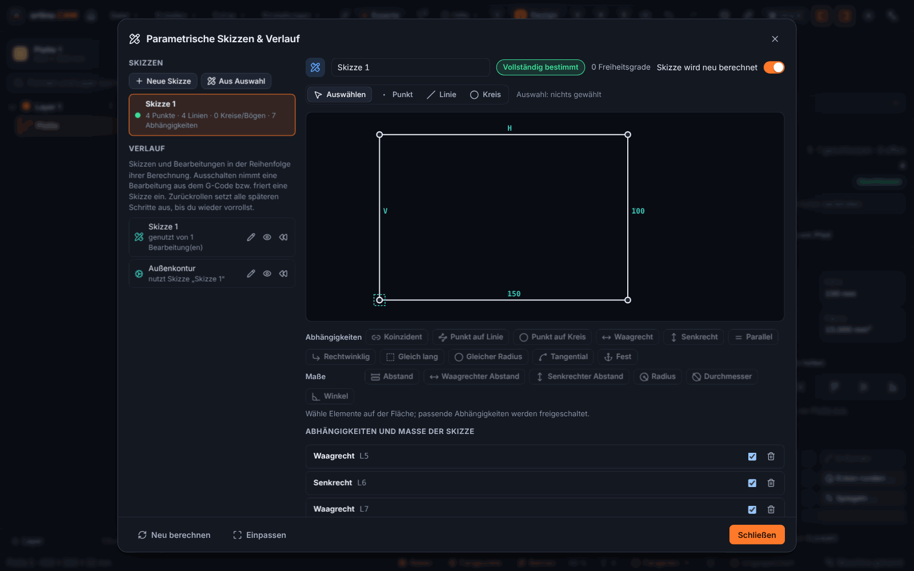</picture> | <picture><source media="(prefers-color-scheme: light)" srcset="docs/bilder/komponenten-light.png">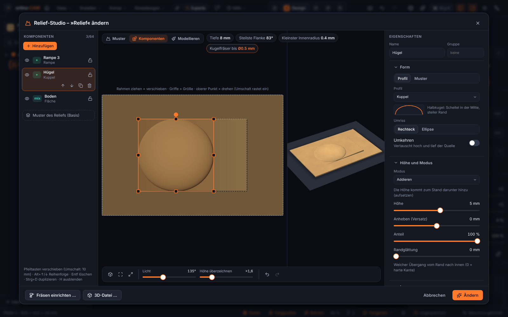</picture> | <picture><source media="(prefers-color-scheme: light)" srcset="docs/bilder/werkstatt-light.png">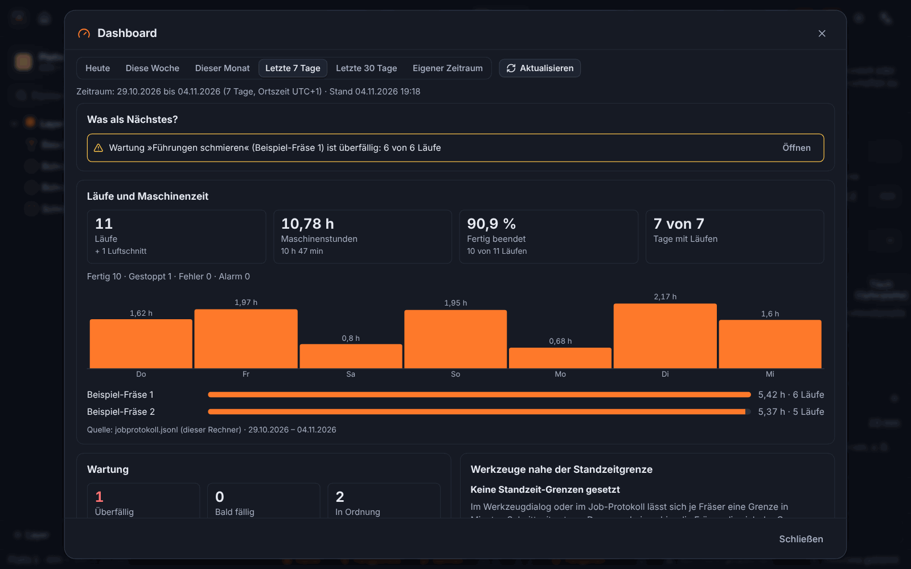</picture> |
| Zeichenfläche, Abhängigkeiten und Maße, Freiheitsgrade, Verlauf<br><sub>Sketch with constraints, dimensions, degrees of freedom and history</sub> | Liste der Ebenen mit Quelle und Modus, Lage in der Draufsicht<br><sub>Relief components: list of layers, source and mode, placement in the top view</sub> | Läufe, Maschinenstunden, Wartung, Lager, offene Angebote (erfundene Beispieldaten)<br><sub>Workshop dashboard (made-up sample data)</sub> |

* **Ehrlich zum Stand:** **Nichts gefräst.** Nur gegen Tests und den Browser (Chromium) geprüft; Skizzen nicht mit einem CAD-Programm verglichen, der Werkstatt-Ordner nicht auf einem echten Netzlaufwerk und nicht unter Windows (WebView2). Vollständig: [Release-Hinweise 0.12.0](release-notes/0.12.0.md).

### Neu in 0.11.0: Export, Schablonen, Angebote und Sägeplan

* **3D-Export (STL und 3MF)** für importierte Modelle, Möbelteile (als Plattenkörper, ohne Bohrungen und Griffe) und Reliefplatten, auch das Bild des Art Designers; Datei-Menü, Möbel-Designer, Relief-Studio, Kommandozeile `ortino export --format 3mf`. **DXF-Splines bleiben Kurven** (Béziers mit Knoten, höchste Abweichung 0,01 mm), und der DXF-Export schreibt Bézier-Konturen wieder als SPLINE, wenn der Rückweg verlustfrei ist.
* **Schablonen-Schrift mit Stegen:** Inseln in O, A, B, D, P, Q, R, 8 bleiben über schmale Brücken am Umfeld; Breite, Stegzahl und Richtung einstellbar, jedes Ergebnis wird nachgeprüft.
* **Kundenstamm, Angebotsnummern, Zahlungsbedingungen:** Kunden mit Nummer und Anschrift, fortlaufende Angebotsnummern mit Revisionen, Fälligkeit, Skonto und Anzahlung, Angebots-PDF mit Adressblock. **Alles bleibt auf dem Rechner** (nichts im Portal, nichts bei Claude).
* **Plattenzuschnitt mit Optimierer (Sägeplan):** Teile mit Maserung, Schnittfuge, Besäumrand, Plattenbestand mit Preisen und Reststücken so verteilen, dass sich alles mit durchgehenden Schnitten sägen lässt. Der Optimierer ist nie schlechter als der einfache Zuschnitt; in einer Rechnung mit 24 Zufallsaufgaben sparte er 7 von 97 Platten.

| Kunden &amp; Angebote | Plattenzuschnitt | Schablone mit Stegen | Export STL/3MF |
|:--:|:--:|:--:|:--:|
| <picture><source media="(prefers-color-scheme: light)" srcset="docs/bilder/kunden-light.png">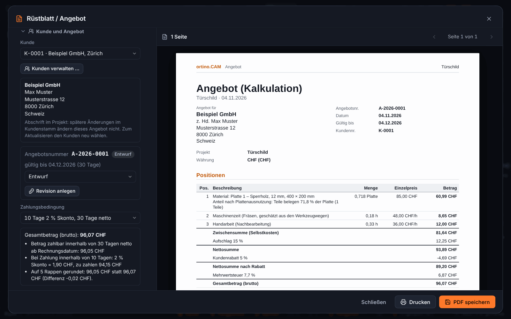</picture> | <picture><source media="(prefers-color-scheme: light)" srcset="docs/bilder/zuschnitt-light.png">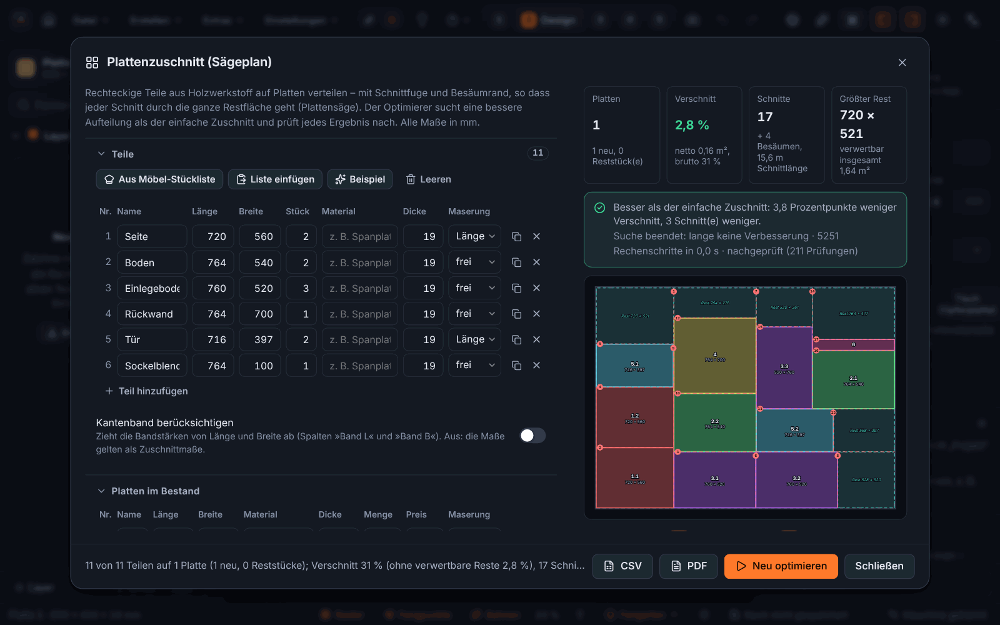</picture> | <picture><source media="(prefers-color-scheme: light)" srcset="docs/bilder/schablone-light.png">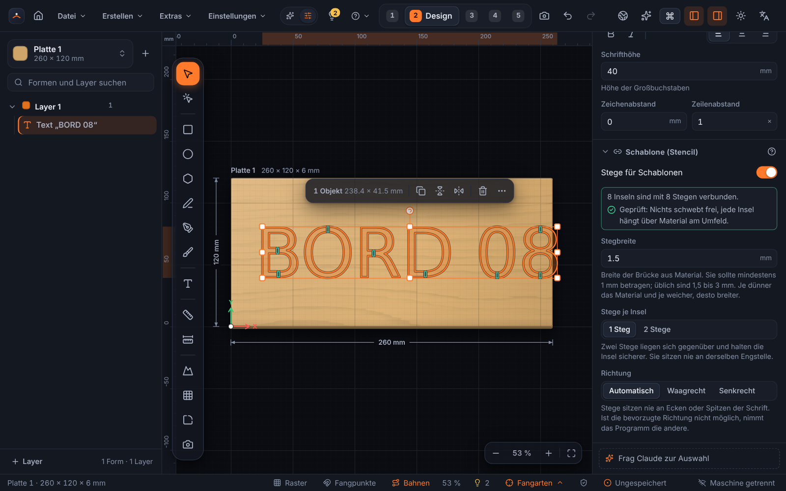</picture> | <picture><source media="(prefers-color-scheme: light)" srcset="docs/bilder/export-light.png">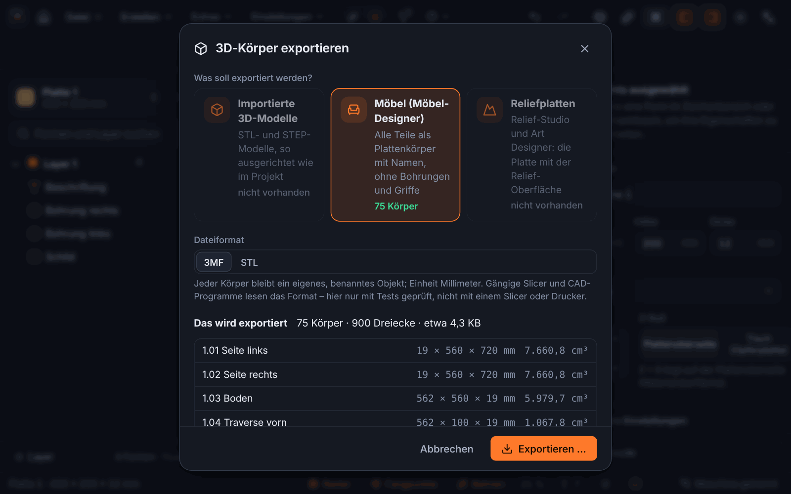</picture> |
| Kundenstamm, Angebotsnummern, Zahlungsbedingungen (erfundene Daten)<br><sub>Customers, quote numbers, payment terms (made-up data)</sub> | Sägeplan mit Schnittfolge und Optimierer<br><sub>Cutting plan with cut sequence and optimizer</sub> | Inseln bleiben über Stege am Umfeld<br><sub>Islands stay attached through bridges</sub> | Quelle wählen, Körper und Hinweise ansehen, speichern<br><sub>Choose the source, check bodies and notes, save</sub> |

* **Ehrlich zum Stand:** **Nichts gefräst, gesägt oder gedruckt.** Nur gegen Tests und den Browser (Chromium) geprüft; 3MF/STL nicht mit einem Slicer, der Sägeplan nicht an einer echten Säge, CSV nicht in Excel, nicht unter Windows (WebView2). Vollständig: [Release-Hinweise 0.11.0](release-notes/0.11.0.md).

### Neu in 0.10.0: eigenes Bild im Art Designer

* **Eigenes Bild** (Schritt »Motiv«, Abschnitt »Eigenes Bild«): PNG, JPEG oder WebP wählen oder auf den Dialog ziehen. Die Helligkeit des Bildes ist die Höhe (hell = hoch). **Lage, Größe und Drehung** per Regler, in der Draufsicht auch mit Maus und Mausrad. **Verschwimmen mit dem Muster:** ganzes Bild, linke, rechte, obere oder untere Hälfte oder Mitte, mit einstellbarer Grenze, Weichheit und Bildanteil. Dazu Kontrast, Gamma, Weichzeichnen und Invertieren. Im Modus Geschnitzt und Schichtholz; für Fotos optional »Tiefe schätzen (KI)«, wenn das Tiefenmodell von »Foto → Relief« vorhanden ist. Mit dem Assistenten (Claude) bedienbar (`motif.image`).
* **Behoben:** Die Handy-Fernbedienung konnte unter Windows zufällig mit »Windows oder eine Schutzsoftware erlaubt dem Programm nicht, … zu lauschen« nicht starten (zufälliger Port in einem von Windows reservierten Bereich); beschädigte Vectric-Werkzeugdateien (`.vtdb`) führten zu einem Abbruch.
* **Ehrlich zum Stand:** **Nichts gefräst oder verleimt.** Nur gegen Tests, den Browser (Chromium) und den echten Kern geprüft, **nicht unter Windows (WebView2), nicht die KI-Schätzung mit echtem Modell, nicht mit echten Fotos oder Gesichtern.** Ein Gesicht von vorn ergibt als Helligkeit nur ein flaches Relief; Seitenansichten und Bilder mit klaren Hell-Dunkel-Flächen gelingen besser. Bei Fotos von Personen braucht man das Einverständnis der Abgebildeten, bei fremden Bildern die Erlaubnis des Urhebers.

### Neu in 0.9.0: Art Designer (Wandbilder aus Holz)

* **Art Designer** (Menü »Erstellen → Art Designer …«): ein Dialog in fünf Schritten, der aus **Format** (A-Reihe, Poster, Quadrat, Panorama, eigene Maße), **Motiv**, **Rahmen und Kante**, **Text und Signatur** ein fräsbares **Wandbild** macht, mit 3D-Vorschau der ganzen Platte. Acht Motive: **Blattstrom, Blattzweig, Monstera, Ginkgo, Farn, Palmwedel, Federfächer** und **Fließende Bänder**; Regler für Größe, Dichte, Weichheit, Variation, Zufall und Tiefe. Hinweise unter der Vorschau, zum Beispiel zu steilen Flanken und zum Kugelfräser (»bis Ø …«). »Einfügen« ist ein Rückgängig-Schritt; »Einfügen und Fräsen einrichten« legt Schruppen und Schlichten an.
* **Schichtholz-Modus:** Das Motiv wird in 3 bis 24 Lagen aus Sperrholz (3, 4 oder 6 mm) zerlegt, dazu eine Rückwand; Passstifte, Nummern, optional eine Klebehilfe, Verteilung der Teile auf Sperrholzplatten und ein **Montageplan** (kopierbar). Auslauf und Fase entfallen, die Schrift bleibt. Passt ein Teil nicht auf die gewählte Platte, meldet das Programm einen Fehler mit Lösung und sperrt »Einfügen«.
* **Nur im Programm,** nicht im Web-Designer des Portals. Mit dem Assistenten (Claude) und der lokalen Schnittstelle bedienbar (`art.*`).
* **Ehrlich zum Stand:** Die Fräsbarkeit ist **gerechnet, nicht gefräst**; nichts wurde verleimt. Nur gegen Tests, den Simulator und Chromium geprüft, **nicht unter Windows (WebView2), nicht an einer echten Maschine**. Die Motive sind eigene, am Rechner erzeugte Muster und nicht alle gleich gelungen (Monstera am schwächsten; Ginkgo und Farn haben im Schichtholz sehr dünne Stege; die oberste Lage besteht meist nur aus dem Rahmen). Mehr im [Wiki](https://github.com/KlapSC/ortino-cam/wiki/Art-Designer).

### Neu in 0.8.2: englische Oberfläche durchgehender, Werkzeugnummer 0 behoben, Video-Anleitungen in der Hilfe

* **Englische Oberfläche auch im Kern.** Namen und Hinweise der mitgelieferten Maschinen, Beschreibungen der Postprozessoren, Standardnamen (Projekt, Platte, Bearbeitungen, Werkzeuge), Beschriftungen der Rückgängig-Liste, Kommentare im G-Code, häufige Konsolenmeldungen, Alarmtexte der Steuerung und die Meldungen der Prüfliste folgen der Sprache der Oberfläche. Deutsch bleibt unverändert, auch der deutsche G-Code. Bereits gespeicherte Namen werden nie übersetzt. **Nicht alles ist übersetzt:** die meisten Fehlermeldungen des Küchen-Designers, Warnungen der Bearbeitungen, viele Fehlertexte und einzelne Teilprüfungen bleiben deutsch.
* **Werkzeugnummer 0 behoben:** Fräser aus der Bibliothek und Standardfräser kamen als »T0« ins Projekt, die es an der Maschine nicht gibt; sie bekommen jetzt die nächste freie Nummer.
* **Kleinere Korrekturen** der englischen Oberfläche (Zahlenformate, Hinweisleiste, Kachelung, Relief-Studio bei 1280 px Breite, Beschriftung auf der Handy-Seite).
* **Hilfe → »Video-Anleitungen«:** 36 kurze Videos (5 bis 20 Sekunden, englisch beschriftet, ohne Ton); abgespielt wird erst nach einem Klick, aus dem Internet. Dieselben Videos stehen im [Wiki](https://github.com/KlapSC/ortino-cam/wiki/Videos).
* **Ehrlich zum Stand:** nur gegen Tests, den Simulator und Chromium geprüft, **nicht unter Windows (WebView2), nicht an einer echten Maschine**. Die Videos wurden vor diesen Korrekturen aufgenommen und zeigen teils noch deutsche Namen oder »T0«.

### Neu in 0.8.0: Marktplatz im Portal (standardmäßig aus), Auffindbarkeit und Besucherstatistik, Schnittstelle für die Handy-App

* **Marktplatz im Portal (Punkte).** Designs und neue **Schnittdaten-Sätze** (Vorschub, Drehzahl, Zustellung je Fräser und Material) lassen sich gegen **Punkte** verkaufen. Punkte sind **keine Währung** (kein Geld, kein Zahlungsanbieter); 10 % verfallen, keine Rückgabe, Erstattung nur bei Mangel nach Prüfung. Verkaufen dürfen nur freigeschaltete Konten, jedes bezahlte Angebot wird vorher geprüft. **Der Marktplatz ist ausgeschaltet** und lässt sich erst einschalten, wenn der Betreiber die Rechtstexte (bisher Entwürfe ohne Prüfung durch eine Fachperson) bestätigt hat. Das Windows-Programm kann bezahlte Designs nicht kaufen; es zeigt eine lesbare Meldung mit Link zum Kauf im Browser.
* **Auffindbarkeit und Besucherstatistik im Portal:** Sitemap als Index, `llms.txt`, Webmaster-Codes, strukturierte Daten, IndexNow (für Bing und andere, nicht für Google) und eine **Besucherstatistik ohne Cookies** (Plausible oder Matomo), alles standardmäßig aus oder leer und nur nach ausdrücklicher Einstellung des Betreibers.
* **Schnittstelle für die kommende Handy-App:** Die Handy-Fernbedienung kann ein Design aus dem Portal **an den Rechner senden** (es öffnet sich erst nach deiner Bestätigung am Rechner) und das **Rüstblatt** (Material, Nullpunkt, Werkzeuge, Spannhinweise) **nur lesen**; beides lässt sich je Handy ausschalten. Es gibt noch keine Handy-App, die das nutzt; die Schnittstelle ist nur mit Tests und dem Simulator geprüft.
* **Ehrlich zum Stand:** Alles Neue ist nur gegen lokale Server mit PostgreSQL, den Mock-Server des Portals, den Simulator und Chromium geprüft; **nicht mit echten Nutzern, nicht mit echter Zahlung von Punkten, nicht mit Plausible, Matomo, IndexNow oder der Google Search Console, nicht an einer echten Maschine**. Änderungen am Zeichnen, Berechnen und Fräsen gibt es nicht.

### Neu in 0.7.0: erweitertes Fangen, Bemaßung, Modellieren, Kachelung, Maschinenprofile aus der Community, Boosts, Startseite und Live-Bearbeitung im Portal

* **Erweitertes Fangen im 2D-Editor.** Der Zeiger rastet zusätzlich auf Schnittpunkten, Verlängerungen (Endpunkt kurz überfahren), Lot, Tangenten, senkrechten und parallelen Spuren, Polar 45° mit Winkel und auf der Kontur; jede Art hat eigene Form, Farbe und Kurztext, je Art abschaltbar. Nur in Tests und Chromium gesehen, nie mit Touch oder Stift.
* **Bemaßung** (Werkzeug `D`): Maße waagerecht, senkrecht, ausgerichtet, Radius, Durchmesser, Winkel und Bogenlänge, an Formen gebunden (sie folgen beim Verschieben und Skalieren), Export nach SVG und DXF. Reine Beschriftung ohne Werkzeugwege; nicht im Rüstblatt und im PDF; die Exporte wurden in keinem fremden CAD-Programm geöffnet.
* **Modellieren von Reliefs** mit dem Pinsel (Aufbauen, Abtragen, Glätten, Einebnen, Schärfen) auf bis zu 8 Modellier-Ebenen über dem parametrischen Relief, Rückgängig je Strich, Einbacken. Nie gefräst; im Web-Designer gesperrt. Anleitung: [Reliefs modellieren](https://github.com/KlapSC/ortino-cam/wiki/Modellieren-von-Reliefs).
* **Kachelung großer Teile:** Platten größer als der Verfahrweg werden in Kacheln mit Überlappung zerlegt, mit einem Programm je Kachel und zwei Passmarken für den Nullpunkt der nächsten Kachel; der Start-Check prüft die Nullung. **Nie an einer echten Maschine gefräst**, die Naht ist nicht erprobt. Anleitung: [Große Teile kacheln](https://github.com/KlapSC/ortino-cam/wiki/Grosse-Teile-kacheln).
* **Maschinenprofile aus der Community** laden und teilen (nur technische Angaben, nie überschreibend, als »ungeprüft« gekennzeichnet; »bestätigt von n Nutzern« ist eine Angabe von Konten, keine Prüfung).
* **Portal:** neue Startseite als Produktseite (die Community-Übersicht liegt unter `/designs`), **Boosts und Punkte** (4 Boosts je Kalendermonat, Punkte für Ersteller, kein Geld, noch kein Shop), Community-Maschinenprofile und **Live-Bearbeitung** geteilter Entwürfe (nur wenn der Besitzer es erlaubt). Dazu Korrekturen aus einer eigenen Sicherheitsprüfung des Portals (kein Penetrationstest). Alles nur gegen lokale Server, Mock und Chromium geprüft, nie mit echten Nutzern.
* **Kleinere Verbesserungen:** Schrägfahrten (X und Y zugleich) an der Handy-Fernbedienung, ein Schnellzugriff »Steuerung« (Referenzfahrt, Entsperren, Nullpunkt XY, Zu X0 Y0) im Schritt »Fräsen« und Korrekturen im Küchenplaner (Schubkastenteile, Griffleiste in 3D und Frontansicht).
* **Neue Portal-Adresse:** Das Programm fragt Portal und Updates ab 0.7.0 bei `https://ortino-cam.com` ab.

### Neu in 0.6.0: Entwürfe teilen, Foto → Relief, EPS-Import, doppelseitig mit Anschlag, Loungesessel und Drehstuhl

* **Portal: Entwürfe teilen und abwechselnd bearbeiten.** Einladung an ein bestehendes Konto (Ansehen oder Bearbeiten), immer schreibt nur eine Person (Sperre mit Übergabe), Konfliktschutz statt stillem Überschreiben, Link zum Ansehen für Kunden, Betrachter dürfen herunterladen und kopieren. Dazu eine Karte »Web-Designer« in der Administration (Last, Zähler, Empfehlungen). Anleitung: [Web-Designer im Portal](https://github.com/KlapSC/ortino-cam/wiki/Web-Designer-im-Portal). Nie von mehreren echten Menschen benutzt; braucht ein Portal mit dem Server-Image 0.6.0.
* **Foto → Relief.** Ein kleines KI-Modell (Depth Anything V2 Small) schätzt die Tiefe eines Fotos **auf deinem Rechner** (das Foto verlässt ihn nie) und legt ein Relief an. Das Modell (47 MB) wird beim ersten Gebrauch vom Portal geladen. **Eine Schätzung, keine echte Geometrie**; bei frontal fotografierten flachen Motiven schwach; nur mit selbst gebauten Szenen geprüft. Anleitung: [Foto → Relief](https://github.com/KlapSC/ortino-cam/wiki/Foto-zu-Relief).
* **Import von EPS, PostScript und alten Illustrator-Dateien** (`.eps`, `.ps`, `.ai` ohne PDF-Teil) mit eigenem, begrenztem PostScript-Leser; DWG wird weiterhin nicht gelesen (Hinweis: als DXF speichern). Es stand keine echte Illustrator-Datei zur Verfügung.
* **Doppelseitig fräsen:** Die Simulation rechnet beide Seiten zusammen, und das Wenden geht auch **an einer Anschlagkante** statt mit Passstiften. Nur Simulator und Tests.
* **Loungesessel und Drehstuhl** im Möbel-Designer: der Loungesessel aus Sperrholz-Konturen (Kissen nur als Zukaufteil), der Drehstuhl mit Sitz und Lehne aus Platte und **Zukaufteilen** (Drehkreuz, Gaslift, Rollen; generische, ungeprüfte Einträge in der Beschlagbibliothek). Die Prüfungen sind Hinweise, kein Festigkeitsnachweis; nichts davon gebaut oder belastet.

### Neu in 0.5.0: Küchen- und Möbel-Designer im Browser (Web-Designer im Portal)

* **Neu:** Der Küchen- und der Möbel-Designer laufen auch **im Community-Portal, im Browser und ohne Installation** (Einstieg *Küche & Möbel entwerfen*, Adresse `/designer/` des Portals). Derselbe Designer wie im Programm, mit 3D-Vorschau, Rendering, Prüfliste, Stückliste (CSV/HTML), Zuschnitt, Varianten und Kundenblatt. Dazu ein Konto mit bestätigter E-Mail-Adresse.
* **Entwürfe im Konto:** Speichern, Öffnen, Umbenennen, Herunterladen und Löschen privat im eigenen Konto (bis 30 Entwürfe, zusammen 40 MB). **Herunterladen als `.ocam`** und im Programm weiterbearbeiten, fräsen und umgekehrt eine `.ocam` im Browser öffnen. Fräsen, Maschine, G-Code und Dateizugriff gibt es im Web **nicht**. Anleitung: [Web-Designer im Portal](https://github.com/KlapSC/ortino-cam/wiki/Web-Designer-im-Portal) im Wiki.
* **Das Windows-Programm ist gegenüber 0.4.2 unverändert;** der Web-Designer braucht ein Portal mit dem **Server-Image 0.5.0**. Der Server rechnet in einer abgeschotteten Umgebung je Nutzer (feste Liste erlaubter Aufrufe, Größen- und Zeitgrenzen).
* **Ehrlich zum Stand:** nur gegen Tests und in Chromium geprüft; nicht mit mehreren Nutzern gleichzeitig, nicht auf dem NAS des Betreibers unter Last, nicht in anderen Browsern, nicht mit einem echten Mailserver. Nichts aus den Designern wurde gefräst oder gebaut.

### Neu in 0.4.2: drei Korrekturen (Schubkästen in der 3D-Vorschau, Fräserwahl und Höhe beim Planen der Opferplatte)

* **Behoben:** In der 3D-Vorschau der Küche (mit »Schubkästen erzeugen«) und der Möbel (Nachttisch, Kommode, Highboard, Sideboard, Schreibtisch-Container) saß der Schubkasten **versetzt zur Front**: nicht mittig zwischen den Seiten und zu tief, teils im Zwischenboden. Die Teile, Maße, Stückliste und Fräsdaten waren richtig, nur die Anzeige. Nur in Chromium geprüft, nicht unter Windows (WebView2).
* **Behoben:** Beim **Planfräsen** und bei **»Opferplatte planen«** schlägt der Assistent jetzt zuerst **deinen eigenen Planfräser** vor (angelegt als Planfräser, mit »Planfräser« im Namen oder ab 12 mm Durchmesser); bisher bekam ein Katalog-Planfräser (zum Beispiel von Amana) oft den Vorzug. Nur gegen Tests und Simulator geprüft.
* **Behoben:** **»Opferplatte planen« mit festem Taster:** Der Fräser stand um die Plattendicke zu hoch (bei 16 mm Platte und 0,5 mm Abtrag auf 15,5 mm statt auf −0,5 mm); die Tiefen zählen jetzt bei der Opferplatte immer ab ihrer Oberseite. Nicht an einer echten Maschine geprüft: erst im Luftschnitt ohne Fräser prüfen.

### Neu in 0.4.1: Opferplatte markieren, neue Tisch-Ansicht, Geräte und Raum in der Küche, mehr Möbel

* **Opferplatte markieren:** Ein Assistent fräst **Nullpunkt-Kreuz und Rahmen, Lineal mit Zahlen, Anschlag-Linien und ein Lochraster** in die Opferplatte, damit sich Werkstücke nach Augenmaß legen und Spannmittel setzen lassen. **Gravur- und Lochtiefe sind frei einstellbar** (zum Beispiel »nur anbohren« mit 2 mm); jede Tiefe wird gegen die gemessene Dicke der Opferplatte und einen Mindestrest geprüft, ein Durchfräsen in den Tisch lässt das Programm nicht zu. Die Lage ist auf die Maschine bezogen (Referenzposition), der Start-Check verlangt XY-Null dort. Anleitung: [Opferplatte markieren](https://github.com/KlapSC/ortino-cam/wiki/Opferplatte-markieren) im Wiki.
* **Tisch-Ansicht neu gestaltet:** Tisch, Opferplatte, Werkstück, Lineal, Referenzposition, Taster, Werkzeug mit Spur und Ziel, Legende; auch die Markierungen der Opferplatte (geplant gestrichelt, gefräst kräftig). Die Lage bleibt auf die Rechnung genau.
* **Küchen-Designer:** **Gerätenischen** (Geschirrspüler, Backofen, Kühlschrank, Mikrowelle, Dunstabzug), **Raum & Aufmaß** (Wände, Fenster, Türen, Anschlüsse), **L-/U-Küche und Kochinsel**, dazu eine **Prüfliste** (Gerät passt, Abstände, Türaufschlag, Durchgang, Hängeschrank vor Fenster ...).
* **Möbel-Designer:** sechs neue Arten (Kommode, Highboard, Nachttisch, Schreibtisch, Garderobe, Schuhbank, jetzt 19 Arten), **Fingerzinken**, neue Prüfungen (Kippsicherung, Schubladen, Schreibtisch-Ergonomie, Wandbefestigung, Verwindung).
* **Behoben:** V-Carving und Inlay auf großen Formen laufen nicht mehr weit über das Zeitlimit hinaus.
* *(Alles Neue nur gegen Tests, Simulator und Chromium geprüft: **keine Markierung gefräst, kein Möbelstück gebaut, keine Küche mit Geräten eingebaut**; Maße, Abstände und Richtwerte der Prüfungen sind Annahmen, kein Nachweis.)*

### Neu in 0.4.0: 3D-Import, Möbel-Designer, Küche speichern und fortsetzen

* **3D-Modelle importieren (STL, STEP):** *Datei ▸ 3D-Modell importieren …* oder die Datei ins Fenster ziehen. Ansicht in 3D auf der Platte, Seite oben wählen, drehen, spiegeln, Einheit und Maßstab, einpassen. Umwandlung als **3D-Relief** (Höhenfeld von oben, direkt aus dem Netz gerechnet), **Umriss als Form** (Schatten von oben, auf Wunsch mit Profil) oder **Schichtmodell** (Lagen in Plattenstärke). Eine Prüfliste mit Lösungen meldet zu groß, zu hoch, Hinterschneidungen und Löcher im Netz. Der **STEP-Import ist eigener Code** und zeigt einen Bericht, welche Flächen angekommen sind. Anleitung: [3D-Modelle importieren](https://github.com/KlapSC/ortino-cam/wiki/3D-Modelle-importieren) im Wiki.
* **Möbel-Designer:** neben der Küche Esstisch, Couchtisch, Beistelltisch, Satztische, Sideboard/Lowboard, Bücher-, Leiter-, Modul- und Wandregal, Hocker, Plattenhocker, Sitzbank und Sperrholzstuhl, **leimlos steckbar** oder klassisch verbunden, mit sechs Stilvorlagen, Essgruppen-Assistent, Aufstellung im Grundriss, Prüfungen (Kippen, Durchbiegung, Stege) mit genannten Annahmen und einer Möbelszene im Rendering.
* **Küche speichern, öffnen, fortsetzen:** Speicherstand im Designer, Dateimenü, Weiterarbeiten nach dem Öffnen; **Varianten** in einer Datei, ganze Küche als Vorlage, Schränke zwischen Projekten kopieren, **Kundenblatt** zum Drucken oder als PDF.
* **Beschlagbibliothek:** 41 Einträge (Griffe, Scharniere, Auszüge, Bodenträger, Sockelfüße, Verbinder) mit Bezugsquelle bei Jumbo, Bauhaus.ch und Hettich; bei der Stückliste mit Bezug und eigenem Preis. Die Einträge sind überwiegend **ungeprüft** und kein Datenblatt-Abgleich.
* **Behoben:** Muster, die die Topfbohrung eines Scharniers anschnitten (jetzt Prüfung), Werte der alten Griffart nach dem Wechsel, Platzhalter-Griffe bei festen Fronten in der Stückliste, Mustergruppen in Bausteinen.
* *(Alles Neue nur gegen Tests, Simulator und Chromium geprüft: **kein importiertes Modell und kein Möbelstück wurde gefräst oder gebaut, der STEP-Import hat nie eine echte CAD-Datei gelesen**, die Möbel-Prüfungen sind Hinweise aus einfachen Formeln und kein Festigkeitsnachweis.)*

### Neu in 0.3.14: Küchenplaner (Farben, Griffe, Reliefs, Rendering) und Touch

* **Anschlag bei Hochschränken** getrennt für die untere und die obere Tür wählbar.
* **Farben und Oberflächen:** Farbe und Glanzgrad (matt, seidenmatt, Hochglanz) für die ganze Küche, einen oder mehrere markierte Schränke; dreizehn Farbfelder mit dunklen Tönen (Schwarz, Anthrazit, Graphit …) und freie Hex-Farbe. Die Ansicht »Echtfarben« zeigt sie in 3D und Frontansicht, die Oberfläche steht in Stückliste, Zuschnitt und Rüstblatt.
* **Griffe:** Bügelgriff, Stangengriff, Knopf, Muschelgriff und Profilgriff mit Ausrichtung, Lage und Oberfläche; als Körper in der 3D-Vorschau, als Zukaufteile in der Stückliste, mit Prüfungen.
* **3D-Reliefs auf Fronten:** parametrische **Wellen** (Richtung, Wellenlänge, Tiefe, Profil, Phase, Mäander, Querwellen), **Lamellen, Rauten, Ripples, Dünen**. **»Muster über Auswahl«** legt ein Relief über mehrere Fronten, zum Beispiel drei Hochschränke: ein durchgehendes Muster ohne Wiederholung je Front. Die Fertigung läuft über die normale 3D-Bearbeitung.
* **Rendering exportieren:** ein Bild der Küche mit **Licht** (Tageslicht, Abend, Studio, LED-Streifen unter den Hängeschränken), **weichen Schatten**, **Glanz** lackierter Fronten, eingebauter **Spüle mit Armatur**, Boden, Wänden und Spritzschutz; PNG oder JPEG bis 4K und mehr. Ein schnelles WebGL-Bild, **kein fotorealistischer Render**; Bildschirmfarben sind keine Farbmuster. Anleitung: [Küchen-Rendering](https://github.com/KlapSC/ortino-cam/wiki/Kuechen-Rendering) im Wiki.
* **Touch und Stift:** Einstellung *Darstellung & Sprache ▸ Touch-Bedienung*; Tippen, Ziehen, Langdruck-Menü, Pinch und Verschieben, große Bedienelemente; **an der Maschine bleiben alle Sperren, es gibt kein Dauerfahren per Finger**. Das Fenster darf jetzt 760 px schmal sein (Tablet im Hochformat). Anleitung: [Touch und Stift](https://github.com/KlapSC/ortino-cam/wiki/Touch-und-Stift) im Wiki.
* *(Alles Neue nur gegen Tests, Simulator und Chromium geprüft: gefräste Reliefs und Griffbohrungen sind nicht gefräst, das Rendering lief nie auf einer echten Grafikkarte, Touch nur als Emulation in Chromium.)*

### Neu in 0.3.12: Sicherung im Portal, Werkzeugwechsel »Automatisch«, »Meine Maschine«

* **Sicherung im Portal** (Menü **Einstellungen ▸ Sicherung im Portal …**): Eigene **Maschinenprofile**, **Meine Fräser** und eine feste Auswahl der **Programmeinstellungen** lassen sich auf Knopfdruck privat im eigenen Portal-Konto sichern und auf demselben oder einem anderen Rechner wieder abrufen – nach einer Neuinstallation oder um Büro und Werkstatt abzugleichen. Abrufen zeigt zuerst eine **Vorschau**; *Zusammenführen* nimmt nur Neues, *Ersetzen* legt vorher eine lokale Kopie an. Bis zu 10 Stände je Art. **Nie** gesichert werden Passwörter, Schlüssel, Anschlüsse, Adressen und Dateipfade. Braucht ein Portal ab Version 0.3.12. Anleitung: [Sicherung im Portal](https://github.com/KlapSC/ortino-cam/wiki/Sicherung-im-Portal) im Wiki. *(Gegen einen echten Portal-Server mit Datenbank und im Browser (Chromium) geprüft; noch nicht gegen das Portal im Internet und nicht unter Windows.)*
* **Werkzeugwechsel »Automatisch«:** Wer den **festen Taster** eingerichtet hat, wechselt das Werkzeug am Taster, ohne Ort und Suchwerte noch einmal anzugeben; ohne Taster bleibt es bei der Pause. Eine ausdrücklich gespeicherte Wahl (auch »Pause«) bleibt unverändert; der Start-Check zeigt, was gilt, und »Stattdessen Pause« schaltet für das Projekt um. *(Nur gegen Tests und Simulator geprüft; der Wechsel am festen Taster mitten im Programm ist nie an einer echten Maschine erprobt.)*
* **»Meine Maschine«:** Fester Taster, Opferplatte, Kamera-Kalibrierung und Zubehör gehören zur Maschine, nicht zum Projekt. Steht die Maschine in deiner Liste und ist die Standardmaschine, bekommt **jedes neue Projekt** die Einrichtung mit. Für eine mitgelieferte Vorlage gibt es den Knopf **»Als meine Maschine speichern«**, für ältere Projekte **»Einrichtung der Maschine aus der Liste übernehmen«**.
* **Ein Design aus der Community überschreibt deine Maschine nicht mehr.** Beim Öffnen gilt standardmäßig **deine eigene Maschine**; wer die des Designs will, wählt sie ausdrücklich. Taster-, Wechsel- und Höhenkarten-Daten einer fremden Maschine werden nie übernommen. Beim **Teilen** kommen die Einrichtung deiner Maschine und die freie Notiz der Maschine nicht mehr ins Paket (bereits veröffentlichte Pakete lassen sich nicht ändern).

### Neu in 0.3.11: Z-Null, Menüs, doppelseitig fräsen

* **Z-Null liegt mit festem Taster von selbst auf der Opferplatte.** Neue Projekte beginnen dann mit »Tisch (Opferplatte)«; ohne festen Taster bleibt es bei der Plattenoberseite. Wer es anders will, stellt es unter **Einstellungen ▸ Maschine & Z-Null** ein. Bestehende Projekte ändern sich nie; ein Klick (»Auf Opferplatte stellen«) stellt ein älteres Projekt um, mit Rückfrage, weil sich die Tiefen im G-Code ändern.
* **Aufgeteilte Menüleiste und eigenes Einstellungen-Menü:** *Datei*, *Erstellen*, *Extras* und *Einstellungen* (Maschine, Fräser, Postprozessor, Darstellung). Der Einstellungen-Dialog öffnet sich auch mit **Strg+,** und braucht kein geöffnetes Projekt. Zu lange Menüs scrollen, statt abgeschnitten zu werden.
* **Doppelseitig fräsen mit Passstiften:** Seite A fräsen, wenden, Seite B fräsen. Das Programm von Seite A bohrt zwei Passlöcher im Verschnittrand bis in die Opferplatte; Wendeachse links ↔ rechts oder oben ↔ unten. Mit Prüfungen, Abschnitt im Rüstblatt und Bestätigung im Start-Check. Anleitung: [Doppelseitig fräsen](https://github.com/KlapSC/ortino-cam/wiki/Doppelseitig-fraesen) im Wiki. *(Nur gegen Tests, Simulator und Chromium geprüft, nicht an einer echten Maschine; es gibt keine gemeinsame Simulation beider Seiten.)*
* **Bestätigt an einer echten Maschine** (Rückmeldung des Betreibers, Version 0.3.10, Ultimate Bee mit xPRO V5): das Einrichten des festen Tasters und das Einmessen eines Werkzeugs an ihm. Alles andere Neue bleibt in der Liste unten und im Warnhinweis ganz oben als nicht an einer Maschine erprobt gekennzeichnet.

### Neu in 0.3.9: Einstieg und Stückzahl

| Beispielgalerie | Geführte Einführung | Stückzahl &amp; Staffel |
|:--:|:--:|:--:|
| <picture><source media="(prefers-color-scheme: light)" srcset="docs/bilder/galerie-light.png">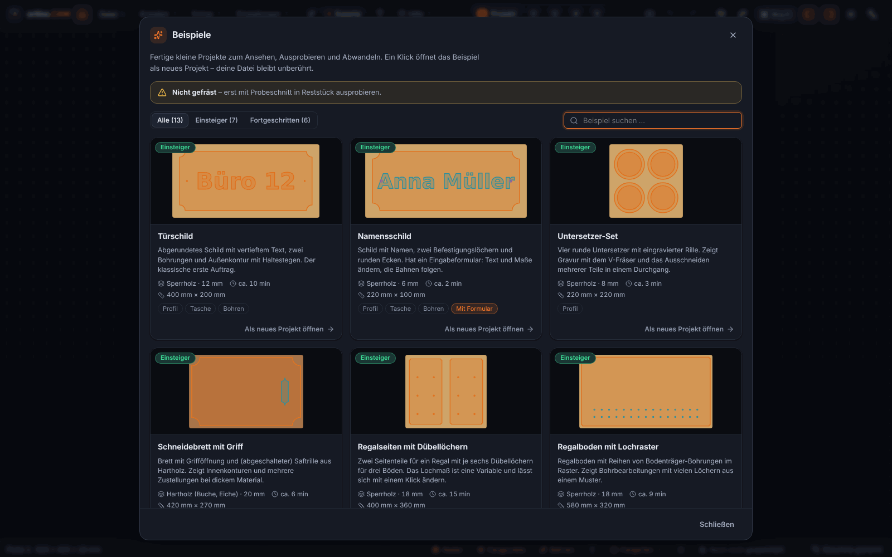</picture> | <picture><source media="(prefers-color-scheme: light)" srcset="docs/bilder/einfuehrung-light.png">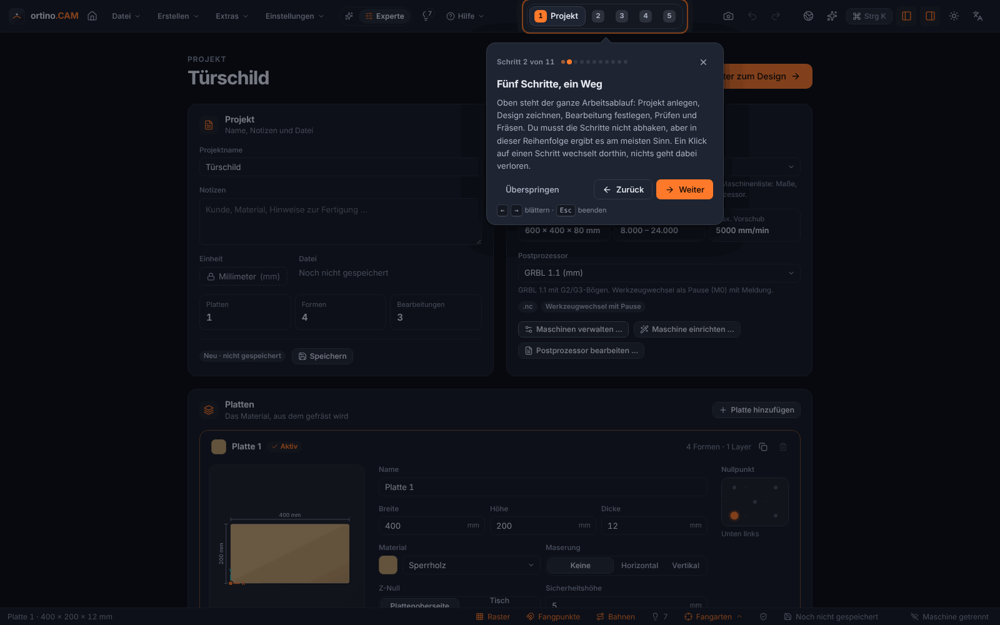</picture> | <picture><source media="(prefers-color-scheme: light)" srcset="docs/bilder/stueckzahl-light.png">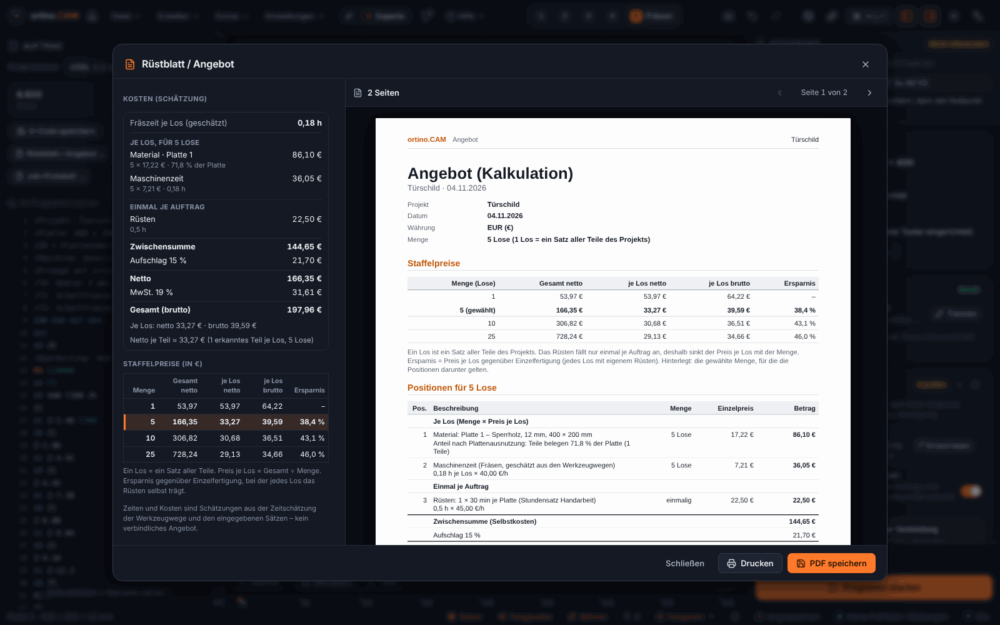</picture> |
| 13 Beispielprojekte zum Öffnen und Abwandeln; sie sind **nicht gefräst**<br><sub>Example gallery: 13 projects to open and adapt; not milled</sub> | Rundgang durch die fünf Schritte; dazu 6 Lektionen mit Aufgaben, die sich selbst abhaken<br><sub>Guided tour of the five steps, plus 6 lessons with self-checking tasks</sub> | Menge, Staffel und Ausschuss im Angebot: Rüsten fällt einmal je Auftrag an<br><sub>Quantity, price tiers and scrap in the quote: setup counts once per job</sub> |

<sub>Aufnahmen der Oberfläche; die Maschine im Schritt »Fräsen« ist der eingebaute Simulator, Namen, Preise und Werte in den Beispielen sind erfunden. / Screenshots of the interface; the machine in the “Cut” step is the built-in simulator, names, prices and values in the examples are made up.</sub>

## Funktionen

Die Tabelle nennt, was das Programm kann – und bei jedem Punkt, was **nur gegen Simulator und Tests** geprüft ist. Was an einer echten Maschine erprobt ist, steht im Warnhinweis ganz oben und unter [Maschinen und Steuerungen](#maschinen-und-steuerungen).

| | |
|---|---|
| ✏️ **Entwerfen** | Rechteck (mit Eckenradius), Ellipse, Vieleck und Stern, Polylinie, **Bézier-Stift und Freihand** (geglättet), Knoten bearbeiten. Boolesche Operationen, Offset, Verrunden, **Fase, Kürzen und Verlängern**, Arrays (rechteckig, kreisförmig, **entlang eines Pfads**), Ausrichten und Verteilen, Fangen an Raster, Endpunkten, Mitten, Plattenrändern und Hilfslinien, dazu **Schnittpunkte, Verlängerung, Lot, Tangente und Polarwinkel**. **Bemaßung** (waagerecht, senkrecht, ausgerichtet, Radius, Durchmesser, Winkel, Bogenlänge; die Maße folgen den Formen). **Touch-Modus** für Tablets und Stift *(nur mit der Touch-Emulation von Chromium geprüft, nie auf einem echten Touchgerät)*. **Variablen und Formeln** mit Einheiten (`Breite/2 - 5mm`, `1/4in`). **Geometrie-Prüfung:** offene Konturen, Selbstschnitte, Innenradien kleiner als der Fräser, zu dünne Stege, Formen außerhalb der Platte – mit Markern im Zeichenbereich. **Parametrische Skizzen** (11 Abhängigkeiten, Maße als Formel, Löser mit Freiheitsgraden und Befunden, Verlauf zum Zurückrollen; eigener Dialog, *nicht mit einem CAD-Programm verglichen*). Rückgängig/Wiederholen mit 200 Schritten, automatische Sicherung alle 30 Sekunden mit Wiederherstellung nach einem Absturz. |
| 🔤 **Text & Schilder** | Mehrzeiliger Text mit den Windows-Systemschriften und mitgelieferten Schriften (Kerning und Ligaturen), **Text auf Pfad** (bleibt editierbar), **elf Einzellinienschriften** für Gravur, **Seriennummern und Platzhalter** (`{n:001}`, Datum, Projektname) für Schilderserien, **Schablonen-Schrift mit Stegen** (Inseln in O, A, B, 8 bleiben über schmale Brücken am Umfeld; *nur gerechnet, nichts gefräst*). |
| 📥 **Importieren & Exportieren** | Import von SVG, DXF, **PDF und Illustrator-Dateien** (`.ai` mit PDF-Teil: Ebenen, Kurven, eingebettete Schriften), **EPS, PostScript und alte Illustrator-Dateien** (`.eps`, `.ps`, `.ai` ohne PDF-Teil; eigener, begrenzter Leser, nur mit selbst erzeugten Dateien geprüft; DWG wird nicht gelesen) und **Bildern** (nachzeichnen: Schwellwert, Graustufen, Farben). **Béziers aus SVG und PDF bleiben Kurven**, ebenso **Splines aus DXF** (höchste Abweichung 0,01 mm, sonst Polylinie) *(nur mit selbst erzeugten Dateien geprüft)*. **3D-Modelle (STL und STEP)** lassen sich als Relief, Umriss oder Schichtmodell auf die Platte bringen *(nur mit selbst erzeugten Körpern und Beispieldateien geprüft, nie mit Dateien aus echten CAD-Programmen)*. Export als SVG, DXF (Bézier-Konturen wieder als SPLINE, wenn der Rückweg verlustfrei ist) und G-Code, dazu **STL und 3MF** für importierte Modelle, Möbelteile (als Plattenkörper) und Reliefplatten *(nur gegen Tests geprüft, nichts mit einem Slicer oder Drucker)*; das Projektformat `.ocam` ist offen und dokumentiert (ZIP mit JSON). |
| 🧩 **Muster & Relief** | **39 parametrische Lochmuster-Arten mit 76 Vorlagen in sechs Kategorien** (Waben, Mashrabiya, Voronoi, Sterne, Lamellen, Wellen, Text und Bild als Lochraster …; *seit 0.14.0* auch Chevron-Lamellen, Fischschuppen, Kagome, Vierpass-Maßwerk, Spiralen, Schneeflocken und weitere, dazu ein Suchfeld) mit **Fräsbarkeits-Ampel** (Mindeststeg, Mindestöffnung, Inseln, Ecken) und Ein-Klick-Korrekturen; **3D-Relief** aus Generatoren (Wellen, Geflechte, Blüten, Kacheln, Strukturen, Ornamente, Paneele und Mauerwerk; 62 Vorlagen in 9 Kategorien, davon 22 neu in 0.14.0, darunter 14 Landschafts-, Blatt- und Bändermotive für den Art Designer), aus Formen (wölben), aus Graustufenbildern oder **aus einem Foto** (»Foto → Relief« mit lokalem KI-Tiefenmodell), mit Studio, 3D-Vorschau und Kennzahlen (Tiefe, Steilheit, Innenradius → Kugelfräser); Schruppen und Schlichten mit einem Klick. **Modellieren** mit dem Pinsel (aufbauen, abtragen, glätten, einebnen, schärfen; bis acht Ebenen). **Komponenten** (Ebenen aus Profil, Muster oder Bild mit sechs Modi, Lage mit der Maus, Gruppen). Das Tiefenmodell verwaltest du im Dialog **KI-Modelle** (Extras ▸ KI-Modelle …; *seit 0.13.0*; es wird nie ohne deinen Klick geladen). **Eigene Vorlagen** *(seit 0.15.0)*: Sparte »Eigene« in beiden Studios (speichern, umbenennen, als Datei sichern, importieren, auch Dateien aus dem Online-Generator) und der Dialog **Formen** mit zehn Grundformen; [Mehr dazu](#neu-in-0150-eigene-vorlagen-zuschnitt-online-generator). *(Reliefs, Modellieren und Komponenten nicht an einer echten Maschine erprobt; keine freie Volumenmodellierung; eigene Vorlagen nicht unter Windows/WebView2 geprüft.)* |
| 🌐 **Online-Generator** *(seit 0.15.0, im Portal)* | **Formen- und Muster-Generator im Browser** unter [ortino-cam.com/tools/generator](https://ortino-cam.com/tools/generator): kostenlos, ohne Konto; 37 Musterarten mit Vorlagen und Fräsbarkeits-Ampel, zehn Formen, Download als **SVG** und **DXF** (Millimeter, Bögen bleiben Bögen) und PNG, eigene Vorlagen im Browser. **Kein G-Code** (der entsteht in ortino.CAM). *(Am Rechner gemessen, nichts gefräst; die Dateien nicht in fremder CAM-Software geprüft.)* [Mehr dazu](https://github.com/KlapSC/ortino-cam/wiki/Formen-und-Muster-Generator) |
| 🧰 **Creator** *(seit 0.13.0)* | Parametrische Werkstück-Generatoren mit einem Dialog für alle (Erstellen ▸ Creator …): **22 Creator in sechs Gruppen** – **Schachtel mit Fingerzinken**; **Bauten und Figuren** (Vogelhaus / Nistkasten, Schattenkasten, 3D-Steckfigur); **Technik** (Holzverbindungen, Zahnräder, Zahnriemenscheibe, Lüftungsgitter, QR-Code); **Ornament** (Puzzle, Rosette / Mandala, Dekoration nach Jahreszeit mit 35 Motiven); **Feste und Jahreszeiten** *(seit 0.14.0)* (Adventskalender, Kranz und Bordüre, Windlicht / Laterne, Girlande / Wimpelkette); **Schrift und Skala** (Namensschild / Türschild, Geburtsbuchstabe, Letter Topper, Wortkacheln, Lineal, Wanduhr-Zifferblatt). Formular mit Formeln, Vorschau mit Maßen, Teileliste, Montagehinweise, Hinweise mit Lösungsknopf, Anlegen mit Bearbeitungen in einem Rückgängig-Schritt; auch für Claude. [Mehr dazu](#neu-in-0130-creator-reihenfolge-der-zustellungen-ki-modelle-startseite) und [Neues in 0.14.0](#neu-in-0140-muster-reliefs-wandbild-motive-dekoration) *(Nur Tests, Simulator und Chromium; nichts gefräst oder verleimt, Passung nicht an echtem Holz erprobt; beim Windlicht prüft der Creator nicht, ob eine offene Flamme sicher ist.)* |
| 🖼️ **Art Designer** | Wandbilder aus Holz in fünf Schritten (Format, Motiv, Rahmen und Kante, Text und Signatur, Übernehmen): **14 Motive** (sechs davon neu in 0.14.0: Geschichtete Berge, Sonnenaufgang, Mond und Wolken, Mondphasen, Olivenzweig, Gräser und Pampas), Formate von A-Reihe über Poster bis Panorama oder eigene Maße, Rahmen mit Auslauf und Fase, Schrift; als **geschnitztes Relief** aus einem Block oder als **Schichtholzbild** (3 bis 24 Lagen aus Sperrholz, Rückwand, Passstifte, Nummern, Verteilung auf Sperrholzplatten, **Montageplan**). Seit 0.10.0 mit **eigenem Bild** (PNG, JPEG, WebP): Lage, Größe und Drehung, **Verschwimmen mit dem Muster** an einer Seite, Ton (Kontrast, Gamma, Weichzeichnen). Nur im Programm, nicht im Web-Designer. [Mehr dazu](https://github.com/KlapSC/ortino-cam/wiki/Art-Designer) *(Gerechnet, nicht gefräst oder verleimt; ein Gesicht von vorn ergibt als Helligkeit nur ein flaches Relief.)* |
| 🧭 **Werkzeugwege** | **Profil** (innen, außen, auf Linie; Gleich-/Gegenlauf, Rampen, Anfahrbögen, **Haltestege** automatisch oder von Hand, Restschicht, Aufmaß mit Schlichtdurchgang), **Tasche** (konturparallel oder Raster, Inseln, Helix-Einstieg, **Restbearbeitung** mit Vorwerkzeug), **adaptives Räumen** (eingriffsgesteuert), **Bohren** (Tiefloch, Spanbrechen, Helix-Bohren), **Gewindefräsen** (metrisch, innen und außen; *nur Simulator*), **V-Carving**, **Inlay**, Gravur, **Planfräsen** (auch der Opferplatte), **Innenecken** (Dogbone, T-Bone), **Spannmittel und Sperrzonen** mit Kollisionsprüfung *(die Geometrie der Halter ist eine Annahme)*, **Reihenfolge optimieren** (als Vorschlag, nie still), dazu bei Profil und Tasche die **Reihenfolge der Zustellungen** (Teil für Teil oder Ebene für Ebene; *seit 0.13.0, nicht an einer Maschine erprobt*). Postprozessoren für GRBL *(an der Ultimate Bee erprobt)*, grblHAL, FluidNC, Mach3/4 und LinuxCNC – dazu UCCNC, Centroid, ShopBot, MASSO und PlanetCNC *(nur nach Herstellerunterlagen)*; eigene Profile möglich. **Außer GRBL ist keiner an einer echten Maschine erprobt.** |
| 🔧 **Werkzeuge & Schnittdaten** | Bibliothek mit **252 Fräsern von 11 Herstellern** (IDC Woodcraft, SpeTool, Amana, Whiteside, Onsrud, Yonico u. a.), jeder mit Quelle und Kennzeichnung *geprüft / abgeleitet / ungeprüft*, ohne Preise; Suche mit Facetten, Vergleich und Auswahlhilfe (z. B. Schneidenlänge für 18-mm-Platten). Eigene Fräser in »Meine Bibliothek« (anlegen, duplizieren, sichern, Import aus Fusion, CSV und Vectric-`.vtdb` *(mit einer echten Vectric-Datei nicht getestet)*). **Werkstoffdatenbank** mit 29 Hölzern, Platten und Kunststoffen, **Richtwerte** für Vorschub und Drehzahl mit Leistungsprüfung gegen die Spindel, **eigene bewährte Schnittdaten** merken. *(Richtwerte sind nicht an einer echten Maschine erprobt.)* |
| 🧊 **Prüfen & Simulieren** | Materialabtrag-Simulation in 3D, Eilgang-Kollision, Übermaß, **Prüfliste** mit Lösungsvorschlägen (bei Fehlern sind Export und Maschinenstart gesperrt). **56 Hinweisregeln** zu Sicherheit, Qualität, Zeit und Ablauf, jede mit »Warum?« und Ein-Klick-Behebung als Rückgängig-Schritt. Zeit- und Kostenschätzung. |
| 👥 **Team & Werkstatt** | Gemeinsamer **Werkstatt-Ordner** (z. B. auf dem NAS) mit Personen und Rollen (*Ansehen*, *Bedienen*, *Verwalten*; optionale PIN), **gemeinsame Bibliothek** (bewährte Schnittdaten, Fräser, Reststücke; Änderungen erst zeigen und bestätigen), Sperre und Revisionsnummer für gleichzeitige Schreiber und ein **Dashboard** (Läufe, Maschinenstunden, Wartung, Standzeit, Lager, offene Angebote ohne Kundendaten). Alles lokal, nichts im Portal. *(Rollen schützen vor Fehlbedienung, nicht vor Dateizugriff; Netzlaufwerk und Windows nicht erprobt.)* |
| 🪚 **Platten & Möbel** | **Plattenplaner** mit Freiform-Nesting (MaxRects, Guillotine, Skyline) für beliebige Teile, **Plattenzuschnitt mit Optimierer** (Sägeplan: Teile, Schnittfuge, Besäumrand, Maserung, Plattenbestand mit Preisen, Reststücke; nie schlechter als der einfache Zuschnitt, jedes Ergebnis nachgeprüft; *nur gerechnet, nie an einer echten Säge*), im Zuschnitt des Möbel- und Küchen-Designers das Verfahren **»Optimiert«** *(seit 0.15.0; probiert MaxRects und Guillotine mit vielen Reihenfolgen: wenige Platten, großes Reststück; nur gerechnet)*, **Passungs-Assistent** (Testcoupon mit gemessener Plattendicke), **Fingerzinken, Zapfen und Nut**, **Küchen- und Schrank-Designer** (7 Schranktypen, Fronten, Küchenzeile mit Arbeitsplatte, Sockel und Blenden, System 32, Topfscharniere) mit Stückliste und Kantenband, **Farben und Glanzgrade**, **Griffkatalog** mit 3D-Anzeige, **3D-Reliefs und Wellenmuster über mehrere Fronten**, **Rendering-Export** (Licht, Schatten, Glanz, Spüle), **Speichern, Öffnen und Varianten** der Küche, **Beschlagbibliothek** mit Bezugsquellen, **Möbel-Designer** (19 Arten: Tische, Sideboard, Kommode, Schreibtisch, Regale, Hocker, Bank, Stuhl, Garderobe ...; leimlos steckbar, Fingerzinken oder klassisch), **Gerätenischen, Raum & Aufmaß, L-/U-Küche und Insel**, eigene Möbelbausteine, **Vorlagen mit Eingabeformular** und **Serien aus CSV**. |
| 🎛️ **Maschinenanbindung** | GRBL-kompatibel über USB/COM oder TCP: Handsteuerung, Referenzfahrt, Antasten (Tastplatte oder XYZ-Eckblock), **»An Position fahren«**, Werkzeugwechsel-Assistent (Längensensor, Tastplatte oder **fester Taster**; mit eingerichtetem Taster automatisch), **Start-Check** vor jedem Lauf (Verbindung, Referenz, Verfahrweg, Nullpunkte, Z-Reserve, Werkzeug …), **Rahmen fahren und Luftschnitt**, Pause, Stopp, Overrides, Start ab Zeile, Konsole. Absaugung und Zusatzausgänge, Benachrichtigungen bei Fertig, Fehler und Wechsel, **Job-Protokoll**, Verbindungswächter und Ruhezustand-Sperre während eines Auftrags *(nur im Simulator geprüft)*. Die **Live-Animation** der Werkzeugposition im Schritt »Fräsen« stimmte bei einem Lauf von rund einer Stunde (Version 0.12.0, Tasche und Kontur in Birke, ohne Pause, Vorschubänderung oder Werkzeugwechsel) laut Betreiber »perfekt« mit dem Fräsen überein – eine Beobachtung, keine Messung. Die Einstellungen der Steuerung liest das Programm nur, es **schreibt nie `$n=`**. |
| 🏭 **Meine Maschine** | **Maschine einrichten** mit Katalog (Ultimate Bee, Shapeoko, Onefinity, LongMill, Genmitsu, OpenBuilds, X-Carve, 3018/6040 u. a.; Herstellerangaben und abgeleitete Werte sind gekennzeichnet) und Verfahrwege-Assistent; Profile exportieren, importieren und sichern. Taster, Opferplatte, Kamera-Kalibrierung und Zubehör gehören zur **Maschine** und gelten in **jedem neuen Projekt**. |
| 🔁 **Doppelseitig fräsen** | Seite A, wenden, Seite B – mit zwei Passstiften in der Opferplatte, wählbarer Wendeachse, 15 Prüfungen und Rüstblatt-Abschnitt. *(Nur Simulator, nicht an echter Maschine erprobt.)* |
| 🧱 **Fester Taster & Opferplatte** | Fester Taster einrichten und Werkzeuge einmessen; Z-Null liegt auf der Opferplatte. *(Einrichten und Einmessen laut Betreiber an einer echten Maschine bestätigt.)* Höhenkarte der Opferplatte messen und beim Fräsen ausgleichen *(nur Simulator)*. **Opferplatte markieren** (Kreuz, Rahmen, Lineal, Anschlag-Linien, Lochraster; Tiefen frei einstellbar) und eine neu gestaltete **Tisch-Ansicht** *(nur Simulator und Chromium)*. |
| 📷 **Kamera auf der Arbeitsplatte** | Vier QR-Marken in den Ecken, das Kamerabild wird entzerrt und liegt millimetergenau unter dem Entwurf; Werkstück-Umriss erkennen. *(Nur mit erzeugten Bildern geprüft, nie mit einer echten Kamera.)* |
| 🛠️ **Wartung & Standzeit** | Standzeit-Grenzen je Werkzeug, Wartungsplan je Maschine, Hinweise im Start-Check. *(Richtwerte, nur Simulator.)* |
| 📱 **Handy-Fernbedienung** | Per QR-Code koppeln, in kleinen Schritten verfahren, Nullpunkte setzen, Pause und Stopp – aus beim Start, nur im eigenen WLAN, unverschlüsselt. *(Stopp, Verfahren in X, Y und Z und Nullpunkte setzen laut Betreiber an einer echten Maschine bestätigt; Pause und Anzeige nicht einzeln bestätigt.)* |
| 📄 **Rüstblatt & Angebot** | PDF mit Werkzeugliste, Reihenfolge, Zeitschätzung, Nullpunkt-Skizze und Vorschau – dazu Kostenrechnung (Material nach Plattenausnutzung, Maschinenstunde, Rüsten, Verschleiß, Aufschlag, MwSt.), auf Wunsch mit **Stückzahl, Staffel** (z. B. 1, 5, 10, 25) und Ausschusszuschlag. **Kundenstamm, fortlaufende Angebotsnummern** (mit Revisionen) und **Zahlungsbedingungen** (Fälligkeit, Skonto, Anzahlung), Angebots-PDF mit Adressblock; alles bleibt auf dem Rechner. Deutsch und Englisch. |
| 🌱 **Für Einsteiger** | Einfach-Modus (Werkzeug, Tiefen und Schnittwerte als Vorschlag mit Begründung), Schnellstart »Was möchtest du fräsen?«, **Beispielgalerie** mit 13 Beispielen, **geführte Einführung** durch die fünf Schritte, **6 Lektionen** mit Aufgaben, die sich selbst abhaken *(Beispiele und Lektionen sind nicht gefräst)*, Befehlspalette (`Strg+K`), **Startseite mit Schnellzugriffen** und Home-Schaltfläche (*seit 0.13.0*), Fehlermeldungen mit Erklärung und Lösung. Oberfläche und Rüstblatt auf Deutsch und Englisch; **36 kurze Video-Anleitungen** in der Hilfe (englisch beschriftet). |
| 🌍 **Community-Portal** | Fräsdesigns entdecken, mit einem Klick laden und eigene teilen – im Programm integriert (Weltkugel in der Kopfleiste); ein Design öffnet sich standardmäßig mit **deiner** Maschine. Dazu eine **private Sicherung** deiner Maschinenprofile, Fräser und Einstellungen im eigenen Konto, um Büro und Werkstatt abzugleichen. Der Küchen- und der Möbel-Designer laufen auch **im Browser** (Web-Designer; Entwürfe teilen und abwechselnd bearbeiten), dazu Maschinenprofile aus der Community, Boosts und ein Marktplatz (standardmäßig aus). [Mehr dazu](#community-portal-und-designs) |
| 🤖 **Claude, Skripte & Kommandozeile** | **MCP-Server** (45 Werkzeuge) und lokale API, mit denen **Claude** das Programm live steuert, jede Aktion ein Rückgängig-Schritt, Maschinenaktionen nur mit Bestätigung im Programm; **Assistent im Programm** mit deinem eigenen API-Schlüssel; **eigene Werkzeuge als Skripte** (Rhai, in einer Sandbox ohne Datei- und Netzzugriff); Kommandozeile `ortino` für G-Code, Prüfung, Export und Serien (auch für CI). [Mehr dazu](#steuerbar-mit-claude--mcp-server-und-lokale-api) |

### Was es (noch) nicht gibt

Damit niemand falsche Erwartungen hat – das fehlt heute. Für eine spätere Version geplant ist die vierte Achse (eine Absicht, keine Zusage):

* **Freie Volumenmodellierung** (Formen aus dem Nichts, Freiformflächen). Komponenten für Reliefs gibt es seit 0.12.0. Reliefs entstehen aus Mustern, Formen, Bildern, Fotos und importierten Modellen (STL, STEP, seit 0.4.0, nur von oben) und lassen sich seit 0.7.0 mit dem Pinsel nachmodellieren *(nur gegen Tests, Simulator und Chromium geprüft)*.
* **Vierte Achse (Rotary)** und **Laser**.
* **Import von DWG** (das Programm sagt es und nennt eine Lösung: als DXF speichern). EPS, PostScript und `.ai` ohne PDF-Teil liest das Programm seit 0.6.0 mit einem eigenen, begrenzten Leser.
* **Vollständiger Bearbeitungsverlauf wie in einem 3D-CAD-Programm** (3D-Features, Schritte umordnen). Parametrische Skizzen mit Verlauf gibt es seit 0.12.0 als eigenen Dialog; keine Splines, kein Skizzieren in der Hauptfläche.
* **Mac und Linux** (nur Windows 10/11, 64 Bit) und weitere Sprachen neben Deutsch und Englisch. Eine **Touch- und Stiftbedienung** gibt es seit 0.3.14, aber nur mit der Touch-Emulation von Chromium geprüft.
* **Steuerungen außer GRBL** sind nicht an einer echten Maschine erprobt.

## Community-Portal und Designs

Neben dem Programm gibt es ein **Community-Portal**: eine Webseite, auf der Fräsdesigns gesammelt, durchsucht und geteilt werden – jeweils mit den Werkzeugen, Tiefen, Vorschüben und einer Anleitung, die zum Design gehören.

* **Entdecken und suchen:** Kategorien, Suche mit Vorschlägen, Filter nach Art, Material, Plattenstärke, Fräser und Lizenz – und **»Passt auf meine Maschine«**, das den Verfahrweg deiner Maschine mit dem Design vergleicht. Stöbern und Herunterladen gehen ohne Konto.
* **Mit einem Klick ins Programm:** In ortino.CAM öffnest du die Community über die **Weltkugel in der Kopfleiste** (oder Strg+Umschalt+D) und lädst ein Design mit **»Laden & öffnen«**. Das Programm prüft das Paket vorher (Prüfsumme, Pfade, keine ausführbaren Inhalte); Skripte aus Paketen werden nie ausgeführt. Auf der Webseite gibt es zusätzlich »In ortino.CAM öffnen« und den Download der Datei.
* **Eigene Designs teilen:** im Programm über »Design teilen« oder auf der Webseite über »Hochladen«, mit einem kostenlosen Konto. Titel, Kategorie, Bilder, Beschreibung und Anleitung ergänzt du selbst; veröffentlichen kannst du öffentlich oder nicht gelistet. Beim Teilen aus dem Programm sucht ortino.CAM nach Dateipfaden und deinem Benutzernamen im Projekt und entfernt sie auf Wunsch aus dem Paket. Auch Vorlagen mit Eingabeformular lassen sich als Design teilen.
* **Deine Maschine bleibt deine:** Ein Design aus dem Portal wird standardmäßig mit **deiner eigenen Maschine** geöffnet (Postprozessor, Zubehör, Taster); die Maschine des Designs wählst du bei Bedarf ausdrücklich. Beim Teilen kommen die Einrichtung deiner Maschine und die freie Notiz nicht ins Paket.
* **Sicherung im Portal:** Maschinenprofile, eigene Fräser und ausgewählte Einstellungen privat im Konto sichern und auf einem anderen Rechner abrufen – nur auf Knopfdruck, nie von selbst. Siehe [Sicherung im Portal](https://github.com/KlapSC/ortino-cam/wiki/Sicherung-im-Portal).
* **Formen- und Muster-Generator (seit 0.15.0):** Unter [ortino-cam.com/tools/generator](https://ortino-cam.com/tools/generator) erzeugst du ohne Konto Muster und Formen für Fräse und Laser, siehst die Fräsbarkeit und lädst SVG oder DXF herunter. Er erzeugt keinen G-Code; Dateien lassen sich in ortino.CAM importieren. Am Rechner gemessen, nichts gefräst; das echte Portal und die Last sind nicht geprüft.
* **Küche und Möbel im Browser (seit 0.5.0):** Der Küchen- und der Möbel-Designer laufen auch im Portal, mit Entwürfen im eigenen Konto und Download als `.ocam` für das Programm; seit 0.6.0 lassen sich Entwürfe teilen und abwechselnd bearbeiten, seit 0.7.0 auf Wunsch des Besitzers auch gleichzeitig (live). Siehe [Web-Designer im Portal](https://github.com/KlapSC/ortino-cam/wiki/Web-Designer-im-Portal). Braucht ein Konto mit bestätigter E-Mail-Adresse und ein Portal mit Server-Version 0.5.0; nur in Chromium geprüft.
* **Rechte und Lizenz:** Lade nur hoch, was du selbst erstellt hast oder teilen darfst. Jedes Design trägt eine Lizenz (CC BY, BY-SA, BY-NC, BY-NC-SA, BY-ND, CC0 oder »Alle Rechte vorbehalten«). Laut Community-Richtlinien nicht erlaubt: fremde Werke ohne Erlaubnis, geschützte Logos und Marken, Waffen oder rechtlich eingeschränkte Teile, gefährliche Anleitungen, absichtlich falsche Einstellungen, Schadsoftware. Verstöße lassen sich über »Melden« der Moderation anzeigen.
* **Katalog eigener Designs:** Als Grundstock ist ein Katalog mit 17 eigenen Beispiel-Designs vorbereitet: Leuchten, Wandbilder, Stühle und Tische. Sie stammen vom KI-Konto »Claude«, wurden **nur am Rechner geprüft** (Prüfliste, G-Code, Simulation) und **nie gefräst oder belastet**; bei Möbeln erst einen Prototyp bauen.
* **Adresse und Kontakt:** [ortino-cam.com](https://ortino-cam.com) – im Programm schon eingetragen. Fragen, Fehler und Wünsche zum Portal wie überall über [GitHub Issues](https://github.com/KlapSC/ortino-cam/issues/new/choose). **Datenschutzanfragen und rechtliche Anliegen** zum Portal (Konto, Auskunft, Löschung, Sperre) gehen an die E-Mail-Adresse im [Impressum des Portals](https://ortino-cam.com/imprint), nicht in ein öffentliches Issue: Dort gehören keine persönlichen Daten hin.
* **Stand:** Das Portal wird von einer **Einzelperson** betrieben und ist **noch im Aufbau**. Das Zusammenspiel von Programm und Portal ist gegen eine lokale Testinstallation geprüft; nicht alles ist im Betrieb im Internet erprobt, zum Beispiel »In ortino.CAM öffnen« aus dem Browser unter Windows. Das gilt auch für die **Sicherung im Portal**. Schnittwerte in Designs (Vorschub, Drehzahl, Tiefe) sind Angaben der Ersteller und gehören zu deren Maschine und Material: vor dem Fräsen im Programm prüfen, mit einem Reststück beginnen.

| Startseite | Suche | Designseite |
|:--:|:--:|:--:|
| <picture><source media="(prefers-color-scheme: light)" srcset="docs/bilder/portal-startseite-light.png">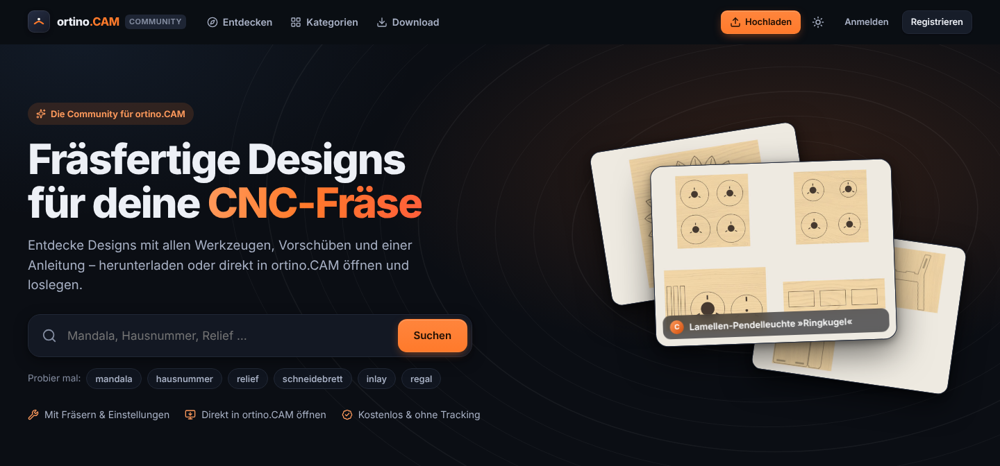</picture> | <picture><source media="(prefers-color-scheme: light)" srcset="docs/bilder/portal-suche-light.png">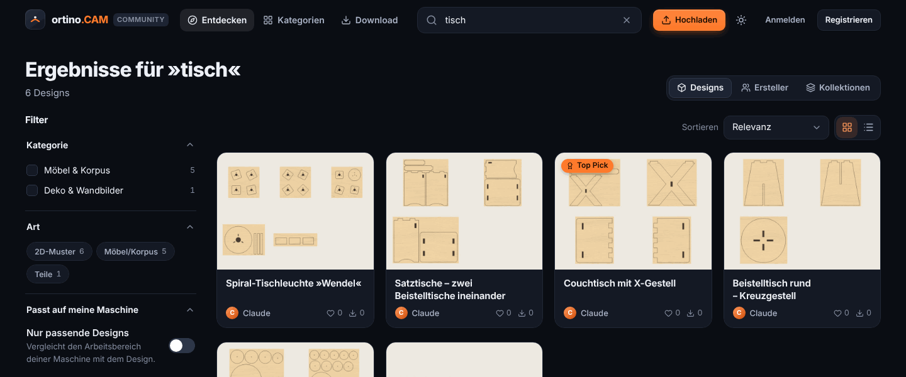</picture> | <picture><source media="(prefers-color-scheme: light)" srcset="docs/bilder/portal-design-light.png">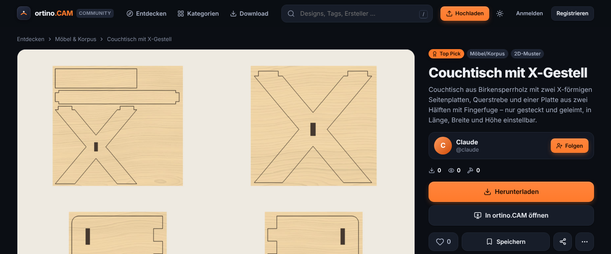</picture> |
| Startseite mit Suche<br><sub>Home page with search</sub> | Filter nach Kategorie, Art und Maschine<br><sub>Search and filters</sub> | Galerie, Herunterladen, »In ortino.CAM öffnen«<br><sub>Design page with gallery and download</sub> |

| Im Programm | Hochladen | Lizenz wählen |
|:--:|:--:|:--:|
| <picture><source media="(prefers-color-scheme: light)" srcset="docs/bilder/community-im-programm-light.png">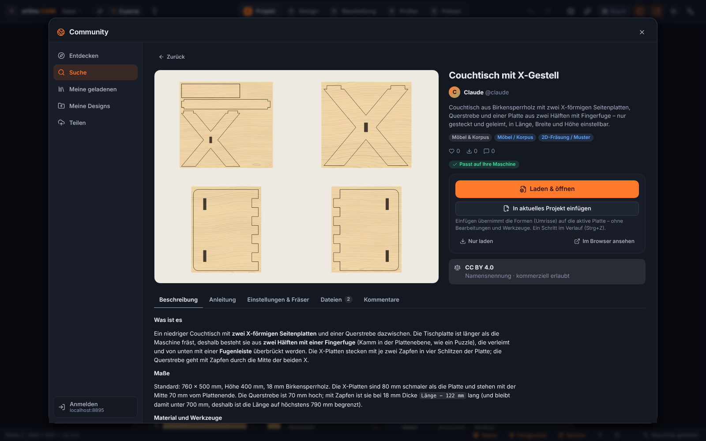</picture> | <picture><source media="(prefers-color-scheme: light)" srcset="docs/bilder/portal-hochladen-light.png">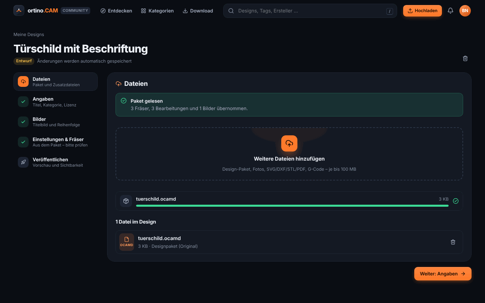</picture> | <picture><source media="(prefers-color-scheme: light)" srcset="docs/bilder/portal-lizenz-light.png">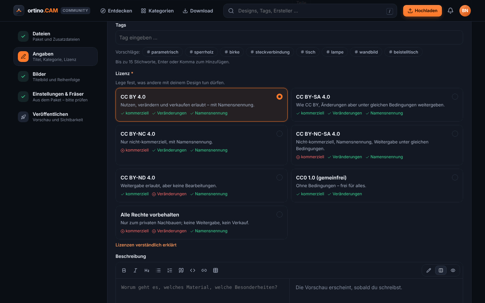</picture> |
| Designseite in der Community, »Laden &amp; öffnen«<br><sub>Inside the app: load and open</sub> | Der Assistent liest das Design-Paket aus dem Programm<br><sub>Upload: the assistant reads the design package</sub> | Jedes Design trägt eine Lizenz<br><sub>Choosing a licence</sub> |

*Die Portal-Bilder zeigen **Beispieldaten aus einer lokalen Installation** (die Katalog-Designs, ohne Nutzerzahlen); das Portal im Internet kann anders aussehen. Alle Bilder: hell oder dunkel je nach Darstellung deines Browsers.*

<details>
<summary><strong>Community portal and designs (English)</strong></summary>

Alongside the app there is a **community portal**: a website where milling designs are collected, searched and shared – each with the tools, depths, feeds and instructions that belong to the design.

* **Discover and search:** categories, search with suggestions, filters (type, material, sheet thickness, bit, licence) and **“fits my machine”**. Browsing and downloading work without an account.
* **One click into the app:** open Community with the **globe icon in the top bar** (or Ctrl+Shift+D) and load a design with **“Load & open”**. The app checks the package first (checksum, paths, no executable content) and never runs scripts from packages. The website also offers “Open in ortino.CAM” and the file download.
* **Share your own:** from the app (“Share design”) or on the website (“Upload”), with a free account. The app looks for file paths and your user name in the project and can strip them from the package. Templates with an input form can be shared as designs, too.
* **Your machine stays yours:** a design from the portal opens with **your own machine** by default (post-processor, accessories, probe); you can choose the design’s machine explicitly. When sharing, your machine’s setup and its free-text note are no longer put into the package.
* **Backup in the portal:** back up machine profiles, your own bits and selected settings privately in your account and restore them on another computer – only on a button press, never automatically. Needs a portal running version 0.3.12 or later; tested against a real portal server and in a browser, not yet against the portal on the internet and not on Windows.
* **Shapes and pattern generator (since 0.15.0):** at [ortino-cam.com/tools/generator](https://ortino-cam.com/tools/generator) you create patterns and shapes for routers and lasers without an account, see whether they can be milled, and download SVG or DXF. It does not produce G-code; the files can be imported into ortino.CAM. Measured on the computer, nothing milled; the live portal and load are untested.
* **Kitchen and furniture in the browser (since 0.5.0):** the kitchen and furniture designers also run in the portal, with designs saved in your own account and a `.ocam` download for the app. See [Web-Designer im Portal](https://github.com/KlapSC/ortino-cam/wiki/Web-Designer-im-Portal) (German). Needs an account with a confirmed e-mail address and a portal running server version 0.5.0; tested in Chromium only.
* **Rights and licence:** upload only what you made yourself or are allowed to share. Every design carries a licence (CC BY, BY-SA, BY-NC, BY-NC-SA, BY-ND, CC0 or all rights reserved). The community guidelines do not allow other people’s work without permission, protected logos and trademarks, weapons or legally restricted parts, dangerous instructions, deliberately wrong settings, or malware.
* **Catalogue:** 17 own sample designs (lamps, wall art, chairs, tables) are prepared as a starting stock. They come from the AI account “Claude”, were checked on the computer only (pre-flight check, G-code, simulation) and were never milled or load-tested.
* **Address and contact:** [ortino-cam.com](https://ortino-cam.com), already set up in the app. Questions, bugs and wishes about the portal go through [GitHub issues](https://github.com/KlapSC/ortino-cam/issues/new/choose), as everywhere. **Data protection requests and legal matters** about the portal (account, access, deletion, suspension) go to the e-mail address in the [portal’s imprint](https://ortino-cam.com/imprint), not into a public issue: personal data does not belong there.
* **Status:** the portal is run by **one person** and is **still being built**. The interplay of app and portal is tested against a local test installation, not everything in live operation on the internet (for example “Open in ortino.CAM” from the browser on Windows). Feeds and speeds in designs are the creators’ values: check them before cutting and start with an offcut.

The portal images show **sample data from a local installation** (the catalogue designs, without user numbers); the portal on the internet may look different.

</details>

## Steuerbar mit Claude – MCP-Server und lokale API

ortino.CAM bringt einen **MCP-Server** (*Model Context Protocol*) mit: **Claude Desktop**, **Claude Code** und jeder andere MCP-Client können zeichnen, Bearbeitungen anlegen, die Prüfliste abarbeiten und G-Code erzeugen – **live im Programmfenster**, jede Aktion ein Rückgängig-Schritt (Strg+Z).

* **MCP-Server `ortino-mcp`** für Claude Desktop und Claude Code.
* **Lokale API** (JSON, nur `127.0.0.1`, zufälliger Zugangsschlüssel, nur auf Wunsch eingeschaltet) für eigene Programme und Skripte.
* **Kommandozeile `ortino`**: G-Code erzeugen, Projekt prüfen, DXF/SVG exportieren, Serien aus CSV – auch für CI.
* **Eigene Werkzeuge** als Rhai-Skripte, die auch Claude benutzen kann.
* **Assistent im Programm** mit deinem eigenen Anthropic-API-Schlüssel (im Windows-Anmeldeinformationsspeicher, nicht in Dateien).

| Stufe | Was erlaubt ist | Standard |
|---|---|---|
| `read` | Projekt, Prüfliste, Vorschau lesen | erlaubt |
| `edit` | Projekt ändern (je Aktion ein Undo-Schritt) | erlaubt |
| `machine` | Verfahren, Spindel, Nullpunkt, Antasten | **gesperrt**, jede Aktion mit Bestätigung im Programm |
| `danger` | Job starten, Dateien überschreiben | **gesperrt**, jede Aktion mit Bestätigung im Programm |

Einstellungen der Steuerung (`$…=`) schreibt ortino.CAM **auf keiner Stufe**, auch nicht über die API.

```jsonc
// claude_desktop_config.json
{
  "mcpServers": {
    "ortino-cam": {
      "command": "C:\\Users\\<Name>\\AppData\\Local\\ortino.CAM\\ortino-mcp.exe",
      "args": []
    }
  }
}
```

Der Pfad gilt für die Installation mit der `setup.exe`. Den genauen Pfad auf deinem Rechner (auch nach einer Installation mit der `.msi`) zeigt ortino.CAM unter *Erweiterungen & KI → Claude verbinden* zum Kopieren an.

```bash
ortino check  tuerschild.ocam
ortino gcode  tuerschild.ocam -o tuerschild.nc --post grbl
ortino export tuerschild.ocam --format dxf -o tuerschild.dxf
```

## ortino.CAM und Vectric Aspire

Eine kurze, sachliche Gegenüberstellung mit den Stärken beider Seiten. Verglichen wird mit Vectric Aspire, dem teuersten Programm der Vectric-Reihe.

| | ortino.CAM | Vectric Aspire |
|---|---|---|
| **Preis** | kostenlos | einmalig rund 1.800 € (laut Preisliste des Herstellers; Updates im ersten Jahr inklusive) |
| **System** | Windows 10/11, 64 Bit | Windows (Mac nur über eine Windows-Virtualisierung) |
| **2D-Entwurf, Profil, Tasche, V-Carving, Gravur, Inlay** | ja | ja |
| **3D-Relief** | Reliefs aus Mustern, Höhenbildern, Formen und Fotos (Foto → Relief) erzeugen und Werkzeugwege dafür berechnen (nicht an einer echten Maschine erprobt); kleiner Umfang; Import von STL und STEP in ein Relief (seit 0.4.0, nur von oben, nur mit selbst erzeugten Dateien geprüft); Modellieren mit dem Pinsel (seit 0.7.0) und Relief-Komponenten aus Profil, Muster oder Bild (seit 0.12.0), beides nur gegen Tests, Simulator und Chromium geprüft; keine freie 3D-Modellierung von Körpern | umfangreiche 3D-Modellierung (Formen, Skulptieren, Komponenten) – <strong>hier ist Aspire klar stärker</strong> |
| **Vierte Achse (Rotary)** | nein – für eine spätere Version geplant | ja |
| **Nesting** | ja (Plattenplaner mit Freiform-Nesting) | ja |
| **Zur Maschine schicken** | direkt aus dem Programm an GRBL-Steuerungen (USB/COM, TCP), mit Start-Check, Antasten und Werkzeugwechsel-Assistent; an einer echten Maschine erprobt nur mit GRBL an der Ultimate Bee | erzeugt G-Code-Dateien, die ein separates Steuerungsprogramm ausführt |
| **Postprozessoren** | GRBL (an der Ultimate Bee erprobt); grblHAL, FluidNC, Mach3/4, LinuxCNC, UCCNC, Centroid, ShopBot, MASSO, PlanetCNC (nicht an einer echten Maschine erprobt, die letzten fünf nur nach Herstellerunterlagen); weitere Steuerungen laufend, Beiträge willkommen | sehr großer Katalog, online verwaltet; deutlich mehr Steuerungen |
| **Steuerung durch Claude (MCP-Server, lokale API)** | ja | keine Angabe des Herstellers gefunden |
| **Reife** | junge Software (0.x), nur Teile an einer echten Maschine erprobt (eine Maschine, GRBL); Neues aus 0.3.9, 0.3.11, 0.3.12, 0.3.14, 0.4.0, 0.4.1, 0.5.0, 0.6.0, 0.7.0, 0.8.0, 0.8.2, 0.9.0, 0.10.0, 0.11.0, 0.12.0, 0.13.0, 0.14.0 und 0.15.0 (eigene Vorlagen, Zuschnitt »Optimiert«, Online-Generator, mehr Muster, Reliefs, Wandbild-Motive und Dekoration, Creator, Reihenfolge der Zustellungen, KI-Modelle, Startseite, Parametrische Skizzen, Relief-Komponenten, Werkstatt und Dashboard, Export STL/3MF, Schablonen-Stege, Kundenstamm und Angebote, Sägeplan, Art Designer mit eigenem Bild, Web-Designer, Foto → Relief, EPS-Import, Fangen, Bemaßung, Modellieren, Kachelung, Marktplatz, Handy-Schnittstelle) nicht systematisch unter Windows (WebView2) geprüft | seit Jahren etabliert, große Nutzergemeinde |
| **Hilfe** | Anleitungen im Repository, Fragen über GitHub Issues (Einzelperson) | Hersteller-Support, Handbuch, Videos, Forum |
| **Kompatibilität** | liest Vectric-Werkzeugdatenbanken (.vtdb; das Format ist nicht offiziell dokumentiert, mit einer echten Vectric-Datei bisher nicht getestet) | – |

**Aspire ist die bessere Wahl, wenn du** eine vierte Achse (Rotary) brauchst, umfangreich in 3D modellieren willst (Skulptieren, Komponenten), auf einem Mac arbeitest (über eine Windows-Virtualisierung), Hersteller-Support möchtest oder auf lange Praxis und eine große Nutzergemeinde setzt.

**ortino.CAM passt, wenn du** eine GRBL-Maschine direkt aus dem Programm fahren willst, einen Möbel- und Küchen-Designer mit Stückliste suchst, das Community-Portal nutzen möchtest, dein CAM per Claude (MCP) steuern willst und ein kostenloses Programm bevorzugst – und mit einer jungen Software leben kannst.

<sub>Angaben zu Vectric nach öffentlich zugänglichen Herstellerangaben und Fachseiten, Stand Oktober 2026, ohne Gewähr; Preise und Umfang ändern sich – bitte beim Hersteller prüfen ([Produktseite Aspire](https://www.vectric.com/products/aspire/)). Vectric, VCarve und Aspire sind Marken der Vectric Ltd.; ortino.CAM ist unabhängig und steht in keiner Verbindung zu Vectric. »Geplant« ist die Absicht des Entwicklers, keine Zusage; Umfang und Zeitpunkt können sich ändern.</sub>

<details>
<summary><strong>ortino.CAM and Vectric Aspire (English)</strong></summary>

A short, factual comparison that names the strengths of both sides. The comparison is with Vectric Aspire, the most expensive program in the Vectric range.

| | ortino.CAM | Vectric Aspire |
|---|---|---|
| **Price** | free | one-off, about €1,800 (according to the manufacturer’s price list; updates included in the first year) |
| **System** | Windows 10/11, 64-bit | Windows (Mac only through Windows virtualisation) |
| **2D design, profile, pocket, V-carving, engraving, inlay** | yes | yes |
| **3D relief** | creates reliefs from patterns, height images, shapes and photos (photo to relief) and computes toolpaths for them (not tested on a real machine); small scope; import of STL and STEP into a relief (since 0.4.0, top view only, tested only with self-made files); relief modelling with a brush (since 0.7.0) and relief components from profile, pattern or image (since 0.12.0), both tested only against tests, simulator and Chromium; no free 3D modelling of solids | extensive 3D modelling (shapes, sculpting, components) – <strong>Aspire is clearly stronger here</strong> |
| **Fourth axis (rotary)** | no – planned for a later version | yes |
| **Nesting** | yes (sheet planner with free-form nesting) | yes |
| **Sending to the machine** | straight from the app to GRBL controllers (USB/COM, TCP), with start check, probing and tool-change assistant; tested on a real machine only with GRBL on the Ultimate Bee | produces G-code files that a separate control program runs |
| **Post-processors** | GRBL (tested on the Ultimate Bee); grblHAL, FluidNC, Mach3/4, LinuxCNC, UCCNC, Centroid, ShopBot, MASSO, PlanetCNC (not tested on a real machine, the last five written from manufacturer documentation only); more controllers ongoing, contributions welcome | very large catalogue, managed online; considerably more controllers |
| **Control by Claude (MCP server, local API)** | yes | no statement from the manufacturer found |
| **Maturity** | young software (0.x), only parts tested on a real machine (one machine, GRBL); what is new in 0.3.9, 0.3.11, 0.3.12, 0.3.14, 0.4.0, 0.4.1, 0.5.0, 0.6.0, 0.7.0, 0.8.0, 0.8.2, 0.9.0, 0.10.0, 0.11.0, 0.12.0, 0.13.0, 0.14.0 and 0.15.0 (own templates, optimised cutting, online generator, more patterns, reliefs, wall-picture motifs and seasonal decorations, creators, order of the depth passes, AI models, home page, parametric sketches, relief components, workshop folder and dashboard, STL/3MF export, stencil bridges, customers and quotes, panel cutting plan, art designer with own image, web designer, photo to relief, EPS import, snapping, dimensions, sculpting, tiling, marketplace, phone interface) have not been systematically tested on Windows (WebView2) | established for years, large user community |
| **Help** | guides in the repository, questions via GitHub issues (one person) | manufacturer support, manual, videos, forum |
| **Compatibility** | reads Vectric tool databases (.vtdb; the format is not officially documented, not yet tested with a real Vectric file) | – |

**Aspire is the better choice if you** need a fourth axis (rotary), want extensive 3D modelling (sculpting, components), work on a Mac (through Windows virtualisation), want manufacturer support or rely on long practice and a large user community.

**ortino.CAM fits if you** want to run a GRBL machine straight from the program, want a furniture and kitchen designer with a parts list, want to use the community portal, want to drive your CAM with Claude (MCP) and prefer a free program – and can live with young software.

<sub>Statements about Vectric are based on publicly available manufacturer information and trade sites, as of October 2026, without guarantee; prices and scope change – please check with the manufacturer ([Aspire product page](https://www.vectric.com/products/aspire/)). Vectric, VCarve and Aspire are trademarks of Vectric Ltd.; ortino.CAM is independent and not affiliated with Vectric. “Planned” is the developer’s intention, not a commitment; scope and timing may change.</sub>

</details>

## Installation (Windows 10/11, 64 Bit)

1. Unter [**Releases**](https://github.com/KlapSC/ortino-cam/releases/latest) die Datei `ortino.cam_<Version>_x64-setup.exe` herunterladen (alternativ die `.msi`, `…_x64_de-de.msi`). Die Prüfsumme (SHA-256) steht in den Hinweisen der Version.
2. Starten und installieren. **Windows warnt beim ersten Start** (SmartScreen: »Weitere Informationen → Trotzdem ausführen«): Der Installer ist mit einem **selbst erstellten Zertifikat** signiert, nicht von einer Zertifizierungsstelle.
3. `.ocam`-Projekte öffnen sich danach per Doppelklick. Ein Beispielprojekt liegt den Releases bei.

**Updates** kommen **im Programm** selbst: Gibt es eine neue Version, zeigt die Kopfleiste einen Hinweis; installiert wird nur nach deinem Klick, mit geprüfter Signatur und nie mitten in einem Fräsauftrag. Das Programm spricht dafür mit dem offiziellen Portal des Betreibers, nicht mit GitHub; übermittelt werden nur Systemart, Architektur, Installationsart und die installierte Version. Diese Seite zeigt nur die Versionen zum Herunterladen.

**Android-App:** Zu ortino.CAM gibt es eine App im Google Play Store: [ortino.CAM bei Google Play](https://play.google.com/store/apps/details?id=com.ortinocam.app). Was sie kann, steht im Eintrag dort; diese Seiten machen dazu bewusst keine Aussage. Das Windows-Programm braucht sie nicht.

## Erste Schritte

1. **Installieren** (siehe oben) und starten.
2. **Maschine einrichten:** Der Assistent »Maschine einrichten« (Schritt »Projekt«) bietet einen Katalog mit Größen und Steuerung; eigene Maschinen sind möglich. Die Maße aus dem Katalog sind teils Herstellerangaben, teils abgeleitet – sie sind als solche gekennzeichnet; bitte einmal nachmessen.
3. **Etwas zum Fräsen wählen:** über »Was möchtest du fräsen?« einen Startpunkt wählen, ein Projekt aus der **Beispielgalerie** öffnen (Datei-Menü oder Strg+K) oder das Beispielprojekt `tuerschild.ocam` aus den Releases laden. Wer möchte, startet vorher die **geführte Einführung** (Hilfe-Menü) oder übt mit den **Lektionen**.
4. **Bearbeiten:** Bearbeitungen anlegen (Profil, Tasche, Bohren, V-Carving …). Im Einfach-Modus kommen Werkzeug, Tiefen und Schnittwerte als Vorschlag mit Begründung.
5. **Prüfen:** 3D-Simulation ansehen und die Prüfliste abarbeiten.
6. **Fräsen:** Maschine verbinden, Nullpunkt setzen, Start-Check lesen. **Zuerst ohne Werkzeug und ohne Material fahren**, Not-Aus in Reichweite, dann mit einem Reststück beginnen.

### Maschinen und Steuerungen

| | |
|---|---|
| **Direkt angebunden** | GRBL-kompatible Steuerungen (GRBL 1.1, grblHAL, FluidNC) über USB/COM oder TCP; an einer echten Maschine erprobt nur GRBL (Ultimate Bee) |
| **Maschinenkatalog** | u. a. Bulkman3D (Ultimate Bee, CNC xPRO V5), Carbide 3D, Onefinity, Sienci Labs, SainSmart, OpenBuilds, Inventables und eine generische GRBL-Vorlage |
| **G-Code zum Export** | Postprozessoren für Mach3/Mach4 und LinuxCNC sowie UCCNC, Centroid, ShopBot, MASSO und PlanetCNC (ohne direkte Anbindung; **keiner davon an einer echten Maschine erprobt**, die letzten fünf nur nach Herstellerunterlagen); eigene Postprozessoren als Textdatei möglich ([`postprozessoren/`](postprozessoren/)) |
| **An echter Maschine erprobt** | bisher nur die Ultimate Bee mit xPRO V5 (siehe Hinweis oben; zuletzt laut Betreiber ein Lauf von rund einer Stunde mit 0.12.0, Tasche und Kontur in Birke, ohne Pause, Vorschubänderung oder Werkzeugwechsel) – **Berichte von anderen Maschinen sind sehr willkommen** ([Vorlage »Test an einer echten Maschine«](https://github.com/KlapSC/ortino-cam/issues/new/choose)) |

## Sicherheit

* Das Programm schreibt **nie** Einstellungen (`$`-Werte) in deine Steuerung; es liest sie nur und vergleicht sie mit dem Maschinenprofil.
* Die Handy-Fernbedienung ist aus, bis du sie einschaltest, und **nicht verschlüsselt**: nur im eigenen, vertrauenswürdigen WLAN. Der Stopp am Rechner bleibt die eigentliche Sicherung.
* Dein Anthropic-Schlüssel für den Assistenten (falls du einen nutzt) liegt im Windows-Anmeldeinformationsspeicher.
* Sicherheitslücken bitte **nicht** als öffentliches Issue melden, sondern wie in [`SECURITY.md`](SECURITY.md) beschrieben.

## Haftungsausschluss

**ortino.CAM wird ohne jede Gewährleistung und ohne Zusicherung bestimmter Eigenschaften bereitgestellt (»wie besehen«). Die Nutzung erfolgt auf eigene Gefahr.**

* CNC-Maschinen sind gefährlich. Fehler im Programm, in den Einstellungen oder in der Maschine können zu **Verletzungen, Schäden an Maschine, Werkzeug und Werkstück, Bränden und Datenverlust** führen. Du bist allein dafür verantwortlich, Werkzeugwege, G-Code, Nullpunkt, Werkzeug und Einspannung vor jedem Lauf zu prüfen, **zuerst ohne Werkzeug und Material** zu testen, den **Not-Aus in Reichweite** zu halten und die Maschine **nie unbeaufsichtigt** laufen zu lassen.
* Simulation, Prüfliste und Start-Check sind Hilfen und **keine Sicherheitsfunktion**. Sie können Fehler übersehen. ortino.CAM ersetzt keinen Not-Aus, keine Schutzeinrichtung und keine eigene Sorgfalt.
* Die Software ist **überwiegend mit KI-Unterstützung entstanden** und nur teilweise an echten Maschinen erprobt (siehe Hinweis oben). Mit Fehlern ist zu rechnen. Werte wie Vorschübe, Drehzahlen, Zeiten und Kosten sind Richtwerte oder Näherungen.
* Der Betreiber und die Mitwirkenden **haften nicht** für Schäden, die aus der Nutzung oder Nichtnutzbarkeit von ortino.CAM entstehen, **soweit das Gesetz es zulässt**. Unberührt bleibt die Haftung für Vorsatz, für die Verletzung von Leben, Körper und Gesundheit und, wo zwingend vorgeschrieben (z. B. nach dem Produkthaftungsgesetz), nach den gesetzlichen Vorschriften.
* Das gilt ebenso für die **Handy-Fernbedienung**, die Anbindung an die Steuerung und alle Hilfen des Assistenten und von Claude: Maschinenbefehle trägst du, nicht das Programm.

Maßgeblich sind die Nutzungsbedingungen in [`LICENSE`](LICENSE).

<details>
<summary><strong>Disclaimer (English)</strong></summary>

ortino.CAM is provided "as is", without warranty of any kind, and you use it at your own risk. CNC machines can cause injury and damage. Verify everything before each run, test without tool and material first, keep the emergency stop within reach and never leave the machine unattended. The pre-flight check and simulation are aids, not safety functions. To the extent permitted by law, the operator and contributors are not liable for any damages; liability for intent, injury to life, body or health, and where mandatory law requires it remains unaffected.

</details>

## Häufige Fragen

<details>
<summary><strong>Kostet ortino.CAM etwas?</strong></summary>

Nein. Private und gewerbliche Nutzung sind kostenlos erlaubt (Bedingungen in [`LICENSE`](LICENSE)). Der Quelltext ist nicht öffentlich.
</details>

<details>
<summary><strong>Läuft es auf Mac oder Linux?</strong></summary>

Nein, derzeit nur unter Windows 10 und 11 (64 Bit).
</details>

<details>
<summary><strong>Brauche ich Claude oder einen Anthropic-Schlüssel?</strong></summary>

Nein. Alles Wesentliche läuft ohne. Den MCP-Server und den Assistenten im Programm kannst du zusätzlich nutzen; der Assistent braucht deinen eigenen Anthropic-Schlüssel.
</details>

<details>
<summary><strong>Erzeugt der Online-Generator G-Code? Brauche ich dafür ein Konto?</strong></summary>

Nein und nein. Der [Formen- und Muster-Generator](https://ortino-cam.com/tools/generator) im Portal (seit 0.15.0) braucht kein Konto und liefert **SVG** und **DXF** in Millimetern, keinen G-Code. G-Code entsteht erst in ortino.CAM: Datei importieren, Fräser und Bearbeitung wählen. Ob ein Muster in deinem Material hält, sagt die Seite nicht; ihre Ampel misst nur die Geometrie am Rechner.
</details>

<details>
<summary><strong>Funktioniert es mit meiner Maschine?</strong></summary>

Mit GRBL-kompatiblen Steuerungen (GRBL 1.1, grblHAL, FluidNC) ja, direkt aus dem Programm. Erprobt ist bisher nur die Ultimate Bee mit xPRO V5, alles andere ist **nicht an einer echten Maschine geprüft**. Für andere Steuerungen (Mach3/Mach4, LinuxCNC, UCCNC, Centroid, ShopBot, MASSO, PlanetCNC) erzeugt das Programm G-Code zum Export; keiner dieser Postprozessoren ist an einer echten Maschine erprobt, die letzten fünf sind nur nach Herstellerunterlagen geschrieben. Prüfe die Maße im Maschinenprofil und fahre zuerst ohne Werkzeug und Material.
</details>

<details>
<summary><strong>Warum warnt Windows beim Installieren?</strong></summary>

Der Installer ist mit einem **selbst erstellten Zertifikat** signiert, nicht von einer Zertifizierungsstelle. Windows (SmartScreen) zeigt deshalb eine Warnung: »Weitere Informationen → Trotzdem ausführen«. Die Prüfsumme (SHA-256) steht in den Hinweisen jeder Version.
</details>

<details>
<summary><strong>Sind die vorgeschlagenen Vorschübe und Drehzahlen sicher?</strong></summary>

Nein, es sind **Richtwerte**. Sie hängen von deiner Maschine, deinem Fräser und deinem Material ab. Prüfe sie, fange vorsichtig an und probiere an einem Reststück.
</details>

<details>
<summary><strong>Kann ich meine Fräserbibliothek mitnehmen?</strong></summary>

Das Programm bringt über 250 Fräser mit und kann Fräserdatenbanken anderer Programme einlesen (Vectric-`.vtdb`, Fusion, CSV). Das `.vtdb`-Format ist nicht offiziell dokumentiert und wurde mit einer echten Vectric-Datei bisher nicht getestet.
</details>

<details>
<summary><strong>Welche Daten sendet das Programm?</strong></summary>

Bei der Update-Abfrage nur Systemart, Architektur, Installationsart und die installierte Version, an das Portal des Betreibers (nicht an GitHub). Mit dem Community-Portal sprichst du nur, wenn du es benutzt. Der Assistent spricht mit Anthropic, wenn du ihn mit deinem Schlüssel einschaltest. Die lokale API ist aus, bis du sie einschaltest, und nur auf `127.0.0.1` erreichbar.
</details>

<details>
<summary><strong>Wie kann ich helfen?</strong></summary>

Am wertvollsten sind **Tests an echten Maschinen** und Fehlermeldungen. Siehe [Mitmachen](#mitmachen).
</details>

## Wie geht es weiter?

* **Für eine spätere Version geplant:** eine vierte Achse (Rotary). Das Modellieren von Reliefs mit dem Pinsel gibt es seit 0.7.0, Komponenten für Reliefs seit 0.12.0; freie 3D-Modellierung von Körpern fehlt.
* **Laufend:** Tests an echten Maschinen, weitere Postprozessoren (Beiträge willkommen), Anleitungen und Übersetzungen.

*»Geplant« ist die Absicht des Entwicklers, keine Zusage; Umfang und Zeitpunkt können sich ändern.*

## Wie ortino.CAM entsteht

ortino.CAM wird **zum größten Teil mit Claude Code (Anthropic) als Co-Autor entwickelt**: Programmcode, automatische Tests und Anleitungen stammen mehrheitlich aus dieser Zusammenarbeit, auch diese Seite. Anforderungen, Entscheidungen, Abnahme und Veröffentlichung liegen beim Betreiber. Tausende automatische Tests prüfen die Rechnung, aber sie stammen aus derselben Quelle wie der Code. Deshalb sind **Tests an echten Maschinen** so wichtig und Berichte darüber so willkommen. KI-erzeugte Bilder im Portal sind dort als solche gekennzeichnet.

## Mitmachen

**Neue Mitwirkende sind willkommen.** Der Quelltext ist nicht öffentlich, mitmachen kannst du trotzdem an vielem:

* **Tests an echten Maschinen** – am wertvollsten. Vorlage »Test an einer echten Maschine« unter [Issues](https://github.com/KlapSC/ortino-cam/issues/new/choose); auch Fehlschläge helfen.
* **Fehler melden und Wünsche äußern** – ebenfalls als Issue.
* **Beiträge als Dateien** per Pull Request: Maschinenprofile, Postprozessor-Vorlagen, Beispielprojekte, Übersetzungen, Korrekturen an Anleitungen. Regeln und Rechte: [`CONTRIBUTING.md`](CONTRIBUTING.md).
* **Mitarbeit am Programm selbst:** Schreibe ein Issue »Mitarbeit am Programm« und beschreibe, woran du Interesse hast. **Der Betreiber gibt Interessierten den Zugang zur Entwicklung frei.**
* **Fräsdesigns** teilst du am besten im Community-Portal direkt aus dem Programm, nicht hier.
* **Anleitungen:** Das **[Wiki](https://github.com/KlapSC/ortino-cam/wiki)** erklärt Installation, erste Schritte, Maschine einrichten, Fräsen, Fehlersuche und mehr; Fehler und Lücken darin meldest du als Issue.

## Kontakt

* **Fragen, Fehler, Wünsche, Maschinenberichte:** über **[GitHub Issues](https://github.com/KlapSC/ortino-cam/issues/new/choose)**. Issues sind öffentlich: Schreib dort **keine persönlichen Daten** hinein (Name, Anschrift, E-Mail-Adresse, Kontodaten).
* **Datenschutzanfragen und rechtliche Anliegen zum Community-Portal** (Konto, Auskunft, Löschung, Sperre): an die E-Mail-Adresse im [Impressum des Portals](https://ortino-cam.com/imprint).
* **Sicherheitslücken:** nicht als Issue, sondern wie in [`SECURITY.md`](SECURITY.md) beschrieben.

## Lizenz

ortino.CAM ist **keine Open-Source-Software**: Der Quelltext ist nicht öffentlich. Die Nutzungsbedingungen (private und gewerbliche Nutzung erlaubt; Weitergeben, Verändern und Weiterverkaufen nicht) stehen in [`LICENSE`](LICENSE); Bausteine Dritter mit ihren Lizenzen in [`THIRD-PARTY-NOTICES.txt`](THIRD-PARTY-NOTICES.txt).

---

### In short (English)

**ortino.CAM** is CAD/CAM software for CNC routers on Windows – design, toolpaths (profile, pocket, V-carving, 3D relief), 3D simulation, a pre-flight check and direct GRBL machine control, drivable by **Claude through an MCP server** and a local API. More: parametric perforation patterns and 3D reliefs from patterns and images, adaptive clearing, tabs, dogbone corners, clamp and keep-out zones with collision check, a library of 252 bits with feeds and speeds, a sheet planner with nesting, a furniture and kitchen designer with parts list, colours and finishes, a handle catalogue, 3D reliefs across several fronts and a rendering export (light, shadows, gloss, sink), saving, reopening and variants of a kitchen, a small fitting library with Swiss sources, a furniture designer (tables, sideboards, shelves, seating), an art designer for wall pictures made of wood (carved or as layered plywood, optionally with your own image), photo to relief and relief modelling with a brush, import of 3D models (STL, STEP) as relief, outline or layered model, setup sheet and quote with quantity pricing, customers with quote numbers and payment terms (local), a panel cutting plan with an optimizer, STL and 3MF export, parametric sketches with a history, relief components, a workshop folder with roles and a dashboard, series from CSV, a start check before every run, a fixed tool probe and spoilboard height map, double-sided milling, and a private backup of machine profiles, bits and settings in the portal (what is tested on a real machine and what is not is stated below). Early version (0.x): proven on a real machine so far only for pockets, V-carving, profiles, homing and touch-plate tool changes (GRBL on the Ultimate Bee with xPRO V5); no other post-processor or controller has been tested on a real machine. Setting up the fixed tool probe and measuring a tool on it were confirmed on the same machine (0.3.10); newer features (tool change at the fixed probe mid-program, spoilboard height map, phone remote, thread milling, maintenance plan, camera, double-sided milling with dowel pins) are tested against a simulator only; everything new in 0.3.9, 0.3.11, 0.3.12, 0.3.14, 0.4.0, 0.4.1, 0.5.0, 0.6.0, 0.7.0, 0.8.0, 0.8.2, 0.9.0, 0.10.0, 0.11.0, 0.12.0, 0.13.0, 0.14.0 and 0.15.0 (own templates, optimised cutting, online generator, more patterns, reliefs, wall-picture motifs and seasonal decorations, creators, order of the depth passes, AI models, home page, parametric sketches, relief components, workshop folder and dashboard, STL/3MF export, stencil bridges, customers and quotes, panel cutting plan, art designer with own image, web designer, photo to relief, EPS import, snapping, dimensions, sculpting, tiling, marketplace, phone interface) (colours, handles, 3D reliefs and pattern groups in the kitchen planner, rendering export, touch and pen input; STL and STEP import, furniture designer, kitchen variants, fitting library; marking the spoilboard, new table view, appliances and room in the kitchen designer) ran only against tests, the simulator and in a browser (Chromium) and was not systematically tested on Windows (WebView2); milled reliefs, imported models, furniture and handle drilling have not been milled or built, STEP import has never read a real CAD file, and the rendering has never run on a real graphics card. The phone remote is unencrypted (own trusted Wi-Fi only). New in 0.15.0: own templates (a tab “Own” in the pattern and relief studios, a shapes dialog with ten basic shapes, import of files from the new online generator), a cutting method “Optimised” in the furniture and kitchen designer with a separate button for the saw plan, a time limit for pattern calculations, and, in the portal, a free shapes-and-patterns generator in the browser (SVG and DXF in millimetres, no G-code); nothing milled or sawn, and the templates are untested in the installed Windows app (WebView2). New in 0.14.0: the pattern studio grows from 25 to 39 kinds and 76 templates in six categories (new category “Ornament”, new search field, an option to drop thin cells at the edge), there are 22 new relief templates (62 in 9 categories) and six new wall-picture motifs in the art designer (14 in all), the seasonal decoration creator offers 35 instead of 8 motifs, and four new creators form the group “Festive and seasonal” (advent calendar, wreath and border, lantern, garland; 22 creators in six groups); nothing of it milled, glued or assembled, the lantern creator does not check whether an open flame is safe. New in 0.13.0: a **creator** dialog with 18 parametric workpiece generators in five groups (box with finger joints, birdhouse, shadow box, gears, puzzle, rosette, name sign, ruler and more; nothing milled or glued, the clearance is a rule of thumb), a choice between part-by-part and level-by-level depth passes for profile and pocket (existing projects give byte-identical G-code), an AI models dialog (download only on click) and a home page with quick-access tiles, plus a correction for arcs of more than 180° (bounding boxes). According to the operator, one run of about an hour with 0.12.0 (pocket and contour in birch, no pause, feed change or tool change) matched the live animation; a single test run, not an endurance test. Download the installer under **Releases**; the app updates itself through the operator's portal. It comes with a **community portal** for milling designs (discover, search, load into the app, share your own; run by one person, still being built) and a short, factual comparison with Vectric Aspire. Developed mostly with Claude Code (Anthropic) as co-author, directed and accepted by the operator. Closed source; private and commercial use allowed, redistribution not – see `LICENSE`. Provided "as is", without warranty. Contributions welcome as issues (especially real-machine test reports) and as data files – see `CONTRIBUTING.md`. Questions and bugs go through GitHub issues (public: no personal data, please); data protection requests and legal matters about the portal go to the e-mail address in the [portal’s imprint](https://ortino-cam.com/imprint).
