<p align="center">
  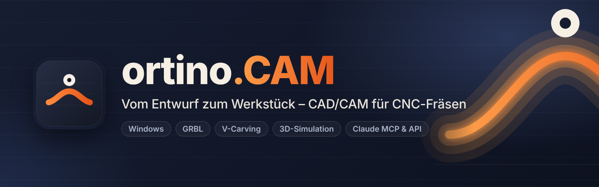
</p>

<p align="center">
  <a href="https://github.com/KlapSC/ortino-cam/releases/latest"></a>
  <a href="https://github.com/KlapSC/ortino-cam/issues/new/choose"></a>
</p>

<p align="center">
  
  
  
  
  
  
</p>

<h3 align="center">
  <a href="#auf-einen-blick">Auf einen Blick</a> ·
  <a href="#funktionen">Funktionen</a> ·
  <a href="#community-portal-und-designs">Portal</a> ·
  <a href="#steuerbar-mit-claude--mcp-server-und-lokale-api">Claude &amp; API</a> ·
  <a href="#ortinocam-und-vectric-aspire">Vergleich</a> ·
  <a href="#installation-windows-1011-64-bit">Installation</a> ·
  <a href="#häufige-fragen">Fragen</a> ·
  <a href="#mitmachen">Mitmachen</a> ·
  <a href="#haftungsausschluss">Haftungsausschluss</a>
</h3>

**ortino.CAM** ist eine **CAD/CAM-Software für CNC-Fräsen** unter Windows: zeichnen, Werkzeugwege berechnen (Profil, Tasche, V-Carving, 3D-Relief), in 3D simulieren, prüfen und direkt an eine **GRBL-Steuerung** wie die der Ultimate Bee (CNC xPRO V5) schicken – alles in einer Anwendung. Mit einem **MCP-Server und einer lokalen API** lässt sie sich von **Claude** und eigenen Skripten steuern.

<p align="center">
  <picture>
    <source media="(prefers-color-scheme: light)" srcset="docs/bilder/entwurf-light.png">
    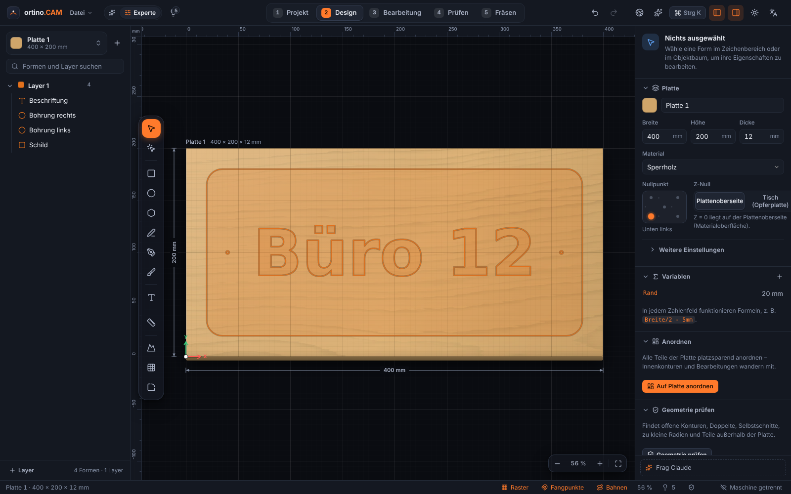
  </picture>
</p>

> [!WARNING]
> **Frühe Version (0.3.x): nicht alles ist an einer echten Maschine erprobt.** An echter Hardware erprobt sind bisher nur Taschen, V-Carving, Konturen, Referenzfahrt und Werkzeugwechsel mit der Tastplatte (Version 0.3.3, Ultimate Bee mit xPRO V5). **Nur gegen Simulator und Tests geprüft** sind fester Taster, Messung der Opferplatte, Höhenkarte, Handy-Fernbedienung, »An Position fahren«, der Längensensor, **Gewindefräsen, Wartungsplan, die Kamera auf der Arbeitsplatte** und die neuen Postprozessoren. Immer zuerst **ohne Werkzeug und Material** testen, Not-Aus in Reichweite. Siehe [Haftungsausschluss](#haftungsausschluss).

## Auf einen Blick

* **Alles in einer Anwendung:** zeichnen, Werkzeugwege berechnen, in 3D simulieren, prüfen und die Maschine fahren – kein Dateien-Hin-und-Her zwischen mehreren Programmen.
* **Prüft, bevor es fräst:** Prüfliste mit Lösungsvorschlägen und ein Start-Check vor jedem Lauf; bei Fehlern sind Export und Maschinenstart gesperrt.
* **Für Einsteiger und Erfahrene:** Der Einfach-Modus schlägt Werkzeug, Tiefen und Schnittwerte vor und begründet sie; der Experten-Modus zeigt alle Einstellungen.
* **Direkt an die Maschine:** GRBL-Steuerungen über USB/COM oder Netzwerk, mit Handsteuerung, Referenzfahrt, Antasten und Werkzeugwechsel-Assistent.
* **Möbel und Platten:** Plattenplaner mit Freiform-Nesting, Fingerzinken, Küchen- und Schrank-Designer mit Stückliste.
* **Gemeinsam:** Community-Portal mit Fräsdesigns zum Laden und Teilen, dazu ein MCP-Server, mit dem **Claude** das Programm bedienen kann.
* **Kostenlos** für private und gewerbliche Nutzung, **Windows 10/11 (64 Bit)**. Ehrlich zum Stand: Es ist eine frühe Version, und was an einer echten Maschine erprobt ist und was nicht, steht [oben](#in-drei-schritten-zum-werkstück) und im [Haftungsausschluss](#haftungsausschluss).

## In drei Schritten zum Werkstück

| 1 · Bearbeiten | 2 · Prüfen | 3 · Fräsen |
|:--:|:--:|:--:|
| <picture><source media="(prefers-color-scheme: light)" srcset="docs/bilder/bearbeitung-light.png">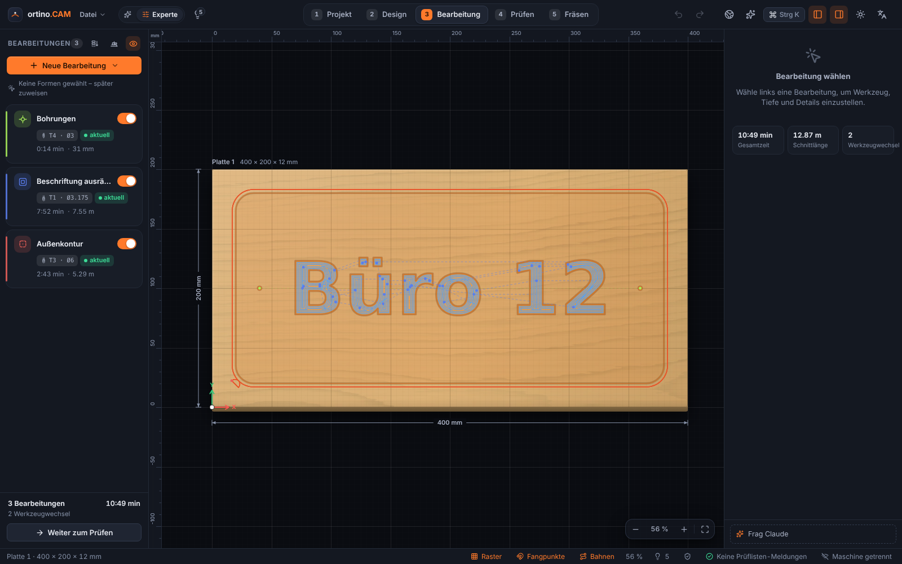</picture> | <picture><source media="(prefers-color-scheme: light)" srcset="docs/bilder/simulation-light.png">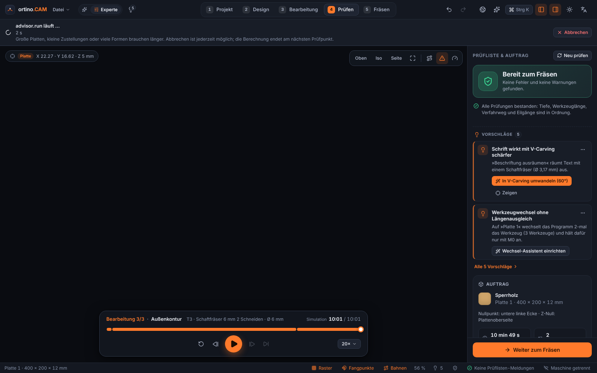</picture> | <picture><source media="(prefers-color-scheme: light)" srcset="docs/bilder/fraesen-light.png">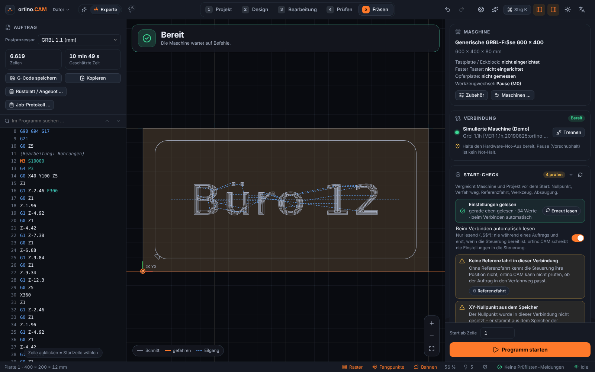</picture> |
| Werkzeugwege festlegen, mit Richtwerten für Vorschub und Drehzahl | Materialabtrag in 3D, Kollisionen, Prüfliste mit Lösungen | Verbinden, Nullpunkt, Start-Check, Pause und Stopp |

### Mehr aus dem Programm

| Rüstblatt &amp; Angebot | Maschine einrichten | Möbel &amp; Küche |
|:--:|:--:|:--:|
| <picture><source media="(prefers-color-scheme: light)" srcset="docs/bilder/ruestblatt-light.png">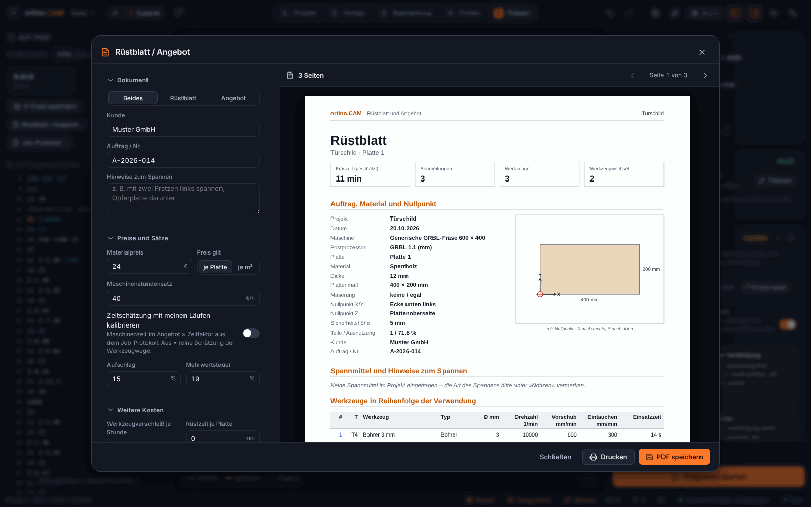</picture> | <picture><source media="(prefers-color-scheme: light)" srcset="docs/bilder/einrichtung-light.png">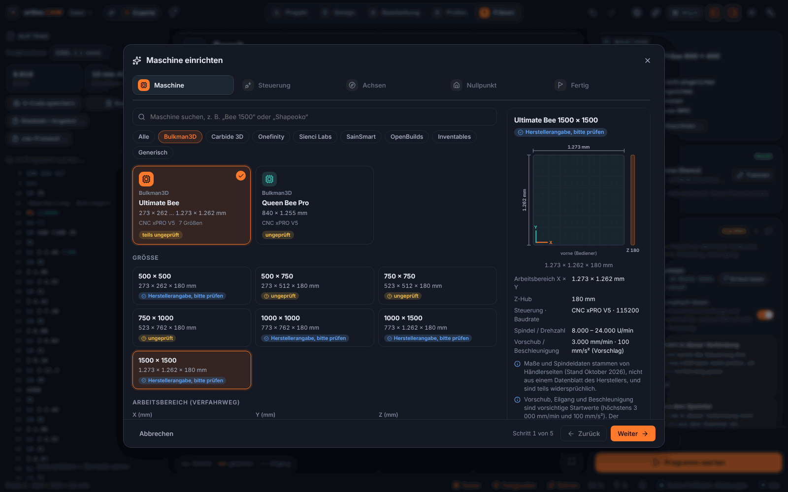</picture> | <picture><source media="(prefers-color-scheme: light)" srcset="docs/bilder/moebel-light.png">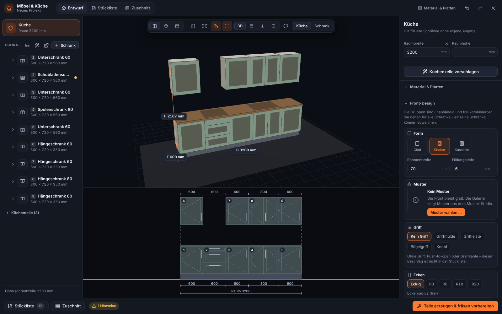</picture> |
| Vorschau des PDFs mit Werkzeugliste, Reihenfolge und Zeitschätzung, dazu Kostenrechnung<br><sub>Setup sheet and quote: PDF preview, tool list, sequence, time estimate, costs</sub> | Katalog mit Größen; Händlerwerte sind als »ungeprüft« oder »Herstellerangabe, bitte prüfen« gekennzeichnet<br><sub>Machine setup: catalogue with sizes; dealer values are flagged</sub> | Küchenzeile in 3D und Frontansicht, mit Stückliste und Zuschnitt (Beispiel)<br><sub>Furniture and kitchen: kitchen row in 3D and front view, parts list and cutting plan</sub> |

<sub>Aufnahmen der Oberfläche; die Maschine im Schritt »Fräsen« ist der eingebaute Simulator, Namen, Preise und Werte in den Beispielen sind erfunden. / Screenshots of the interface; the machine in the “Cut” step is the built-in simulator, names, prices and values in the examples are made up.</sub>

## Funktionen

| | |
|---|---|
| ✏️ **Entwerfen** | Formen, Text (auch auf Pfad, Einzellinienschriften), Bézier-Stift, Knoten bearbeiten, Boolesche Operationen, Offset, Verrunden, Arrays, Variablen und Formeln mit Einheiten (`Breite/2 - 5mm`). Import von SVG, DXF, PDF/Illustrator und Bildern (nachzeichnen). |
| 🧭 **Werkzeugwege** | Profil, Tasche, adaptives Räumen, Bohren, **Gewindefräsen** (metrisch, innen und außen), V-Carving, Inlay, Gravur, 3D-Relief. Postprozessoren für GRBL, grblHAL, FluidNC, Mach3/4 und LinuxCNC – dazu UCCNC, Centroid, ShopBot, MASSO und PlanetCNC *(nur nach Herstellerunterlagen, nicht erprobt)*. |
| 🧊 **Prüfen** | Materialabtrag-Simulation in 3D, Eilgang-Kollision, Übermaß, Prüfliste mit Lösungsvorschlägen. Bei Fehlern sind Export und Maschinenstart gesperrt. |
| 🪚 **Platten & Möbel** | Plattenplaner mit Freiform-Nesting, Passungen und Fingerzinken, Küchen- und Schrank-Designer mit Stückliste und Kantenband, Vorlagen und Serien aus CSV. |
| 🎛️ **Maschinenanbindung** | GRBL-kompatibel über USB/COM oder TCP: Handsteuerung, Referenzfahrt, Antasten (Tastplatte oder XYZ-Eckblock), Werkzeugwechsel-Assistent (Längensensor, Tastplatte oder fester Taster), **Start-Check** vor jedem Lauf, Pause, Stopp, Start ab Zeile. |
| 🧱 **Opferplatte** | Höhenkarte messen und beim Fräsen ausgleichen *(nur Simulator, nicht an echter Maschine erprobt)*. |
| 📷 **Kamera auf der Arbeitsplatte** | Vier QR-Marken in den Ecken, das Kamerabild wird entzerrt und liegt millimetergenau unter dem Entwurf; Werkstück-Umriss erkennen. *(Nur mit erzeugten Bildern geprüft, nie mit einer echten Kamera.)* |
| 🛠️ **Wartung & Standzeit** | Standzeit-Grenzen je Werkzeug, Wartungsplan je Maschine, Hinweise im Start-Check. *(Richtwerte, nur Simulator.)* |
| 📱 **Handy-Fernbedienung** | Per QR-Code koppeln, in kleinen Schritten verfahren, Pause und Stopp – aus beim Start, nur im eigenen WLAN, unverschlüsselt. |
| 🌱 **Für Einsteiger** | Einfach-Modus, Schnellstart »Was möchtest du fräsen?«, Hinweise mit Begründung, 250+ Fräser in einer Bibliothek, Richtwerte für Vorschub und Drehzahl. |
| 📄 **Rüstblatt & Angebot** | PDF mit Werkzeugliste, Reihenfolge, Zeitschätzung und Vorschau – dazu Kostenrechnung. Deutsch und Englisch. |
| 🌍 **Community-Portal** | Fräsdesigns entdecken, mit einem Klick laden und eigene teilen – im Programm integriert (Weltkugel in der Kopfleiste). [Mehr dazu](#community-portal-und-designs) |

## Community-Portal und Designs

Neben dem Programm gibt es ein **Community-Portal**: eine Webseite, auf der Fräsdesigns gesammelt, durchsucht und geteilt werden – jeweils mit den Werkzeugen, Tiefen, Vorschüben und einer Anleitung, die zum Design gehören.

* **Entdecken und suchen:** Kategorien, Suche mit Vorschlägen, Filter nach Art, Material, Plattenstärke, Fräser und Lizenz – und **»Passt auf meine Maschine«**, das den Verfahrweg deiner Maschine mit dem Design vergleicht. Stöbern und Herunterladen gehen ohne Konto.
* **Mit einem Klick ins Programm:** In ortino.CAM öffnest du die Community über die **Weltkugel in der Kopfleiste** (oder Strg+Umschalt+D) und lädst ein Design mit **»Laden & öffnen«**. Das Programm prüft das Paket vorher (Prüfsumme, Pfade, keine ausführbaren Inhalte); Skripte aus Paketen werden nie ausgeführt. Auf der Webseite gibt es zusätzlich »In ortino.CAM öffnen« und den Download der Datei.
* **Eigene Designs teilen:** im Programm über »Design teilen« oder auf der Webseite über »Hochladen«, mit einem kostenlosen Konto. Titel, Kategorie, Bilder, Beschreibung und Anleitung ergänzt du selbst; veröffentlichen kannst du öffentlich oder nicht gelistet. Beim Teilen aus dem Programm sucht ortino.CAM nach Dateipfaden und deinem Benutzernamen im Projekt und entfernt sie auf Wunsch aus dem Paket. Auch Vorlagen mit Eingabeformular lassen sich als Design teilen.
* **Rechte und Lizenz:** Lade nur hoch, was du selbst erstellt hast oder teilen darfst. Jedes Design trägt eine Lizenz (CC BY, BY-SA, BY-NC, BY-NC-SA, BY-ND, CC0 oder »Alle Rechte vorbehalten«). Laut Community-Richtlinien nicht erlaubt: fremde Werke ohne Erlaubnis, geschützte Logos und Marken, Waffen oder rechtlich eingeschränkte Teile, gefährliche Anleitungen, absichtlich falsche Einstellungen, Schadsoftware. Verstöße lassen sich über »Melden« der Moderation anzeigen.
* **Katalog eigener Designs:** Als Grundstock ist ein Katalog mit 17 eigenen Beispiel-Designs vorbereitet: Leuchten, Wandbilder, Stühle und Tische. Sie stammen vom KI-Konto »Claude«, wurden **nur am Rechner geprüft** (Prüfliste, G-Code, Simulation) und **nie gefräst oder belastet**; bei Möbeln erst einen Prototyp bauen.
* **Adresse und Kontakt:** [benini.access.ly:8088](https://benini.access.ly:8088) – im Programm schon eingetragen. Fragen, Fehler und Wünsche zum Portal wie überall über [GitHub Issues](https://github.com/KlapSC/ortino-cam/issues/new/choose).
* **Stand:** Das Portal wird von einer **Einzelperson** betrieben und ist **noch im Aufbau**. Das Zusammenspiel von Programm und Portal ist gegen eine lokale Testinstallation geprüft; nicht alles ist im Betrieb im Internet erprobt, zum Beispiel »In ortino.CAM öffnen« aus dem Browser unter Windows. Schnittwerte in Designs (Vorschub, Drehzahl, Tiefe) sind Angaben der Ersteller und gehören zu deren Maschine und Material: vor dem Fräsen im Programm prüfen, mit einem Reststück beginnen.

| Startseite | Suche | Designseite |
|:--:|:--:|:--:|
| <picture><source media="(prefers-color-scheme: light)" srcset="docs/bilder/portal-startseite-light.png">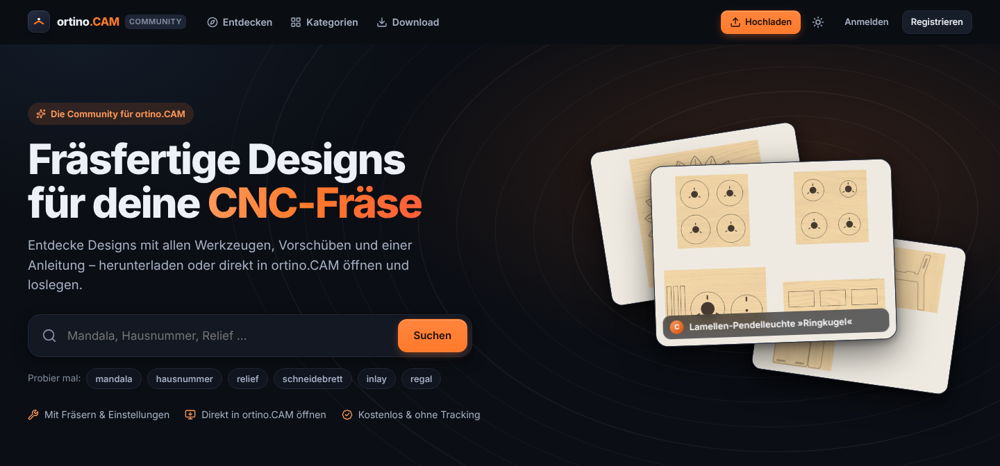</picture> | <picture><source media="(prefers-color-scheme: light)" srcset="docs/bilder/portal-suche-light.png">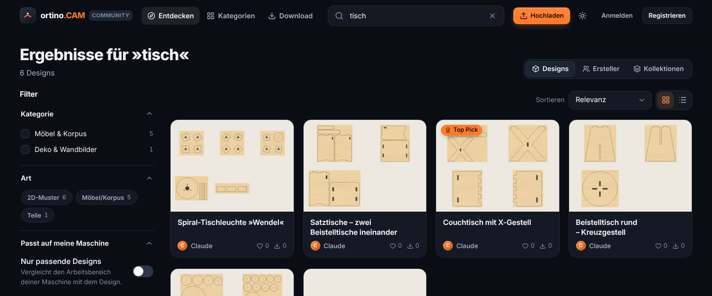</picture> | <picture><source media="(prefers-color-scheme: light)" srcset="docs/bilder/portal-design-light.png">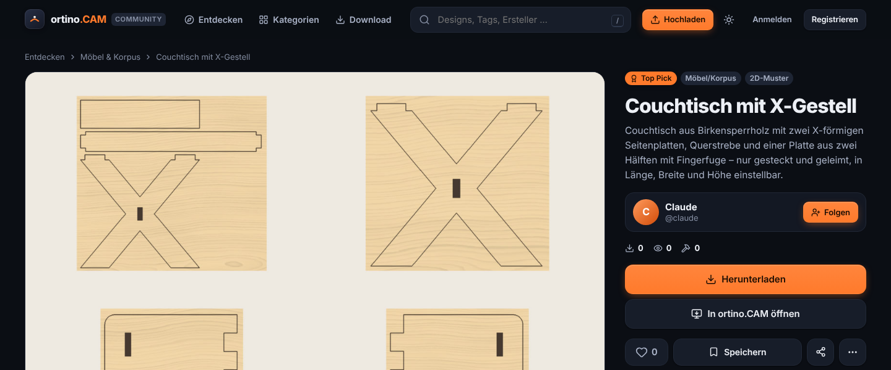</picture> |
| Startseite mit Suche<br><sub>Home page with search</sub> | Filter nach Kategorie, Art und Maschine<br><sub>Search and filters</sub> | Galerie, Herunterladen, »In ortino.CAM öffnen«<br><sub>Design page with gallery and download</sub> |

| Im Programm | Hochladen | Lizenz wählen |
|:--:|:--:|:--:|
| <picture><source media="(prefers-color-scheme: light)" srcset="docs/bilder/community-im-programm-light.png">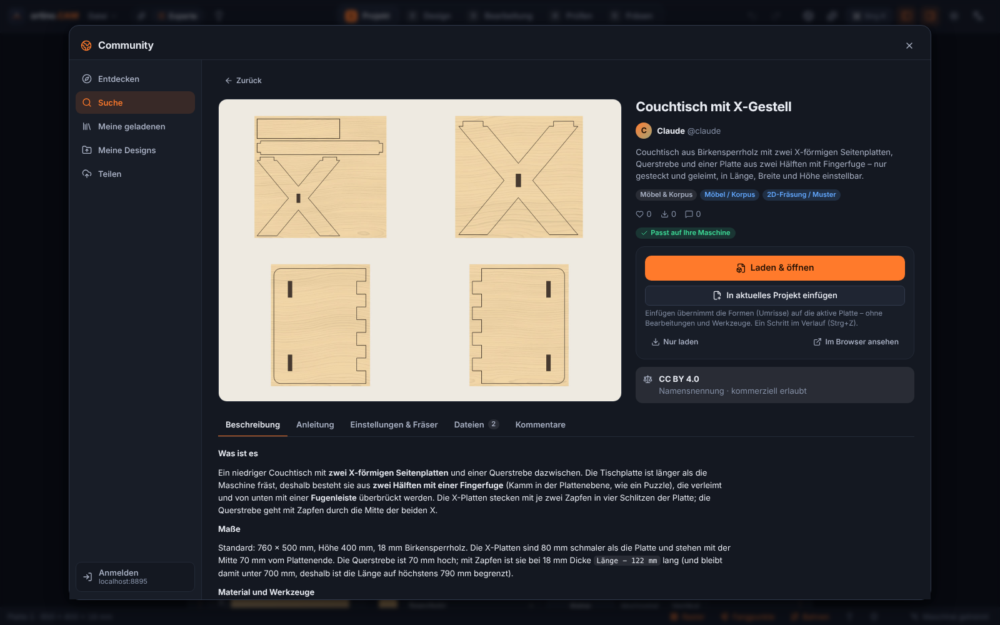</picture> | <picture><source media="(prefers-color-scheme: light)" srcset="docs/bilder/portal-hochladen-light.png">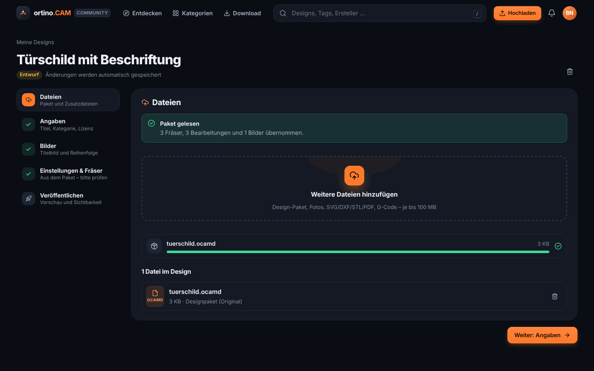</picture> | <picture><source media="(prefers-color-scheme: light)" srcset="docs/bilder/portal-lizenz-light.png">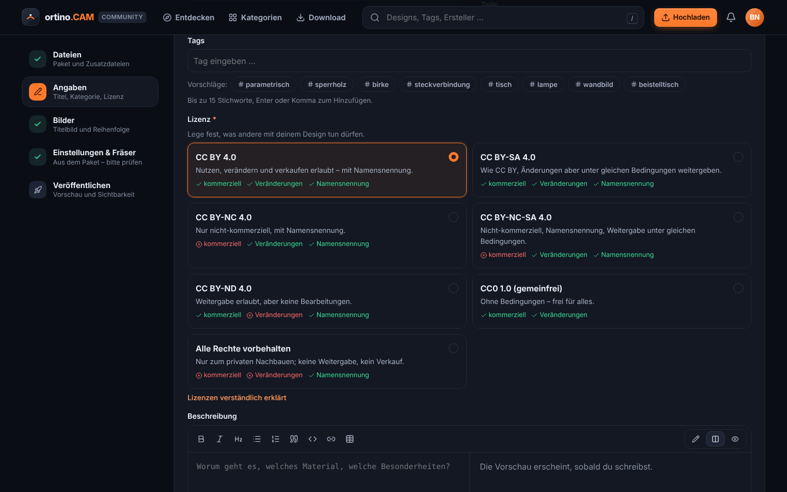</picture> |
| Designseite in der Community, »Laden &amp; öffnen«<br><sub>Inside the app: load and open</sub> | Der Assistent liest das Design-Paket aus dem Programm<br><sub>Upload: the assistant reads the design package</sub> | Jedes Design trägt eine Lizenz<br><sub>Choosing a licence</sub> |

*Die Portal-Bilder zeigen **Beispieldaten aus einer lokalen Installation** (die Katalog-Designs, ohne Nutzerzahlen); das Portal im Internet kann anders aussehen. Alle Bilder: hell oder dunkel je nach Darstellung deines Browsers.*

<details>
<summary><strong>Community portal and designs (English)</strong></summary>

Alongside the app there is a **community portal**: a website where milling designs are collected, searched and shared – each with the tools, depths, feeds and instructions that belong to the design.

* **Discover and search:** categories, search with suggestions, filters (type, material, sheet thickness, bit, licence) and **“fits my machine”**. Browsing and downloading work without an account.
* **One click into the app:** open Community with the **globe icon in the top bar** (or Ctrl+Shift+D) and load a design with **“Load & open”**. The app checks the package first (checksum, paths, no executable content) and never runs scripts from packages. The website also offers “Open in ortino.CAM” and the file download.
* **Share your own:** from the app (“Share design”) or on the website (“Upload”), with a free account. The app looks for file paths and your user name in the project and can strip them from the package. Templates with an input form can be shared as designs, too.
* **Rights and licence:** upload only what you made yourself or are allowed to share. Every design carries a licence (CC BY, BY-SA, BY-NC, BY-NC-SA, BY-ND, CC0 or all rights reserved). The community guidelines do not allow other people’s work without permission, protected logos and trademarks, weapons or legally restricted parts, dangerous instructions, deliberately wrong settings, or malware.
* **Catalogue:** 17 own sample designs (lamps, wall art, chairs, tables) are prepared as a starting stock. They come from the AI account “Claude”, were checked on the computer only (pre-flight check, G-code, simulation) and were never milled or load-tested.
* **Address and contact:** [benini.access.ly:8088](https://benini.access.ly:8088), already set up in the app. Questions, bugs and wishes about the portal go through [GitHub issues](https://github.com/KlapSC/ortino-cam/issues/new/choose), as everywhere.
* **Status:** the portal is run by **one person** and is **still being built**. The interplay of app and portal is tested against a local test installation, not everything in live operation on the internet (for example “Open in ortino.CAM” from the browser on Windows). Feeds and speeds in designs are the creators’ values: check them before cutting and start with an offcut.

The portal images show **sample data from a local installation** (the catalogue designs, without user numbers); the portal on the internet may look different.

</details>

## Steuerbar mit Claude – MCP-Server und lokale API

ortino.CAM bringt einen **MCP-Server** (*Model Context Protocol*) mit: **Claude Desktop**, **Claude Code** und jeder andere MCP-Client können zeichnen, Bearbeitungen anlegen, die Prüfliste abarbeiten und G-Code erzeugen – **live im Programmfenster**, jede Aktion ein Rückgängig-Schritt (Strg+Z).

* **MCP-Server `ortino-mcp`** für Claude Desktop und Claude Code.
* **Lokale API** (JSON, nur `127.0.0.1`, zufälliger Zugangsschlüssel, nur auf Wunsch eingeschaltet) für eigene Programme und Skripte.
* **Kommandozeile `ortino`**: G-Code erzeugen, Projekt prüfen, DXF/SVG exportieren, Serien aus CSV – auch für CI.
* **Eigene Werkzeuge** als Rhai-Skripte, die auch Claude benutzen kann.
* **Assistent im Programm** mit deinem eigenen Anthropic-API-Schlüssel (im Windows-Anmeldeinformationsspeicher, nicht in Dateien).

| Stufe | Was erlaubt ist | Standard |
|---|---|---|
| `read` | Projekt, Prüfliste, Vorschau lesen | erlaubt |
| `edit` | Projekt ändern (je Aktion ein Undo-Schritt) | erlaubt |
| `machine` | Verfahren, Spindel, Nullpunkt, Antasten | **gesperrt**, jede Aktion mit Bestätigung im Programm |
| `danger` | Job starten, Dateien überschreiben | **gesperrt**, jede Aktion mit Bestätigung im Programm |

Einstellungen der Steuerung (`$…=`) schreibt ortino.CAM **auf keiner Stufe**, auch nicht über die API.

```jsonc
// claude_desktop_config.json
{
  "mcpServers": {
    "ortino-cam": {
      "command": "C:\\Users\\<Name>\\AppData\\Local\\ortino.CAM\\ortino-mcp.exe",
      "args": []
    }
  }
}
```

```bash
ortino check  tuerschild.ocam
ortino gcode  tuerschild.ocam -o tuerschild.nc --post grbl
ortino export tuerschild.ocam --format dxf -o tuerschild.dxf
```

## ortino.CAM und Vectric Aspire

Eine kurze, sachliche Gegenüberstellung mit den Stärken beider Seiten. Verglichen wird mit Vectric Aspire, dem teuersten Programm der Vectric-Reihe.

| | ortino.CAM | Vectric Aspire |
|---|---|---|
| **Preis** | kostenlos | einmalig rund 1.800 € (laut Preisliste des Herstellers; Updates im ersten Jahr inklusive) |
| **System** | Windows 10/11, 64 Bit | Windows (Mac nur über eine Windows-Virtualisierung) |
| **2D-Entwurf, Profil, Tasche, V-Carving, Gravur, Inlay** | ja | ja |
| **3D-Relief** | Reliefs aus Mustern, Höhenbildern und Formen erzeugen und fräsen; kleiner Umfang; Modellierwerkzeuge (Skulptieren, Komponenten) für Version 0.4.0 geplant | umfangreiche 3D-Modellierung (Formen, Skulptieren, Komponenten) – <strong>hier ist Aspire klar stärker</strong> |
| **Vierte Achse (Rotary)** | nein – für Version 0.4.0 geplant | ja |
| **Nesting** | ja (Plattenplaner mit Freiform-Nesting) | ja |
| **Zur Maschine schicken** | direkt aus dem Programm an GRBL-Steuerungen (USB/COM, TCP), mit Start-Check, Antasten und Werkzeugwechsel-Assistent | erzeugt G-Code-Dateien, die ein separates Steuerungsprogramm ausführt |
| **Postprozessoren** | GRBL, grblHAL, FluidNC, Mach3/4, LinuxCNC; UCCNC, Centroid, ShopBot, MASSO, PlanetCNC (nicht erprobt); weitere Steuerungen laufend, Beiträge willkommen | sehr großer Katalog, online verwaltet; deutlich mehr Steuerungen |
| **Steuerung durch Claude (MCP-Server, lokale API)** | ja | keine Angabe des Herstellers gefunden |
| **Reife** | junge Software (0.3.x), nur Teile an einer echten Maschine erprobt | seit Jahren etabliert, große Nutzergemeinde |
| **Hilfe** | Anleitungen im Repository, Fragen über GitHub Issues (Einzelperson) | Hersteller-Support, Handbuch, Videos, Forum |
| **Kompatibilität** | liest Vectric-Werkzeugdatenbanken (.vtdb; das Format ist nicht offiziell dokumentiert, mit einer echten Vectric-Datei bisher nicht getestet) | – |

**Aspire ist die bessere Wahl, wenn du** eine vierte Achse (Rotary) brauchst, umfangreich in 3D modellieren willst (Skulptieren, Komponenten), auf einem Mac arbeitest (über eine Windows-Virtualisierung), Hersteller-Support möchtest oder auf lange Praxis und eine große Nutzergemeinde setzt.

**ortino.CAM passt, wenn du** eine GRBL-Maschine direkt aus dem Programm fahren willst, einen Möbel- und Küchen-Designer mit Stückliste suchst, das Community-Portal nutzen möchtest, dein CAM per Claude (MCP) steuern willst und ein kostenloses Programm bevorzugst – und mit einer jungen Software leben kannst.

<sub>Angaben zu Vectric nach öffentlich zugänglichen Herstellerangaben und Fachseiten, Stand Oktober 2026, ohne Gewähr; Preise und Umfang ändern sich – bitte beim Hersteller prüfen ([Produktseite Aspire](https://www.vectric.com/products/aspire/)). Vectric, VCarve und Aspire sind Marken der Vectric Ltd.; ortino.CAM ist unabhängig und steht in keiner Verbindung zu Vectric. »Geplant« ist die Absicht des Entwicklers, keine Zusage; Umfang und Zeitpunkt können sich ändern.</sub>

<details>
<summary><strong>ortino.CAM and Vectric Aspire (English)</strong></summary>

A short, factual comparison that names the strengths of both sides. The comparison is with Vectric Aspire, the most expensive program in the Vectric range.

| | ortino.CAM | Vectric Aspire |
|---|---|---|
| **Price** | free | one-off, about €1,800 (according to the manufacturer’s price list; updates included in the first year) |
| **System** | Windows 10/11, 64-bit | Windows (Mac only through Windows virtualisation) |
| **2D design, profile, pocket, V-carving, engraving, inlay** | yes | yes |
| **3D relief** | creates and mills reliefs from patterns, height images and shapes; small scope; modelling tools (sculpting, components) planned for version 0.4.0 | extensive 3D modelling (shapes, sculpting, components) – <strong>Aspire is clearly stronger here</strong> |
| **Fourth axis (rotary)** | no – planned for version 0.4.0 | yes |
| **Nesting** | yes (sheet planner with free-form nesting) | yes |
| **Sending to the machine** | straight from the app to GRBL controllers (USB/COM, TCP), with start check, probing and tool-change assistant | produces G-code files that a separate control program runs |
| **Post-processors** | GRBL, grblHAL, FluidNC, Mach3/4, LinuxCNC; UCCNC, Centroid, ShopBot, MASSO, PlanetCNC (untested); more controllers ongoing, contributions welcome | very large catalogue, managed online; considerably more controllers |
| **Control by Claude (MCP server, local API)** | yes | no statement from the manufacturer found |
| **Maturity** | young software (0.3.x), only parts tested on a real machine | established for years, large user community |
| **Help** | guides in the repository, questions via GitHub issues (one person) | manufacturer support, manual, videos, forum |
| **Compatibility** | reads Vectric tool databases (.vtdb; the format is not officially documented, not yet tested with a real Vectric file) | – |

**Aspire is the better choice if you** need a fourth axis (rotary), want extensive 3D modelling (sculpting, components), work on a Mac (through Windows virtualisation), want manufacturer support or rely on long practice and a large user community.

**ortino.CAM fits if you** want to run a GRBL machine straight from the program, want a furniture and kitchen designer with a parts list, want to use the community portal, want to drive your CAM with Claude (MCP) and prefer a free program – and can live with young software.

<sub>Statements about Vectric are based on publicly available manufacturer information and trade sites, as of October 2026, without guarantee; prices and scope change – please check with the manufacturer ([Aspire product page](https://www.vectric.com/products/aspire/)). Vectric, VCarve and Aspire are trademarks of Vectric Ltd.; ortino.CAM is independent and not affiliated with Vectric. “Planned” is the developer’s intention, not a commitment; scope and timing may change.</sub>

</details>

## Installation (Windows 10/11, 64 Bit)

1. Unter [**Releases**](https://github.com/KlapSC/ortino-cam/releases/latest) die Datei `ortino.cam_<Version>_x64-setup.exe` herunterladen (alternativ die `.msi`, `…_x64_de-de.msi`). Die Prüfsumme (SHA-256) steht in den Hinweisen der Version.
2. Starten und installieren. **Windows warnt beim ersten Start** (SmartScreen: »Weitere Informationen → Trotzdem ausführen«): Der Installer ist mit einem **selbst erstellten Zertifikat** signiert, nicht von einer Zertifizierungsstelle.
3. `.ocam`-Projekte öffnen sich danach per Doppelklick. Ein Beispielprojekt liegt den Releases bei.

**Updates** kommen **im Programm** selbst: Gibt es eine neue Version, zeigt die Kopfleiste einen Hinweis; installiert wird nur nach deinem Klick, mit geprüfter Signatur und nie mitten in einem Fräsauftrag. Das Programm spricht dafür mit dem offiziellen Portal des Betreibers, nicht mit GitHub; übermittelt werden nur Systemart, Architektur, Installationsart und die installierte Version. Diese Seite zeigt nur die Versionen zum Herunterladen.

## Erste Schritte

1. **Installieren** (siehe oben) und starten.
2. **Maschine einrichten:** Der Assistent »Maschine einrichten« (Schritt »Projekt«) bietet einen Katalog mit Größen und Steuerung; eigene Maschinen sind möglich. Die Maße aus dem Katalog sind teils Herstellerangaben, teils abgeleitet – sie sind als solche gekennzeichnet; bitte einmal nachmessen.
3. **Etwas zum Fräsen wählen:** über »Was möchtest du fräsen?« einen Startpunkt wählen oder das Beispielprojekt `tuerschild.ocam` aus den Releases öffnen.
4. **Bearbeiten:** Bearbeitungen anlegen (Profil, Tasche, Bohren, V-Carving …). Im Einfach-Modus kommen Werkzeug, Tiefen und Schnittwerte als Vorschlag mit Begründung.
5. **Prüfen:** 3D-Simulation ansehen und die Prüfliste abarbeiten.
6. **Fräsen:** Maschine verbinden, Nullpunkt setzen, Start-Check lesen. **Zuerst ohne Werkzeug und ohne Material fahren**, Not-Aus in Reichweite, dann mit einem Reststück beginnen.

### Maschinen und Steuerungen

| | |
|---|---|
| **Direkt angebunden** | GRBL-kompatible Steuerungen (GRBL 1.1, grblHAL, FluidNC) über USB/COM oder TCP |
| **Maschinenkatalog** | u. a. Bulkman3D (Ultimate Bee, CNC xPRO V5), Carbide 3D, Onefinity, Sienci Labs, SainSmart, OpenBuilds, Inventables und eine generische GRBL-Vorlage |
| **G-Code zum Export** | Postprozessoren für Mach3/Mach4 und LinuxCNC sowie UCCNC, Centroid, ShopBot, MASSO und PlanetCNC (diese fünf nur nach Herstellerunterlagen, **nicht erprobt**; ohne direkte Anbindung); eigene Postprozessoren als Textdatei möglich ([`postprozessoren/`](postprozessoren/)) |
| **An echter Maschine erprobt** | bisher nur die Ultimate Bee mit xPRO V5 (siehe Hinweis oben) – **Berichte von anderen Maschinen sind sehr willkommen** ([Vorlage »Test an einer echten Maschine«](https://github.com/KlapSC/ortino-cam/issues/new/choose)) |

## Sicherheit

* Das Programm schreibt **nie** Einstellungen (`$`-Werte) in deine Steuerung; es liest sie nur und vergleicht sie mit dem Maschinenprofil.
* Die Handy-Fernbedienung ist aus, bis du sie einschaltest, und **nicht verschlüsselt**: nur im eigenen, vertrauenswürdigen WLAN. Der Stopp am Rechner bleibt die eigentliche Sicherung.
* Dein Anthropic-Schlüssel für den Assistenten (falls du einen nutzt) liegt im Windows-Anmeldeinformationsspeicher.
* Sicherheitslücken bitte **nicht** als öffentliches Issue melden, sondern wie in [`SECURITY.md`](SECURITY.md) beschrieben.

## Haftungsausschluss

**ortino.CAM wird ohne jede Gewährleistung und ohne Zusicherung bestimmter Eigenschaften bereitgestellt (»wie besehen«). Die Nutzung erfolgt auf eigene Gefahr.**

* CNC-Maschinen sind gefährlich. Fehler im Programm, in den Einstellungen oder in der Maschine können zu **Verletzungen, Schäden an Maschine, Werkzeug und Werkstück, Bränden und Datenverlust** führen. Du bist allein dafür verantwortlich, Werkzeugwege, G-Code, Nullpunkt, Werkzeug und Einspannung vor jedem Lauf zu prüfen, **zuerst ohne Werkzeug und Material** zu testen, den **Not-Aus in Reichweite** zu halten und die Maschine **nie unbeaufsichtigt** laufen zu lassen.
* Simulation, Prüfliste und Start-Check sind Hilfen und **keine Sicherheitsfunktion**. Sie können Fehler übersehen. ortino.CAM ersetzt keinen Not-Aus, keine Schutzeinrichtung und keine eigene Sorgfalt.
* Die Software ist **überwiegend mit KI-Unterstützung entstanden** und nur teilweise an echten Maschinen erprobt (siehe Hinweis oben). Mit Fehlern ist zu rechnen. Werte wie Vorschübe, Drehzahlen, Zeiten und Kosten sind Richtwerte oder Näherungen.
* Der Betreiber und die Mitwirkenden **haften nicht** für Schäden, die aus der Nutzung oder Nichtnutzbarkeit von ortino.CAM entstehen, **soweit das Gesetz es zulässt**. Unberührt bleibt die Haftung für Vorsatz, für die Verletzung von Leben, Körper und Gesundheit und, wo zwingend vorgeschrieben (z. B. nach dem Produkthaftungsgesetz), nach den gesetzlichen Vorschriften.
* Das gilt ebenso für die **Handy-Fernbedienung**, die Anbindung an die Steuerung und alle Hilfen des Assistenten und von Claude: Maschinenbefehle trägst du, nicht das Programm.

Maßgeblich sind die Nutzungsbedingungen in [`LICENSE`](LICENSE).

<details>
<summary><strong>Disclaimer (English)</strong></summary>

ortino.CAM is provided "as is", without warranty of any kind, and you use it at your own risk. CNC machines can cause injury and damage. Verify everything before each run, test without tool and material first, keep the emergency stop within reach and never leave the machine unattended. The pre-flight check and simulation are aids, not safety functions. To the extent permitted by law, the operator and contributors are not liable for any damages; liability for intent, injury to life, body or health, and where mandatory law requires it remains unaffected.

</details>

## Häufige Fragen

<details>
<summary><strong>Kostet ortino.CAM etwas?</strong></summary>

Nein. Private und gewerbliche Nutzung sind kostenlos erlaubt (Bedingungen in [`LICENSE`](LICENSE)). Der Quelltext ist nicht öffentlich.
</details>

<details>
<summary><strong>Läuft es auf Mac oder Linux?</strong></summary>

Nein, derzeit nur unter Windows 10 und 11 (64 Bit).
</details>

<details>
<summary><strong>Brauche ich Claude oder einen Anthropic-Schlüssel?</strong></summary>

Nein. Alles Wesentliche läuft ohne. Den MCP-Server und den Assistenten im Programm kannst du zusätzlich nutzen; der Assistent braucht deinen eigenen Anthropic-Schlüssel.
</details>

<details>
<summary><strong>Funktioniert es mit meiner Maschine?</strong></summary>

Mit GRBL-kompatiblen Steuerungen (GRBL 1.1, grblHAL, FluidNC) ja, direkt aus dem Programm. Erprobt ist bisher nur die Ultimate Bee mit xPRO V5, alles andere ist **nicht an einer echten Maschine geprüft**. Für andere Steuerungen (Mach3/Mach4, LinuxCNC, UCCNC, Centroid, ShopBot, MASSO, PlanetCNC) erzeugt das Programm G-Code zum Export; die letzten fünf sind nicht erprobt. Prüfe die Maße im Maschinenprofil und fahre zuerst ohne Werkzeug und Material.
</details>

<details>
<summary><strong>Warum warnt Windows beim Installieren?</strong></summary>

Der Installer ist mit einem **selbst erstellten Zertifikat** signiert, nicht von einer Zertifizierungsstelle. Windows (SmartScreen) zeigt deshalb eine Warnung: »Weitere Informationen → Trotzdem ausführen«. Die Prüfsumme (SHA-256) steht in den Hinweisen jeder Version.
</details>

<details>
<summary><strong>Sind die vorgeschlagenen Vorschübe und Drehzahlen sicher?</strong></summary>

Nein, es sind **Richtwerte**. Sie hängen von deiner Maschine, deinem Fräser und deinem Material ab. Prüfe sie, fange vorsichtig an und probiere an einem Reststück.
</details>

<details>
<summary><strong>Kann ich meine Fräserbibliothek mitnehmen?</strong></summary>

Das Programm bringt über 250 Fräser mit und kann Fräserdatenbanken anderer Programme einlesen (Vectric-`.vtdb`, Fusion, CSV). Das `.vtdb`-Format ist nicht offiziell dokumentiert und wurde mit einer echten Vectric-Datei bisher nicht getestet.
</details>

<details>
<summary><strong>Welche Daten sendet das Programm?</strong></summary>

Bei der Update-Abfrage nur Systemart, Architektur, Installationsart und die installierte Version, an das Portal des Betreibers (nicht an GitHub). Mit dem Community-Portal sprichst du nur, wenn du es benutzt. Der Assistent spricht mit Anthropic, wenn du ihn mit deinem Schlüssel einschaltest. Die lokale API ist aus, bis du sie einschaltest, und nur auf `127.0.0.1` erreichbar.
</details>

<details>
<summary><strong>Wie kann ich helfen?</strong></summary>

Am wertvollsten sind **Tests an echten Maschinen** und Fehlermeldungen. Siehe [Mitmachen](#mitmachen).
</details>

## Wie geht es weiter?

* **Für Version 0.4.0 geplant:** eine vierte Achse (Rotary) und Modellierwerkzeuge für 3D-Reliefs (Skulptieren, Komponenten).
* **Laufend:** Tests an echten Maschinen, weitere Postprozessoren (Beiträge willkommen), Anleitungen und Übersetzungen.

*»Geplant« ist die Absicht des Entwicklers, keine Zusage; Umfang und Zeitpunkt können sich ändern.*

## Wie ortino.CAM entsteht

ortino.CAM wird **zum größten Teil mit Claude Code (Anthropic) als Co-Autor entwickelt**: Programmcode, automatische Tests und Anleitungen stammen mehrheitlich aus dieser Zusammenarbeit, auch diese Seite. Anforderungen, Entscheidungen, Abnahme und Veröffentlichung liegen beim Betreiber. Tausende automatische Tests prüfen die Rechnung, aber sie stammen aus derselben Quelle wie der Code. Deshalb sind **Tests an echten Maschinen** so wichtig und Berichte darüber so willkommen. KI-erzeugte Bilder im Portal sind dort als solche gekennzeichnet.

## Mitmachen

**Neue Mitwirkende sind willkommen.** Der Quelltext ist nicht öffentlich, mitmachen kannst du trotzdem an vielem:

* **Tests an echten Maschinen** – am wertvollsten. Vorlage »Test an einer echten Maschine« unter [Issues](https://github.com/KlapSC/ortino-cam/issues/new/choose); auch Fehlschläge helfen.
* **Fehler melden und Wünsche äußern** – ebenfalls als Issue.
* **Beiträge als Dateien** per Pull Request: Maschinenprofile, Postprozessor-Vorlagen, Beispielprojekte, Übersetzungen, Korrekturen an Anleitungen. Regeln und Rechte: [`CONTRIBUTING.md`](CONTRIBUTING.md).
* **Mitarbeit am Programm selbst:** Schreibe ein Issue »Mitarbeit am Programm« und beschreibe, woran du Interesse hast. **Der Betreiber gibt Interessierten den Zugang zur Entwicklung frei.**
* **Fräsdesigns** teilst du am besten im Community-Portal direkt aus dem Programm, nicht hier.
* **Anleitungen:** Das **[Wiki](https://github.com/KlapSC/ortino-cam/wiki)** erklärt Installation, erste Schritte, Maschine einrichten, Fräsen, Fehlersuche und mehr; Fehler und Lücken darin meldest du als Issue.

## Kontakt

Alles läuft über **[GitHub Issues](https://github.com/KlapSC/ortino-cam/issues/new/choose)**: Fragen, Fehler, Wünsche, Maschinenberichte.

## Lizenz

ortino.CAM ist **keine Open-Source-Software**: Der Quelltext ist nicht öffentlich. Die Nutzungsbedingungen (private und gewerbliche Nutzung erlaubt; Weitergeben, Verändern und Weiterverkaufen nicht) stehen in [`LICENSE`](LICENSE); Bausteine Dritter mit ihren Lizenzen in [`THIRD-PARTY-NOTICES.txt`](THIRD-PARTY-NOTICES.txt).

---

### In short (English)

**ortino.CAM** is CAD/CAM software for CNC routers on Windows – design, toolpaths (profile, pocket, V-carving, 3D relief), 3D simulation, a pre-flight check and direct GRBL machine control, drivable by **Claude through an MCP server** and a local API. Early version (0.3.x): proven on a real machine so far only for pockets, V-carving, profiles, homing and touch-plate tool changes; newer features (fixed tool probe, spoilboard height map, phone remote) are tested against a simulator only. Download the installer under **Releases**; the app updates itself through the operator's portal. It comes with a **community portal** for milling designs (discover, search, load into the app, share your own; run by one person, still being built) and a short, factual comparison with Vectric Aspire. Developed mostly with Claude Code (Anthropic) as co-author, directed and accepted by the operator. Closed source; private and commercial use allowed, redistribution not – see `LICENSE`. Provided "as is", without warranty. Contributions welcome as issues (especially real-machine test reports) and as data files – see `CONTRIBUTING.md`.
