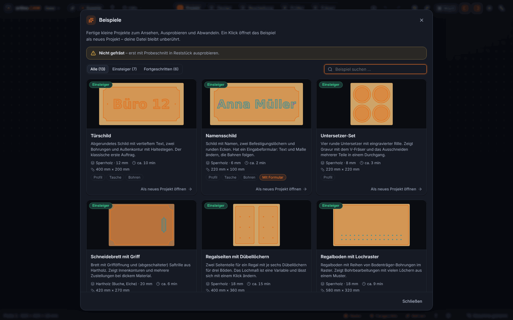
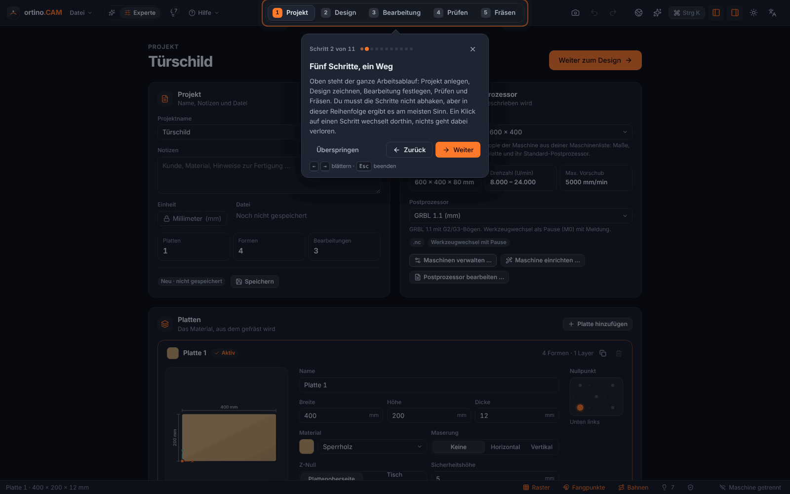
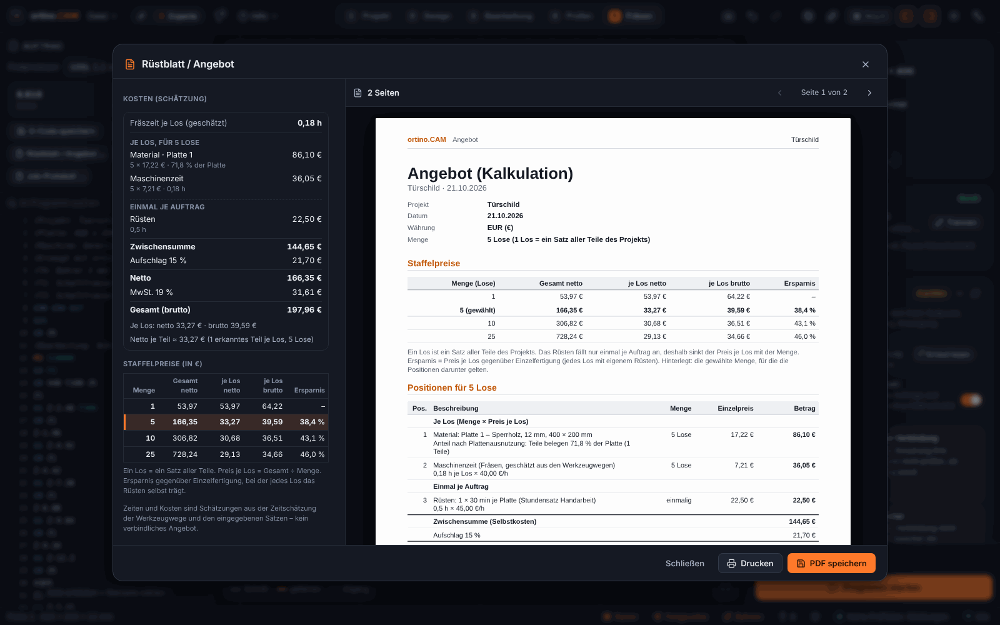

<p align="center">
  
</p>

<p align="center">
  <a href="https://github.com/KlapSC/ortino-cam/releases/latest"></a>
  <a href="https://github.com/KlapSC/ortino-cam/issues/new/choose"></a>
</p>

<p align="center">
  
  
  
  
  
  
</p>

<h3 align="center">
  <a href="#auf-einen-blick">Auf einen Blick</a> ·
  <a href="#funktionen">Funktionen</a> ·
  <a href="#community-portal-und-designs">Portal</a> ·
  <a href="#steuerbar-mit-claude--mcp-server-und-lokale-api">Claude &amp; API</a> ·
  <a href="#ortinocam-und-vectric-aspire">Vergleich</a> ·
  <a href="#installation-windows-1011-64-bit">Installation</a> ·
  <a href="#häufige-fragen">Fragen</a> ·
  <a href="#mitmachen">Mitmachen</a> ·
  <a href="#haftungsausschluss">Haftungsausschluss</a>
</h3>

**ortino.CAM** ist eine **CAD/CAM-Software für CNC-Fräsen** unter Windows: zeichnen, Werkzeugwege berechnen (Profil, Tasche, V-Carving, 3D-Relief), in 3D simulieren, prüfen und direkt an eine **GRBL-Steuerung** wie die der Ultimate Bee (CNC xPRO V5) schicken – alles in einer Anwendung. Mit einem **MCP-Server und einer lokalen API** lässt sie sich von **Claude** und eigenen Skripten steuern.

<p align="center">
  <picture>
    <source media="(prefers-color-scheme: light)" srcset="docs/bilder/entwurf-light.png">
    
  </picture>
</p>

> [!WARNING]
> **Frühe Version (0.3.x): nicht alles ist an einer echten Maschine erprobt.** An echter Hardware erprobt sind bisher nur Taschen, V-Carving, Konturen, Referenzfahrt und Werkzeugwechsel mit der Tastplatte (Version 0.3.3, Ultimate Bee mit xPRO V5, **GRBL**); dazu laut Rückmeldung des Betreibers das **Einrichten des festen Tasters und das Einmessen eines Werkzeugs an ihm** (Version 0.3.10, dieselbe Maschine) und an der **Handy-Fernbedienung** das **Stoppen, Verfahren und Setzen der Nullpunkte** (dieselbe Maschine) sowie die **Korrektur des Werkzeugwechsels am festen Taster (0.3.13)**; ebenso lief laut Betreiber ein Projekt von der **Modellierung mit Claude (MCP)** über **»Reihenfolge optimieren«** bis zum Fräsen (Einzelheiten nicht festgehalten). **Alle anderen Postprozessoren und Steuerungen** (grblHAL, FluidNC, Mach3/4, LinuxCNC, UCCNC, Centroid, ShopBot, MASSO, PlanetCNC) sind **nicht an einer echten Maschine erprobt**. **Nur gegen Simulator und Tests geprüft** sind Messung der Opferplatte, Höhenkarte, die übrigen Teile der Handy-Fernbedienung (Pause, Anzeige), »An Position fahren«, der Längensensor, **Gewindefräsen, Wartungsplan und die Kamera auf der Arbeitsplatte**. **Alles Neue aus 0.3.9, 0.3.11, 0.3.12 und 0.3.14** (**Farben, Griffe, 3D-Reliefs und Mustergruppen im Küchenplaner, Rendering-Export, Touch- und Stiftbedienung**; Beispielgalerie, Einführung, Lektionen, Array entlang eines Pfads, Béziers, Seriennummern, Stückzahl; **doppelseitiges Fräsen mit Passstiften**, Z-Null »Opferplatte« als Vorgabe bei festem Taster, aufgeteilte Menüleiste, Einstellungen-Dialog; **Sicherung im Portal, Werkzeugwechsel »Automatisch«, »Meine Maschine«, Maschine beim Öffnen eines Designs**) lief nur gegen Tests, Simulator und im Browser (Chromium) und ist **nicht systematisch unter Windows (WebView2)** geprüft. Die **Beispiele** der Galerie und die **Lektionen** sind nicht gefräst, und **Béziers aus SVG und PDF** sind nur mit selbst erzeugten Dateien geprüft. Die **Handy-Fernbedienung ist unverschlüsselt** (nur im eigenen, vertrauenswürdigen WLAN). Immer zuerst **ohne Werkzeug und Material** testen, Not-Aus in Reichweite. Siehe [Haftungsausschluss](#haftungsausschluss).

## Auf einen Blick

* **Alles in einer Anwendung:** zeichnen, Werkzeugwege berechnen, in 3D simulieren, prüfen und die Maschine fahren – kein Dateien-Hin-und-Her zwischen mehreren Programmen.
* **Prüft, bevor es fräst:** Prüfliste mit Lösungsvorschlägen und ein Start-Check vor jedem Lauf; bei Fehlern sind Export und Maschinenstart gesperrt.
* **Für Einsteiger und Erfahrene:** Der Einfach-Modus schlägt Werkzeug, Tiefen und Schnittwerte vor und begründet sie; der Experten-Modus zeigt alle Einstellungen. Eine **Beispielgalerie**, eine **geführte Einführung** und **Lektionen** helfen beim Einstieg.
* **Direkt an die Maschine:** GRBL-Steuerungen über USB/COM oder Netzwerk, mit Handsteuerung, Referenzfahrt, Antasten und Werkzeugwechsel-Assistent.
* **Entwerfen ohne Umwege:** 2D-Zeichnen mit Formeln und Variablen, Text auf Pfad und Einzellinienschriften, Import von SVG, DXF, PDF und Bildern, dazu **25 Lochmuster** und **3D-Relief** aus Mustern und Bildern.
* **Möbel und Platten:** Plattenplaner mit Freiform-Nesting, Fingerzinken, Küchen- und Schrank-Designer mit Stückliste, Farben, Griffen, 3D-Reliefs auf Fronten und **Rendering** der Küche als Bild.
* **Vom Entwurf zum Angebot:** Rüstblatt als PDF mit Werkzeugliste und Zeitschätzung, Kostenrechnung mit Stückzahl und Staffel, Serien aus CSV.
* **Gemeinsam:** Community-Portal mit Fräsdesigns zum Laden und Teilen, dazu ein MCP-Server, mit dem **Claude** das Programm bedienen kann. Deine Maschinenprofile, Fräser und Einstellungen lassen sich **privat im Portal sichern** und auf einem zweiten Rechner abrufen.
* **Kostenlos** für private und gewerbliche Nutzung, **Windows 10/11 (64 Bit)**. Ehrlich zum Stand: Es ist eine frühe Version, und was an einer echten Maschine erprobt ist und was nicht, steht im Warnhinweis ganz oben, unter [Maschinen und Steuerungen](#maschinen-und-steuerungen) und im [Haftungsausschluss](#haftungsausschluss).

## In drei Schritten zum Werkstück

| 1 · Bearbeiten | 2 · Prüfen | 3 · Fräsen |
|:--:|:--:|:--:|
| <picture><source media="(prefers-color-scheme: light)" srcset="docs/bilder/bearbeitung-light.png"></picture> | <picture><source media="(prefers-color-scheme: light)" srcset="docs/bilder/simulation-light.png"></picture> | <picture><source media="(prefers-color-scheme: light)" srcset="docs/bilder/fraesen-light.png"></picture> |
| Werkzeugwege festlegen, mit Richtwerten für Vorschub und Drehzahl | Materialabtrag in 3D, Kollisionen, Prüfliste mit Lösungen | Verbinden, Nullpunkt, Start-Check, Pause und Stopp |

### Mehr aus dem Programm

| Rüstblatt &amp; Angebot | Maschine einrichten | Möbel &amp; Küche |
|:--:|:--:|:--:|
| <picture><source media="(prefers-color-scheme: light)" srcset="docs/bilder/ruestblatt-light.png"></picture> | <picture><source media="(prefers-color-scheme: light)" srcset="docs/bilder/einrichtung-light.png"></picture> | <picture><source media="(prefers-color-scheme: light)" srcset="docs/bilder/moebel-light.png"></picture> |
| Vorschau des PDFs mit Werkzeugliste, Reihenfolge und Zeitschätzung, dazu Kostenrechnung<br><sub>Setup sheet and quote: PDF preview, tool list, sequence, time estimate, costs</sub> | Katalog mit Größen; Händlerwerte sind als »ungeprüft« oder »Herstellerangabe, bitte prüfen« gekennzeichnet<br><sub>Machine setup: catalogue with sizes; dealer values are flagged</sub> | Küchenzeile in 3D und Frontansicht, mit Stückliste und Zuschnitt (Beispiel)<br><sub>Furniture and kitchen: kitchen row in 3D and front view, parts list and cutting plan</sub> |

### Neu in 0.3.14: Küchenplaner (Farben, Griffe, Reliefs, Rendering) und Touch

* **Anschlag bei Hochschränken** getrennt für die untere und die obere Tür wählbar.
* **Farben und Oberflächen:** Farbe und Glanzgrad (matt, seidenmatt, Hochglanz) für die ganze Küche, einen oder mehrere markierte Schränke; dreizehn Farbfelder mit dunklen Tönen (Schwarz, Anthrazit, Graphit …) und freie Hex-Farbe. Die Ansicht »Echtfarben« zeigt sie in 3D und Frontansicht, die Oberfläche steht in Stückliste, Zuschnitt und Rüstblatt.
* **Griffe:** Bügelgriff, Stangengriff, Knopf, Muschelgriff und Profilgriff mit Ausrichtung, Lage und Oberfläche; als Körper in der 3D-Vorschau, als Zukaufteile in der Stückliste, mit Prüfungen.
* **3D-Reliefs auf Fronten:** parametrische **Wellen** (Richtung, Wellenlänge, Tiefe, Profil, Phase, Mäander, Querwellen), **Lamellen, Rauten, Ripples, Dünen**. **»Muster über Auswahl«** legt ein Relief über mehrere Fronten, zum Beispiel drei Hochschränke: ein durchgehendes Muster ohne Wiederholung je Front. Die Fertigung läuft über die normale 3D-Bearbeitung.
* **Rendering exportieren:** ein Bild der Küche mit **Licht** (Tageslicht, Abend, Studio, LED-Streifen unter den Hängeschränken), **weichen Schatten**, **Glanz** lackierter Fronten, eingebauter **Spüle mit Armatur**, Boden, Wänden und Spritzschutz; PNG oder JPEG bis 4K und mehr. Ein schnelles WebGL-Bild, **kein fotorealistischer Render**; Bildschirmfarben sind keine Farbmuster. Anleitung: [Küchen-Rendering](https://github.com/KlapSC/ortino-cam/wiki/Kuechen-Rendering) im Wiki.
* **Touch und Stift:** Einstellung *Darstellung & Sprache ▸ Touch-Bedienung*; Tippen, Ziehen, Langdruck-Menü, Pinch und Verschieben, große Bedienelemente; **an der Maschine bleiben alle Sperren, es gibt kein Dauerfahren per Finger**. Das Fenster darf jetzt 760 px schmal sein (Tablet im Hochformat). Anleitung: [Touch und Stift](https://github.com/KlapSC/ortino-cam/wiki/Touch-und-Stift) im Wiki.
* *(Alles Neue nur gegen Tests, Simulator und Chromium geprüft: gefräste Reliefs und Griffbohrungen sind nicht gefräst, das Rendering lief nie auf einer echten Grafikkarte, Touch nur als Emulation in Chromium.)*

### Neu in 0.3.12: Sicherung im Portal, Werkzeugwechsel »Automatisch«, »Meine Maschine«

* **Sicherung im Portal** (Menü **Einstellungen ▸ Sicherung im Portal …**): Eigene **Maschinenprofile**, **Meine Fräser** und eine feste Auswahl der **Programmeinstellungen** lassen sich auf Knopfdruck privat im eigenen Portal-Konto sichern und auf demselben oder einem anderen Rechner wieder abrufen – nach einer Neuinstallation oder um Büro und Werkstatt abzugleichen. Abrufen zeigt zuerst eine **Vorschau**; *Zusammenführen* nimmt nur Neues, *Ersetzen* legt vorher eine lokale Kopie an. Bis zu 10 Stände je Art. **Nie** gesichert werden Passwörter, Schlüssel, Anschlüsse, Adressen und Dateipfade. Braucht ein Portal ab Version 0.3.12. Anleitung: [Sicherung im Portal](https://github.com/KlapSC/ortino-cam/wiki/Sicherung-im-Portal) im Wiki. *(Gegen einen echten Portal-Server mit Datenbank und im Browser (Chromium) geprüft; noch nicht gegen das Portal im Internet und nicht unter Windows.)*
* **Werkzeugwechsel »Automatisch«:** Wer den **festen Taster** eingerichtet hat, wechselt das Werkzeug am Taster, ohne Ort und Suchwerte noch einmal anzugeben; ohne Taster bleibt es bei der Pause. Eine ausdrücklich gespeicherte Wahl (auch »Pause«) bleibt unverändert; der Start-Check zeigt, was gilt, und »Stattdessen Pause« schaltet für das Projekt um. *(Nur gegen Tests und Simulator geprüft; der Wechsel am festen Taster mitten im Programm ist nie an einer echten Maschine erprobt.)*
* **»Meine Maschine«:** Fester Taster, Opferplatte, Kamera-Kalibrierung und Zubehör gehören zur Maschine, nicht zum Projekt. Steht die Maschine in deiner Liste und ist die Standardmaschine, bekommt **jedes neue Projekt** die Einrichtung mit. Für eine mitgelieferte Vorlage gibt es den Knopf **»Als meine Maschine speichern«**, für ältere Projekte **»Einrichtung der Maschine aus der Liste übernehmen«**.
* **Ein Design aus der Community überschreibt deine Maschine nicht mehr.** Beim Öffnen gilt standardmäßig **deine eigene Maschine**; wer die des Designs will, wählt sie ausdrücklich. Taster-, Wechsel- und Höhenkarten-Daten einer fremden Maschine werden nie übernommen. Beim **Teilen** kommen die Einrichtung deiner Maschine und die freie Notiz der Maschine nicht mehr ins Paket (bereits veröffentlichte Pakete lassen sich nicht ändern).

### Neu in 0.3.11: Z-Null, Menüs, doppelseitig fräsen

* **Z-Null liegt mit festem Taster von selbst auf der Opferplatte.** Neue Projekte beginnen dann mit »Tisch (Opferplatte)«; ohne festen Taster bleibt es bei der Plattenoberseite. Wer es anders will, stellt es unter **Einstellungen ▸ Maschine & Z-Null** ein. Bestehende Projekte ändern sich nie; ein Klick (»Auf Opferplatte stellen«) stellt ein älteres Projekt um, mit Rückfrage, weil sich die Tiefen im G-Code ändern.
* **Aufgeteilte Menüleiste und eigenes Einstellungen-Menü:** *Datei*, *Erstellen*, *Extras* und *Einstellungen* (Maschine, Fräser, Postprozessor, Darstellung). Der Einstellungen-Dialog öffnet sich auch mit **Strg+,** und braucht kein geöffnetes Projekt. Zu lange Menüs scrollen, statt abgeschnitten zu werden.
* **Doppelseitig fräsen mit Passstiften:** Seite A fräsen, wenden, Seite B fräsen. Das Programm von Seite A bohrt zwei Passlöcher im Verschnittrand bis in die Opferplatte; Wendeachse links ↔ rechts oder oben ↔ unten. Mit Prüfungen, Abschnitt im Rüstblatt und Bestätigung im Start-Check. Anleitung: [Doppelseitig fräsen](https://github.com/KlapSC/ortino-cam/wiki/Doppelseitig-fraesen) im Wiki. *(Nur gegen Tests, Simulator und Chromium geprüft, nicht an einer echten Maschine; es gibt keine gemeinsame Simulation beider Seiten.)*
* **Bestätigt an einer echten Maschine** (Rückmeldung des Betreibers, Version 0.3.10, Ultimate Bee mit xPRO V5): das Einrichten des festen Tasters und das Einmessen eines Werkzeugs an ihm. Alles andere Neue bleibt in der Liste unten und im Warnhinweis ganz oben als nicht an einer Maschine erprobt gekennzeichnet.

### Neu in 0.3.9: Einstieg und Stückzahl

| Beispielgalerie | Geführte Einführung | Stückzahl &amp; Staffel |
|:--:|:--:|:--:|
| <picture><source media="(prefers-color-scheme: light)" srcset="docs/bilder/galerie-light.png"></picture> | <picture><source media="(prefers-color-scheme: light)" srcset="docs/bilder/einfuehrung-light.png"></picture> | <picture><source media="(prefers-color-scheme: light)" srcset="docs/bilder/stueckzahl-light.png"></picture> |
| 13 Beispielprojekte zum Öffnen und Abwandeln; sie sind **nicht gefräst**<br><sub>Example gallery: 13 projects to open and adapt; not milled</sub> | Rundgang durch die fünf Schritte; dazu 6 Lektionen mit Aufgaben, die sich selbst abhaken<br><sub>Guided tour of the five steps, plus 6 lessons with self-checking tasks</sub> | Menge, Staffel und Ausschuss im Angebot: Rüsten fällt einmal je Auftrag an<br><sub>Quantity, price tiers and scrap in the quote: setup counts once per job</sub> |

<sub>Aufnahmen der Oberfläche; die Maschine im Schritt »Fräsen« ist der eingebaute Simulator, Namen, Preise und Werte in den Beispielen sind erfunden. / Screenshots of the interface; the machine in the “Cut” step is the built-in simulator, names, prices and values in the examples are made up.</sub>

## Funktionen

Die Tabelle nennt, was das Programm kann – und bei jedem Punkt, was **nur gegen Simulator und Tests** geprüft ist. Was an einer echten Maschine erprobt ist, steht im Warnhinweis ganz oben und unter [Maschinen und Steuerungen](#maschinen-und-steuerungen).

| | |
|---|---|
| ✏️ **Entwerfen** | Rechteck (mit Eckenradius), Ellipse, Vieleck und Stern, Polylinie, **Bézier-Stift und Freihand** (geglättet), Knoten bearbeiten. Boolesche Operationen, Offset, Verrunden, **Fase, Kürzen und Verlängern**, Arrays (rechteckig, kreisförmig, **entlang eines Pfads**), Ausrichten und Verteilen, Fangen an Raster, Endpunkten, Mitten, Plattenrändern und Hilfslinien. **Variablen und Formeln** mit Einheiten (`Breite/2 - 5mm`, `1/4in`). **Geometrie-Prüfung:** offene Konturen, Selbstschnitte, Innenradien kleiner als der Fräser, zu dünne Stege, Formen außerhalb der Platte – mit Markern im Zeichenbereich. Rückgängig/Wiederholen mit 200 Schritten, automatische Sicherung alle 30 Sekunden mit Wiederherstellung nach einem Absturz. |
| 🔤 **Text & Schilder** | Mehrzeiliger Text mit den Windows-Systemschriften und mitgelieferten Schriften (Kerning und Ligaturen), **Text auf Pfad** (bleibt editierbar), **elf Einzellinienschriften** für Gravur, **Seriennummern und Platzhalter** (`{n:001}`, Datum, Projektname) für Schilderserien. |
| 📥 **Importieren & Exportieren** | Import von SVG, DXF, **PDF und Illustrator-Dateien** (`.ai` mit PDF-Teil: Ebenen, Kurven, eingebettete Schriften) und **Bildern** (nachzeichnen: Schwellwert, Graustufen, Farben). **Béziers aus SVG und PDF bleiben Kurven** *(nur mit selbst erzeugten Dateien geprüft)*. Export als SVG, DXF und G-Code; das Projektformat `.ocam` ist offen und dokumentiert (ZIP mit JSON). |
| 🧩 **Muster & Relief** | **25 parametrische Lochmuster** (Waben, Mashrabiya, Voronoi, Sterne, Lamellen, Wellen, Text und Bild als Lochraster …) mit **Fräsbarkeits-Ampel** (Mindeststeg, Mindestöffnung, Inseln, Ecken) und Ein-Klick-Korrekturen; **3D-Relief** aus Generatoren (Wellen, Geflechte, Blüten, Kacheln, Strukturen; 32 Vorlagen), aus Formen (wölben) oder aus Graustufenbildern, mit Studio, 3D-Vorschau und Kennzahlen (Tiefe, Steilheit, Innenradius → Kugelfräser); Schruppen und Schlichten mit einem Klick. *(Reliefs nicht an einer echten Maschine erprobt; keine Skulptur-Werkzeuge.)* |
| 🧭 **Werkzeugwege** | **Profil** (innen, außen, auf Linie; Gleich-/Gegenlauf, Rampen, Anfahrbögen, **Haltestege** automatisch oder von Hand, Restschicht, Aufmaß mit Schlichtdurchgang), **Tasche** (konturparallel oder Raster, Inseln, Helix-Einstieg, **Restbearbeitung** mit Vorwerkzeug), **adaptives Räumen** (eingriffsgesteuert), **Bohren** (Tiefloch, Spanbrechen, Helix-Bohren), **Gewindefräsen** (metrisch, innen und außen; *nur Simulator*), **V-Carving**, **Inlay**, Gravur, **Planfräsen** (auch der Opferplatte), **Innenecken** (Dogbone, T-Bone), **Spannmittel und Sperrzonen** mit Kollisionsprüfung *(die Geometrie der Halter ist eine Annahme)*, **Reihenfolge optimieren** (als Vorschlag, nie still). Postprozessoren für GRBL *(an der Ultimate Bee erprobt)*, grblHAL, FluidNC, Mach3/4 und LinuxCNC – dazu UCCNC, Centroid, ShopBot, MASSO und PlanetCNC *(nur nach Herstellerunterlagen)*; eigene Profile möglich. **Außer GRBL ist keiner an einer echten Maschine erprobt.** |
| 🔧 **Werkzeuge & Schnittdaten** | Bibliothek mit **252 Fräsern von 11 Herstellern** (IDC Woodcraft, SpeTool, Amana, Whiteside, Onsrud, Yonico u. a.), jeder mit Quelle und Kennzeichnung *geprüft / abgeleitet / ungeprüft*, ohne Preise; Suche mit Facetten, Vergleich und Auswahlhilfe (z. B. Schneidenlänge für 18-mm-Platten). Eigene Fräser in »Meine Bibliothek« (anlegen, duplizieren, sichern, Import aus Fusion, CSV und Vectric-`.vtdb` *(mit einer echten Vectric-Datei nicht getestet)*). **Werkstoffdatenbank** mit 29 Hölzern, Platten und Kunststoffen, **Richtwerte** für Vorschub und Drehzahl mit Leistungsprüfung gegen die Spindel, **eigene bewährte Schnittdaten** merken. *(Richtwerte sind nicht an einer echten Maschine erprobt.)* |
| 🧊 **Prüfen & Simulieren** | Materialabtrag-Simulation in 3D, Eilgang-Kollision, Übermaß, **Prüfliste** mit Lösungsvorschlägen (bei Fehlern sind Export und Maschinenstart gesperrt). **56 Hinweisregeln** zu Sicherheit, Qualität, Zeit und Ablauf, jede mit »Warum?« und Ein-Klick-Behebung als Rückgängig-Schritt. Zeit- und Kostenschätzung. |
| 🪚 **Platten & Möbel** | **Plattenplaner** mit Freiform-Nesting (MaxRects, Guillotine, Skyline) für beliebige Teile, **Passungs-Assistent** (Testcoupon mit gemessener Plattendicke), **Fingerzinken, Zapfen und Nut**, **Küchen- und Schrank-Designer** (7 Schranktypen, Fronten, Küchenzeile mit Arbeitsplatte, Sockel und Blenden, System 32, Topfscharniere) mit Stückliste und Kantenband, **Farben und Glanzgrade**, **Griffkatalog** mit 3D-Anzeige, **3D-Reliefs und Wellenmuster über mehrere Fronten**, **Rendering-Export** (Licht, Schatten, Glanz, Spüle), eigene Möbelbausteine, **Vorlagen mit Eingabeformular** und **Serien aus CSV**. |
| 🎛️ **Maschinenanbindung** | GRBL-kompatibel über USB/COM oder TCP: Handsteuerung, Referenzfahrt, Antasten (Tastplatte oder XYZ-Eckblock), **»An Position fahren«**, Werkzeugwechsel-Assistent (Längensensor, Tastplatte oder **fester Taster**; mit eingerichtetem Taster automatisch), **Start-Check** vor jedem Lauf (Verbindung, Referenz, Verfahrweg, Nullpunkte, Z-Reserve, Werkzeug …), **Rahmen fahren und Luftschnitt**, Pause, Stopp, Overrides, Start ab Zeile, Konsole. Absaugung und Zusatzausgänge, Benachrichtigungen bei Fertig, Fehler und Wechsel, **Job-Protokoll**, Verbindungswächter und Ruhezustand-Sperre während eines Auftrags *(nur im Simulator geprüft)*. Die Einstellungen der Steuerung liest das Programm nur, es **schreibt nie `$n=`**. |
| 🏭 **Meine Maschine** | **Maschine einrichten** mit Katalog (Ultimate Bee, Shapeoko, Onefinity, LongMill, Genmitsu, OpenBuilds, X-Carve, 3018/6040 u. a.; Herstellerangaben und abgeleitete Werte sind gekennzeichnet) und Verfahrwege-Assistent; Profile exportieren, importieren und sichern. Taster, Opferplatte, Kamera-Kalibrierung und Zubehör gehören zur **Maschine** und gelten in **jedem neuen Projekt**. |
| 🔁 **Doppelseitig fräsen** | Seite A, wenden, Seite B – mit zwei Passstiften in der Opferplatte, wählbarer Wendeachse, 15 Prüfungen und Rüstblatt-Abschnitt. *(Nur Simulator, nicht an echter Maschine erprobt.)* |
| 🧱 **Fester Taster & Opferplatte** | Fester Taster einrichten und Werkzeuge einmessen; Z-Null liegt auf der Opferplatte. *(Einrichten und Einmessen laut Betreiber an einer echten Maschine bestätigt.)* Höhenkarte der Opferplatte messen und beim Fräsen ausgleichen *(nur Simulator)*. |
| 📷 **Kamera auf der Arbeitsplatte** | Vier QR-Marken in den Ecken, das Kamerabild wird entzerrt und liegt millimetergenau unter dem Entwurf; Werkstück-Umriss erkennen. *(Nur mit erzeugten Bildern geprüft, nie mit einer echten Kamera.)* |
| 🛠️ **Wartung & Standzeit** | Standzeit-Grenzen je Werkzeug, Wartungsplan je Maschine, Hinweise im Start-Check. *(Richtwerte, nur Simulator.)* |
| 📱 **Handy-Fernbedienung** | Per QR-Code koppeln, in kleinen Schritten verfahren, Nullpunkte setzen, Pause und Stopp – aus beim Start, nur im eigenen WLAN, unverschlüsselt. *(Stopp, Verfahren in X, Y und Z und Nullpunkte setzen laut Betreiber an einer echten Maschine bestätigt; Pause und Anzeige nicht einzeln bestätigt.)* |
| 📄 **Rüstblatt & Angebot** | PDF mit Werkzeugliste, Reihenfolge, Zeitschätzung, Nullpunkt-Skizze und Vorschau – dazu Kostenrechnung (Material nach Plattenausnutzung, Maschinenstunde, Rüsten, Verschleiß, Aufschlag, MwSt.), auf Wunsch mit **Stückzahl, Staffel** (z. B. 1, 5, 10, 25) und Ausschusszuschlag. Deutsch und Englisch. |
| 🌱 **Für Einsteiger** | Einfach-Modus (Werkzeug, Tiefen und Schnittwerte als Vorschlag mit Begründung), Schnellstart »Was möchtest du fräsen?«, **Beispielgalerie** mit 13 Beispielen, **geführte Einführung** durch die fünf Schritte, **6 Lektionen** mit Aufgaben, die sich selbst abhaken *(Beispiele und Lektionen sind nicht gefräst)*, Befehlspalette (`Strg+K`), Fehlermeldungen mit Erklärung und Lösung. Oberfläche und Rüstblatt auf Deutsch und Englisch. |
| 🌍 **Community-Portal** | Fräsdesigns entdecken, mit einem Klick laden und eigene teilen – im Programm integriert (Weltkugel in der Kopfleiste); ein Design öffnet sich standardmäßig mit **deiner** Maschine. Dazu eine **private Sicherung** deiner Maschinenprofile, Fräser und Einstellungen im eigenen Konto, um Büro und Werkstatt abzugleichen. [Mehr dazu](#community-portal-und-designs) |
| 🤖 **Claude, Skripte & Kommandozeile** | **MCP-Server** (45 Werkzeuge) und lokale API, mit denen **Claude** das Programm live steuert, jede Aktion ein Rückgängig-Schritt, Maschinenaktionen nur mit Bestätigung im Programm; **Assistent im Programm** mit deinem eigenen API-Schlüssel; **eigene Werkzeuge als Skripte** (Rhai, in einer Sandbox ohne Datei- und Netzzugriff); Kommandozeile `ortino` für G-Code, Prüfung, Export und Serien (auch für CI). [Mehr dazu](#steuerbar-mit-claude--mcp-server-und-lokale-api) |

### Was es (noch) nicht gibt

Damit niemand falsche Erwartungen hat – das fehlt heute. Für Version 0.4.0 geplant sind die vierte Achse und Modellierwerkzeuge für Reliefs (eine Absicht, keine Zusage):

* **3D-Modellierung** (Skulptieren, Komponenten) und **3D-Import** (STL, STEP); Reliefs entstehen aus Mustern, Formen und Bildern.
* **Vierte Achse (Rotary)** und **Laser**.
* **Import von DWG sowie EPS und `.ai` ohne PDF-Teil** (das Programm sagt es und nennt eine Lösung).
* **Parametrische Skizzen mit Feature-Verlauf**; Maße und Formeln gibt es, aber keinen Bearbeitungsverlauf wie in einem CAD-Programm.
* **Mac und Linux** (nur Windows 10/11, 64 Bit), **Touch- und Stiftbedienung**, weitere Sprachen neben Deutsch und Englisch.
* **Steuerungen außer GRBL** sind nicht an einer echten Maschine erprobt.

## Community-Portal und Designs

Neben dem Programm gibt es ein **Community-Portal**: eine Webseite, auf der Fräsdesigns gesammelt, durchsucht und geteilt werden – jeweils mit den Werkzeugen, Tiefen, Vorschüben und einer Anleitung, die zum Design gehören.

* **Entdecken und suchen:** Kategorien, Suche mit Vorschlägen, Filter nach Art, Material, Plattenstärke, Fräser und Lizenz – und **»Passt auf meine Maschine«**, das den Verfahrweg deiner Maschine mit dem Design vergleicht. Stöbern und Herunterladen gehen ohne Konto.
* **Mit einem Klick ins Programm:** In ortino.CAM öffnest du die Community über die **Weltkugel in der Kopfleiste** (oder Strg+Umschalt+D) und lädst ein Design mit **»Laden & öffnen«**. Das Programm prüft das Paket vorher (Prüfsumme, Pfade, keine ausführbaren Inhalte); Skripte aus Paketen werden nie ausgeführt. Auf der Webseite gibt es zusätzlich »In ortino.CAM öffnen« und den Download der Datei.
* **Eigene Designs teilen:** im Programm über »Design teilen« oder auf der Webseite über »Hochladen«, mit einem kostenlosen Konto. Titel, Kategorie, Bilder, Beschreibung und Anleitung ergänzt du selbst; veröffentlichen kannst du öffentlich oder nicht gelistet. Beim Teilen aus dem Programm sucht ortino.CAM nach Dateipfaden und deinem Benutzernamen im Projekt und entfernt sie auf Wunsch aus dem Paket. Auch Vorlagen mit Eingabeformular lassen sich als Design teilen.
* **Deine Maschine bleibt deine:** Ein Design aus dem Portal wird standardmäßig mit **deiner eigenen Maschine** geöffnet (Postprozessor, Zubehör, Taster); die Maschine des Designs wählst du bei Bedarf ausdrücklich. Beim Teilen kommen die Einrichtung deiner Maschine und die freie Notiz nicht ins Paket.
* **Sicherung im Portal:** Maschinenprofile, eigene Fräser und ausgewählte Einstellungen privat im Konto sichern und auf einem anderen Rechner abrufen – nur auf Knopfdruck, nie von selbst. Siehe [Sicherung im Portal](https://github.com/KlapSC/ortino-cam/wiki/Sicherung-im-Portal).
* **Rechte und Lizenz:** Lade nur hoch, was du selbst erstellt hast oder teilen darfst. Jedes Design trägt eine Lizenz (CC BY, BY-SA, BY-NC, BY-NC-SA, BY-ND, CC0 oder »Alle Rechte vorbehalten«). Laut Community-Richtlinien nicht erlaubt: fremde Werke ohne Erlaubnis, geschützte Logos und Marken, Waffen oder rechtlich eingeschränkte Teile, gefährliche Anleitungen, absichtlich falsche Einstellungen, Schadsoftware. Verstöße lassen sich über »Melden« der Moderation anzeigen.
* **Katalog eigener Designs:** Als Grundstock ist ein Katalog mit 17 eigenen Beispiel-Designs vorbereitet: Leuchten, Wandbilder, Stühle und Tische. Sie stammen vom KI-Konto »Claude«, wurden **nur am Rechner geprüft** (Prüfliste, G-Code, Simulation) und **nie gefräst oder belastet**; bei Möbeln erst einen Prototyp bauen.
* **Adresse und Kontakt:** [benini.access.ly:8088](https://benini.access.ly:8088) – im Programm schon eingetragen. Fragen, Fehler und Wünsche zum Portal wie überall über [GitHub Issues](https://github.com/KlapSC/ortino-cam/issues/new/choose). **Datenschutzanfragen und rechtliche Anliegen** zum Portal (Konto, Auskunft, Löschung, Sperre) gehen an die E-Mail-Adresse im [Impressum des Portals](https://benini.access.ly:8088/imprint), nicht in ein öffentliches Issue: Dort gehören keine persönlichen Daten hin.
* **Stand:** Das Portal wird von einer **Einzelperson** betrieben und ist **noch im Aufbau**. Das Zusammenspiel von Programm und Portal ist gegen eine lokale Testinstallation geprüft; nicht alles ist im Betrieb im Internet erprobt, zum Beispiel »In ortino.CAM öffnen« aus dem Browser unter Windows. Das gilt auch für die **Sicherung im Portal**. Schnittwerte in Designs (Vorschub, Drehzahl, Tiefe) sind Angaben der Ersteller und gehören zu deren Maschine und Material: vor dem Fräsen im Programm prüfen, mit einem Reststück beginnen.

| Startseite | Suche | Designseite |
|:--:|:--:|:--:|
| <picture><source media="(prefers-color-scheme: light)" srcset="docs/bilder/portal-startseite-light.png"></picture> | <picture><source media="(prefers-color-scheme: light)" srcset="docs/bilder/portal-suche-light.png"></picture> | <picture><source media="(prefers-color-scheme: light)" srcset="docs/bilder/portal-design-light.png"></picture> |
| Startseite mit Suche<br><sub>Home page with search</sub> | Filter nach Kategorie, Art und Maschine<br><sub>Search and filters</sub> | Galerie, Herunterladen, »In ortino.CAM öffnen«<br><sub>Design page with gallery and download</sub> |

| Im Programm | Hochladen | Lizenz wählen |
|:--:|:--:|:--:|
| <picture><source media="(prefers-color-scheme: light)" srcset="docs/bilder/community-im-programm-light.png"></picture> | <picture><source media="(prefers-color-scheme: light)" srcset="docs/bilder/portal-hochladen-light.png"></picture> | <picture><source media="(prefers-color-scheme: light)" srcset="docs/bilder/portal-lizenz-light.png"></picture> |
| Designseite in der Community, »Laden &amp; öffnen«<br><sub>Inside the app: load and open</sub> | Der Assistent liest das Design-Paket aus dem Programm<br><sub>Upload: the assistant reads the design package</sub> | Jedes Design trägt eine Lizenz<br><sub>Choosing a licence</sub> |

*Die Portal-Bilder zeigen **Beispieldaten aus einer lokalen Installation** (die Katalog-Designs, ohne Nutzerzahlen); das Portal im Internet kann anders aussehen. Alle Bilder: hell oder dunkel je nach Darstellung deines Browsers.*

<details>
<summary><strong>Community portal and designs (English)</strong></summary>

Alongside the app there is a **community portal**: a website where milling designs are collected, searched and shared – each with the tools, depths, feeds and instructions that belong to the design.

* **Discover and search:** categories, search with suggestions, filters (type, material, sheet thickness, bit, licence) and **“fits my machine”**. Browsing and downloading work without an account.
* **One click into the app:** open Community with the **globe icon in the top bar** (or Ctrl+Shift+D) and load a design with **“Load & open”**. The app checks the package first (checksum, paths, no executable content) and never runs scripts from packages. The website also offers “Open in ortino.CAM” and the file download.
* **Share your own:** from the app (“Share design”) or on the website (“Upload”), with a free account. The app looks for file paths and your user name in the project and can strip them from the package. Templates with an input form can be shared as designs, too.
* **Your machine stays yours:** a design from the portal opens with **your own machine** by default (post-processor, accessories, probe); you can choose the design’s machine explicitly. When sharing, your machine’s setup and its free-text note are no longer put into the package.
* **Backup in the portal:** back up machine profiles, your own bits and selected settings privately in your account and restore them on another computer – only on a button press, never automatically. Needs a portal running version 0.3.12 or later; tested against a real portal server and in a browser, not yet against the portal on the internet and not on Windows.
* **Rights and licence:** upload only what you made yourself or are allowed to share. Every design carries a licence (CC BY, BY-SA, BY-NC, BY-NC-SA, BY-ND, CC0 or all rights reserved). The community guidelines do not allow other people’s work without permission, protected logos and trademarks, weapons or legally restricted parts, dangerous instructions, deliberately wrong settings, or malware.
* **Catalogue:** 17 own sample designs (lamps, wall art, chairs, tables) are prepared as a starting stock. They come from the AI account “Claude”, were checked on the computer only (pre-flight check, G-code, simulation) and were never milled or load-tested.
* **Address and contact:** [benini.access.ly:8088](https://benini.access.ly:8088), already set up in the app. Questions, bugs and wishes about the portal go through [GitHub issues](https://github.com/KlapSC/ortino-cam/issues/new/choose), as everywhere. **Data protection requests and legal matters** about the portal (account, access, deletion, suspension) go to the e-mail address in the [portal’s imprint](https://benini.access.ly:8088/imprint), not into a public issue: personal data does not belong there.
* **Status:** the portal is run by **one person** and is **still being built**. The interplay of app and portal is tested against a local test installation, not everything in live operation on the internet (for example “Open in ortino.CAM” from the browser on Windows). Feeds and speeds in designs are the creators’ values: check them before cutting and start with an offcut.

The portal images show **sample data from a local installation** (the catalogue designs, without user numbers); the portal on the internet may look different.

</details>

## Steuerbar mit Claude – MCP-Server und lokale API

ortino.CAM bringt einen **MCP-Server** (*Model Context Protocol*) mit: **Claude Desktop**, **Claude Code** und jeder andere MCP-Client können zeichnen, Bearbeitungen anlegen, die Prüfliste abarbeiten und G-Code erzeugen – **live im Programmfenster**, jede Aktion ein Rückgängig-Schritt (Strg+Z).

* **MCP-Server `ortino-mcp`** für Claude Desktop und Claude Code.
* **Lokale API** (JSON, nur `127.0.0.1`, zufälliger Zugangsschlüssel, nur auf Wunsch eingeschaltet) für eigene Programme und Skripte.
* **Kommandozeile `ortino`**: G-Code erzeugen, Projekt prüfen, DXF/SVG exportieren, Serien aus CSV – auch für CI.
* **Eigene Werkzeuge** als Rhai-Skripte, die auch Claude benutzen kann.
* **Assistent im Programm** mit deinem eigenen Anthropic-API-Schlüssel (im Windows-Anmeldeinformationsspeicher, nicht in Dateien).

| Stufe | Was erlaubt ist | Standard |
|---|---|---|
| `read` | Projekt, Prüfliste, Vorschau lesen | erlaubt |
| `edit` | Projekt ändern (je Aktion ein Undo-Schritt) | erlaubt |
| `machine` | Verfahren, Spindel, Nullpunkt, Antasten | **gesperrt**, jede Aktion mit Bestätigung im Programm |
| `danger` | Job starten, Dateien überschreiben | **gesperrt**, jede Aktion mit Bestätigung im Programm |

Einstellungen der Steuerung (`$…=`) schreibt ortino.CAM **auf keiner Stufe**, auch nicht über die API.

```jsonc
// claude_desktop_config.json
{
  "mcpServers": {
    "ortino-cam": {
      "command": "C:\\Users\\<Name>\\AppData\\Local\\ortino.CAM\\ortino-mcp.exe",
      "args": []
    }
  }
}
```

Der Pfad gilt für die Installation mit der `setup.exe`. Den genauen Pfad auf deinem Rechner (auch nach einer Installation mit der `.msi`) zeigt ortino.CAM unter *Erweiterungen & KI → Claude verbinden* zum Kopieren an.

```bash
ortino check  tuerschild.ocam
ortino gcode  tuerschild.ocam -o tuerschild.nc --post grbl
ortino export tuerschild.ocam --format dxf -o tuerschild.dxf
```

## ortino.CAM und Vectric Aspire

Eine kurze, sachliche Gegenüberstellung mit den Stärken beider Seiten. Verglichen wird mit Vectric Aspire, dem teuersten Programm der Vectric-Reihe.

| | ortino.CAM | Vectric Aspire |
|---|---|---|
| **Preis** | kostenlos | einmalig rund 1.800 € (laut Preisliste des Herstellers; Updates im ersten Jahr inklusive) |
| **System** | Windows 10/11, 64 Bit | Windows (Mac nur über eine Windows-Virtualisierung) |
| **2D-Entwurf, Profil, Tasche, V-Carving, Gravur, Inlay** | ja | ja |
| **3D-Relief** | Reliefs aus Mustern, Höhenbildern und Formen erzeugen und Werkzeugwege dafür berechnen (nicht an einer echten Maschine erprobt); kleiner Umfang; Modellierwerkzeuge (Skulptieren, Komponenten) für Version 0.4.0 geplant | umfangreiche 3D-Modellierung (Formen, Skulptieren, Komponenten) – <strong>hier ist Aspire klar stärker</strong> |
| **Vierte Achse (Rotary)** | nein – für Version 0.4.0 geplant | ja |
| **Nesting** | ja (Plattenplaner mit Freiform-Nesting) | ja |
| **Zur Maschine schicken** | direkt aus dem Programm an GRBL-Steuerungen (USB/COM, TCP), mit Start-Check, Antasten und Werkzeugwechsel-Assistent; an einer echten Maschine erprobt nur mit GRBL an der Ultimate Bee | erzeugt G-Code-Dateien, die ein separates Steuerungsprogramm ausführt |
| **Postprozessoren** | GRBL (an der Ultimate Bee erprobt); grblHAL, FluidNC, Mach3/4, LinuxCNC, UCCNC, Centroid, ShopBot, MASSO, PlanetCNC (nicht an einer echten Maschine erprobt, die letzten fünf nur nach Herstellerunterlagen); weitere Steuerungen laufend, Beiträge willkommen | sehr großer Katalog, online verwaltet; deutlich mehr Steuerungen |
| **Steuerung durch Claude (MCP-Server, lokale API)** | ja | keine Angabe des Herstellers gefunden |
| **Reife** | junge Software (0.3.x), nur Teile an einer echten Maschine erprobt (eine Maschine, GRBL); Neues aus 0.3.9, 0.3.11, 0.3.12 und 0.3.14 nicht systematisch unter Windows (WebView2) geprüft | seit Jahren etabliert, große Nutzergemeinde |
| **Hilfe** | Anleitungen im Repository, Fragen über GitHub Issues (Einzelperson) | Hersteller-Support, Handbuch, Videos, Forum |
| **Kompatibilität** | liest Vectric-Werkzeugdatenbanken (.vtdb; das Format ist nicht offiziell dokumentiert, mit einer echten Vectric-Datei bisher nicht getestet) | – |

**Aspire ist die bessere Wahl, wenn du** eine vierte Achse (Rotary) brauchst, umfangreich in 3D modellieren willst (Skulptieren, Komponenten), auf einem Mac arbeitest (über eine Windows-Virtualisierung), Hersteller-Support möchtest oder auf lange Praxis und eine große Nutzergemeinde setzt.

**ortino.CAM passt, wenn du** eine GRBL-Maschine direkt aus dem Programm fahren willst, einen Möbel- und Küchen-Designer mit Stückliste suchst, das Community-Portal nutzen möchtest, dein CAM per Claude (MCP) steuern willst und ein kostenloses Programm bevorzugst – und mit einer jungen Software leben kannst.

<sub>Angaben zu Vectric nach öffentlich zugänglichen Herstellerangaben und Fachseiten, Stand Oktober 2026, ohne Gewähr; Preise und Umfang ändern sich – bitte beim Hersteller prüfen ([Produktseite Aspire](https://www.vectric.com/products/aspire/)). Vectric, VCarve und Aspire sind Marken der Vectric Ltd.; ortino.CAM ist unabhängig und steht in keiner Verbindung zu Vectric. »Geplant« ist die Absicht des Entwicklers, keine Zusage; Umfang und Zeitpunkt können sich ändern.</sub>

<details>
<summary><strong>ortino.CAM and Vectric Aspire (English)</strong></summary>

A short, factual comparison that names the strengths of both sides. The comparison is with Vectric Aspire, the most expensive program in the Vectric range.

| | ortino.CAM | Vectric Aspire |
|---|---|---|
| **Price** | free | one-off, about €1,800 (according to the manufacturer’s price list; updates included in the first year) |
| **System** | Windows 10/11, 64-bit | Windows (Mac only through Windows virtualisation) |
| **2D design, profile, pocket, V-carving, engraving, inlay** | yes | yes |
| **3D relief** | creates reliefs from patterns, height images and shapes and computes toolpaths for them (not tested on a real machine); small scope; modelling tools (sculpting, components) planned for version 0.4.0 | extensive 3D modelling (shapes, sculpting, components) – <strong>Aspire is clearly stronger here</strong> |
| **Fourth axis (rotary)** | no – planned for version 0.4.0 | yes |
| **Nesting** | yes (sheet planner with free-form nesting) | yes |
| **Sending to the machine** | straight from the app to GRBL controllers (USB/COM, TCP), with start check, probing and tool-change assistant; tested on a real machine only with GRBL on the Ultimate Bee | produces G-code files that a separate control program runs |
| **Post-processors** | GRBL (tested on the Ultimate Bee); grblHAL, FluidNC, Mach3/4, LinuxCNC, UCCNC, Centroid, ShopBot, MASSO, PlanetCNC (not tested on a real machine, the last five written from manufacturer documentation only); more controllers ongoing, contributions welcome | very large catalogue, managed online; considerably more controllers |
| **Control by Claude (MCP server, local API)** | yes | no statement from the manufacturer found |
| **Maturity** | young software (0.3.x), only parts tested on a real machine (one machine, GRBL); what is new in 0.3.9, 0.3.11, 0.3.12 and 0.3.14 has not been systematically tested on Windows (WebView2) | established for years, large user community |
| **Help** | guides in the repository, questions via GitHub issues (one person) | manufacturer support, manual, videos, forum |
| **Compatibility** | reads Vectric tool databases (.vtdb; the format is not officially documented, not yet tested with a real Vectric file) | – |

**Aspire is the better choice if you** need a fourth axis (rotary), want extensive 3D modelling (sculpting, components), work on a Mac (through Windows virtualisation), want manufacturer support or rely on long practice and a large user community.

**ortino.CAM fits if you** want to run a GRBL machine straight from the program, want a furniture and kitchen designer with a parts list, want to use the community portal, want to drive your CAM with Claude (MCP) and prefer a free program – and can live with young software.

<sub>Statements about Vectric are based on publicly available manufacturer information and trade sites, as of October 2026, without guarantee; prices and scope change – please check with the manufacturer ([Aspire product page](https://www.vectric.com/products/aspire/)). Vectric, VCarve and Aspire are trademarks of Vectric Ltd.; ortino.CAM is independent and not affiliated with Vectric. “Planned” is the developer’s intention, not a commitment; scope and timing may change.</sub>

</details>

## Installation (Windows 10/11, 64 Bit)

1. Unter [**Releases**](https://github.com/KlapSC/ortino-cam/releases/latest) die Datei `ortino.cam_<Version>_x64-setup.exe` herunterladen (alternativ die `.msi`, `…_x64_de-de.msi`). Die Prüfsumme (SHA-256) steht in den Hinweisen der Version.
2. Starten und installieren. **Windows warnt beim ersten Start** (SmartScreen: »Weitere Informationen → Trotzdem ausführen«): Der Installer ist mit einem **selbst erstellten Zertifikat** signiert, nicht von einer Zertifizierungsstelle.
3. `.ocam`-Projekte öffnen sich danach per Doppelklick. Ein Beispielprojekt liegt den Releases bei.

**Updates** kommen **im Programm** selbst: Gibt es eine neue Version, zeigt die Kopfleiste einen Hinweis; installiert wird nur nach deinem Klick, mit geprüfter Signatur und nie mitten in einem Fräsauftrag. Das Programm spricht dafür mit dem offiziellen Portal des Betreibers, nicht mit GitHub; übermittelt werden nur Systemart, Architektur, Installationsart und die installierte Version. Diese Seite zeigt nur die Versionen zum Herunterladen.

## Erste Schritte

1. **Installieren** (siehe oben) und starten.
2. **Maschine einrichten:** Der Assistent »Maschine einrichten« (Schritt »Projekt«) bietet einen Katalog mit Größen und Steuerung; eigene Maschinen sind möglich. Die Maße aus dem Katalog sind teils Herstellerangaben, teils abgeleitet – sie sind als solche gekennzeichnet; bitte einmal nachmessen.
3. **Etwas zum Fräsen wählen:** über »Was möchtest du fräsen?« einen Startpunkt wählen, ein Projekt aus der **Beispielgalerie** öffnen (Datei-Menü oder Strg+K) oder das Beispielprojekt `tuerschild.ocam` aus den Releases laden. Wer möchte, startet vorher die **geführte Einführung** (Hilfe-Menü) oder übt mit den **Lektionen**.
4. **Bearbeiten:** Bearbeitungen anlegen (Profil, Tasche, Bohren, V-Carving …). Im Einfach-Modus kommen Werkzeug, Tiefen und Schnittwerte als Vorschlag mit Begründung.
5. **Prüfen:** 3D-Simulation ansehen und die Prüfliste abarbeiten.
6. **Fräsen:** Maschine verbinden, Nullpunkt setzen, Start-Check lesen. **Zuerst ohne Werkzeug und ohne Material fahren**, Not-Aus in Reichweite, dann mit einem Reststück beginnen.

### Maschinen und Steuerungen

| | |
|---|---|
| **Direkt angebunden** | GRBL-kompatible Steuerungen (GRBL 1.1, grblHAL, FluidNC) über USB/COM oder TCP; an einer echten Maschine erprobt nur GRBL (Ultimate Bee) |
| **Maschinenkatalog** | u. a. Bulkman3D (Ultimate Bee, CNC xPRO V5), Carbide 3D, Onefinity, Sienci Labs, SainSmart, OpenBuilds, Inventables und eine generische GRBL-Vorlage |
| **G-Code zum Export** | Postprozessoren für Mach3/Mach4 und LinuxCNC sowie UCCNC, Centroid, ShopBot, MASSO und PlanetCNC (ohne direkte Anbindung; **keiner davon an einer echten Maschine erprobt**, die letzten fünf nur nach Herstellerunterlagen); eigene Postprozessoren als Textdatei möglich ([`postprozessoren/`](postprozessoren/)) |
| **An echter Maschine erprobt** | bisher nur die Ultimate Bee mit xPRO V5 (siehe Hinweis oben) – **Berichte von anderen Maschinen sind sehr willkommen** ([Vorlage »Test an einer echten Maschine«](https://github.com/KlapSC/ortino-cam/issues/new/choose)) |

## Sicherheit

* Das Programm schreibt **nie** Einstellungen (`$`-Werte) in deine Steuerung; es liest sie nur und vergleicht sie mit dem Maschinenprofil.
* Die Handy-Fernbedienung ist aus, bis du sie einschaltest, und **nicht verschlüsselt**: nur im eigenen, vertrauenswürdigen WLAN. Der Stopp am Rechner bleibt die eigentliche Sicherung.
* Dein Anthropic-Schlüssel für den Assistenten (falls du einen nutzt) liegt im Windows-Anmeldeinformationsspeicher.
* Sicherheitslücken bitte **nicht** als öffentliches Issue melden, sondern wie in [`SECURITY.md`](SECURITY.md) beschrieben.

## Haftungsausschluss

**ortino.CAM wird ohne jede Gewährleistung und ohne Zusicherung bestimmter Eigenschaften bereitgestellt (»wie besehen«). Die Nutzung erfolgt auf eigene Gefahr.**

* CNC-Maschinen sind gefährlich. Fehler im Programm, in den Einstellungen oder in der Maschine können zu **Verletzungen, Schäden an Maschine, Werkzeug und Werkstück, Bränden und Datenverlust** führen. Du bist allein dafür verantwortlich, Werkzeugwege, G-Code, Nullpunkt, Werkzeug und Einspannung vor jedem Lauf zu prüfen, **zuerst ohne Werkzeug und Material** zu testen, den **Not-Aus in Reichweite** zu halten und die Maschine **nie unbeaufsichtigt** laufen zu lassen.
* Simulation, Prüfliste und Start-Check sind Hilfen und **keine Sicherheitsfunktion**. Sie können Fehler übersehen. ortino.CAM ersetzt keinen Not-Aus, keine Schutzeinrichtung und keine eigene Sorgfalt.
* Die Software ist **überwiegend mit KI-Unterstützung entstanden** und nur teilweise an echten Maschinen erprobt (siehe Hinweis oben). Mit Fehlern ist zu rechnen. Werte wie Vorschübe, Drehzahlen, Zeiten und Kosten sind Richtwerte oder Näherungen.
* Der Betreiber und die Mitwirkenden **haften nicht** für Schäden, die aus der Nutzung oder Nichtnutzbarkeit von ortino.CAM entstehen, **soweit das Gesetz es zulässt**. Unberührt bleibt die Haftung für Vorsatz, für die Verletzung von Leben, Körper und Gesundheit und, wo zwingend vorgeschrieben (z. B. nach dem Produkthaftungsgesetz), nach den gesetzlichen Vorschriften.
* Das gilt ebenso für die **Handy-Fernbedienung**, die Anbindung an die Steuerung und alle Hilfen des Assistenten und von Claude: Maschinenbefehle trägst du, nicht das Programm.

Maßgeblich sind die Nutzungsbedingungen in [`LICENSE`](LICENSE).

<details>
<summary><strong>Disclaimer (English)</strong></summary>

ortino.CAM is provided "as is", without warranty of any kind, and you use it at your own risk. CNC machines can cause injury and damage. Verify everything before each run, test without tool and material first, keep the emergency stop within reach and never leave the machine unattended. The pre-flight check and simulation are aids, not safety functions. To the extent permitted by law, the operator and contributors are not liable for any damages; liability for intent, injury to life, body or health, and where mandatory law requires it remains unaffected.

</details>

## Häufige Fragen

<details>
<summary><strong>Kostet ortino.CAM etwas?</strong></summary>

Nein. Private und gewerbliche Nutzung sind kostenlos erlaubt (Bedingungen in [`LICENSE`](LICENSE)). Der Quelltext ist nicht öffentlich.
</details>

<details>
<summary><strong>Läuft es auf Mac oder Linux?</strong></summary>

Nein, derzeit nur unter Windows 10 und 11 (64 Bit).
</details>

<details>
<summary><strong>Brauche ich Claude oder einen Anthropic-Schlüssel?</strong></summary>

Nein. Alles Wesentliche läuft ohne. Den MCP-Server und den Assistenten im Programm kannst du zusätzlich nutzen; der Assistent braucht deinen eigenen Anthropic-Schlüssel.
</details>

<details>
<summary><strong>Funktioniert es mit meiner Maschine?</strong></summary>

Mit GRBL-kompatiblen Steuerungen (GRBL 1.1, grblHAL, FluidNC) ja, direkt aus dem Programm. Erprobt ist bisher nur die Ultimate Bee mit xPRO V5, alles andere ist **nicht an einer echten Maschine geprüft**. Für andere Steuerungen (Mach3/Mach4, LinuxCNC, UCCNC, Centroid, ShopBot, MASSO, PlanetCNC) erzeugt das Programm G-Code zum Export; keiner dieser Postprozessoren ist an einer echten Maschine erprobt, die letzten fünf sind nur nach Herstellerunterlagen geschrieben. Prüfe die Maße im Maschinenprofil und fahre zuerst ohne Werkzeug und Material.
</details>

<details>
<summary><strong>Warum warnt Windows beim Installieren?</strong></summary>

Der Installer ist mit einem **selbst erstellten Zertifikat** signiert, nicht von einer Zertifizierungsstelle. Windows (SmartScreen) zeigt deshalb eine Warnung: »Weitere Informationen → Trotzdem ausführen«. Die Prüfsumme (SHA-256) steht in den Hinweisen jeder Version.
</details>

<details>
<summary><strong>Sind die vorgeschlagenen Vorschübe und Drehzahlen sicher?</strong></summary>

Nein, es sind **Richtwerte**. Sie hängen von deiner Maschine, deinem Fräser und deinem Material ab. Prüfe sie, fange vorsichtig an und probiere an einem Reststück.
</details>

<details>
<summary><strong>Kann ich meine Fräserbibliothek mitnehmen?</strong></summary>

Das Programm bringt über 250 Fräser mit und kann Fräserdatenbanken anderer Programme einlesen (Vectric-`.vtdb`, Fusion, CSV). Das `.vtdb`-Format ist nicht offiziell dokumentiert und wurde mit einer echten Vectric-Datei bisher nicht getestet.
</details>

<details>
<summary><strong>Welche Daten sendet das Programm?</strong></summary>

Bei der Update-Abfrage nur Systemart, Architektur, Installationsart und die installierte Version, an das Portal des Betreibers (nicht an GitHub). Mit dem Community-Portal sprichst du nur, wenn du es benutzt. Der Assistent spricht mit Anthropic, wenn du ihn mit deinem Schlüssel einschaltest. Die lokale API ist aus, bis du sie einschaltest, und nur auf `127.0.0.1` erreichbar.
</details>

<details>
<summary><strong>Wie kann ich helfen?</strong></summary>

Am wertvollsten sind **Tests an echten Maschinen** und Fehlermeldungen. Siehe [Mitmachen](#mitmachen).
</details>

## Wie geht es weiter?

* **Für Version 0.4.0 geplant:** eine vierte Achse (Rotary) und Modellierwerkzeuge für 3D-Reliefs (Skulptieren, Komponenten).
* **Laufend:** Tests an echten Maschinen, weitere Postprozessoren (Beiträge willkommen), Anleitungen und Übersetzungen.

*»Geplant« ist die Absicht des Entwicklers, keine Zusage; Umfang und Zeitpunkt können sich ändern.*

## Wie ortino.CAM entsteht

ortino.CAM wird **zum größten Teil mit Claude Code (Anthropic) als Co-Autor entwickelt**: Programmcode, automatische Tests und Anleitungen stammen mehrheitlich aus dieser Zusammenarbeit, auch diese Seite. Anforderungen, Entscheidungen, Abnahme und Veröffentlichung liegen beim Betreiber. Tausende automatische Tests prüfen die Rechnung, aber sie stammen aus derselben Quelle wie der Code. Deshalb sind **Tests an echten Maschinen** so wichtig und Berichte darüber so willkommen. KI-erzeugte Bilder im Portal sind dort als solche gekennzeichnet.

## Mitmachen

**Neue Mitwirkende sind willkommen.** Der Quelltext ist nicht öffentlich, mitmachen kannst du trotzdem an vielem:

* **Tests an echten Maschinen** – am wertvollsten. Vorlage »Test an einer echten Maschine« unter [Issues](https://github.com/KlapSC/ortino-cam/issues/new/choose); auch Fehlschläge helfen.
* **Fehler melden und Wünsche äußern** – ebenfalls als Issue.
* **Beiträge als Dateien** per Pull Request: Maschinenprofile, Postprozessor-Vorlagen, Beispielprojekte, Übersetzungen, Korrekturen an Anleitungen. Regeln und Rechte: [`CONTRIBUTING.md`](CONTRIBUTING.md).
* **Mitarbeit am Programm selbst:** Schreibe ein Issue »Mitarbeit am Programm« und beschreibe, woran du Interesse hast. **Der Betreiber gibt Interessierten den Zugang zur Entwicklung frei.**
* **Fräsdesigns** teilst du am besten im Community-Portal direkt aus dem Programm, nicht hier.
* **Anleitungen:** Das **[Wiki](https://github.com/KlapSC/ortino-cam/wiki)** erklärt Installation, erste Schritte, Maschine einrichten, Fräsen, Fehlersuche und mehr; Fehler und Lücken darin meldest du als Issue.

## Kontakt

* **Fragen, Fehler, Wünsche, Maschinenberichte:** über **[GitHub Issues](https://github.com/KlapSC/ortino-cam/issues/new/choose)**. Issues sind öffentlich: Schreib dort **keine persönlichen Daten** hinein (Name, Anschrift, E-Mail-Adresse, Kontodaten).
* **Datenschutzanfragen und rechtliche Anliegen zum Community-Portal** (Konto, Auskunft, Löschung, Sperre): an die E-Mail-Adresse im [Impressum des Portals](https://benini.access.ly:8088/imprint).
* **Sicherheitslücken:** nicht als Issue, sondern wie in [`SECURITY.md`](SECURITY.md) beschrieben.

## Lizenz

ortino.CAM ist **keine Open-Source-Software**: Der Quelltext ist nicht öffentlich. Die Nutzungsbedingungen (private und gewerbliche Nutzung erlaubt; Weitergeben, Verändern und Weiterverkaufen nicht) stehen in [`LICENSE`](LICENSE); Bausteine Dritter mit ihren Lizenzen in [`THIRD-PARTY-NOTICES.txt`](THIRD-PARTY-NOTICES.txt).

---

### In short (English)

**ortino.CAM** is CAD/CAM software for CNC routers on Windows – design, toolpaths (profile, pocket, V-carving, 3D relief), 3D simulation, a pre-flight check and direct GRBL machine control, drivable by **Claude through an MCP server** and a local API. More: parametric perforation patterns and 3D reliefs from patterns and images, adaptive clearing, tabs, dogbone corners, clamp and keep-out zones with collision check, a library of 252 bits with feeds and speeds, a sheet planner with nesting, a furniture and kitchen designer with parts list, colours and finishes, a handle catalogue, 3D reliefs across several fronts and a rendering export (light, shadows, gloss, sink), setup sheet and quote with quantity pricing, series from CSV, a start check before every run, a fixed tool probe and spoilboard height map, double-sided milling, and a private backup of machine profiles, bits and settings in the portal (what is tested on a real machine and what is not is stated below). Early version (0.3.x): proven on a real machine so far only for pockets, V-carving, profiles, homing and touch-plate tool changes (GRBL on the Ultimate Bee with xPRO V5); no other post-processor or controller has been tested on a real machine. Setting up the fixed tool probe and measuring a tool on it were confirmed on the same machine (0.3.10); newer features (tool change at the fixed probe mid-program, spoilboard height map, phone remote, thread milling, maintenance plan, camera, double-sided milling with dowel pins) are tested against a simulator only; everything new in 0.3.9, 0.3.11, 0.3.12 and 0.3.14 (colours, handles, 3D reliefs and pattern groups in the kitchen planner, rendering export, touch and pen input) ran only against tests, the simulator and in a browser (Chromium) and was not systematically tested on Windows (WebView2); milled reliefs and handle drilling have not been milled, and the rendering has never run on a real graphics card. The phone remote is unencrypted (own trusted Wi-Fi only). Download the installer under **Releases**; the app updates itself through the operator's portal. It comes with a **community portal** for milling designs (discover, search, load into the app, share your own; run by one person, still being built) and a short, factual comparison with Vectric Aspire. Developed mostly with Claude Code (Anthropic) as co-author, directed and accepted by the operator. Closed source; private and commercial use allowed, redistribution not – see `LICENSE`. Provided "as is", without warranty. Contributions welcome as issues (especially real-machine test reports) and as data files – see `CONTRIBUTING.md`. Questions and bugs go through GitHub issues (public: no personal data, please); data protection requests and legal matters about the portal go to the e-mail address in the [portal’s imprint](https://benini.access.ly:8088/imprint).
