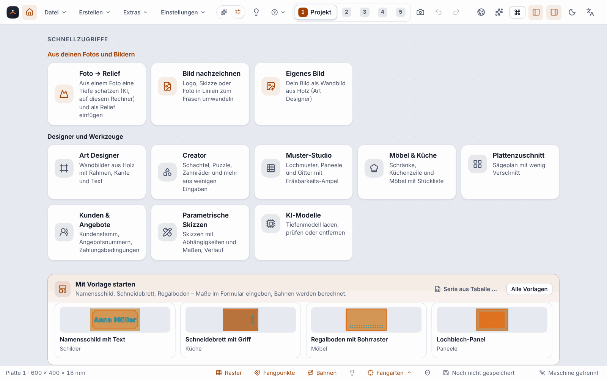

**English** | [Deutsch](KI-Modelle-und-Startseite)

# AI models and start page with quick access (since 0.13.0)

Two things for a quick start: the **start page with quick access** (and the principle “Your own first”) and the **AI models** dialog, in which you download, check or remove the depth model for “Photo → relief”.

> **Honest about the status:** Both have only been checked with Vitest tests and Chromium against the real engine, with a **stand-in model** (396 bytes) and a **stand-in for the portal**. **The download of the real depth model (47.3 MB) from the real portal has not been checked.** None of it has been operated under Windows (WebView2). Whether the shortcut `Alt+Home` arrives there is open: browsers assign the key to “Home page”; the interface intercepts it, but whether WebView2 handles it itself beforehand has not been tested. The button and the command palette work in any case.

## Start page and Home button

The start page is the **Project** step with the welcome view. With an empty starter project it appears by itself. You can get back to it **at any time**:

* with the **Home button** (house icon to the left of the File menu in the header bar),
* with `Alt+Home` (German interface: `Alt+Pos1`),
* with the command palette (`Ctrl+K`: “Go to the home page”).

If you already have a project in progress, the card **“Your project”** is at the top: name, number of shapes and operations, saved or unsaved, plus “Continue” and “Project settings”. The bar for restoring is then missing (it would replace your project).

**The start page is only a view.** Nothing changes in the project, and switching to another step ends it. “New project”, “Open” and the examples ask about unsaved changes as before.

### Quick access

Tiles in two groups. Each tile is a button (Tab, `Enter` or space bar) and opens the same as the command of the same name in the command palette:

| Group | Tiles |
|---|---|
| **From your own photos and images** | Photo → relief · Trace an image · Your own image (Art Designer) |
| **Designers and tools** | Art Designer · [Creators](Creators) · Pattern Studio · Furniture & kitchen · [Sheet cutting](Sheet-Cutting) · [Customers & quotes](Customers-and-Quotes) · Parametric sketches · AI models |

If a dialog belongs only in the “Design” step, the tile switches there first. Without an open project it says what is missing and names the solution. In the web designer of the portal there are only the tiles whose function exists there.

### Your own first

Wherever you choose a **source**, your own sources come **before** the generators, patterns and supplied templates: a photo, an image, a height image, your own shapes or text, an own image in the Art Designer, an own module, an own template. The groups carry subheadings such as “Your own” and “Templates”, “Patterns” or “Generators” (only where both groups exist). This affects, for example, the gallery of the relief studio, the Pattern Studio, the Art Designer, the **Create** menu (there the group “Your own” with Photo → relief, Trace an image and Your own image stands before “Designers and tools”), the File menu, the command palette and the furniture designer.

**Only the order of display** is changed: not the default selection (the first pattern stays the first), not saved settings and not the content of your projects.

## AI models

The depth model for [Photo → relief](Photo-to-Relief) and for your own image in the [Art Designer](Art-Designer-en) (“Estimate depth (AI)”) calculates **on your computer**. It is not in the installer and is only downloaded when you want it.

Opening:

* Menu **Extras ▸ AI models …**
* Command palette `Ctrl+K`: “AI models”
* **Settings ▸ General ▸ Manage AI models …**
* The **AI models** tile on the start page

The dialog is a **list**; today it contains the depth model (Depth Anything V2 Small). The card shows:

| Item | Content |
|---|---|
| Used for | Depth estimation for Photo → relief and for your own image in the Art Designer |
| Size, licence, source | Size (47.3 MB); weights under Apache-2.0, training data partly under research licences (legal status unclear); the host of the portal the file comes from |
| State | *Not downloaded* (also “download interrupted” if part of it is already there), *Downloaded (not checked yet)*, *Downloaded and checked*, *Damaged* |
| Portal | *available*, *not published yet*, *different version*, *no connection* or *portal error*, with the explanation and a solution |
| Location | the full path (under Windows in the folder `%LOCALAPPDATA%\ortino.CAM\models`), with the button “Copy path” |

**Buttons:** *Download* (with progress, MB/s and remaining time), *Cancel download*, *Resume* (from the partial file), *Download again* (for a damaged file), *Check again* (reads the file and checks size and checksum), *Use a model file …* (without network, for example from a USB stick) and *Remove* (with a confirmation, also for a partial file). Existing reliefs stay unchanged when you remove it, because the height image is in the project.

**Never a download without a click.** When opening, the dialog only asks, and only if the model is missing, **once** at your portal whether it is there (a small request without a photo, at most about 5 seconds). Downloading happens only after your click on “Download”, and every file is checked against a fixed checksum before it is used. Your photo never leaves the computer.

**In the Art Designer** the **“Load model …”** button (under “Estimate depth (AI)”) replaces the earlier detour via the relief studio: it opens the same card in the same dialog, so that image and design are not lost. In “Photo → relief” it is the same card.

## Limits

* The download of the real model from the real portal is **not checked** (see above). If the model is not yet on the portal, the dialog says “not published yet”; then adding it by hand remains.
* A program build without a portal knows no download (“This build knows no portal”), only adding it.
* Today there is only **one** model; more will appear in the list as soon as there are any (no promise). Larger models are not planned.
* The result of “Photo → relief” remains an estimate, not real geometry; the restrictions are under [Photo → relief](Photo-to-Relief).
* In the web designer of the portal there is no “AI models” dialog, and only tiles whose function exists on the web appear there.

## Next

* [Photo → relief](Photo-to-Relief)
* [Art Designer](Art-Designer-en)
* [Creators](Creators)
* [Keyboard Shortcuts](Keyboard-Shortcuts)
