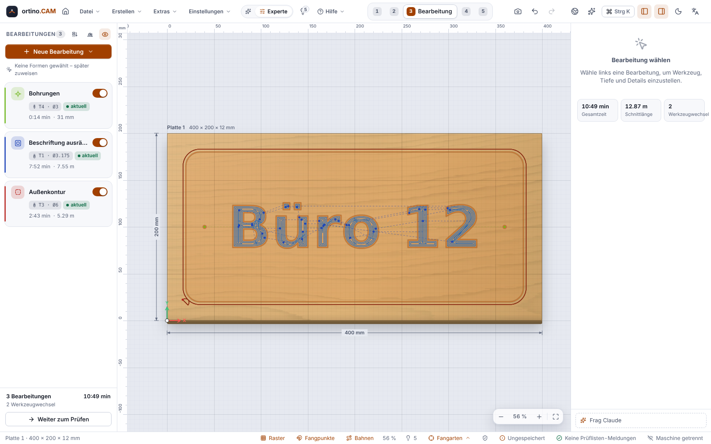
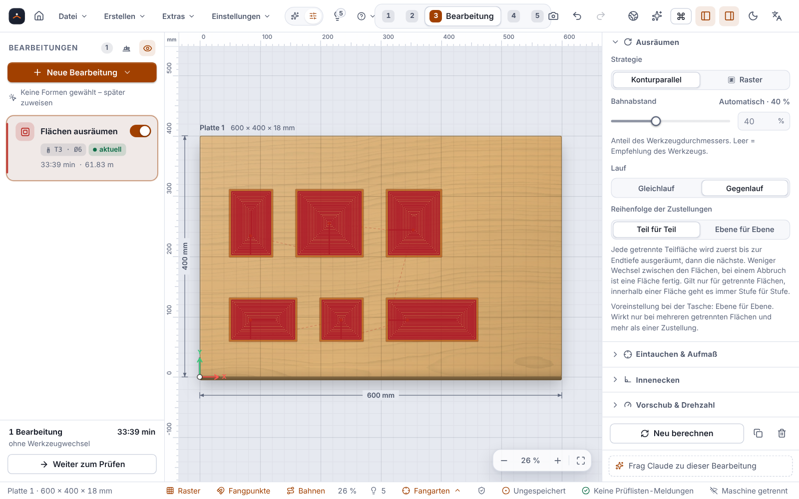

# Bearbeitungen

Eine **Bearbeitung** sagt ortino.CAM, was mit einer Form passieren soll: ausschneiden, ausfräsen, bohren, gravieren. Aus der Bearbeitung, dem Werkzeug und dem Material berechnet das Programm den **Werkzeugweg**. Diese Seite erklärt die Arten, ihre wichtigsten Einstellungen und den Unterschied zwischen **Gleichlauf** und **Gegenlauf**.

> **Ehrlich zum Stand:** An einer echten Maschine erprobt sind bisher nur **Taschen, V-Carving und Konturen** (Version 0.3.3, Ultimate Bee) und, laut Betreiber, ein einstündiger Lauf mit **Tasche und Kontur in Birke** mit Version 0.12.0 (siehe [Fräsen an der Maschine](Fräsen-an-der-Maschine)). Alles andere auf dieser Seite ist **nur gerechnet und simuliert**: adaptives Räumen, Gewindefräsen, Inlay, Gravur, 3D-Relief, Planfräsen, Dogbone, Muster. Zeiten und Schnittwerte sind Richtwerte. Teste jede neue Bearbeitung zuerst **ohne Werkzeug und Material** (Luftschnitt) und dann in Restmaterial.

## So legst du eine Bearbeitung an

1. Wähle im Schritt **Design** die Formen aus.
2. Wechsle zum Schritt **Bearbeitung** und klicke **Neue Bearbeitung**. Das Programm empfiehlt eine Art zur Auswahl (»Empfohlen«): kleine Kreise zum Bohren, Text als Tasche, offene Linien als Profil »Auf Linie«.
3. Wähle das Werkzeug, die Tiefe und die Einstellungen in den Eigenschaften rechts.
4. Prüfe Zeit und Meldungen in der Liste. Bahnen werden automatisch neu berechnet, sobald du etwas änderst.

Alternativ legt der **Schnellstart** »Was möchtest du fräsen?« mit wenigen Fragen komplette Bearbeitungen an, samt Werkzeug und Begründung (siehe [Erste Schritte](Erste-Schritte)).

**Einfach-Modus und Experten-Modus:** Im Einfach-Modus (Umschalter in der Kopfleiste) siehst du je Bearbeitung nur die wichtigsten Abschnitte. Alles andere liegt unter **Mehr Einstellungen**. Umschalten ändert nie das Projekt.

**Tiefen als Formel:** Statt einer festen Zahl kannst du `Dicke + 0,3mm` eintragen. Dann schneidet die Bearbeitung immer ganz durch, auch wenn du die Plattendicke änderst.

## Gleichlauf und Gegenlauf

Ein Fräser dreht sich. Je nachdem, ob die Drehung an der Schneide mit der Vorschubrichtung läuft oder dagegen, schneidet er anders:

| | Gleichlauf | Gegenlauf |
|---|---|---|
| Der Span beginnt … | dick und endet dünn | dünn und endet dick |
| Kante | meist **sauberer** in Holz und Kunststoff | etwas rauer |
| Gut bei | steifer Maschine und sicher gespanntem Teil, denn er **zieht den Fräser ins Material** | wackliger Mechanik und dünnen Teilen mit Haltestegen, denn er läuft ruhiger |

**Wie das in ortino.CAM heißt:** Im Abschnitt **Lauf** wählst du zwischen »Gleichlauf« und »Gegenlauf«. Die **Voreinstellung heißt Gegenlauf.** Für sauberere Kanten in Holz und Kunststoff wähle **Gleichlauf**. Das Programm weist darauf hin, wenn du bei Holz oder Kunststoff im Gegenlauf fräst (Hinweis »Gleichlauf gibt sauberere Kanten«; in den Hinweisregeln heißt die Regel »Gegenlauf bei Holz/Kunststoff«), und stellt auf Klick um.

Bei einer Spindel, die im Uhrzeigersinn dreht (`M3`, Blick von oben), schneidet das Werkzeug im Gleichlauf, wenn das **Material rechts der Fahrtrichtung** liegt. Außen um ein Teil heißt das: im Uhrzeigersinn. In einer Tasche: gegen den Uhrzeigersinn.

> **Wichtig für Nutzer älterer Versionen:** Bis Version 0.3.7 hieß die Voreinstellung fälschlich »Gleichlauf«, obwohl die Maschine im Gegenlauf fuhr. Seit 0.3.8 stimmen die Namen. **Der G-Code ist unverändert**, nur die Namen wurden getauscht. Wer früher »Gegenlauf« gewählt hatte, fräst jetzt im »Gleichlauf« (gleiche Bahn, richtiger Name). Ob der Gleichlauf die Voreinstellung werden soll, entscheidet die Praxis an der Maschine.

Beim **Gewinde** bedeutet »Gleichlauf« von Anfang an den echten Gleichlauf, und er ist dort die Voreinstellung.

## Profil

Das **Profil** fährt die Kontur einer Form ab. Es ist die Bearbeitung zum Ausschneiden.

* **Seite:** **Außen** (das Werkzeug läuft außen, das Teil innerhalb der Kontur behält seine Größe), **Innen** (schneidet ein Loch in der Größe der Kontur) oder **Auf Linie** (Werkzeugmitte auf der Linie, auch für offene Linien, die Gravur).
* **Innenkonturen zuerst:** Löcher entstehen, solange das Teil noch fest sitzt.
* **Haltestege:** kleine Brücken, die ein ausgeschnittenes Teil am Rest halten, damit es nicht wegfliegt oder das Werkzeug einklemmt. Automatisch oder von Hand gesetzt, mit Rampen. Du trennst sie nach dem Fräsen mit Säge oder Messer. Für Durchschnitte (Tiefe über die Plattendicke) meldet das Programm fehlende Stege, nicht aber bei kleinem Abfall und Schlitzen. Mit **Restschicht** (Onion Skin, üblich 0,2 bis 0,5 mm) bleibt am Boden eine dünne Schicht stehen, die ein letzter Durchgang trennt. Für sehr kleine Teile gibt es eine **Kleinteile-Analyse** mit Empfehlung.
* **Anfahrt:** Anfahrbogen oder Linie, damit am Eintauchpunkt keine Marke an der Kontur bleibt.
* **Eintauchen:** Rampe (Winkel einstellbar) oder senkrecht. Die Rampe schont das Werkzeug.
* **Aufmaß** mit Schlichtdurchgang für eine bessere Oberfläche.

## Tasche

Eine **Tasche** räumt eine Fläche aus. Die Standardstrategie ist **konturparallel** von innen nach außen, mit Inseln, Rampe oder senkrechtem Eintauchen und Wandschlichten. Dazu gibt es:

* **Raster:** parallele Bahnen unter einem einstellbaren Winkel, Zickzack oder einseitig, optional mit Randdurchgang.
* **Helix-Einstieg:** Das Werkzeug schraubt sich ins Material, wenn Platz ist (sonst Rampe).
* **Restbearbeitung:** Ein kleineres Werkzeug räumt, was das erste nicht erreicht hat.

## Reihenfolge der Zustellungen: Teil für Teil oder Ebene für Ebene (seit 0.13.0)

Hat eine Bearbeitung **mehrere Teile** (mehrere Konturen, Löcher und Außenkonturen, getrennte Flächen einer Tasche) und **mehr als eine Zustellung**, stellt sich die Frage, in welcher Reihenfolge die Tiefenstufen gefahren werden. Der Schalter **»Reihenfolge der Zustellungen«** steht bei Profil und Tasche unter **Erweitert** (im Einfach-Modus hinter »Mehr Einstellungen«) und hat zwei Werte:

| Wert | Ablauf |
|---|---|
| **Teil für Teil** | Jedes Teil bekommt alle Zustellungen bis zur Endtiefe, dann folgt das nächste. |
| **Ebene für Ebene** | Erst die erste Zustellung an allen Teilen, dann die zweite, und so weiter. |

**Die Vorgabe ist das bisherige Verhalten:** beim **Profil Teil für Teil**, bei der **Tasche Ebene für Ebene**. Der Standardwert wird nicht in die Datei geschrieben. Deine bisherigen Projekte laden und speichern unverändert, und ihr **G-Code bleibt Byte für Byte gleich**; das prüft ein Test an den elf mitgelieferten Beispielen und am Beispielprojekt `tuerschild.ocam`. Bei nur einem Teil oder nur einer Zustellung sind beide Werte gleich.

**Wozu Ebene für Ebene?** Bis zur letzten Stufe hängen alle Teile am Material. Zusammen mit **Haltestegen** oder **Restschicht** bleibt die Platte bis zum letzten Schnitt stabil; ein fertig ausgeschnittenes Teil kann sich sonst lösen, während die anderen noch folgen, und vom Fräser erfasst werden. Das Durchtrennen der Restschicht kommt dann als letzte Stufe für alle Teile.

**Was es kostet, ehrlich:**

* Mehr Leerfahrten: Nach jeder Kontur zieht sich das Werkzeug auf die Sicherheitshöhe zurück. **Gemessen** an drei Teilen von 40 × 30 mm im Abstand von 150 bis 250 mm, vier Zustellungen, Fräser Ø 6 mm: Der Eilweg im G-Code wächst von **1053 auf 2006 mm**, die geschätzte Zeit von **70 auf 89 Sekunden** (Teil für Teil gegen Ebene für Ebene). Je weiter die Teile auseinanderliegen und je mehr Zustellungen es gibt, desto größer der Unterschied; bei dicht gepackten Teilen ist er klein. Das ist eine Rechnung im Programm, **kein gefräster Lauf**.
* Bei einem **Abbruch** ist mit Ebene für Ebene **kein** Teil fertig, mit Teil für Teil zumindest das erste.

**Beim Profil** (innen, außen, auf Linie, auch offene Linien) fährt das Werkzeug dieselben Schnittbewegungen, nur anders geordnet; Rampen, Anfahrbögen, Haltestege, Freistellungen und Schlichtaufmaß bleiben. Zwischen den Teilen zieht es sich auf die Sicherheitshöhe zurück; zurück in eine schon gefräste Nut geht es im Eilgang nur senkrecht und nur bis 0,5 mm über deren Boden, den Rest mit Eintauchvorschub. Die Reihenfolge der Teile wechselt je Stufe zwischen vorwärts und rückwärts, je nachdem, was den kürzeren Eilweg ergibt. Der **Materialabtrag in der Simulation ist am Ende derselbe** (Zelle für Zelle verglichen).

**Bei der Tasche** heißt »Teil für Teil«: Jede **getrennte Teilfläche** wird zuerst vollständig bis zur Endtiefe ausgeräumt (samt Schlichtdurchgang an der Wand), dann die nächste. Innerhalb einer zusammenhängenden Fläche geht es immer Stufe für Stufe.

**Grenzen:** Nur gegen Rust-Tests, die eigene Simulation und einen Browser-Test (Chromium) geprüft, **nicht an einer echten Maschine**; ob eine Platte mit Ebene für Ebene am Ende besser hält, hängt von Material, Stegen und Spannung ab und ist nicht gemessen. Die **Vorschau im Zeichenbereich** sieht bei beiden Werten gleich aus (sie zeigt Wege ohne Tiefe); den Unterschied siehst du in der Simulation im Schritt »Prüfen« und im G-Code. Zusammen mit Kachelung und doppelseitigem Fräsen ist Ebene für Ebene nur durch Durchsicht abgedeckt, nicht durch einen eigenen Test. Auch Claude kennt den Schalter (`pass_order`).

## Adaptives Räumen

Beim **adaptiven Räumen** (Neue Bearbeitung → Weitere Strategien) regelt das Programm den Eingriff des Fräsers, damit er überall ähnlich belastet wird. Das erlaubt tiefe Zustellungen mit der vollen Schneidenlänge bei schmalem seitlichem Eingriff. Für tiefe Taschen kann das schneller sein und den Fräser schonen. Wichtige Einstellungen: **Optimale Last** (5 bis 40 %), Fräsrichtung, »In beide Richtungen schneiden«, Einsenken per Helix oder Rampe, Aufmaß und Vorschubanpassung. Ein **Zeitvergleich mit der Standard-Tasche** steht im Eigenschaften-Panel. Die Leistungsprüfung braucht die **Spindelleistung** (Feld im Maschinen-Dialog, bei Katalogmaschinen aus der gewählten Spindel).

Grenzen: Scharfe Innenecken und sehr schmale Stellen (schmaler als der Fräser) bleiben als Rest stehen und gehören in eine Restbearbeitung. Zeitangaben sind Schätzungen. **Nur in der Simulation erprobt.**

## Bohren

**Bohren** setzt Löcher an den Mittelpunkten gewählter Kreise. Modi: **Tiefloch** (mit Rückzug zum Spänebrechen, englisch *Peck*), Spanbrechen, ein Zug, Verweilzeit. **Helix-Bohren** fräst runde Löcher von Ø D bis knapp 2 × D mit einem Schaftfräser auf einer Schraubenbahn. Passt der Bohrer nicht zum Kreis, schlägt das Programm das passende Verfahren vor (Bohrer, Helix oder Innenkontur).

## Gewindefräsen

Neue Bearbeitung **Gewinde** mit der Werkzeugart **Gewindefräser** (60°-Profil): metrisches ISO-Gewinde **M3 bis M12** und eigene Maße, **innen** in einem vorhandenen Kernloch oder **außen** an einem Zapfen, Rechts- oder Linksgewinde, mehrere radiale Zustellungen mit Schlichtdurchgang, Anfahrbogen. Die Bahn ist eine Schraubenlinie. Die gewählten Kreise geben nur die Mittelpunkte an.

* Das **Kernloch** muss vorher da sein (Bohren auf denselben Kreisen), ein Außengewinde braucht den freigestellten Zapfen.
* Das Programm prüft: Fräser passt nicht ins Loch, Schneide kürzer als das Gewinde, Länge keine ganze Zahl von Umdrehungen, zu wenige Umdrehungen, Steigung unplausibel.
* Die Simulation zeigt keine Gewindeflanken: Ein Innengewinde erscheint als Bohrung auf Nenndurchmesser.
* Nicht umgesetzt: Zoll-, Trapez-, Rohr- und Mehrgang-Gewinde, Mehrprofil-Fräser mit fester Steigung.

> **Nur gerechnet und simuliert, nie an einer Maschine gefräst.** Ob ein so gefrästes Gewinde passt und trägt, ist nicht erprobt. Fräse zuerst ein **Probegewinde in Restmaterial** und prüfe es mit einer Lehre oder einer passenden Schraube.

## V-Carving, Inlay und Gravur

* **V-Carving:** Mit einem V-Fräser (auch Kugelfräser) folgt die Frästiefe der Breite der Form: Schmale Stellen werden flach, breite tief. Das gibt Schilder und Schrift mit scharfen Kanten. Wird die Form breiter als die maximale Tiefe, entsteht ein **Flachboden**. Den räumt ein zweites Werkzeug (Schaftfräser, Bearbeitung »Ausräumen«) aus, der V-Fräser arbeitet die Ecken nach. Passt der Ausräumfräser nirgends hinein, nennt das Programm eine Tiefe als Ausweg. *Im Echtbetrieb bestätigt (Version 0.3.3).*
* **Inlay:** Zwei zusammengehörige Teile: das **Weibchen** (die Tasche) und das gespiegelte **Männchen** (der Einleger) auf einer zweiten Platte. Du stellst Taschentiefe, **Klebespalt** (Standard 0,5 mm), Überstand und Spalt am Boden oder an den Flanken ein. Der Einleger steht eingesetzt über und wird nach dem Verleimen abgesägt. Die Passung ist in der Simulation nachgemessen (Spalt und Überstand auf etwa 0,1 mm). Kugelfräser sind beim Inlay nicht erlaubt. **Nicht gefräst.** Mache vor dem ersten Inlay einen Probeschnitt in Restholz und passe den Klebespalt an.
* **Gravur:** Profil »Auf Linie« mit einem spitzen V-Fräser (bevorzugt 30° oder weniger) und etwa 0,5 mm Tiefe. Das Programm zeigt die Linienbreite an der Oberfläche und rechnet eine Wunschbreite in die Tiefe um. Einzellinienschriften für die Gravur stehen unter [Zeichnen und Importieren](Zeichnen-und-Importieren). **Nie graviert.**

## 3D-Relief und Muster

* **Relief-Studio:** erzeugt 3D-Reliefs aus Vorlagen, aus Formen (wölben) oder aus einem Graustufenbild. Mit wenigen Reglern: Größe, Tiefe, Dichte, Weichheit, Variation, Zufall. Seit 0.15.0 ist **»Eigene«** der erste Reiter der Galerie: eigene Vorlagen speichern, als Datei sichern und importieren, siehe [Eigene Vorlagen](Eigene-Vorlagen). Es gibt **62 Vorlagen in 9 Kategorien** (seit 0.14.0; 0.13.0: 40 in 7): Wellen, Kacheln, Geflechte, Blüten und Blätter, Natur und Struktur, **Ornamente**, **Paneele und Fronten**, Formen und Bilder sowie Kunst. **22 Vorlagen sind seit 0.14.0 neu:** Wellen mit Schaumkämmen, Bambus, Schilf, Jahresringe, Höhenlinien, Quadermauer, Bruchsteinmauer, Mandala, Holzrosette, Stern-Facetten, Schneeflocke, Schneeflocken-Raster, Tropfenkranz, Kassettenfüllung, Kissenfüllung, Diamantspitzen und die sechs neuen Wandbild-Motive des [Art Designers](Art-Designer) (Kategorie Kunst, jetzt 14). Dafür gibt es sechs neue Generatoren und zwei neue Blattstile (Rosette, Jahresringe und Höhenlinien, Mauerwerk, Kassetten, Bambus und Schilf, Landschaften sowie Olivenzweig und Gräser als Blattstile). **Bestehende Reliefs rechnen unverändert**; geändert sind nur die Startwerte von fünf Vorlagen (Sanfte Hügel, Gebirge, Blüte, Kissen, Schuppen), die ein neu eingefügtes Relief bekommt. Die steilste Flanke der neuen Vorlagen liegt unter 70°; die engsten Kehlen (Mauerfugen, Schilf, Holzrosette, Stern-Kerben) erreicht ein Kugelfräser von Ø 3 mm gerade noch, größere runden sie aus. Das ist gerechnet, **nichts davon wurde gefräst**. Schwächen: Die Quadermauer wirkt eher wie Ziegel, die Schaumkämme sind Zellen auf den Wellen und kein echter Schaum, einzelne große Stern-Facetten sind bei 10 mm Tiefe auf 480 mm zu flach.
* **3D-Relief fräsen:** legt mit einem Klick Schruppen und Schlichten an (bei Bedarf Restbearbeitung und eine Stufe für ebene Flächen). Du entscheidest nur über die **Qualität** (Entwurf, Standard, Fein, Ultra), das Programm wählt Kugelfräser, Zustellung, Bahnabstand und Vorschub und zeigt jeweils die Zeit. Ein **Soll-Ist-Vergleich** zeigt, wo die Bahn vom Relief abweicht.
* **Muster-Studio:** Lochpaneele aus **39 Arten mit 76 Vorlagen in sechs Kategorien** (seit 0.14.0; 0.13.0: 25 Arten, 37 Vorlagen): Waben, Sterne, Gitter, Voronoi, Blätter, Rasterverlauf, Text und Bild als Lochraster und neu Chevron-Lamellen, Fischschuppen, Kagome, Vierpass-Maßwerk, Spiralen, Schneeflocken und weitere, dazu ein Suchfeld. Welche Arten es gibt und was dabei gilt, steht unter [Zeichnen und Importieren](Zeichnen-und-Importieren#muster-studio-39-arten-und-76-vorlagen-seit-0140-erweitert). Die **Fräsbarkeit** wird gemessen (Mindeststeg, Öffnungsweite, Inseln, Ecken), als Ampel gezeigt und lässt sich mit einem Klick korrigieren. Der Mindeststeg 1,5 mm ist eine Voreinstellung, keine Materialgarantie. Alle 76 Vorlagen sind mit den Voreinstellungen laut Ampel grün, **gemessen, nicht gefräst**.

Grenzen beim Relief: Nur Höhenfelder (keine Hinterschneidungen). Ein 3D-Modell aus einer STL- oder STEP-Datei wird von oben auf ein Höhenfeld abgebildet, siehe [3D-Modelle importieren](3D-Modelle-importieren). An senkrechten Wänden lässt der Kugelfräser eine Kehle in der Größe seines Radius stehen. **Nicht gefräst.**

## Planfräsen, Dogbone, Reihenfolge

* **Planfräsen:** ebnet das Werkstück oder die **Opferplatte** (Neue Bearbeitung → Planfräsen). Ein Assistent rechnet auf einer Kopie und zeigt Fräser, Zeit und Warnungen. Die Planiertiefe wird eine Projektvariable, die anderen Bearbeitungen passen sich an.
* **Innenecken (Dogbone, T-Bone, minimal):** Bei Profil und Tasche stellt das Programm Innenecken frei, damit ein eckiges Gegenstück hineinpasst. Das Programm prüft Fräserdurchmesser, Eckwinkel und Nachbarkanten und meldet blockierte Ecken.
* **Reihenfolge der Zustellungen** (seit 0.13.0): Teil für Teil oder Ebene für Ebene, siehe den Abschnitt weiter oben.
* **Reihenfolge optimieren:** schlägt eine Reihenfolge mit weniger Werkzeugwechseln und weniger Eilweg vor. Du siehst vorher und nachher und übernimmst per Klick (ein Rückgängig-Schritt). Durchschnitte kommen nach allem, was in der Form ihres Teils liegt.

Auch das ist **nicht an einer echten Maschine erprobt**.

<!-- videos:start -->
## Videos (English)

*   
**Cut out a shape with a Profile** · 16 s

*   
**Clear out lettering with a Pocket** · 13 s

*   
**Drill holes at the centre of circles** · 11 s

*   
**Carve lettering with a V-bit** · 12 s

Alle Videos: [Videos](Videos).
<!-- videos:end -->

## Weiter

* [Werkzeuge und Schnittdaten](Werkzeuge-und-Schnittdaten): Fräser wählen, Vorschub und Drehzahl
* [Prüfen und Simulation](Prüfen-und-Simulation)
* [Platten und Möbel](Platten-und-Möbel): Passungen und Fingerzinken
