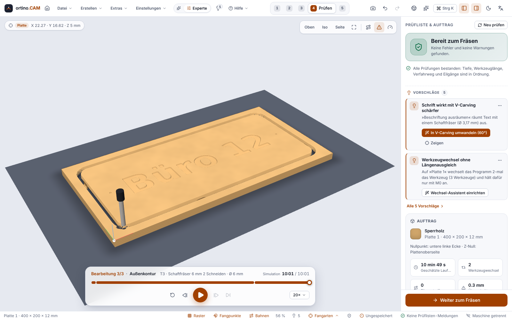

**English** | [Deutsch](Prüfen-und-Simulation)

# Checking and simulation

Before you cut, ortino.CAM checks your project on several levels. In the **Check** step you see the **checklist**, the **3D simulation** and a time estimate. In addition there are the **hints** (the light bulb in the header bar) and, later at the machine, the **start check**.

> **Important:** Simulation, checklist, hints and start check are **aids and not a safety function**. They can miss errors. They replace neither the emergency stop nor a protective device nor your own care. Check toolpaths, work zero, tool and clamping yourself before every run, test first **without a tool and material** and never leave the machine unattended. See the [disclaimer](https://github.com/KlapSC/ortino-cam/blob/main/README.en.md#disclaimer).

## The four levels of checking at a glance

| Level | Where | What it does |
|---|---|---|
| **Geometry check** | Design | Finds problems in your drawings before toolpaths are made. |
| **Checklist** | “Check” step | Checks the calculated toolpaths. **Errors block G-code export and machine start.** |
| **Hints** | Light bulb in the header and status bar | Suggest improvements, never block anything. |
| **Start check** | “Cut” step | Compares the state of the controller with the project. See [Milling on the machine](Milling-on-the-Machine). |

## The checklist

The checklist shows an overall result at the top: “Ready to cut”, warnings or errors. Every entry explains what is going on and usually has a **solution** and a “Go to operation” button.

* **Errors** block the “Continue to cutting” button, the G-code export and the start. You cannot click them away. Fix them.
* **Warnings** allow cutting. You can deliberately **accept** a warning (button “Accept”). It then no longer counts and does not appear among the hints either. If the situation changes, it comes back. With “Show again” you bring it back, and Ctrl+Z undoes the accepting.
* **Notes** only inform.

Among other things, the checklist reports:

* depth greater than the material thickness, tool too short for the cutting depth,
* rapid through standing material (see below), travel exceeded,
* missing tabs on through cuts (not for small waste and for slots),
* spindle speed and feed rate limits of the machine, V-bit too deep, empty toolpaths,
* collisions with clamps (see below).

**Rapid into standing material:** If an operation starts below the surface (start depth greater than 0) and no earlier operation has removed the material there, the bit crashes into it at rapid speed. The checklist simulates the whole job on a coarse height grid and reports this as an **error**. Fix: create an operation before it that clears down to this depth, or set the start depth to 0. The thresholds are assumptions, not measured on real material. A very small bit (below about 0.4 to 0.7 mm diameter) can fall between the grid cells and is then not reported.

## The 3D simulation

The simulation plays the material removal in 3D and uses the real toolpaths to do so.

* **Playback:** play and pause, restart, jump to the previous or next operation, jump to the end, speed, timeline.
* **Views:** Top, Iso, Side.
* **Quality:** “Fast”, “Balanced” or “Fine” (more cells, more computing time).
* **Display:** toolpaths and **rapid hits**. In addition, the simulation counts **overcut** and **tool changes**.
* **Tools:** flat, ball nose and V-bits and drills. V-grooves and the fit of inlays are measured against the theory in tests. A thread mill is simulated as a cylinder without thread flanks.
* **Time:** Under “Job” is the **estimated run time** (with acceleration, rapid and the largest feed rate from the machine profile, without tool changes). The time of the playback calculates **without acceleration** and therefore differs. Both are approximations, **not compared with real run times**.

What the simulation can **not** do:

* It calculates with a height grid on the processor, not with a full solid model.
* It knows no deflection of the bit, no chips, no wear and no elasticity of the machine.
* A target-versus-actual comparison exists only for 3D reliefs, not for 2D operations.
* If WebGL is missing in your graphics driver, the 3D view stays off. Checklist and job overview keep working. A driver update usually helps.

## Hints (light bulb)

A rules engine analyses your project continuously (shortly after the last change) and makes suggestions. It never blocks anything. Every hint has a level (“Important”, “Better this way”, “Tips”), a category (safety, quality, time, workflow), a reason (**“Why?”**) and often a **one-click fix**, which is carried out as a single undo step.

Examples: through cut without tabs, depth per pass too deep, feed rate far above the guide value, bit larger than fine details, order wastes tool changes, deep pocket better cleared adaptively, safe height too low, dust extraction not set up, “Do an air cut first”, climb milling recommended for wood (see [Operations](Operations)).

Hints can be hidden: for the session, for this project (saved in the project) or as a whole kind. Hidden also means “accepted” in the checklist. Errors can never be hidden.

## Geometry check

Already while you draw and import, the geometry check finds: open or almost closed contours, duplicate contours, self-intersections, micro-segments, inner radii smaller than the bit radius, parts that are too small, thin webs and shapes outside the sheet. A panel and markers in the drawing area show the places, and many can be repaired with one click (one undo step). More under [Drawing and importing](Drawing-and-Importing).

## Clamps and keep-out zones

You can enter clamps, screws, vacuum pods and keep-out zones (areas that must not be cut) in the project (button in the header of the operations list). The checklist then checks all movements, including the moves between operations and the return to work zero, against bit, shank, collet nut and spindle. A collision is an **error** and blocks export and start. Limits: the dimensions of the collet nut (Ø 22 mm) and spindle (Ø 65 mm) are **assumptions** for a typical routing spindle, so measure yours. Clamps count as vertical columns (no undercuts, no sloping clamp arms). The first approach from the unknown machine position is not checked.

## From practice: the live animation while milling

In the “Cut” step the program shows the tool position live. With version 0.12.0 the operator milled a **pocket and profile cut in birch** on the Ultimate Bee (xPRO V5) in a normal run of about an hour, without a pause, feed rate change or tool change, and watched everything. According to the operator, the **live animation matched “perfectly”** what the machine did. This is an **observation from a single run**, not a measurement and not an endurance test, and it says nothing about other machines, materials or controllers. No run time was reported; the **time estimate therefore still counts as not compared with real run times**, and the 3D simulation in the “Check” step does not replace a test run.

## A sensible sequence

1. Read the checklist, fix errors, understand warnings (and accept them only deliberately).
2. Play the simulation through once completely and look at the edges.
3. Jump to critical places in the timeline: plunging, corners, tabs.
4. Only then switch to the “Cut” step.

<!-- videos:start -->
## Videos (English)

*   
**Watch the 3D simulation** · 15 s

*   
**Read the checklist before you cut** · 15 s

All videos: [Videos](Videos-en).
<!-- videos:end -->

## Next

* [Milling on the machine](Milling-on-the-Machine)
* [Operations](Operations)
* Something not displayed correctly? [Troubleshooting](Troubleshooting)
