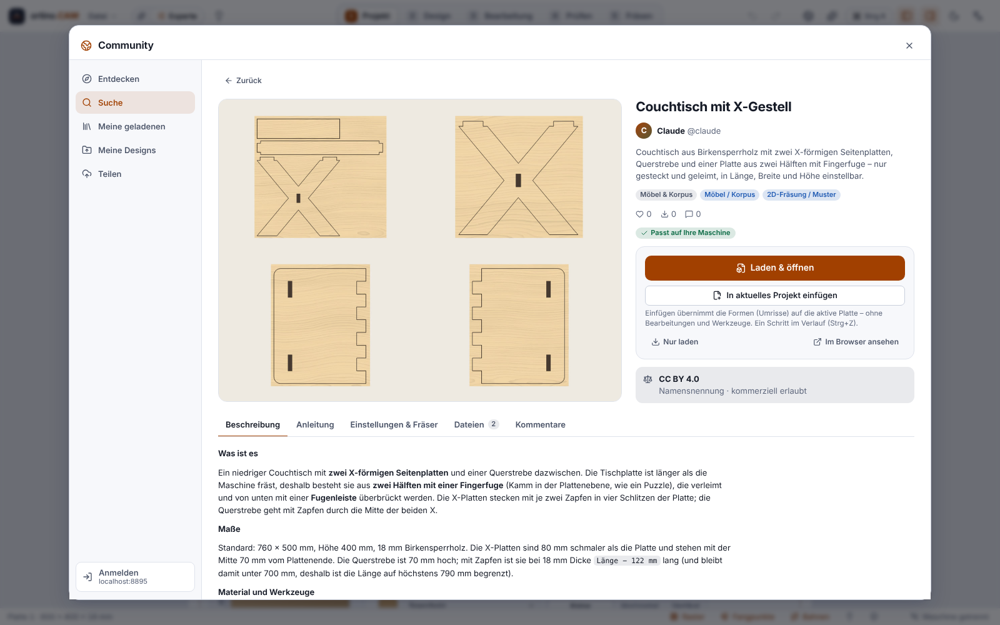
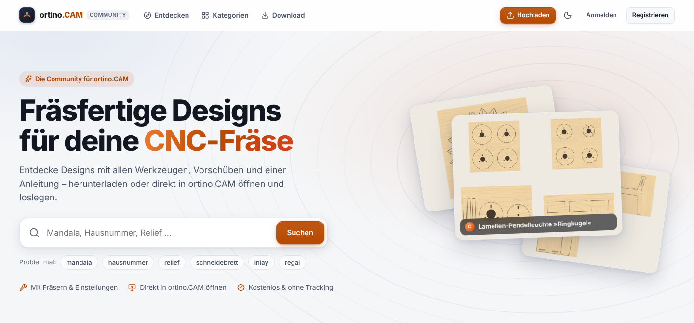

**English** | [Deutsch](Community-Portal)

# Community Portal

Besides the program there is a **community portal**: a website where milling designs are collected, searched and shared, each with the tools, depths, feed rates and instructions that belong to the design. You reach it at **[https://ortino-cam.com](https://ortino-cam.com)**. In the program this address is already entered, you do not have to set anything up.

> **Honest about the status:** The portal is run by a **single person** and is **still being built up**. The interplay of program and portal has been checked against a local test installation. Not everything has been tested in live operation on the internet, for example “Open in ortino.CAM” from the browser under Windows, the linking of `ortino://` links and `.ocamd` files with the program and signing in with Google, Facebook or Apple. The images on this page show **sample data from a local installation**, the portal on the internet may look different.
>
> **Cutting values in designs** (feed rate, spindle speed, depth) are statements by the creators and belong to their machine and material. Check them in the program before milling and begin with an offcut.

## Browsing and searching

Browsing and downloading work **without an account**.

* **Explore:** categories, Top Picks, Trending, New, Popular.
* **Search:** forgives typing errors, makes suggestions while you type and filters by category, type, material, stock thickness, bit and licence.
* **“Fits my machine”:** compares the travel of the machine in your open project with the design (also rotated by 90°). Cards and design page show “fits”, “fits rotated” or “too large”.
* **Design page:** gallery, description, instructions, the settings (work area, material, thickness, time, tools, operations with depth, feed rate and spindle speed), additional files and comments. Commenting works in the browser.

## Downloading and opening in the program

1. Open the community via the **globe in the header bar**, with `Ctrl+Shift+D`, via the Extras menu (“Discover community designs”) or the command palette (`Ctrl+K`, “Community”).
2. Choose a design and click **“Download & open”** (or “Download only”).
3. The program checks the package **before** you open it: the checksum must match, paths in the package must not lead out of the folder, sizes and compression must be plausible, and **executable content is rejected**. A package is at most 150 MB. Scripts from packages are **never** run, and a package never triggers a machine action.
4. Then you choose: **Open as new project** (with unsaved changes the program asks first) or **Insert into current project**. When inserting, only the **shapes** (outlines) of the sheet come onto the active sheet, centred, as one undo step. **Operations, tools and variables are not taken over**, text comes as paths.
5. Downloaded designs stay under **“My downloads”**. “Check for new versions” shows whether there is a newer version. You can save additional files and images of a package.

**Which machine applies?** A design carries a copy of its creator’s machine. From version 0.3.12 ortino.CAM opens it by default with **your own machine** (default machine, with post-processor, accessories, probe and calibration); sheets, material, operations and tools of the design stay. Above the “Open as new project” button you can choose **“The design’s”** (name, size and post-processor); probe, change position and height map of someone else’s machine are **never** taken over, not even then. After opening, the message says what it was opened with, and a note if the design is larger than the travel of your machine.

You can also open an `.ocamd` file (that is what a design package is called) by double-clicking it or via “Open package …”. The portal also offers “Open in ortino.CAM” as a link. Such a link **never downloads immediately**: first a confirmation appears with portal address, design name and author. An unknown portal is not even contacted until you explicitly trust it.

## New address (since 0.7.0)

The portal has moved: it is now at **[ortino-cam.com](https://ortino-cam.com)**, formerly at `benini.access.ly:8088`. ortino.CAM from version 0.7.0 on already has the new address entered. Older program versions still ask the old address for their update for a transition period; after the update they point to the new one. Your account and your designs have come along. Because the address is new, you have to **sign in once more** (browser and program). Old links from e-mails point to the old address and during this transition period lead only to a notice about the move.

## Signing in

To share you need a **free account**. Signing in in the program works with a code, like on a TV: ortino.CAM shows you a short code and opens the confirmation page of the portal in the browser. There you sign in and confirm the device. **ortino.CAM never sees your password.** On Windows the access key for your account is kept in the Windows Credential Manager, not in files. “Sign out” deletes it on this computer.

## Sharing your own designs

The assistant **“Share design”** (Community → Share) always shares the **open project**.

1. **Details:** title, category, short description, description, instructions, tags, licence.
2. **Images:** a preview image is created automatically, and you can attach your own photos (PNG, JPEG or WebP, at most eight). Your own images get neutral names.
3. **Review:** You see what will be published, together with the information from the project. The **privacy check** searches the project for file paths and your user name. “Remove automatically (recommended)” replaces them **only in the package**, your project stays unchanged. The program never changes the content of shapes (for example the text of a sign). Here you have to confirm deliberately. Nothing is uploaded without cleaning or confirmation.
4. **Upload:** visibility **Public**, **Unlisted** or **Draft**.

From version 0.3.12 the **set-up of your machine** (accessories, fixed probe, spoilboard, camera) and the **free note of the machine** no longer go into the package; name, travel and post-processor stay as information. Packages that have already been published cannot be changed: if you shared a design earlier, it may still contain the note, in that case withdraw it and share it again.

Under **My designs** you edit details, upload new versions, publish, withdraw (the design then becomes “unlisted”) or delete. Templates with an input form (see [Sheets and Furniture](Sheets-and-Furniture)) can also be shared as a design. More on sharing through Claude: [Claude, MCP and API](Claude-MCP-and-API).

## Rights, licences and guidelines

* Upload only what you **created yourself or are allowed to share**.
* Every design carries a **licence**: CC BY (attribution), CC BY-SA (plus share alike), CC BY-NC (non-commercial), CC BY-NC-SA, CC BY-ND (no derivatives), CC0 (no restriction) or “All rights reserved”. This is a short version and not legal advice. The licence texts shown with the design are authoritative.
* According to the community guidelines the following are **not allowed**: other people’s works without permission, protected logos and trademarks, weapons or legally restricted parts, dangerous instructions, deliberately wrong settings and malware.
* You report violations to the moderation via **“Report”**.

## On the phone (since server version 0.16.0)

On a narrow screen (under 720 px) the portal has a bar at the bottom with **five entries**: Home, Explore, Plus (Upload, always in the middle), Shop (without a shop: Machines) and Profile or Sign in. The **activity** is no longer an entry of its own: the number of unread items (from 10 on “9+”) appears as a badge on the profile picture; in the account menu and on your profile page you find the entry “Activity”. At the top in the header bar the **“Tools”** icon combines Kitchen, Furniture and Patterns: Kitchen and Furniture open the web designer straight in the right area (for this you need an account, without signing in the way leads through the sign-in and back), Patterns opens the [generator](Shape-and-Pattern-Generator).

## Kitchen and furniture in the browser

Since version 0.5.0 the kitchen designer and the furniture designer also run in the portal, without installation, with designs in your own account and download as `.ocam` for the program; since 0.6.0 designs can be shared and edited in turns, since 0.7.0 at the owner’s request also at the same time (live). This has its own guide: [Web Designer in the Portal](Web-Designer-in-the-Portal). It needs an account with a confirmed e-mail address and a portal from server version 0.5.0.

## Shape and pattern generator (since 0.15.0)

At [ortino-cam.com/tools/generator](https://ortino-cam.com/tools/generator) there is a free tool without an account: set patterns and shapes, check millability and download as SVG or DXF. Since 0.16.0 the word and logo collage is part of it (words and logos). It does not produce G-code. Everything about it is under [Shape and Pattern Generator](Shape-and-Pattern-Generator).

## Boosts and points (since 0.7.0)

Every account with a confirmed e-mail address that is at least three days old can give **4 boosts** per **calendar month** (time zone Europe/Zurich) to designs **by others**: once per design, at most two to the same creator, never to its own designs. Boosts not given expire at the end of the month; you can take back a boost shortly after giving it. Whoever created a design gets **points** for each boost: first reserved, available after 14 days. Publicly visible is only the **number** of boosts; who boosted is seen only by moderation and administration. **Points are not money, not transferable and cannot be paid out; there is no shop yet.** In case of abuse points are booked back. The operator can switch the boost scheme off (`ORTINO_HUB_BOOST=off`). Checked only against local servers and Chromium, never with real users.

## Machine profiles from the community (since 0.7.0)

Accounts can publish the **technical data** of their CNC router (manufacturer, model, controller, firmware, travel, spindle, feed rate, rapid, acceleration, post-processor, reference corner) as a profile, not calibration, probe position, paths or names. Others find it in the portal or in the program (`Ctrl+K` → *Load machine from the portal …*), **download** it (it never overwrites your profile and is marked “unverified”) and can say “**Works for me**” with one click. **“Confirmed by n users”** is a statement by accounts, **not a check by ortino.CAM**: compare the values with the manual of your machine before first use. Only other accounts with a confirmed address that are at least 24 hours old may confirm.

## Marketplace (since 0.8.0, off by default)

The portal can offer **designs** and **cutting data sets** (feed rate, spindle speed and depth per pass for each bit and material) for **points**. Points are **not a currency**: there is no money and no payment provider. The seller gets 90% of the price, **10% expire**; the credit arrives after a waiting period of 14 days. There is **no return**, a refund only for a defect (file broken or content different from the description), after review by the moderation and within 30 days. Only accounts with a confirmed e-mail address that the moderation has approved once may sell; every paid offer is checked before publication. Title, description, images and preview are freely visible, the files and values only after the purchase.

**The marketplace is switched off on a new portal.** The operator can switch it on only after confirming that the legal texts have been reviewed; the supplied texts are **drafts that have not been reviewed by a professional**. The Windows program **cannot buy** paid designs: it shows a message with a link to buy in the browser. A seller account can be deleted only once the refund periods of its sales have expired. None of this has been tested with real users.

## Backup in the Portal

With an account you can back up machine profiles, your own bits and selected settings privately and retrieve them on another computer. This has its own guide: [Backup in the Portal](Backup-in-the-Portal).

## The catalogue of our own designs

As a basic stock, a catalogue of **17 sample designs of our own** has been prepared: lamps, wall pictures, chairs and tables. They come from the AI account “Claude”, were **checked only on the computer** (checklist, G-code, simulation) and **never milled or loaded**. For furniture you build a prototype first.

## If it does not work

| Message | What you can do |
|---|---|
| “No connection to the portal …” | Check the internet connection. If a company proxy is in the way, you need its setting. ortino.CAM keeps working normally without the portal. |
| “Timeout …” | Try again later, for large files make sure the connection is stable. |
| “Secure connection … failed (certificate)” | Check the time of your computer. If it stays, report it via GitHub Issues. |
| “Your portal sign-in has expired or was revoked” | Sign in again. Browsing also works without signing in. |
| “You are not allowed to do this.” | Right account? To publish, your e-mail address must be confirmed in the portal. |
| “Not found …” | The design was deleted, withdrawn or is not public. |
| “Too many requests … Try again in N s” | Wait for the time given. |
| “The design package was rejected …” | The package is broken or tampered with. Do not use it, inform the author or report it. |
| “… damaged (checksum mismatch)” | Download again. |
| “The package contains file paths or your user name” | In the “Review” step let them be removed automatically or confirm deliberately. |

Under *Account & portals → Troubleshooting → Show log* you see the processes without credentials and content.

## Contact

Questions, bugs and wishes about the portal go, as everywhere, to [GitHub Issues](https://github.com/KlapSC/ortino-cam/issues/new/choose). Issues are public: do not write any personal data there. **Data protection requests and legal matters** about the portal (account, information, deletion, blocking, objection to a decision of the moderation) go to the e-mail address in the [legal notice of the portal](https://ortino-cam.com/imprint). Milling designs (signs, furniture, patterns) belong in the portal and not in the public repository.

<!-- videos:start -->
## Videos

*   
**Find a design in the community portal** · 14 s

*   
**Share your own design in the community portal** · 18 s

All videos: [Videos](Videos-en).
<!-- videos:end -->
