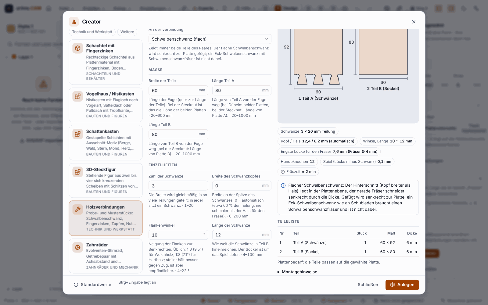
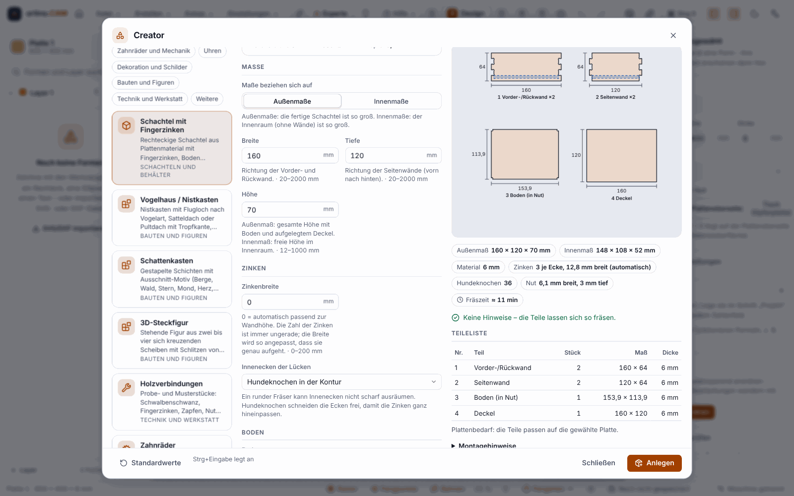
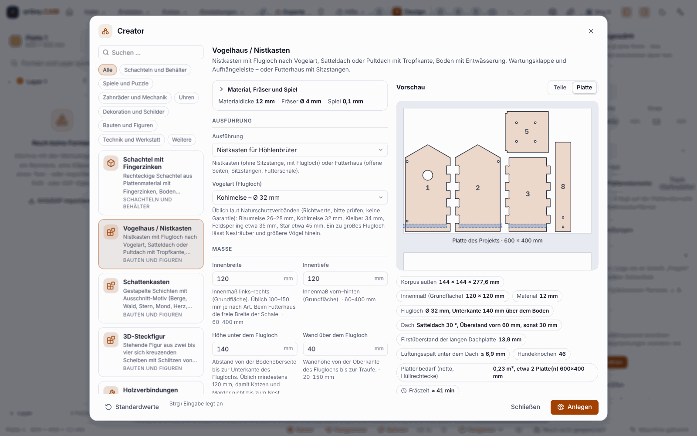
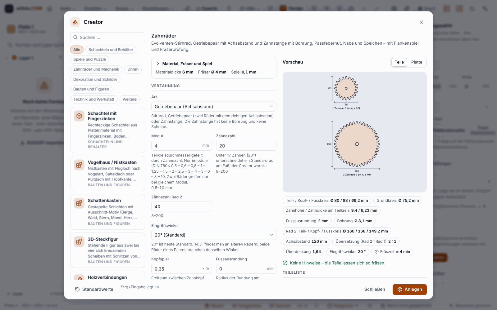
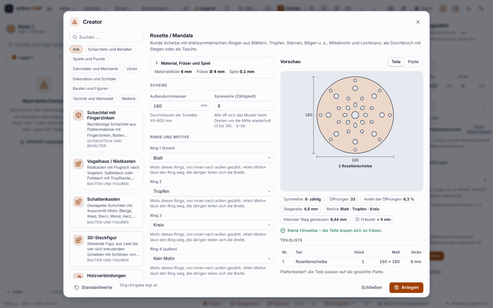
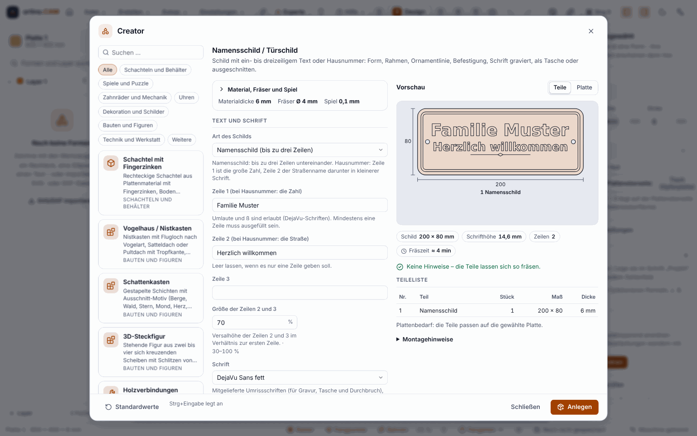

# Creator: Werkstücke aus wenigen Eingaben (seit 0.13.0)

Ein **Creator** erzeugt aus wenigen Eingaben ein fertiges Werkstück aus Plattenmaterial: die Teile als Konturen, mit Nuten, Ausschnitten und Gravur, dazu Teileliste, Montagehinweise und Plattenbedarf. Auf Wunsch legt er das Werkstück samt Fräsbearbeitungen im Projekt an. Es gibt **18 Creator in fünf Gruppen**, vom Vogelhaus über Zahnräder bis zum Türschild.

> **Ehrlich zum Stand:** Alles ist **nur mit Rust-Tests, Vitest-Tests, dem Simulator und Chromium geprüft**. **Kein einziges Teil wurde gefräst, verleimt, zusammengesteckt oder aufgehängt.** Das **Spiel** (Standard 0,1 mm) ist ein **Richtwert**; ob Zinken, Zungen und Zapfen in deinem Holz stramm, locker oder gar nicht greifen, zeigt nur ein Versuch. Die Fräszeit ist eine grobe Schätzung aus Bahnlängen. Unter Windows (WebView2) wurde der Dialog nicht bedient. **Fräse zuerst einen Probeschnitt im Reststück** und den **Passungs-Testcoupon** (siehe [Platten und Möbel](Platten-und-Möbel)), bevor du eine Serie startest.

## Öffnen

* Menü **Erstellen ▸ Creator …**
* Befehlspalette `Strg+K`, Stichwort »Creator«
* Kachel **Creator** auf der [Startseite](KI-Modelle-und-Startseite)

Den Creator gibt es nur im Programm (und für Claude über die lokale Schnittstelle), **nicht im Web-Designer des Portals**.

## So gehst du vor

1. **Creator wählen.** Links die Galerie: Karten mit Name, Kurzbeschreibung und Kategorie. Die Suche findet Name, Beschreibung und Stichwörter in beiden Sprachen; Kategorien filtern; Pfeiltasten wählen, `Esc` leert die Suche.
2. **Werte eintragen.** Das Formular in der Mitte entsteht aus der Beschreibung des Creators: Gruppen, Einheiten (mm oder Zoll, wie dein Projekt), Grenzen und Hilfetexte an jedem Feld. In Zahlenfelder darfst du auch eine **Formel** schreiben (`Breite - 30`, mit Variablen des Projekts). Die Pfeiltasten ändern eine Zahl (`Umschalt` zehnfach, `Alt` zehntel), `Enter` springt zum nächsten Feld. Felder, die nur bei einer Wahl sinnvoll sind (zum Beispiel die Beschriftung nur mit Deckel), erscheinen erst dann.
3. **Kontext prüfen** (aufklappbar): die **Platte** und ihre **Materialdicke** (Standard: die Dicke der Platte), der **Fräser** (sein Durchmesser bestimmt Mindestbreiten, Nuten und Hundeknochen) und das **Spiel** (Standard: die Variable `Spiel` aus dem Passungs-Assistenten, sonst 0,1 mm). Bei anderer Materialdicke legt der Creator die Teile auf eigene Platten dieser Dicke.
4. **Vorschau lesen.** Rechts siehst du die **Teile** mit Maßlinien und Nummern oder die **Platte** mit den angeordneten Teilen, dazu Kennzahlen (Außen- und Innenmaß, Zinken, Fächer, grobe Fräszeit), **Hinweise im Stil der Prüfliste** mit Erklärung und Lösung (oft mit einem **Lösungsknopf**, der den Wert setzt), die **Teileliste** mit Plattenbedarf und die **Montagehinweise**. Geben die Eingaben keine Teile her, bleibt die letzte gültige Vorschau abgedunkelt stehen, und die Fehler stehen darüber.
5. **Anlegen** (`Strg+Eingabe`). Der Creator legt Platten, Formen und Bearbeitungen im Projekt an, als **ein Rückgängig-Schritt**. Bei Fehlern ist der Knopf gesperrt. »Standardwerte« setzt das Formular zurück; die zuletzt benutzten Werte merkt sich der Dialog je Creator (nur als Bequemlichkeit).
6. **Weiter wie gewohnt:** Bearbeitung ansehen, [Prüfen und Simulation](Prüfen-und-Simulation), dann [Fräsen](Fräsen-an-der-Maschine).

Die Fräsbahnen sind ganz normale Bearbeitungen (innen vor außen, Außenkonturen mit automatischen Haltestegen); du kannst alles danach von Hand ändern.

## Die 18 Creator in fünf Gruppen

Die fünf Gruppen sind die der Dokumentation. In der Galerie im Programm filterst du zusätzlich nach Kategorien (Schachteln und Behälter, Spiele und Puzzle, Zahnräder und Mechanik, Uhren, Dekoration und Schilder, Bauten und Figuren, Technik und Werkstatt, Weitere).

### Schachtel (1)

* **Schachtel mit Fingerzinken:** rechteckige Schachtel, Maße außen oder innen; Boden aufgelegt oder in einer Nut; Deckel aufgelegt oder als Schiebedeckel; Trennwände im Raster mit Stecknuten; Fingerausschnitt oder Griffmulde; Beschriftung und Teilenummern. Die Zinkenbreite wählst du oder lässt sie automatisch passend zur Wandhöhe wählen (immer eine ungerade Zahl von Zellen).

### Bauten und Figuren (3)

* **Vogelhaus / Nistkasten:** Nistkasten mit **Flugloch nach Vogelart** (Blaumeise, Kohlmeise, Kleiber, Feldsperling, Star), Satteldach oder Pultdach mit Tropfkante, Boden mit Entwässerungsbohrungen, Seitenklappe zur Reinigung und Aufhängeleiste. Oder ein Futterhaus mit Schale, Sitzstangen und Silo-Ausschnitt. Am Nistkasten gibt es bewusst keine Sitzstange.
* **Schattenkasten:** 2 bis 8 gestapelte Schichten mit Ausschnitt-Motiv (Berge, Wald, Stern, Mond, Herz oder ein Schriftzug als Schablone), Distanzrahmen, Rückwand mit **LED-Streifenkanal**, Kabeldurchlass, Batteriefach und Außenrahmen mit Fingerzinken.
* **3D-Steckfigur:** stehende Figur aus 2 bis 4 gleichen Scheiben, die sich kreuzen und mit Schlitzen von oben und unten ineinandergesteckt werden: Stern, Weihnachtsbaum, Tannenbaum oder Schneeflocke. Tiere gibt es nicht.

### Technik (5)

* **Holzverbindungen:** Probe- und Musterstücke für flachen Schwalbenschwanz (in der Plattenebene), Fingerzinken, Zapfen und Schlitz, Nut und Feder, Überblattung, Dübelbohrungen und Stecknut. Du bekommst immer **beide Teile** mit Spiel.
* **Zahnräder:** Evolventen-Stirnrad (Modul und 8 bis 200 Zähne), Getriebepaar mit Achsabstand und Zahnstange, mit Bohrung, Passfedernut, Nabe und Speichen. Das Programm prüft, ob dein Fräser in die Zahnlücke passt.
* **Zahnriemenscheibe:** für GT2, HTD 3M und HTD 5M mit Bordscheiben, Nabe und Bohrung, dazu Riemenlänge und Achsabstand für zwei Scheiben.
* **Lüftungsgitter:** rechteckig oder rund, mit Schlitzen, Lamellen oder Wabenmuster, Rahmen und Befestigungslöchern; zeigt den **Öffnungsanteil** in Prozent.
* **QR-Code:** für Adresse, Text, WLAN oder Kontakt, als Tasche, Gravur oder Durchbruch-Schablone, mit Fehlerkorrektur, Ruhezone und Prüfung der Modulgröße gegen den Fräser.

### Ornament (3)

* **Puzzle (Jigsaw):** Raster aus Spalten und Zeilen (bis 200 Teile) im gewünschten Außenmaß, drei Zungenformen mit einem Hals, den dein Fräser schafft, Streuung nach Zufallswert (gleicher Wert, gleiches Puzzle), Spiel zwischen den Teilen, gerader oder gewellter Rand und auf Wunsch ein Rahmen.
* **Rosette / Mandala:** runde Scheibe mit drehsymmetrischen Ringen aus Blättern, Tropfen, Sternen, Bögen und mehr (Symmetrie 3 bis 36), Mittelmotiv und Lochkranz; als Durchbruch mit **symmetrischen Stegen**, damit nichts herausfällt, oder als Tasche.
* **Dekoration nach Jahreszeit:** Schneeflocke, Stern, Weihnachtsbaum, Osterei, Hase, Herbstblatt, Kürbis und Herz als Anhänger oder mit Fuß, mit Beschriftung oder Jahreszahl und Stückzahl.

### Schrift und Skala (6)

* **Namensschild / Türschild:** bis zu drei Zeilen Text oder eine Hausnummer mit Straßenname, Schild als Rundrechteck, Rechteck, Oval, Wappen, Blatt oder Stein, mit Rahmenlinie oder Doppellinie, Ornamentlinie und Befestigung. Die Schrift passt sich automatisch ein, ist graviert, eine Tasche oder ausgeschnitten (mit Stegen für O, A, B und Co.).
* **Geburtsbuchstabe:** großer Anfangsbuchstabe als Plakette oder als Buchstabenform, mit Name, Datum, Uhrzeit, Gewicht und Größe, wahlweise mit Sternen, Mond und Wolken und einem Ständer-Fuß.
* **Letter Topper:** Buchstaben oder ein Wort mit Spieß für Torte oder Blumentopf, einzeln oder als Gruppe, auch als Fahne mit ausgeschnittenem Wort.
* **Wortkacheln:** ein Wort als einzelne Buchstabenkacheln (Scrabble-artig, mit Punktwert) oder als zusammenhängende Leiste mit Aufhängeloch.
* **Lineal:** Teilung in Millimetern und/oder Zoll, beschriftete Zentimeter, Nullpunkt, Teilungskorrektur und Aufhängeloch; die Striche graviert oder als V-Nut.
* **Wanduhr-Zifferblatt:** Ziffern arabisch oder römisch, Stunden- und Minutenstriche, Loch für das Uhrwerk und Aufhängerbohrung; graviert oder als Tasche.

## Mit Claude

Claude kann die Creator über die lokale Schnittstelle benutzen (`creator.list`, `creator.info`, `creator.preview` und `creator.create`; siehe [Claude, MCP und API](Claude-MCP-und-API)). Eine Bitte wie »Erstelle eine Schachtel 200 × 150 × 80« liest zuerst die Parameter, rechnet eine Vorschau (die nichts ändert) und legt sie erst dann an. Wie jede Änderung ist auch das ein Rückgängig-Schritt.

## Grenzen

* **Nichts davon ist gefräst.** Rechenwerte sind keine Messwerte: Spiel, Stegbreiten, Haltbarkeit von Spießen und Stegen, Zahnflanken, Riemenrillen, die Teilung eines Lineals und die Lesbarkeit eines QR-Codes sind **nicht an echtem Material oder mit einem echten Telefon geprüft**. Ein Holzlineal ist kein Messmittel.
* **Vogelmaße sind Richtwerte,** wie sie Naturschutzverbände üblicherweise nennen (bitte prüfen). Es gibt **keine Garantie**, dass eine Art einzieht.
* **Letter Topper:** Für Lebensmittel nur lebensmittelechtes Material oder Folie um den Spieß verwenden; ein Topper ist kein Spielzeug. Das Programm prüft das nicht.
* **Nicht dabei:** Tiere als Steckfiguren; der Eck-Schwalbenschwanz wie an Schubladen (er braucht einen Schwalbenschwanzfräser); Zahnräder mit Schräg-, Kegel- oder Innenverzahnung und jede Festigkeitsrechnung; Zahnriemenscheiben T2,5 und T5; Zeiger und Uhrwerkhalter fürs Zifferblatt; eine 3D- oder Explosionsansicht (die Vorschau ist eine 2D-Zeichnung).
* **Dünnes Material** (unter 3 mm) bricht beim Fräsen von Zinken leicht; die Meldung nennt die Lösung. Die **Haltestege** der Außenkonturen musst du nach dem Fräsen abstemmen. Die Gravur ist flach und für einen Gravierfräser gedacht; gibt es im Projekt keinen V-Fräser, nimmt das Programm den kleinsten Schaftfräser und warnt, dass kleine Schrift damit grob wird.
* **Anordnung:** Die Teile liegen ohne Drehen auf der Platte. Ist die Platte größer als der Verfahrweg deiner Maschine, meldet die Prüfliste das; dann eine kleinere Platte wählen oder [kacheln](Grosse-Teile-kacheln).
* **Obergrenzen** gegen Unfug: höchstens 400 Exemplare je Aufruf, höchstens 8 neue Platten, Maße bis 2000 mm.
* Die Schrift stammt aus den Schriften des Programms; die Qualität des Satzes (Abstände, Umlaute der Einzellinienschrift) hat kein Schriftgestalter geprüft.

## Weiter

* [Platten und Möbel](Platten-und-Möbel) (Passungs-Assistent, Fingerzinken)
* [Bearbeitungen](Bearbeitungen)
* [Prüfen und Simulation](Prüfen-und-Simulation)
* [Fräsen an der Maschine](Fräsen-an-der-Maschine)
