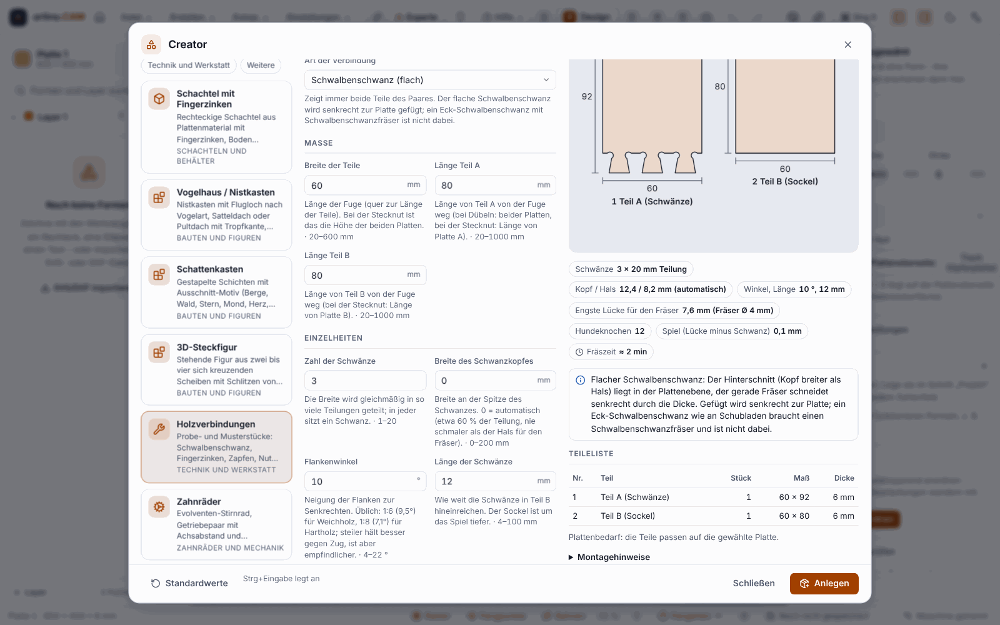
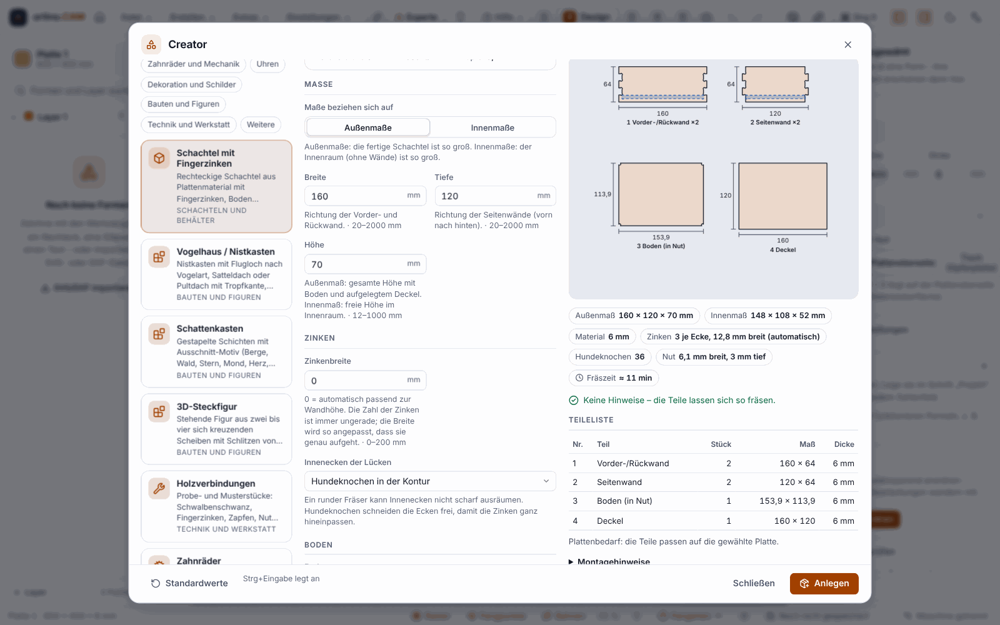
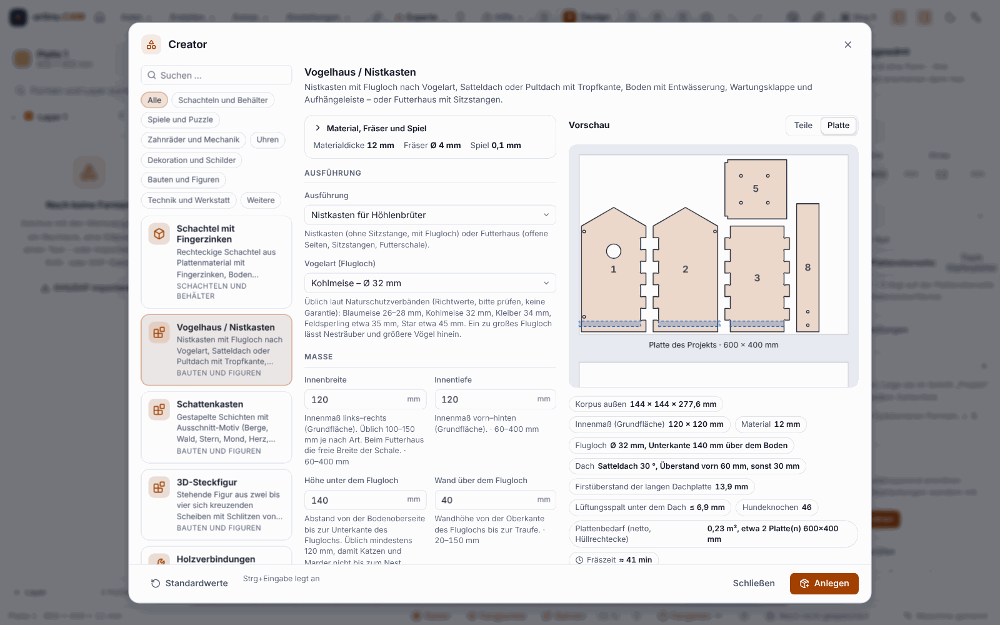
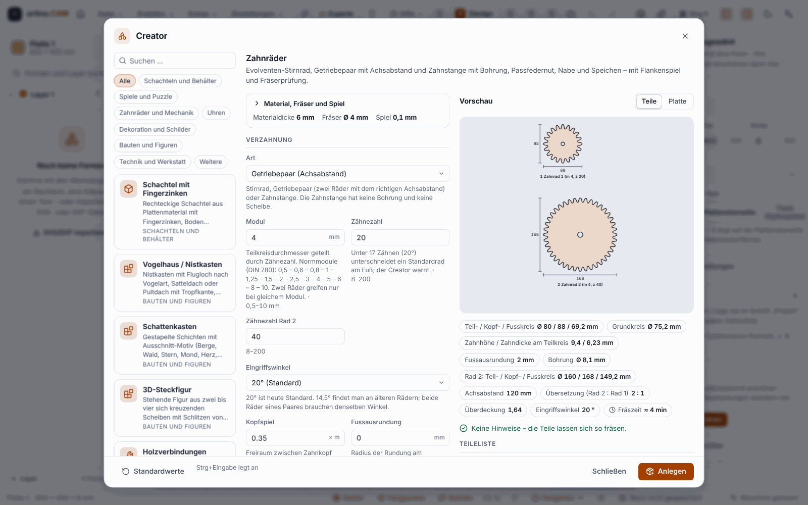
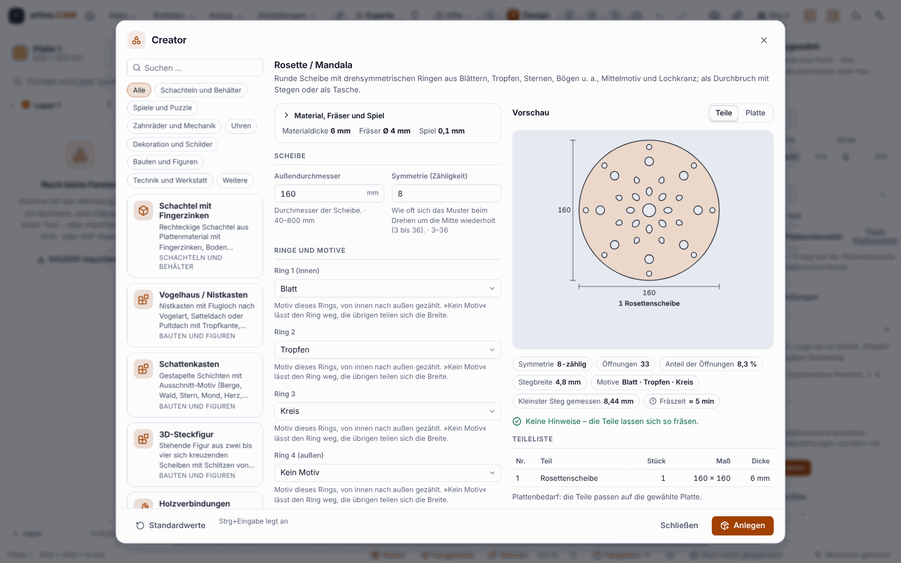
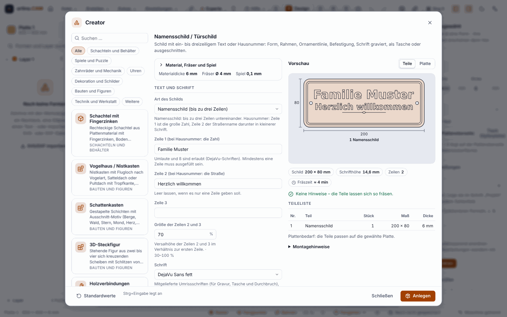

**English** | [Deutsch](Creator)

# Creators: workpieces from a few inputs (since 0.13.0, extended in 0.14.0)

A **creator** produces a finished workpiece from sheet material out of a few inputs: the parts as contours, with grooves, cutouts and engraving, plus a part list, assembly notes and the sheet requirement. If you want, it creates the workpiece in the project together with the milling operations. There are **22 creators in six groups**, from the birdhouse through gears and a door sign to the advent calendar. **Since 0.14.0** the new group “Festive and seasonal” with four creators and the seasonal decoration with 35 instead of 8 motifs are part of it (0.13.0: 18 creators in five groups).

> **Honest about the status:** Everything is **checked only with Rust tests, Vitest tests, the simulator and Chromium**. **Not a single part has been milled, glued, plugged together or hung up.** The **clearance** (default 0.1 mm) is a **guide value**; whether fingers, tongues and tenons in your wood fit tight, loose or not at all, only a trial will show. The milling time is a rough estimate from toolpath lengths. The dialog has not been operated under Windows (WebView2). **Mill a test cut in an offcut first** and the **fit test coupon** (see [Sheets and Furniture](Sheets-and-Furniture)) before you start a series.

## Opening

* Menu **Create ▸ Creator …**
* Command palette `Ctrl+K`, keyword “Creator”
* The **Creators** tile on the [start page](AI-Models-and-Start-Page)

The creators exist only in the program (and for Claude through the local interface), **not in the web designer of the portal**.

## How to proceed

1. **Choose a creator.** The gallery is on the left: cards with name, short description and category. The search finds name, description and keywords in both languages; categories filter; the arrow keys select, `Esc` clears the search.
2. **Enter values.** The form in the middle is built from the description of the creator: groups, units (mm or inches, as in your project), limits and help texts on every field. In number fields you may also write a **formula** (`Width - 30`, with variables of the project). The arrow keys change a number (`Shift` tenfold, `Alt` tenth), `Enter` jumps to the next field. Fields that only make sense for a certain choice (for example the lettering only with a lid) appear only then.
3. **Check the context** (collapsible): the **sheet** and its **material thickness** (default: the thickness of the sheet), the **cutter** (its diameter sets minimum widths, grooves and dogbones) and the **clearance** (default: the variable `Spiel` from the fit assistant, otherwise 0.1 mm). With a different material thickness the creator puts the parts on sheets of their own with that thickness.
4. **Read the preview.** On the right you see the **parts** with dimension lines and numbers or the **sheet** with the arranged parts, plus key figures (outer and inner size, fingers, compartments, rough milling time), **notes in the style of the checklist** with explanation and solution (often with a **fix button** that sets the value), the **part list** with the sheet requirement and the **assembly notes**. If the inputs yield no parts, the last valid preview stays dimmed and the errors appear above it.
5. **Create** (`Ctrl+Enter`). The creator creates sheets, shapes and operations in the project, as **one undo step**. If there are errors, the button is locked. “Defaults” resets the form; the dialog remembers the values you used last for each creator (only as a convenience).
6. **Continue as usual:** look at the operation, [Checking and Simulation](Checking-and-Simulation), then [milling](Milling-on-the-Machine).

The milling paths are completely ordinary operations (inside before outside, outer contours with automatic tabs); you can change everything by hand afterwards.

## The 22 creators in six groups

The six groups are those of the documentation. In the gallery in the program you also filter by categories (Boxes and containers, Games and puzzles, Gears and mechanics, Clocks, Decoration and signs, Festive and seasonal *(since 0.14.0)*, Builds and figures, Engineering and workshop, Other). Under “Festive and seasonal” you also find the seasonal decoration, which belongs to the Ornament group in this list.

### Box (1)

* **Box with finger joints:** rectangular box, dimensions outside or inside; bottom laid on or in a groove; lid laid on or as a sliding lid; dividers in a grid with slot-in grooves; finger notch or grip recess; lettering and part numbers. You choose the finger width or let it be chosen automatically to suit the wall height (always an odd number of cells).

### Builds and figures (3)

* **Birdhouse / nest box:** nest box with an **entrance hole by bird species** (blue tit, great tit, nuthatch, tree sparrow, starling), gable roof or mono-pitch roof with a drip edge, base with drain holes, side flap for cleaning and a hanging strip. Or a bird feeder with tray, perches and silo cutout. The nest box deliberately has no perch.
* **Shadow box:** 2 to 8 stacked layers with a cutout motif (mountains, forest, star, moon, heart or a lettering as a stencil), spacer frame, back wall with an **LED strip channel**, cable passage, battery compartment and outer frame with finger joints.
* **3D slot figure:** standing figure made of 2 to 4 identical discs that cross each other and are plugged together with slots from above and below: star, Christmas tree, fir tree or snowflake. There are no animals.

### Engineering (5)

* **Wood joints:** trial and sample pieces for flat dovetail (in the plane of the sheet), finger joints, mortise and tenon, tongue and groove, lap joint, dowel holes and cross slot. You always get **both parts** with clearance.
* **Gears:** involute spur gear (module and 8 to 200 teeth), gear pair with centre distance and rack, with bore, keyway, hub and spokes. The program checks whether your bit fits into the tooth gap.
* **Timing pulley:** for GT2, HTD 3M and HTD 5M with flanges, hub and bore, plus belt length and centre distance for two pulleys.
* **Ventilation grille:** rectangular or round, with slots, louvres or honeycomb pattern, frame and mounting holes; shows the **open area** in percent.
* **QR code:** for an address, text, Wi-Fi or contact, as a pocket, engraving or cut-through stencil, with error correction, quiet zone and a check of the module size against the bit.

### Ornament (3)

* **Jigsaw puzzle:** grid of columns and rows (up to 200 pieces) in the outer size you want, three tab shapes with a neck that your bit can cut, scatter by random seed (same value, same puzzle), clearance between the pieces, straight or wavy edge and, if you want, a frame.
* **Rosette / mandala:** round disc with rotationally symmetric rings of leaves, drops, stars, arcs and more (symmetry 3 to 36), centre motif and ring of holes; as a cut-through with **symmetric webs** so that nothing falls out, or as a pocket.
* **Seasonal decoration:** **35 motifs** (since 0.14.0; before that 8) as a pendant or with a foot, with lettering or year and quantity. Snowflake, star, Christmas tree, Easter egg, bunny, autumn leaf, pumpkin and heart were already there in 0.13.0. **New since 0.14.0:** winter and Advent (bell, moon and stars, candy cane, pine cone, gift, snowman, gingerbread man, candle, reindeer), spring and Easter (tulip, daisy, butterfly, ladybird, bee, bird), summer (sun, sunflower, scallop shell, starfish, anchor), autumn (acorn, fly agaric, owl, ghost, bat) and love (double heart, bow). You choose the inner drawing (eyes, veins, ornaments) as **cutouts**, as **engraved lines** or **both**; the hanging is a loop, a hole or a foot with a base plate. **Easter bunny** and **autumn leaf** (now a maple leaf) have been redrawn: the same inputs give a **different contour than in 0.13.0**; parts already created in the project stay unchanged. Places that are too narrow for the bit (antennae, legs, antlers) are reported by a warning with a fix button. Reindeer face, bee and bow are mediocre as drawings.

### Festive and seasonal (4, since 0.14.0)

Four creators in the gallery under the category “Festive and seasonal” (together with the seasonal decoration). **None of this has been milled, plugged together or glued.**

* **Advent calendar:** **1 to 60 numbered doors** (default 24) as a disc, rounded square, label or as a figure of the decoration (star, tree, bell, snowflake, gift, snowman, moon, heart, candle); each door carries **its number** engraved, has a loop or a hole for the string and, if you want, a decorative line. Plus a **board with rows** or a **tree** (rows with 3, 5, 7, 9 … holes) with holes for hooks or wooden pins; the number is above every hole, if you want **shuffled** (fixed random seed) instead of in order. If the board does not fit on the sheet, the program reports an error with a fix button (fewer rows, otherwise smaller doors); the tree with 24 doors, for example, does not fit on a sheet of 600 × 400 mm. Not included: doors that open, compartments to fill, numbers as cut-throughs.
* **Wreath and border:** a door wreath **round, oval or heart-shaped** or a straight **border**: a band with **leaves** (veins engraved), **stars, hearts, flowers** or **berry clusters**, motifs outside (default), on both sides or alternately inside and outside, if you want a second, smaller layer for gluing on and a hanging hole with a web all around. The **outer size** is kept (in the test it deviates by at most 1.5 mm). **Caution:** the frame clears every opening as a pocket right through; for a wreath with motifs on the inside as well, the toolpath calculation becomes very long. A profile cut with tabs for large openings is not included.
* **Lantern / tealight holder:** **four walls to plug together like the strokes of a # sign**: two walls with slots from above, two from below, up to half the height, slot width thickness plus clearance (guide value 0.1 mm), dogbones at the slot bottom. **Windows** made of figures (star, heart, tree, moon and star, snowflake, bell, owl, butterfly), as a dot pattern or as vertical slots; a **base with a recess** for the tealight (default Ø 38 mm) and, if you want, a **roof** with a round hole. **Safety:** wood burns. The creator is designed for an **LED tealight** (switch “For LED tealight”, on by default). If you switch it off, it warns about a wooden roof above the flame and about walls under 110 mm in height. It **does not check, however, whether an open flame is safe in this lantern**; heat resistance and soot formation are not tested. With a real flame never leave it unattended, never with a closed roof, away from curtains. Not included: handle, glass insert, roof with a slope, round lanterns.
* **Garland / bunting:** pennants as a **triangle, swallowtail, rectangle or half round** (width 30 to 250 mm, height 30 to 300 mm), **one letter per pennant** (for example “HAPPY BIRTHDAY”, spaces are skipped, at most 40 characters) or 1 to 40 blank pennants with a quantity, if you want a decorative line. For the string there are **two holes** in the upper corners or a **slot**; the key figures give the string length. Not included: pennants with a picture or pattern, letters as cut-throughs, multi-line sayings.

### Lettering and scales (6)

* **Name sign / door sign:** up to three lines of text or a house number with street name, sign as a rounded rectangle, rectangle, oval, crest, leaf or stone, with frame line or double line, ornament line and fixing. The lettering fits itself automatically and is engraved, a pocket or cut out (with webs for O, A, B and the like).
* **Birth letter:** large initial letter as a plaque or as a letter shape, with name, date, time, weight and length, optionally with stars, moon and clouds and a stand foot.
* **Letter topper:** letters or a word with a spike for a cake or flower pot, single or as a group, also as a flag with a cut-out word.
* **Word tiles:** a word as individual letter tiles (Scrabble-like, with point value) or as a connected strip with a hanging hole.
* **Ruler:** graduation in millimetres and/or inches, numbered centimetres, zero point, scale correction and hanging hole; the marks engraved or as a V-groove.
* **Wall clock dial:** numerals Arabic or Roman, hour and minute marks, hole for the clock movement and hanging bore; engraved or as a pocket.

## With Claude

Claude can use the creators through the local interface (`creator.list`, `creator.info`, `creator.preview` and `creator.create`; see [Claude, MCP and API](Claude-MCP-and-API)). A request such as “Create a box 200 × 150 × 80” first reads the parameters, calculates a preview (which changes nothing) and only then creates it. Like every change, this too is one undo step.

## Limits

* **None of this has been milled.** Calculated values are not measured values: clearance, web widths, durability of spikes and webs, gear flanks, belt grooves, the graduation of a ruler and the readability of a QR code are **not checked on real material or with a real phone**. A wooden ruler is not a measuring instrument.
* **Lantern and open flame:** The creator does not check whether a flame is safe; for an open flame you are responsible yourself, an LED tealight is the safe choice.
* **Bird dimensions are guide values,** as nature conservation associations usually state them (please check). There is **no guarantee** that a species will move in.
* **Letter topper:** For food use only food-safe material or foil around the spike; a topper is not a toy. The program does not check this.
* **Not included:** animals as slot figures; the corner dovetail as on drawers (it needs a dovetail bit); gears with helical, bevel or internal teeth and any strength calculation; timing pulleys T2.5 and T5; hands and clock movement holder for the dial; a 3D or exploded view (the preview is a 2D drawing).
* **Thin material** (under 3 mm) easily breaks when milling fingers; the message gives the solution. You have to chisel off the **tabs** of the outer contours after milling. The engraving is shallow and meant for an engraving bit; if there is no V-bit in the project, the program takes the smallest end mill and warns that small lettering becomes coarse with it.
* **Layout:** The parts lie on the sheet without rotating. If the sheet is larger than the travel of your machine, the checklist reports it; then choose a smaller sheet or [tile](Tiling-Large-Parts).
* **Upper limits** against nonsense: at most 400 copies per call, at most 8 new sheets, dimensions up to 2000 mm.
* The lettering comes from the fonts of the program; the quality of the typesetting (spacing, umlauts of the single-line font) has not been checked by a type designer.

## Next

* [Sheets and Furniture](Sheets-and-Furniture) (fit assistant, finger joints)
* [Operations](Operations)
* [Checking and Simulation](Checking-and-Simulation)
* [Milling on the Machine](Milling-on-the-Machine)
