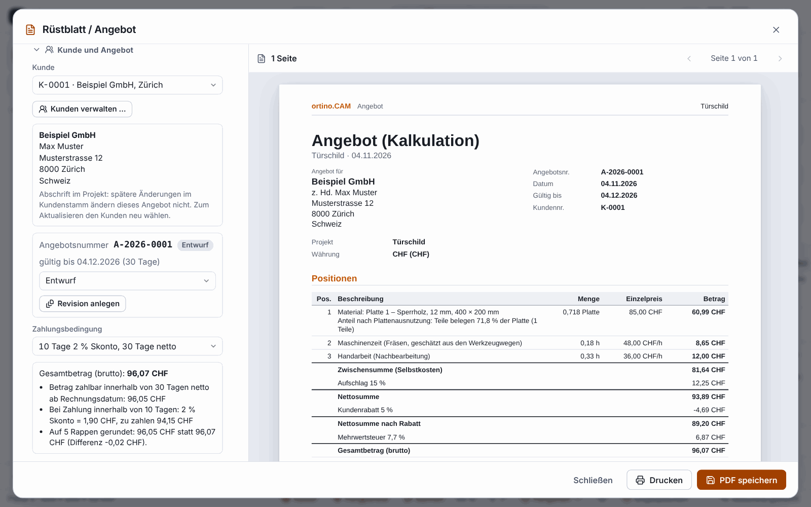

**English** | [Deutsch](Kunden-und-Angebote)

# Customers and quotes (since 0.11.0)

Besides the free-text “Customer” field, the quote from [Setup sheet and quote](Setup-Sheet-and-Quote) knows **customer records**, **sequential quote numbers** with revisions and **payment terms**. All of this is stored **locally in your program’s data folder**: no cloud, none of it goes to the portal or to Claude.

Names and amounts are invented.

> **Honest about the status:** Checked with tests, in the browser (Chromium) against the program with the real core and with two PDF checking tools. **Not checked:** Acrobat and the Windows PDF viewers, printing, the file dialog under Windows, Excel (the CSV files are built to Excel’s rules but have never been opened in Excel).
>
> **The program gives no legal or tax advice.** Whether a detail, number, period, payment term or VAT rate suits and is permitted for your business, including the mandatory details on quotes and invoices, is for you to check. Nothing here has been checked as “legally compliant”.

## Opening

* File menu **Customers & quotes …**
* Command palette `Ctrl+K`: “Customers”, “Quotes”, “Payment terms”
* In the setup sheet / quote dialog the button **“Manage customers …”**
* Since 0.13.0: the **Customers & quotes** tile on the [start page](AI-Models-and-Start-Page)

The dialog has four tabs: **Customers**, **Quotes**, **Payment terms** and **Number range**.

## The customer records

1. Tab **Customers**, create a new customer: name or company (required), contact person, address, email, phone, VAT number, internal note, default payment terms, default discount and the language of the documents (German or English).
2. Every customer gets a **number** (`K-0001`, `K-0002` …). A number is **never assigned again**, not even after deleting.
3. The **search** finds words in all fields; umlauts also count without the umlaut (“muller” finds “Müller”).
4. If a customer already has a quote, deleting **archives** them instead: they disappear from the selection but are kept for the old quotes. You have to ask explicitly for a permanent deletion. Before any deletion the program makes a backup.
5. A new customer with the same name, the same postcode and the same town as an existing one is created, but with a warning.

**The VAT number is only checked for its form** (for example `CHE-123.456.789 MWST`, `DE` and nine digits), not for validity and not against a register.

### Import and export

* **Export** as CSV (semicolon, UTF-8 with BOM, built for Excel) or JSON. Cells that begin like a formula (`=`, `+`, `-`, `@`) get an apostrophe in front so that Excel does not execute them.
* **Import** reads CSV and JSON with a detected separator and a detected character encoding; the columns may have German or English headings (“Firma”, “Strasse”, “Postleitzahl” …), at least the column “Name / company” must be there. First there is a **preview**, then **Merge** (default) or **Replace** (with a backup before). A second import of the same file does not duplicate anything. Errors in single rows only skip that row; the message names row and field, never the content.

## Quote with a number

1. Open the setup sheet / quote dialog (see [Setup sheet and quote](Setup-Sheet-and-Quote)) and, in the section **“Customer and quote”**, pick the customer from the records. Their address block then appears in the quote PDF. Without a chosen customer the free-text field stays as before.
2. **Create quote** assigns the number. It is created **only on this button**, not when looking at the preview, printing or saving the PDF. Without a number the sheet says “not yet assigned”.
3. A changed quote keeps its number and, via **“Create revision”**, gets the suffix `-R2`, `-R3` … The older revisions stay in the list with their status and do not count twice in the totals.
4. The **status** is draft, sent, accepted, rejected or expired. The **validity** is 30 days by default (adjustable); a draft or sent quote after expiry counts as expired. A draft follows changes to the project. Once a quote is sent, the list holds the printed figures; if the project later deviates from them, the dialog shows “The project differs from the quote”.
5. Quotes are **not deleted**, so that the numbers stay gap-free; quotes you no longer want you set to “rejected” or “expired”.

The **Quotes** tab lists all quotes with number, date, customer, project, validity, status and gross, with a filter by status, a search and the **total per currency** (only the latest revision each; there are no totals across currencies).

### Number range

In the **Number range** tab you set a pattern, for example `A-{YYYY}-{NNNN}` (gives `A-2026-0007`): `{YYYY}` or `{YY}` for the year, `{MM}` for the month, `{N}` up to `{NNNNNNNNN}` for the counter with leading zeros. Exactly one counter is required. In addition there are the start value, the **restart** (yearly, monthly or never) and the default validity; the dialog shows the next number as an example. With a yearly restart the pattern must contain the year, otherwise numbers would be assigned twice, and the dialog tells you so.

The numbers are **unique and gap-free per computer and data folder**. A shared number range across several computers is **not guaranteed**. A number is never reused, not even after “Undo”.

## Payment terms

Four templates are supplied: **“30 days net”**, **“10 days 2 % discount, 30 days net”**, **“50 % deposit on order, remainder on delivery”** and **“Payment in advance”**. You can change them, delete them and create your own (at most 50). A term knows payment period, early-payment discount (Skonto) with its period, deposit, payment in advance, due at the end of the month and an additional text. From it the quote calculates deposit, remainder, discount and due date. Only in the currency CHF is rounding to 5 Rappen applied; the difference is shown separately on the sheet. Whether this rounding has to apply to your invoice is for you to check. In the tab there is a **trial calculation** on an example amount.

## Where the data is stored

In the program’s data folder (dialog “About ortino.CAM”), under Windows in `%APPDATA%\ortino.CAM`: `kunden.json`, `angebote.json` and `zahlungsbedingungen.json`. Before deleting, replacing and restoring, backups are made (the last ten). A damaged file is **left unchanged by the program**, and it assigns no number until you restore a backup or explicitly put the file aside. Otherwise the number range would silently start from zero.

The workshop dashboard (see [Workshop and team](Workshop-and-Team)) shows from the quotes only the number and total of the open ones, without customer data.

## Limits

* **No sender:** The quote page prints no letterhead, no address of your business, no bank details, no VAT number of your own and no logo. The program does not know the business details.
* **No invoice,** no dunning, no bookkeeping, no connection to programs for those.
* At most 20,000 customers. Everything only in the program, **not in the Web Designer** of the portal.
* If you pass on an `.ocam` project file, the address and prices in the quote go with it. When a design is shared in the portal, the program leaves these entries out.
* The business checks the details itself; the prices in the picture are invented.

## Next

* [Setup sheet and quote](Setup-Sheet-and-Quote)
* [Workshop and team](Workshop-and-Team)
* [Sheets and furniture](Sheets-and-Furniture)
