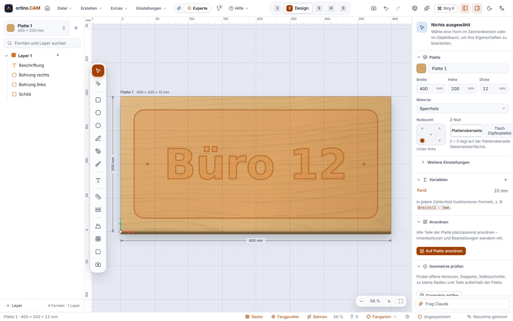
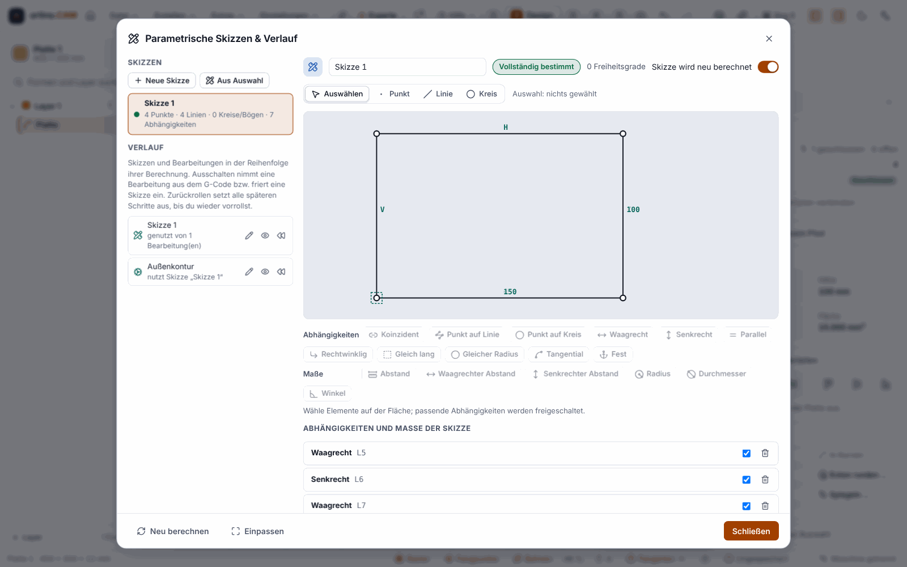
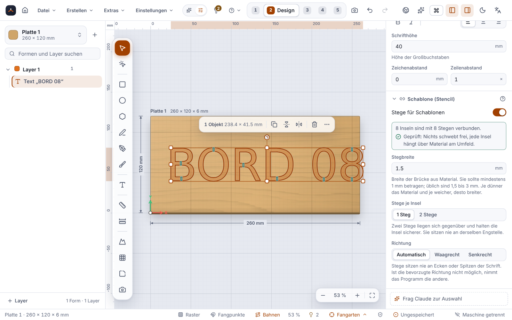

**English** | [Deutsch](Zeichnen-und-Importieren)

# Drawing and Importing

In the **Design** step you design what is to be milled: shapes, text, imported drawings. Everything can be kept **parametric** with formulas and variables, that is, adjusted later by changing a number.



The sheet is the material you mill from. Its origin is at the bottom left, the Y axis points up. All lengths are in millimetres (or inches, if you created the project that way; the unit cannot be changed afterwards). A list of the keys is under [Keyboard Shortcuts](Keyboard-Shortcuts).

## Navigating and snapping

* **Zoom:** mouse wheel. **Pan:** drag with the middle mouse button, or hold Space and drag with the left button. **Fit:** `F` fits the view to the sheet, `Z` zooms to the selection.
* **Snapping** locks onto the grid, endpoints, midpoints, sheet edges and guides. When dragging nodes, `Alt` switches snapping off. **Since 0.7.0** these are added (each type with its own shape, colour and short text, switchable per type in the **“Snap modes”** window of the status bar and under *Settings ▸ Drawing*): **intersections** (line, circle, arc), **extension** (hover over the endpoint of a line or arc for about 0.3 s, then a **+** appears and the pointer snaps onto the dashed extension), **perpendicular** and **tangent** from the last point, **perpendicular and parallel tracks** of a segment you have hovered over and **polar** at the set angle step (default 90°, down to 5°) with the angle displayed, as well as **on the contour**. Seen only in tests and in Chromium, never with touch or pen.
* **Undo:** `Ctrl+Z` (up to 200 steps, typed changes are combined). **Autosave** saves every 30 seconds to a recovery file. If the program finds an automatically saved state at start-up, it offers on the welcome page to restore it.

## Drawing shapes

| Tool | Key | Note |
|---|---|---|
| Select | `V` | Arrow keys move the selection by one grid step (ten times with `Shift`) |
| Edit nodes | `A` | see below |
| Rectangle | `R` | with corner radius |
| Ellipse / circle | `E` | |
| Polygon / star | `P` | 3 to 32 corners, `S` switches between polygon and star |
| Line / polyline | `L` | |
| Pen (Bézier curves) | `B` | click = corner, click and drag = curve, click on the start point closes |
| Freehand | `Shift+B` | is smoothed, corners stay corners, a slider sets the smoothing |
| Text | `T` | |
| Measure | `M` | |

Every shape has properties (position, size, corner radius, rotation) into which you can write numbers **or formulas**.

## Dimensioning (since 0.7.0)

With the **D** tool you place dimensions in the drawing: **horizontal, vertical, aligned, radius, diameter, angle and arc length**. A dimension is attached to points of shapes; if you move or scale the shape or change its parameters, the dimension follows. If you delete the shape, a free dimension remains with a note. Dimensions are **pure annotation**: they **never create toolpaths** and do not appear in the G-code, the simulation or the checklist. Export: **SVG** (as a group) and **DXF** (layer `BEMASSUNG`). **Limits:** not in the setup sheet and the PDF; the exports have not been opened in any third-party CAD program; not tried under Windows.

## Parametric sketches (since 0.12.0)

> **Honest about the status:** Checked only against tests and Chromium, not compared with a CAD program, never milled.



The menu **Create ▸ Parametric sketches & history** opens a dialog of its own with its own drawing surface. You draw **points, segments, circles and arcs** (keys P, L, C) and set **constraints** (11 types in all, plus 6 types of dimensions): coincidence, point on line or circle, horizontal (H), vertical (V), parallel, perpendicular, equal length, equal radius, tangent, fixed (F). **Dimensions** (D) are distance, radius, diameter or angle, as a number or as a **formula with variables** of the project. The solver shows the **degrees of freedom** and reports redundant or contradictory constraints with a suggested solution. The sketch produces ordinary shapes, with which everything else (Boolean operations, operations, simulation, export) keeps working. The **history** lists sketches and operations in order; you can rename, switch off, roll back and roll forward steps. If a variable changes, the program recalculates only the affected sketches. Since 0.13.0: the dialog also has a tile **Parametric sketches** on the [start page](AI-Models-and-Start-Page).

**Limits:** no splines, ellipses or repeat patterns; no sketching directly in the main drawing area; at most 50 sketches with 250 elements and 250 constraints each; where there are several possible solutions, the one closest to the starting position wins.

## Text and fonts

Text stays **editable**: multi-line, with alignment as well as letter and line spacing. You can choose the fonts of your Windows and the supplied DejaVu fonts, with kerning and ligatures. For toolpaths text is resolved into outlines. With “To curves” text becomes a free path.

* **Text on path:** The text follows a line, an arc, a circle, rectangle, polygon or any path and **stays text**. A typical use is a round sign with lettering around the outside. You choose the shape, open the section “Text on this path” and enter the text. You can set the side (outside, inside, centred), start offset or angle, distance from the line, the reading direction, “Avoid upside-down text” and “Fit to path length”. If the path shape changes, the text follows. The program warns if the path is too short or too tight or if letters would touch. The sheet planner does not nest bound texts individually.
* **Single-line fonts:** Eleven Hershey fonts (for example Roman Simplex, Script, Gothic) supply **open lines** instead of areas, intended for engraving with the profile “On line”. The program composes umlauts (Ä Ö Ü ä ö ü) from the letter and two dots. **ß, €, accents and the underscore are missing** and are reported instead of replaced.
* **Stencil lettering with bridges (since 0.11.0):** When a stencil is milled out, letters with a closed inner area (O, A, B, D, P, Q, R, 8, 0, 4, 6, 9 and more) leave an **island** cut free all round, which falls out. The switch **“Bridges for stencils”** in the section “Stencil” of the text leaves narrow **bridges of material** at each island. You can set the **bridge width** (default 1.5 mm; 1.5 to 3 mm is usual, the thinner and softer the material, the wider), **one or two bridges** per island and the **direction** (automatic, horizontal or vertical). The program checks every cut and the whole (“Checked: nothing floats free”); if it does not succeed, there is an error with a recalculated suggestion for a smaller width. Preview, toolpath, simulation and export see the same geometry. **Limits:** straight bridges only; single-line fonts need no bridges; the Art Designer and the furniture module still place text without bridges; **never milled**, whether 1.5 mm holds in your plywood or plastic only a trial will show. (The Creators “Name sign” and “Birth letter” use the same bridges, see [Creators](Creators).)



* **Variable fields and serial numbers:** In a text you may put placeholders in curly braces: `{n}` (counter, start 1), `{n:001}` (counter with three digits and start 001: the digits give the minimum width and the start value, `{n:100}` counts 100, 101 …), `{date}` (today's date, also with a pattern such as `{date:DD.MM.YY}`), `{project}` (project name) and `{sheet}` (name of the sheet). `{{` and `}}` each give one brace. In the properties panel of a text the section **“Variable fields”** shows a preview of the result. The counters count up in **rectangular, circular and path arrays** and in **series** (start and step adjustable, the original is No. 0; in a series every table row counts). **Invalid placeholders** stay literally in the text and trigger a warning with a solution; nothing is silently discarded.
  * **Limits:** `{date}` comes from the system clock in **UTC** (shortly after midnight local time it can still be the previous day). The counter counts per copy, not per item of a quantity. There are no calculation expressions such as `{n+1}`.

> **Never milled or engraved.** Text on path, single-line font and serial numbers are checked by calculation and in the browser. Engraving quality, plunging at stroke ends and order of the strokes are unchecked.

## Editing shapes

In the properties panel and in the command palette (`Ctrl+K`) you find:

* **Move, scale, rotate, mirror, align, distribute, duplicate.**
* **Combine** (Boolean operations): **Weld** (union), **Subtract**, **Intersect**, **Exclude**. When subtracting, all shapes are subtracted from the one chosen first. “Keep originals” is selectable.
* **Offset:** move a contour outward or inward in parallel by a distance.
* **Round corners**, **Chamfer**, **Trim** and **Extend** (keys `O`, `H`, `X`, `N`). A preview shows the result, with the removed piece dashed in red. Arcs stay arcs.
* **Array:** copies in a **grid** (columns, rows, gaps), on a **circle** (count, angle, centre, rotate copies along) or **along a path** (see below).
* **Join:** chain open lines into closed contours.

### Array along a path

Select the shapes, open **Array …** in the properties panel and there the third segment **Along path**. A line, polyline, arc, circle, rectangle, polygon or Bézier curve can serve as the path. You give either the **count** or the **spacing**, measured along the arc length. Under “More settings” you set start and end offset, whether the last copy sits at the end, the direction, whether the copies are aligned to the tangent, the extra rotation and the reference point. In the drawing area you see live where the copies will be created. **Create copies** is a single undo step.

* With a **closed** path the last position is not placed twice: a circle with the spacing “circumference divided by 10” gives exactly 10 copies.
* For Bézier paths the path rounded to arcs applies. The spacings deviate from the true curve length by at most the rounding error.
* Text and patterns must first be converted to curves if they are to serve as the path. At most 10,000 copies per step. On any error the project stays unchanged, and the program names a solution.
* **Never milled:** The spacings were re-measured with tests; checked only against the simulator and a browser.

### Editing nodes

With the node tool (`A`, or double-click a shape) you see the nodes: square = corner, circle = smooth, diamond = symmetric. You can drag nodes and handles, bend segments, insert and delete nodes, switch between line, arc and curve, join, close and split paths and determine the **plunge point** at which the toolpath starts. “Reduce nodes” simplifies dense polylines into a few curves. Parametric shapes (rectangle, ellipse, text) become free paths when first edited; `Ctrl+Z` undoes that. Curves stay curves in the document and are rounded into circular arcs with an adjustable tolerance only when milling, exporting and simulating.

## Variables and formulas

With variables you change a dimension in one place, and everything that depends on it adapts. Create them in the **Project** step (“Variables …”). In every number field you may write a formula with units:

```text
Breite/2 - 5mm
1/4in
Dicke + 0,3mm
```

The program knows functions and detects circular references. Depths such as `Dicke + 0,3mm` always cut all the way through, even if you change the sheet thickness. The example project `tuerschild.ocam` uses a variable `Rand`.

## Importing files

With `Ctrl+I` (File menu: “Import (SVG, DXF, PDF/AI, image) …”) or by **drag & drop** onto the window. The program recognises the type from the file name. Files from the [Shape and Pattern Generator](Shape-and-Pattern-Generator) in the browser (SVG, DXF) you import here like any other; the file `.ortino-vorlage.json` from the same generator, however, belongs in the section “Own” (see [Custom Templates](Custom-Templates)).

| Format | What happens |
|---|---|
| **SVG** | Vectors are taken over. For SVG 1 px = 0.2646 mm (96 dpi). If the dimensions are wrong, a scale factor helps (quick choice, for example “72 → 96 dpi ×1.33”). |
| **DXF** | Vectors, layers optionally taken over as layers. A unit stated in the file is converted to millimetres automatically. DXF R12 to 2018 are supported. |
| **PDF** and **AI** (with PDF part) | Vectors, page preview, page choice, unit and scale, layers become layers, embedded fonts become outlines. |
| **PNG, JPEG, WebP** | The image is **traced** into vectors. |
| **STL**, **STEP** (`.step`, `.stp`) | A 3D model opens a dialog of its own and is taken over as relief, outline or layered model, see [Importing 3D Models](Importing-3D-Models). **Checked only with self-made files, never with files from a real CAD program.** |

In the import dialog you choose the **placement** (automatically fitted to the sheet, keep position, at the sheet corner, centred), the scaling, the target sheet and the target layer. The dialog shows notes about the import.

**What happens to curves in SVG and PDF:** Free curves (S-curves, lettering, blobs) are kept as **Bézier curves with nodes and handles** and can be reworked with the node tool. Circles, roundings on rectangles and slots become **segments and circular arcs** (adjustable tolerance, default 0.02 mm; for PDF this was already the case, for SVG it is new, where circles and roundings used to arrive as dense segments). Very large or complex files (more than 20,000 curve segments, over 4 million curve points or 10 seconds of computing time) are broken down into segments, with a note, as with the switch off. The switch **“Keep curves as Béziers with nodes”** in the import dialog (for PDF under “More settings”) is on by default; switched off, the earlier behaviour applies. Open curves that chain into a contour when joined lose their Bézier form in the process. For DXF (splines) and when tracing images it stays with segments and arcs; text from PDF fonts stays an outline. **Checked only with self-generated SVG and PDF files**, not with real files from Illustrator, Inkscape or CorelDRAW.

**Limits of the PDF import:**

* **Not tested with real files from Illustrator, Inkscape or CorelDRAW.** It was checked with files from other programs and self-built PDFs.
* Images in the PDF, transparency and clipping paths are **only reported**, not converted. For raster images there is the button “Trace as image”.
* Stroke widths and dashing are ignored, the centre line counts. Gradients and patterns are taken over only as an outline.
* Fonts that are not embedded are reported and not guessed. Solution: convert the text to outlines in the source.
* ortino.CAM cannot read **DWG** and rejects the file (also under another extension) with an explanation. Save as **DXF** or SVG in your CAD program.

**EPS, PostScript and old Illustrator files (since 0.6.0):** `.eps`, `.ps` and `.ai` **without a PDF part** (Illustrator 1 to 8) go through the same dialog as the PDF, with the same settings (page, unit, scale, Béziers, layers); the header line names the file type. For this a small PostScript reader of its own reads the paths; it executes no file, network or process commands and has hard limits for time and memory. Areas become shapes, lines become centre lines, compound paths with a hole are kept. **Text, images, patterns and clipping paths are not drawn**, but counted and reported with a solution (for example: convert text to outlines in the source). **Limits:** No real file from Illustrator, CorelDRAW or Ghostscript was available (real only from cairo, the output module of Inkscape); Illustrator from version 9 as EPS without private data is unchecked and may arrive incomplete.
* Password-protected PDFs are rejected.

### Tracing an image

The assistant traces photos, logos and sketches as millable contours. You choose a preset (**Logo**, **Sketch**, **Photo outline**, **Levels**, **Colours**), the target size (or “Fit to the sheet (…)”) and, with **one slider**, the level of detail. A **live preview** shows the original, black and white, paths and overlay. Notes tell you if the image is too small, has too little contrast or is rather a photo (then choose “Photo outline”). With “Dark areas” / “Light areas” and “Invert” you decide what is foreground. Inner contours become holes. The result is one undo step.

## Exporting

Under File you find **Export as SVG** and **Export as DXF** (the vectors of the sheet). You create the G-code in the “Cut” step, see [Milling on the Machine](Milling-on-the-Machine). You can save 3D bodies as STL or 3MF, see [Exporting 3D bodies](Export-STL-3MF-en).

## Finding problems in the drawing

The **geometry check** finds open or almost closed contours, duplicates, self-intersections, micro-segments, inside radii too tight for the bit, parts that are too small, thin webs and shapes outside the sheet. Most findings are repaired by one click (one undo step). See [Checking and Simulation](Checking-and-Simulation).

## Pattern and Relief Studio

Two studios create elaborate surfaces with a few controls: the **Pattern Studio** for perforated panels (honeycomb, stars, Voronoi, text and image as hole grid, word and logo collage) and the **Relief Studio** for 3D reliefs. You open them via the tool palette or the command palette (“Patterns & reliefs …”). How to turn them into toolpaths is described under [Operations](Operations).

### Pattern Studio: 40 types and 80 templates

> **Honest about the status:** The patterns are **only calculated and checked on screen** (Rust tests, Vitest, Chromium, simulator), **nothing was milled**. The manufacturability (web, opening width, islands, corners) is measured; whether fine webs hold in the wood has not been tested. The minimum web of 1.5 mm is a preset, not a material guarantee.

* **How the studio is laid out:** On the left are the **templates** as cards with a preview; you filter by category or type into the **search field** (*since 0.14.0*: searches name, description, pattern type and category; all words must match, upper and lower case and accents do not matter, `Esc` clears the field). In the middle you see the sheet at original size with all openings and the **traffic light** for manufacturability. On the right are the simple controls (size, density, web, variation, randomness with dice), below them “Area and margin” and “Advanced” with all parameters. **“Add to sheet”** (`Ctrl+Enter`) is one undo step; **“Set up machining”** creates the inner contour and, if wanted, an outer contour with tabs.
* **40 types in six categories** (0.14.0: 39, 0.13.0: 25 types in five categories; **bold** = new since 0.14.0, the collage is new since 0.16.0):
  * *Geometric:* triangles, honeycomb, grid, brick bond, herringbone, cubes, slats, Truchet arcs, zigzag and waves, concentric rings, **chevron slats, argyle, cross parquet, Penrose tiling**
  * *Oriental:* mashrabiya, stars with six, eight and twelve points, **ogee lantern, fish scales (seigaiha), kagome**
  * *Ornament (new category):* **quatrefoil tracery, overlapping circles (shippo), art deco fans, spirals**
  * *Nature:* leaves, palm fronds, blossom vortex, flowers, **sunflower (Fibonacci), snowflakes, wave lines**
  * *Random:* random rectangles, subdivided fields, Voronoi, confetti
  * *Hole grid:* halftone, text from holes, image as hole grid, **word and logo collage (since 0.16.0)**
* **80 templates** (0.14.0: 76, 0.13.0: 37), among them eleven new ones for the existing types (0.14.0) and four for the collage (0.16.0). 75 of them are **green** according to the traffic light with the studio's presets (bit 3.175 mm, minimum web 1.5 mm, no islands) – measured, not milled. Not green are the **four templates of the collage** (islands, see below); the template “Image as hole grid” needs an image from you.
* **Option `trim`** (*since 0.14.0*, under “Advanced”, for triangles, honeycomb, grid, brick, herringbone, cubes and slats): cells cut off at the edge, of which less than the chosen share remains, are dropped. Without `trim` (default) narrow slots appear at the edge, even below the bit width. For the **flowers** there is an **offset, centred grid** with the same margin all round. Saved patterns do not change because of either.
* **Arcs stay arcs:** The ornament types (ogee, fish scales, quatrefoil, shippo, art deco fans, spirals, cross parquet) calculate with true circular arcs, not with many small segments. This makes the calculation fast: on the development computer under 0.3 seconds per type for a whole sheet of 1200 × 600 mm (one measurement, not a promise).
* **Word and logo collage (*since 0.16.0*):** This type fills an area densely with up to four words or logos; details in the section [Word and logo collage](#word-and-logo-collage-since-0160) below.
* **Custom templates (*since 0.15.0*):** In the tab **“Own”** (the first of the gallery) you save the state of the studio with **“Save as own template”**, rename, back up as a file, import files (also from the [online generator](Shape-and-Pattern-Generator)) and start with **“Create new”**. Patterns made from an image cannot be saved; of the collage a template stores only the words, never a logo. The shapes icon in the header of the gallery opens the dialog **“Shapes”** with ten basic shapes. Everything about this is under [Custom Templates](Custom-Templates); the templates have not been checked under Windows (WebView2).
* **Calculation time limit (*since 0.15.0*):** For outliers the calculation ends by itself after the program's time limit (default 180 s), with a message; before, the limit did not apply to patterns. Patterns that finish within the limit calculate unchanged.
* **Limits:** With rotated grids and with ellipses as outline, edge cells are cut off, and segments arise there instead of arcs. Spirals, snowflakes and sunflower place only **whole elements**, so the margin is uneven in width. Argyle shows only whole diamonds. **Shippo** is the circle arrangement of that name, not the “Flower of Life”. Thin tips (ogee, snowflakes, Penrose), long narrow webs (spirals) and very fine meshes (shippo, fish scales) are millable by calculation, but their **durability in wood has not been tested**. The stars follow a construction by eye, they are not historically exact rosettes; palm and leaf shapes are stylised.

#### Word and logo collage (since 0.16.0)

* **What it does:** An area (for example a wall panel of 1200 × 600 mm) is densely filled with up to four different words, texts or logos, in many sizes and rotations (horizontal only, 0° and 90°, or free), interlocked. Small parts also sit in the inner areas of large letters (“o”, “A”, “0”). The outlines of the letters including their inner areas are the openings; the **web** is the minimum distance between two parts. The type is in the category *Hole grid*.
* **The form “Words and logos”:** It has four entries; each is **Off**, **Word** or **Logo**. A *word* has text (one line, at most 40 characters), font and bold. A *logo* comes from a PNG or JPEG file with a preview and **“Remove”**; the dark part is the shape, with transparency the opaque part; **“Swap light and dark”** reverses that. The **frequency** (1 to 5) determines the share of an entry among the placed parts. In addition there are smallest and largest height, density, rotation and thoroughness. The same inputs and the same start value (dice) give the same picture.
* **Fonts:** Supplied are **Montserrat** (slim, the default for **newly created** words), **DejaVu Sans** (sturdy) and **DejaVu Serif** (with serifs); also **“System font …”** with the font list of your computer. Montserrat is under the SIL Open Font License 1.1 (licence text under “About ortino.CAM → Licenses …”) and is reduced to the characters of Western Europe: accents, umlauts, digits, punctuation, euro. If a font lacks a character (Cyrillic or Greek in Montserrat), the collage reports this with a solution (DejaVu Sans has both). **Older files stay as they were:** A word without a font specification continues to be set in DejaVu Sans.
* **Templates:** *Name collage*, *Two words, dense*, *Word and logo* (with a free logo slot) and *Four brands mixed* (three fonts). The examples use neutral words. They take 1 to 2 mm web and parts from 8 mm height.
* **Manufacturability:** Letters with inner areas produce **islands** that fall out when milled through. That is why the traffic light almost never shows green for words; it names the islands, and **“Bridges for islands”** places tabs. The slim font has thin strokes: for a bit of 3.175 mm the traffic light reports many openings as too narrow. The collage is rather meant for fine tools (V-bit, engraving). Whether webs of around 1 mm between letters and small parts hold in the wood has not been tested.
* **Saving:** A project with a collage stores the logo as a greyscale image in the `.ocam` file; older program versions cannot open the file. Custom templates store only the words (never an image); a pattern with a logo cannot be saved as a template, the button names the cause.
* **Rights to images and brands:** At the logo slot there is the note “Only use logos and images you have the rights to.” Anyone who enters other people's names and logos is responsible for the rights themselves. The collage is also available in the [online generator](Shape-and-Pattern-Generator) (there with the three supplied fonts).

### Relief Studio: 62 templates (extended since 0.14.0)

The Relief Studio shows templates with a mini preview on the left (filter by category), a 3D preview in the middle and on the right the controls size, depth, density, softness, variation and randomness. Since 0.14.0 there are **62 templates in 9 categories** (0.13.0: 40 in 7); which are new and what applies when milling is described under [Operations](Operations#3d-relief-and-patterns). How to reshape a relief with the brush is described under [Modelling Reliefs](Modelling-Reliefs). Since 0.15.0 **“Own”** is the first tab of the gallery: you save an adjusted relief as your own template (60 of the 62 supplied templates can be saved; reliefs from a photo, height image, 3D model, mask, components or brush strokes are rejected), see [Custom Templates](Custom-Templates).

<!-- videos:start -->
## Videos (English)

* [](https://klapsc.github.io/ortino-cam/videos/#draw-shapes)  
**Draw a rectangle and a circle** · 17 s

* [](https://klapsc.github.io/ortino-cam/videos/#text-tool)  
**Add text and change its size and font** · 16 s

* [](https://klapsc.github.io/ortino-cam/videos/#import-svg)  
**Import an SVG file** · 12 s

* [](https://klapsc.github.io/ortino-cam/videos/#snap-and-dimension)  
**Snap points and dimensions** · 15 s

* [](https://klapsc.github.io/ortino-cam/videos/#parametric-variables)  
**Variables: change one value, the shape follows** · 13 s

* [](https://klapsc.github.io/ortino-cam/videos/#copies-array)  
**Make copies of a shape with Array** · 12 s

All videos: [Videos](Videos-en).
<!-- videos:end -->

## Next

* [Custom Templates](Custom-Templates)
* [Shape and Pattern Generator](Shape-and-Pattern-Generator)
* [Operations](Operations)
* [Tools and Cutting Data](Tools-and-Cutting-Data)
