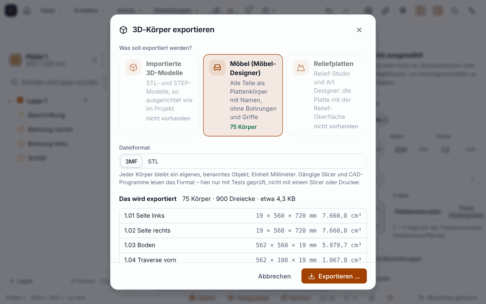

**English** | [Deutsch](Export-STL-3MF)

# Exporting 3D bodies: STL and 3MF (since 0.11.0)

Since version 0.11.0 you can also **save** the 3D bodies of your project again, for passing on or for viewing in other programs. Until then there was only the [import of STL and STEP](Importing-3D-Models). The formats are **3MF** (with unit millimetre, one named body per part) and **STL** (all bodies as one mesh).

> **Honest about the status:** Checked **only with tests**: the files were read back and re-measured with a ZIP reader and an independent XML reader (volume, dimensions, number of triangles). **Nothing was checked with a slicer, a CAD program or a 3D printer.** Whether PrusaSlicer, Bambu Studio, Cura, Fusion or the Windows 3D Viewer open the files without complaint is open. Nothing was printed or milled either.

## What you can export

| Source | Content |
|---|---|
| **Imported 3D models** (STL, STEP) | oriented and scaled as in the project (unit, scale, rotation, mirroring); if a model is used several times in different positions, each position becomes a body |
| **Furniture parts** from the furniture designer | as **board bodies**: outline × thickness at their position in space, named by part number and name (“2.03 Left side”). Z points up, the front is −Y. **Without** holes, pockets, grooves, handles, front reliefs, edge banding and fittings; doors are closed |
| **Relief plates** | the board under a relief from the relief studio, from a 3D model or from the Art Designer: underside flat, top side following the relief, full thickness outside the relief |

If the source is not given, the program takes the only one available; if there are several, it asks.

## How to proceed

1. **File ▸ Export 3D (3MF, STL) …** opens the dialog. Other ways: the command palette (`Ctrl+K`: “Export 3D bodies”), in the furniture designer the File menu (*Export furniture parts as 3MF/STL …*) and in the relief studio the *3D file …* button in the footer (for a relief that has already been inserted).
2. Choose the **source**. The dialog shows where there is something to export and lists the **bodies** with dimensions and volume together with notes (a preview without a file).
3. For reliefs you can change the **grid spacing** (default automatic, about 250,000 points): finer grids give sharper edges, but larger files.
4. **Save:** in the program via the save dialog.

Command line: `ortino export projekt.ocam --format 3mf` or `--format stl` (with `--source models|furniture|relief`). Claude can also export (tool `export_file`), but only into a released output folder.

## The check before writing

Before writing, the program checks every mesh and reports **with a suggested solution**: empty or broken meshes, infinite or missing numbers, too many triangles (more than 3 million) or bodies (more than 5000). It leaves out degenerate triangles (duplicate points, zero area) and reports it. A closed mesh that is turned inside out it turns round. An **open mesh** it writes, but points it out, because many slicers report it.

## Limits

* Furniture parts are **board bodies**: no drilling pattern, no grooves, no handles, no fittings, no front reliefs; roundings have 6 segments per corner.
* The surface of a relief comes from a **grid**: edges finer than the grid spacing are smoothed. More than 1.2 million points the program refuses and names the smallest permitted grid spacing. A rotated relief is exported as a rectangle around the rotated area.
* **Not included:** the layers of a layered plywood picture from the Art Designer (parts per layer), colours, materials, wood grain, preview images and combining several bodies into an assembly.
* **3MF cannot be imported,** and there is no export to STEP.
* Not in the web designer of the portal.
* **Not measured:** large projects with hundreds of furniture parts and very large reliefs.

## Next

* [Importing 3D Models](Importing-3D-Models)
* [Sheets and Furniture](Sheets-and-Furniture)
* [Modelling Reliefs](Modelling-Reliefs)
