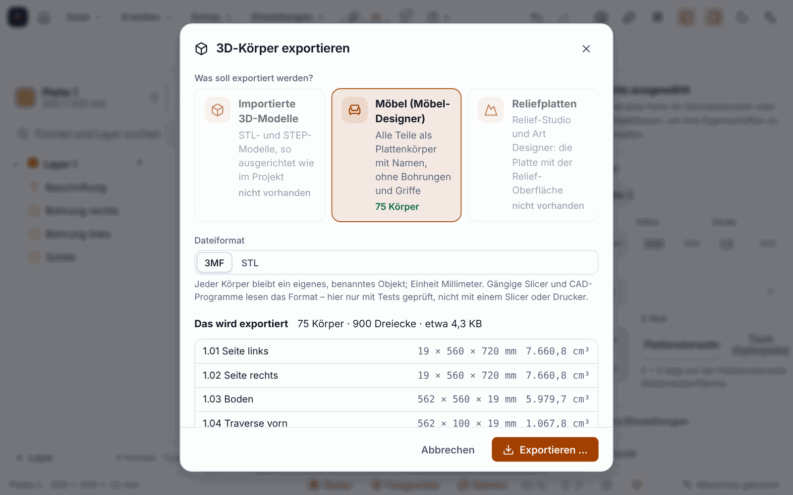

[English](Export-STL-3MF-en) | **Deutsch**

# 3D-Körper exportieren: STL und 3MF (seit 0.11.0)

Seit Version 0.11.0 kannst du 3D-Körper deines Projekts auch wieder **speichern**, zum Weitergeben oder zum Ansehen in anderen Programmen. Bis dahin gab es nur den [Import von STL und STEP](3D-Modelle-importieren). Die Formate sind **3MF** (mit Einheit Millimeter, ein benannter Körper je Teil) und **STL** (alle Körper als ein Netz).

> **Ehrlich zum Stand:** Geprüft **nur mit Tests**: Die Dateien wurden mit einem ZIP-Leser und einem unabhängigen XML-Leser wieder gelesen und nachgemessen (Volumen, Maße, Zahl der Dreiecke). **Nichts wurde mit einem Slicer, einem CAD-Programm oder einem 3D-Drucker geprüft.** Ob PrusaSlicer, Bambu Studio, Cura, Fusion oder der 3D-Viewer von Windows die Dateien ohne Murren öffnen, ist offen. Auch nichts wurde gedruckt oder gefräst.

## Was du exportieren kannst

| Quelle | Inhalt |
|---|---|
| **Importierte 3D-Modelle** (STL, STEP) | so ausgerichtet und skaliert wie im Projekt (Einheit, Maßstab, Drehung, Spiegelung); wird ein Modell mit verschiedener Lage mehrfach benutzt, wird jede Lage ein Körper |
| **Möbelteile** aus dem Möbel-Designer | als **Plattenkörper**: Umriss × Dicke an ihrer Lage im Raum, benannt nach Teilenummer und Name (»2.03 Seite links«). Z zeigt nach oben, vorne ist −Y. **Ohne** Bohrungen, Taschen, Nuten, Griffe, Fronten-Reliefs, Kantenband und Beschläge; Türen sind geschlossen |
| **Reliefplatten** | die Platte unter einem Relief aus dem Relief-Studio, aus einem 3D-Modell oder aus dem Art Designer: Unterseite eben, Oberseite nach dem Relief, außerhalb des Reliefs voll dick |

Fehlt die Angabe der Quelle, nimmt das Programm die einzige vorhandene; gibt es mehrere, fragt es nach.

## So gehst du vor

1. **Datei ▸ 3D-Körper exportieren (3MF, STL) …** öffnet den Dialog. Weitere Wege: die Befehlspalette (`Strg+K`: »3D-Körper exportieren«), im Möbel-Designer das Datei-Menü (*Möbelteile als 3MF/STL exportieren …*) und im Relief-Studio der Knopf *3D-Datei …* in der Fußzeile (für ein schon eingefügtes Relief).
2. Wähle die **Quelle**. Der Dialog zeigt, wo es etwas zu exportieren gibt, und listet die **Körper** mit Maßen und Volumen samt Hinweisen (eine Vorschau ohne Datei).
3. Bei Reliefs kannst du die **Rasterweite** ändern (Standard automatisch, etwa 250 000 Punkte): feinere Raster geben schärfere Kanten, aber größere Dateien.
4. **Speichern:** im Programm über den Speichern-Dialog.

Kommandozeile: `ortino export projekt.ocam --format 3mf` oder `--format stl` (mit `--source models|furniture|relief`). Auch Claude kann exportieren (Werkzeug `export_file`), aber nur in einen freigegebenen Ausgabeordner.

## Die Prüfung vor dem Schreiben

Vor dem Schreiben prüft das Programm jedes Netz und meldet **mit Lösungsvorschlag**: leere oder kaputte Netze, unendliche oder fehlende Zahlen, zu viele Dreiecke (mehr als 3 Millionen) oder Körper (mehr als 5000). Entartete Dreiecke (doppelte Punkte, Fläche null) lässt es weg und meldet es. Ein von innen nach außen gedrehtes, geschlossenes Netz dreht es um. Ein **offenes Netz** schreibt es, weist aber darauf hin, denn viele Slicer melden das.

## Grenzen

* Möbelteile sind **Plattenkörper**: kein Bohrbild, keine Nuten, keine Griffe, keine Beschläge, keine Frontreliefs; Rundungen haben 6 Segmente je Ecke.
* Die Oberfläche eines Reliefs kommt aus einem **Raster**: Kanten, die feiner als die Rasterweite sind, werden geglättet. Mehr als 1,2 Millionen Punkte lehnt das Programm ab und nennt die kleinste zulässige Rasterweite. Ein gedrehtes Relief wird als Rechteck um die gedrehte Fläche exportiert.
* **Nicht enthalten:** die Lagen eines Schichtholzbilds aus dem Art Designer (Teile je Lage), Farben, Materialien, Maserung, Vorschaubilder und das Zusammenfassen mehrerer Körper zu einer Baugruppe.
* **3MF lässt sich nicht einlesen,** und es gibt keinen Export nach STEP.
* Nicht im Web-Designer des Portals.
* **Nicht gemessen:** große Projekte mit Hunderten Möbelteilen und sehr große Reliefs.

## Weiter

* [3D-Modelle importieren](3D-Modelle-importieren)
* [Platten und Möbel](Platten-und-Möbel)
* [Reliefs modellieren](Modellieren-von-Reliefs)
