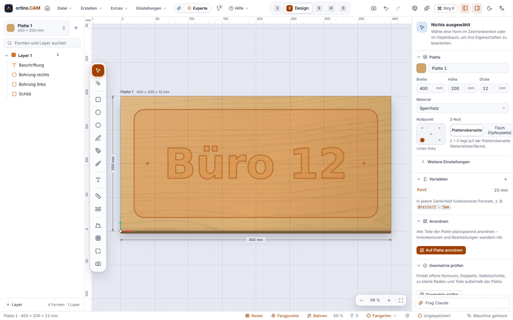
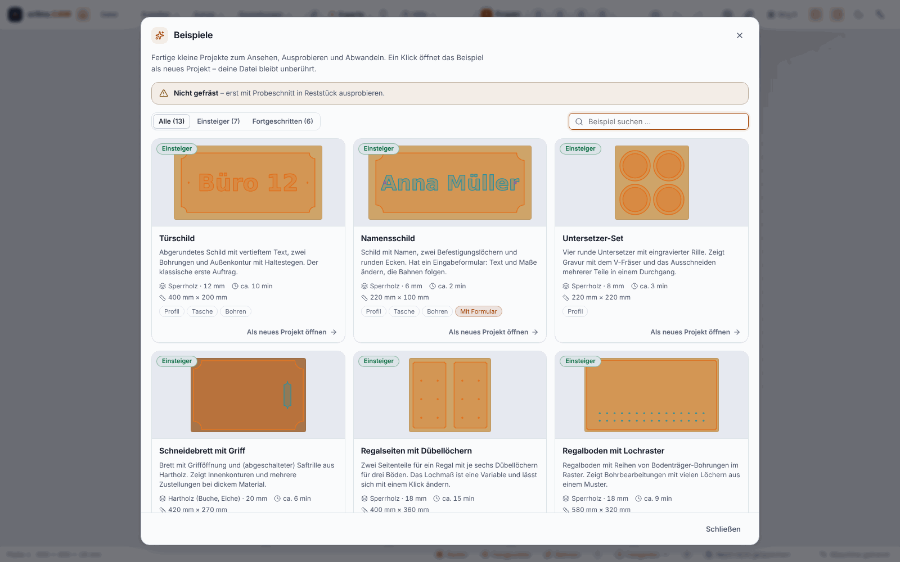
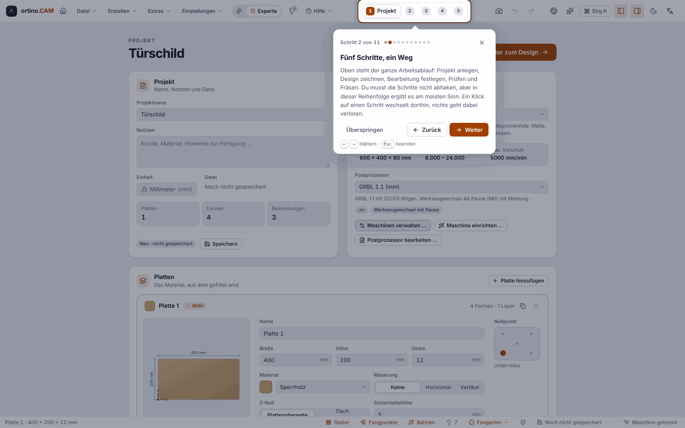
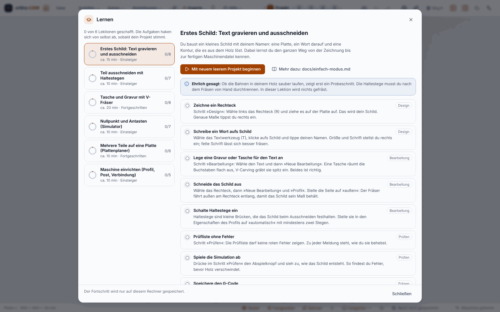

**English** | [Deutsch](Erste-Schritte)

# Getting Started

This page takes you from the first start to the first workpiece. You first learn on a finished **example project** (a door sign), then you create a project of your own. Everything that concerns the machine you practise first with the **simulated demo machine**. You do not need a CNC router for that.

> **Safety first:** When you mill on a real machine later, test **first without bit and without material**, keep the **emergency stop** within reach and never leave the machine unattended. The software is an early version, and not everything has been tested on a real machine (see [Home](Home-en)). See the [disclaimer](https://github.com/KlapSC/ortino-cam/blob/main/README.en.md#disclaimer).

## 1. Install and start

How to install ortino.CAM is described under [Installation and Updates](Installation-and-Updates). At the first start you see the **welcome page**. It offers four cards (and, once after the offer “Set up machine”, a guided tour, see section 4):

* **New project:** set sheet, material and machine.
* **Browse examples:** the example gallery with 13 finished projects, including the door sign (see section 4).
* **Open project:** continue working on a saved `.ocam` file.
* **Import file:** take over an SVG, DXF, PDF/AI or an image.

New users start in **Easy mode**. It shows only the most important settings for each operation and gives reasons for its suggestions. With the **Easy | Expert** switch in the header bar you can see everything at any time. Switching never changes the project.

## 2. Open the example project

On the welcome page you click **Browse examples** and choose the **Door sign**. Alternatively you download the file `tuerschild.ocam` from the [release page](https://github.com/KlapSC/ortino-cam/releases/latest) and open it by double-clicking or with `Ctrl+O`. The command palette (`Ctrl+K`) also knows “Load example project “Door sign””.

The project is a name plate: 400 × 200 mm, 12 mm plywood, with the inscription “Office 12”, two mounting holes and a rounded outer contour. The machine in the project is a **generic GRBL router 600 × 400**. This is only a template, you enter your own dimensions later (see [Setting Up the Machine](Setting-Up-the-Machine)).

At the top you see the five steps of the work. You switch between them with the mouse or with `Alt+1` to `Alt+5`.

| Step | What you do there |
|---|---|
| **Project** | Sheet (size, thickness, material, work zero), machine, variables |
| **Design** | Draw and import shapes |
| **Machining** | Decide what should happen to the shapes |
| **Check** | Checklist and 3D simulation |
| **Cut** | Connect, set work zero, pre-flight check, mill |

Go through the steps with the example:

1. **Project:** The sheet is 400 × 200 × 12 mm. The project has a **variable** `Margin` with the value 20 mm. The outer contour is set up as the formula `400 - 2*Margin`.
2. **Design:** The sign is a rectangle with a corner radius of 15 mm, plus two small circles (3 mm) and the text. Click the rectangle and look at the formulas in the properties panel. Try it out: in the “Project” step change the variable `Margin` to 30 mm. The sign becomes narrower, the toolpaths are recalculated. `Ctrl+Z` takes it back.
3. **Machining:** There are three operations: **Drill holes** (the two circles, 3 mm drill), **Pocket inscription** (a pocket, 2 mm deep, with a 3.175 mm bit) and **Outer contour** (a profile on the outside with a 6 mm bit, with tabs, all the way through the sheet). Click an operation and look at what is in the properties panel. More on the kinds: [Operations](Operations).
4. **Check:** Read the checklist (errors block milling) and play the 3D simulation. See [Checking and Simulation](Checking-and-Simulation).
5. **Cut:** Connect to the **demo** (card “Connection”, type “Simulated machine (demo)”). Set the work zero, read the pre-flight check, run the **frame** and start the program. The simulated machine runs the whole sequence. See [Milling on the Machine](Milling-on-the-Machine).

## 3. Your first own project

1. **New project** (`Ctrl+N`). Choose a template (Sign, Panel cut, Furniture board, Relief / square or Custom size), enter the dimensions of your material and choose your machine. The dialog shows you whether the sheet fits into the work area of the machine. You cannot change the **unit** (millimetres or inches) afterwards, everything else you can.
2. **Set up the machine:** If you have not set up a machine yet, do it now (or later, but before the first run on the real machine): [Setting Up the Machine](Setting-Up-the-Machine).
3. **Choose something to mill.** Two ways:
   * **Quick start** “What would you like to cut?”: You choose an intention (for example sign with V-carving, cut out, drilling pattern, pocket, engraving, inlay) and answer two to four questions. The program shows a **plan** with tool, depths and time, explains every decision (“Why this way?”) and offers three quality levels. With “Apply” it creates everything in one undo step. You find the quick start on the card in the “Project” step and in the command palette.
   * **Draw it yourself:** In the **Design** step you draw shapes (`R` rectangle, `E` ellipse, `T` text …) or import a drawing. More on this under [Drawing and Importing](Drawing-and-Importing). Then, in the **Machining** step, you create the matching operation with **New operation**.
4. **Check:** Read the checklist, look at the simulation, heed the hints of the light bulb in the header bar.
5. **Save the G-code or mill.** In the “Cut” step you can save the G-code as a file or send it directly to a GRBL machine.

**Important about cutting values:** All suggestions for feed rate and spindle speed are **guide values**, without guarantee. They depend on your machine, your bit and your material. Check them, start carefully and try with an offcut. More under [Tools and Cutting Data](Tools-and-Cutting-Data).

## 4. Examples, tour and lessons

Three helps for the beginning. You find them in the **Help** menu of the header bar and in the command palette (`Ctrl+K`).

> **Honest about the status:** All examples and lessons are **not milled**. They have been checked with tests, the simulation and a browser (Chromium), never on a real machine and not under Windows (WebView2). Run an example first without bit and without material, and begin with an offcut afterwards.

### Example gallery

The **“Examples”** dialog shows 13 finished small projects as tiles. Each tile gives the preview, material and thickness, estimated milling time, sheet size, the kinds of operations and the level (**Beginner** or **Advanced**). Filter and search (also in English) help with finding. You open the gallery in the File menu (“Browse examples …”), on the welcome page, in the empty drawing area, in the Help menu or with `Ctrl+K`.

* A click opens the example **as a new project** in the “Design” step. If the open project has unsaved changes, the program asks first. When saving, it asks for a name, the original stays unchanged.
* **Beginner:** Door sign, Name plate (with input form), Coaster set, Cutting board with handle, Shelf sides with dowel holes, Shelf board with pin-hole grid, Perforated panel.
* **Advanced:** Engraved card, Round sign with arched text, Finger-joint corner, Wall panel with honeycomb pattern, Star inlay, Relief rosette.
* The times are estimates of the pure toolpath time, without clamping, work zero and tool changes. The relief calculates in draft quality and, at about 45 minutes, is the longest example.
* When the gallery is opened for the first time, the program calculates the previews. This takes a few seconds.
* If the example takes the machine from your set-up, it also takes over its presets. If an example is larger than the work area of your machine, the tile says so.

### Guided tour

A walk through the five steps and the most important places: 11 cards in Expert mode, 12 in Easy mode. The highlighted element stays **operable**, the overlay does not intercept clicks. The card has Back, Next and End. `Esc` ends it at any time, with `←` and `→` you page through when the focus is in the card.

* It starts **once by itself** after the offer “Set up machine” is done, and only on the welcome page of an empty project, never over a dialog.
* To start it again: **Help → Start the tour** or `Ctrl+K` → “Start the tour”.
* The tour only switches the working steps and **never changes your project**. If it does not find an element (for example because it is missing in this mode), it explains the step at the step bar or skips it.
* **Unchecked:** Position and focus of the card have only been tested in the browser, not under Windows (WebView2) and not at 125 or 150% scaling.

### Lessons

The **“Learn”** dialog (Help → Lessons) offers six lessons with progress ring, guide time and level. While a lesson is running, a card in a corner shows the tasks. **Each task ticks itself off** as soon as your project has reached the state. The card can be collapsed, moved to another corner and paused. The progress is kept on this computer.

| Lesson | Level, guide time |
|---|---|
| First sign: engrave text and cut out | Beginner, approx. 15 min |
| Cut out a part with tabs | Beginner, approx. 10 min |
| Pocket and engraving with a V-bit | Advanced, approx. 20 min |
| Zero point and probing (simulator) | Beginner, approx. 10 min |
| Several parts on one sheet (sheet planner) | Advanced, approx. 10 min |
| Set up the machine (profile, post, connection) | Beginner, approx. 10 min |

* If you want, the lessons begin in a **new empty project** (with a question about unsaved changes). Whoever continues in the open project gets what is already right there ticked off immediately.
* The lessons “Zero point and probing” and “Set up the machine” run against the **simulator**. Probing on a real machine is not tested in this context.
* Each lesson refers to a guide. The program brings it along and shows it in a small reader. The guides exist **in German only**, also in the English interface.
* The detection only sees what is in the project and in the observed actions. Whether a rectangle is “a sign”, it does not know. A milestone such as “simulation played” counts per session: after a restart it counts again only when you do it again. Tasks that have already been ticked off stay ticked off.

## 5. Saving and undo

* `Ctrl+S` saves the project as an `.ocam` file, `Ctrl+Shift+S` saves under a new name.
* `Ctrl+Z` undoes steps (up to 200), `Ctrl+Y` or `Ctrl+Shift+Z` restores them. Actions of assistants, quick start and Claude are one step each.
* Every 30 seconds the program saves automatically. After a crash it offers on the welcome page to restore the state.

## What next?

* [Setting Up the Machine](Setting-Up-the-Machine): catalogue, travel, controller
* [Milling on the Machine](Milling-on-the-Machine): connect, work zero, pre-flight check
* [Keyboard Shortcuts](Keyboard-Shortcuts) and [Glossary](Glossary)
* If something goes wrong: [Troubleshooting](Troubleshooting)

<!-- videos:start -->
## Videos

*   
**The five steps at a glance** · 14 s

*   
**Set up the sheet: size, thickness, material, work zero** · 15 s

*   
**Easy mode and Expert mode** · 12 s

All videos: [Videos](Videos-en).
<!-- videos:end -->
