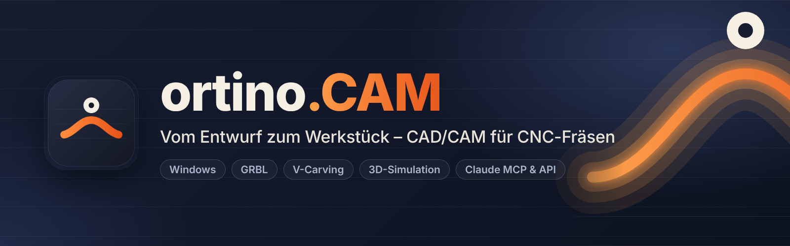

**English** | [Deutsch](Home)

# ortino.CAM Wiki

Welcome. **ortino.CAM** is **CAD/CAM software for CNC routers** on Windows: draw, calculate toolpaths (profile, pocket, V-carving, 3D relief), simulate in 3D, check and send straight to a **GRBL controller** such as the one on the Ultimate Bee (CNC xPRO V5), all in one application. With an MCP server and a local interface it can also be driven by **Claude** and by your own scripts.

This wiki is for people who **use** ortino.CAM: hobby router users, woodworkers and workshops. You do not need to know anything about the source code. It describes the published **version 0.16.0**. New since 0.16.0 are the word and logo collage in the Pattern Studio and in the generator in the browser (making 40 kinds and 80 templates in the Pattern Studio) and the slim Montserrat typeface. New since 0.15.0 are the custom templates (the “Own” tab in the Pattern Studio and in the Relief Studio, the “Shapes” dialog), the cutting method “Optimised” in the Furniture and Kitchen Designer and the shape and pattern generator in the browser. New since 0.14.0 are more patterns in the Pattern Studio (as of 0.14.0: 39 kinds, 76 templates), more relief templates (62), 14 motifs in the Art Designer, seasonal decoration with 35 motifs and four new creators (22 in six groups). New since 0.13.0 are the Creator, the order of the depth passes, the AI models dialog and the home page with quick-access tiles. The pages and sections about them carry the notes **“since 0.16.0”**, **“since 0.15.0”**, **“since 0.14.0”** and **“since 0.13.0”** respectively.

## Please read first

> **Early version (0.x): not everything has been tested on a real machine.** So far, milling has been done on one machine (Ultimate Bee with xPRO V5, GRBL); everything else has only run against tests and the simulator. **Always test without tool and material first**, with the emergency stop within reach. What exactly has been tested: [Testing Status](Testing-Status).

The software is developed **for the most part with Claude Code (Anthropic) as co-author**. Requirements, decisions, acceptance and publication rest with the operator. Errors are to be expected. That is why reports from real machines are so important (see [Contributing and Testing](Contributing-and-Testing)).

**How to read this wiki:** where something has been checked only in the simulator, in tests or with generated images, it says so, and likewise where something has not been tested. Where nothing is said, it is still an early version.

## Where do I start?

| I want to … | Page |
|---|---|
| install the program and keep it up to date | [Installation and Updates](Installation-and-Updates) |
| get from an empty project to a first workpiece, with the example gallery, the tour and lessons | [Getting Started](Getting-Started) |
| enter my router and measure the travel | [Setting Up the Machine](Setting-Up-the-Machine) |
| draw (also with parametric sketches), set text (also as a stencil with bridges), import SVG/DXF/PDF/EPS or an image | [Drawing and Importing](Drawing-and-Importing) |
| know what profile, pocket, V-carving and threads do, what climb and conventional milling mean and in which order the depth passes are run (since 0.13.0) | [Operations](Operations) |
| choose bits and cutting values | [Tools and Cutting Data](Tools-and-Cutting-Data) |
| check before I mill | [Checking and Simulation](Checking-and-Simulation) |
| mill on the machine | [Milling on the Machine](Milling-on-the-Machine) |
| mill a workpiece from both sides, with dowels (simulator only) | [Double-Sided Milling](Double-Sided-Milling) |
| use the fixed probe or the spoilboard height map | [Fixed Probe and Spoilboard](Fixed-Probe-and-Spoilboard) |
| mill markings (cross, frame, ruler, stop, hole grid) into the spoilboard | [Marking the Spoilboard](Marking-the-Spoilboard) |
| control the machine from the phone | [Phone Remote Control](Phone-Remote-Control) |
| align material on the worktable with a camera | [Camera on the Worktable](Camera-on-the-Worktable) |
| divide sheets (also as a saw plan for the panel saw), mill finger joints, design cabinets and kitchens | [Sheets and Furniture](Sheets-and-Furniture) |
| calculate a saw plan for the panel saw with an optimiser | [Sheet Cutting](Sheet-Cutting) |
| design tables, sideboards, shelves and chairs (glueless slot-together); have the “Optimised” cutting calculated (since 0.15.0) | [Furniture Designer](Furniture-Designer) |
| design, share and edit kitchens and furniture in the browser in turns (portal) | [Web Designer in the Portal](Web-Designer-in-the-Portal) |
| make a relief from a photo (AI depth estimation on your computer) | [Photo to Relief](Photo-to-Relief) |
| download, check or remove the AI depth model; use the home page with quick-access tiles (since 0.13.0) | [AI Models and Start Page](AI-Models-and-Start-Page) |
| design a wall picture in wood (carved or layered plywood; 14 motifs, six of them since 0.14.0) | [Art Designer](Art-Designer-en) |
| design a perforated panel from patterns (40 kinds, 80 templates, with a search field; extended in 0.14.0, word and logo collage since 0.16.0) | [Drawing and Importing](Drawing-and-Importing) |
| create a 3D relief from templates (62 templates in 9 categories; extended in 0.14.0) and make toolpaths from it | [Operations](Operations) |
| save custom patterns, reliefs and shapes, back them up as a file and import them; place ten basic shapes on the sheet (since 0.15.0) | [Custom Templates](Custom-Templates) |
| create patterns and shapes in the browser and download them as SVG or DXF, without an account (since 0.15.0, word and logo collage since 0.16.0; no G-code) | [Shape and Pattern Generator](Shape-and-Pattern-Generator) |
| create a workpiece from a few inputs: box, birdhouse, gears, puzzle, door sign, advent calendar, lantern and more (22 creators; since 0.13.0, extended in 0.14.0) | [Creators](Creators) |
| mill a 3D model (STL, STEP) as a relief, outline or layered model; export parts as STL or 3MF | [Importing 3D Models](Importing-3D-Models) |
| export 3D bodies as STL or 3MF (models, furniture parts, relief sheets) | [Exporting 3D Bodies](Export-STL-3MF-en) |
| assemble a relief from components or rework it with the brush | [Modelling Reliefs](Modelling-Reliefs) |
| mill a part that is larger than the travel (tiling) | [Tiling Large Parts](Tiling-Large-Parts) |
| render an image of the kitchen for the customer (light, shadows, gloss, sink) | [Kitchen Rendering](Kitchen-Rendering) |
| operate with finger or pen (tablet, touch laptop) | [Touch and Pen](Touch-and-Pen) |
| work with several people: workshop folder, roles, shared library, dashboard (local) | [Workshop and Team](Workshop-and-Team) |
| create a setup sheet and a quote, also with quantity and price tiers, customer records, quote number and payment terms | [Setup Sheet and Quote](Setup-Sheet-and-Quote) |
| manage customers, assign quote numbers, insert payment terms | [Customers and Quotes](Customers-and-Quotes) |
| use another G-code dialect or custom post-processors | [Post-Processors and Controllers](Post-Processors-and-Controllers) |
| use Claude, MCP, the local interface or the command line | [Claude, MCP and API](Claude-MCP-and-API) |
| discover, load and share designs | [Community Portal](Community-Portal-en) |
| back up machine profiles, bits and settings privately in the portal | [Backup in the Portal](Backup-in-the-Portal) |
| watch short tutorial videos (5–20 seconds, captioned in English) | [Videos](Videos-en) |
| solve a problem | [Troubleshooting](Troubleshooting) |
| look up a keyboard shortcut | [Keyboard Shortcuts](Keyboard-Shortcuts) |
| look up a term | [Glossary](Glossary) |
| know what has been tested on a real machine and what has not | [Testing Status](Testing-Status) |
| help or report a test | [Contributing and Testing](Contributing-and-Testing) |

## The most important points in brief

* **Everything in one application:** project, design, machining, check, cut. Five steps lead from design to workpiece.
* **Checks before it cuts:** a checklist with suggested solutions and a pre-flight check before every run. If there are errors, export and machine start are blocked.
* **For beginners and experienced users:** easy mode suggests tool, depths and cutting values and explains them. Expert mode shows all settings.
* **Straight to the machine:** GRBL-compatible controllers (GRBL 1.1, grblHAL, FluidNC) over USB or network. The program **never writes settings into your controller**, it only reads them.
* **New in 0.16.0:** the **word and logo collage** (up to four words or logos, densely mixed) in the Pattern Studio and in the [Shape and Pattern Generator](Shape-and-Pattern-Generator) in the browser, plus the slim Montserrat typeface (see [Drawing and Importing](Drawing-and-Importing#word-and-logo-collage-since-0160)). The Pattern Studio thus has 40 kinds and 80 templates. How far all this has been tested is on [Testing Status](Testing-Status).
* **New in 0.15.0:** [custom templates](Custom-Templates) (the “Own” tab in the Pattern Studio and the Relief Studio, the “Shapes” dialog with ten basic shapes), the cutting method “Optimised” in the [Furniture Designer](Furniture-Designer#nesting-optimised-and-saw-plan-since-0150) and the [Shape and Pattern Generator](Shape-and-Pattern-Generator) in the browser (SVG and DXF, no G-code). None of it has been milled or sawn; the custom templates have not been tested under Windows (WebView2).
* **New in 0.14.0:** more patterns (as of 0.14.0: 39 kinds and 76 templates in the Pattern Studio, see [Drawing and Importing](Drawing-and-Importing)), 62 relief templates (see [Operations](Operations)), 14 motifs in the [Art Designer](Art-Designer-en) and, in the [Creators](Creators), seasonal decoration with 35 motifs and four new creators (advent calendar, wreath and border, lantern / tealight holder, garland). None of it has been milled or glued.
* **New in 0.13.0:** a [Creator](Creators) with 18 workpiece generators (as of 0.13.0), the choice of the [order of the depth passes](Operations), the [AI models](AI-Models-and-Start-Page) dialog and a home page with quick-access tiles. None of it has been milled.
* **Free** for private and commercial use, **Windows 10 and 11 (64-bit)**. The source code is not public.

## Links

* **Download:** [Releases](https://github.com/KlapSC/ortino-cam/releases/latest)
* **Questions, bugs, wishes, machine reports:** [GitHub Issues](https://github.com/KlapSC/ortino-cam/issues/new/choose). Issues are public, so please do not write any personal data into them. **Data protection requests and legal matters about the community portal** go to the e-mail address in the [portal’s imprint](https://ortino-cam.com/imprint).
* **Overview, comparison and questions:** the [README](https://github.com/KlapSC/ortino-cam/blob/main/README.en.md) and the [project page](https://klapsc.github.io/ortino-cam/en/)
* **Community portal:** [https://ortino-cam.com](https://ortino-cam.com)
* **Contributing:** [CONTRIBUTING.md](https://github.com/KlapSC/ortino-cam/blob/main/CONTRIBUTING.md) (in German)
