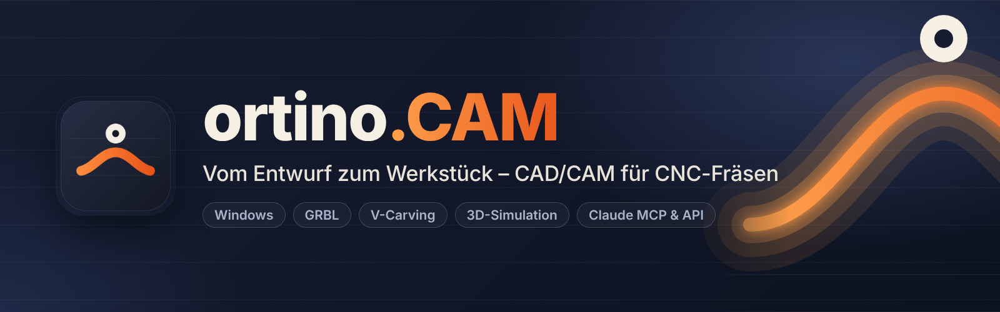

# ortino.CAM Wiki

Willkommen. **ortino.CAM** ist eine **CAD/CAM-Software für CNC-Fräsen** unter Windows: zeichnen, Werkzeugwege berechnen (Profil, Tasche, V-Carving, 3D-Relief), in 3D simulieren, prüfen und direkt an eine **GRBL-Steuerung** wie die der Ultimate Bee (CNC xPRO V5) schicken, alles in einer Anwendung. Mit einem MCP-Server und einer lokalen Schnittstelle lässt sie sich auch von **Claude** und eigenen Skripten steuern.

Dieses Wiki ist für Menschen, die ortino.CAM **benutzen**: Hobby-Fräser, Tischler und Werkstätten. Du musst nichts über den Quelltext wissen. Es beschreibt die veröffentlichte **Version 0.15.0**. Neu seit 0.15.0 sind die eigenen Vorlagen (Sparte »Eigene« im Muster-Studio und im Relief-Studio, Dialog »Formen«), das Zuschnittverfahren »Optimiert« im Möbel- und Küchen-Designer und der Formen- und Muster-Generator im Browser. Neu seit 0.14.0 sind mehr Muster im Muster-Studio (39 Arten, 76 Vorlagen), mehr Relief-Vorlagen (62), 14 Motive im Art Designer, die Dekoration nach Jahreszeit mit 35 Motiven und vier neue Creator (22 in sechs Gruppen). Neu seit 0.13.0 sind der Creator, die Reihenfolge der Zustellungen, der Dialog KI-Modelle und die Startseite mit Schnellzugriffen. Die Seiten und Abschnitte dazu tragen die Hinweise **»seit 0.15.0«**, **»seit 0.14.0«** bzw. **»seit 0.13.0«**.

## Bitte zuerst lesen

> **Frühe Version (0.x): nicht alles ist an einer echten Maschine erprobt.** An echter Hardware erprobt sind bisher nur **Taschen, V-Carving, Konturen, Referenzfahrt und Werkzeugwechsel mit der Tastplatte** (Version 0.3.3, Ultimate Bee mit xPRO V5); dazu laut Rückmeldung des Betreibers das **Einrichten des festen Tasters und das Einmessen eines Werkzeugs an ihm** (Version 0.3.10, dieselbe Maschine) und an der **Handy-Fernbedienung** das **Stoppen, Verfahren und Setzen der Nullpunkte** (dieselbe Maschine); ebenso lief laut Betreiber ein Projekt von der **Modellierung mit Claude (MCP)** über **»Reihenfolge optimieren«** bis zum Fräsen (Einzelheiten nicht festgehalten). **Nur gegen Simulator und Tests geprüft** sind der Werkzeugwechsel am festen Taster mitten im Programm, die Messung der Opferplatte, die Höhenkarte, die übrigen Teile der Handy-Fernbedienung (Pause, Anzeige), »An Position fahren«, der Längensensor, **Gewindefräsen, der Wartungsplan, die Kamera auf der Arbeitsplatte** und **alle Postprozessoren außer GRBL** (grblHAL, FluidNC, Mach3/4, LinuxCNC, UCCNC, Centroid, ShopBot, MASSO, PlanetCNC). Die **Beispiele** der Galerie und die **Lektionen** sind **nicht gefräst**, und **Béziers aus SVG und PDF** sind nur mit selbst erzeugten Dateien geprüft. Zuletzt hat der Betreiber mit Version 0.12.0 an derselben Maschine (Ultimate Bee mit xPRO V5) **Tasche und Kontur in Birke** in einem normalen Lauf von rund einer Stunde gefräst, **ohne Pause, Vorschubänderung oder Werkzeugwechsel**; die **Live-Animation** im Schritt »Fräsen« stimmte laut Betreiber »perfekt« mit dem Fräsen überein. Das ist die Beobachtung bei einem Lauf, keine Messung und kein Dauertest, und sie sagt nichts über Werkzeugwechsel, Pausen, andere Maschinen, Materialien oder Steuerungen. Die Neuerungen aus 0.3.9, 0.3.11, 0.3.12, 0.3.14, 0.4.0, 0.4.1, 0.5.0 und 0.6.0 (das **Markieren der Opferplatte**, die neue **Tisch-Ansicht**, **Gerätenischen und Raum** im Küchenplaner und die neuen **Möbelarten**; ebenso auch der **Import von STL- und STEP-Modellen**, der **Möbel-Designer**, das Speichern und die Varianten der Küche und die Beschlagbibliothek; ebenso das **doppelseitige Fräsen mit Passstiften** sowie **Farben, Griffe, 3D-Reliefs, Rendering-Export und Touch-Bedienung** des Küchenplaners; ebenso der **Web-Designer im Portal**) liefen nur gegen Tests, Simulator und im Browser (Chromium) und sind nicht systematisch unter Windows (WebView2) geprüft; dasselbe gilt für alles Neue aus 0.7.0 bis 0.15.0 (unter anderem Bemaßung und erweitertes Fangen, Modellieren und Komponenten für Reliefs, Kachelung, Art Designer, Export als STL und 3MF, Kundenstamm und Angebote, Plattenzuschnitt, parametrische Skizzen, Werkstatt-Ordner und Dashboard, Creator, Reihenfolge der Zustellungen, KI-Modelle und Startseite, mehr Muster, Reliefs und Dekoration, eigene Vorlagen, Zuschnitt »Optimiert« und der Formen- und Muster-Generator); die **eigenen Vorlagen** sind nie unter Windows (WebView2) geprüft (Speichern über Neustart und Update, Dateidialog, Ablegen von Dateien), der Zuschnitt »Optimiert« ist nur am Rechner gemessen und nie gesägt, und die SVG- und DXF-Dateien des Generators sind nicht in fremder CAM-Software und nicht an einer Maschine geprüft; gefräste Reliefs, importierte Modelle, Möbelstücke und Griffbohrungen sind nie gefräst oder gebaut, der STEP-Import hat nie eine echte CAD-Datei gelesen, das Rendering lief nie auf einer echten Grafikkarte.
>
> **Teste immer zuerst ohne Werkzeug und ohne Material**, mit dem Not-Aus in Reichweite, und lass die Maschine nie unbeaufsichtigt laufen. CNC-Maschinen sind gefährlich. Simulation, Prüfliste und Start-Check sind Hilfen und keine Sicherheitsfunktion. Schnittwerte und Zeiten sind Richtwerte. Lies den **[Haftungsausschluss](https://github.com/KlapSC/ortino-cam#haftungsausschluss)**: ortino.CAM wird ohne Gewährleistung bereitgestellt, die Nutzung erfolgt auf eigene Gefahr.

Die Software entsteht **zum größten Teil mit Claude Code (Anthropic) als Co-Autor**. Anforderungen, Entscheidungen, Abnahme und Veröffentlichung liegen beim Betreiber. Mit Fehlern ist zu rechnen. Deshalb sind Berichte von echten Maschinen so wichtig (siehe [Mitmachen und Tests](Mitmachen-und-Tests)).

**So liest du dieses Wiki:** Wo etwas nur im Simulator, in Tests oder mit erzeugten Bildern geprüft ist, steht das dabei, ebenso wo etwas nicht erprobt ist. Wo nichts steht, ist es dennoch eine frühe Version.

## Wo fange ich an?

| Ich möchte … | Seite |
|---|---|
| das Programm installieren und aktuell halten | [Installation und Updates](Installation-und-Updates) |
| vom leeren Projekt zum ersten Werkstück kommen, mit Beispielgalerie, Einführung und Lektionen | [Erste Schritte](Erste-Schritte) |
| meine Fräse eintragen und die Verfahrwege messen | [Maschine einrichten](Maschine-einrichten) |
| zeichnen (auch mit parametrischen Skizzen), Text setzen (auch als Schablone mit Stegen), SVG/DXF/PDF/EPS oder ein Bild importieren | [Zeichnen und Importieren](Zeichnen-und-Importieren) |
| wissen, was Profil, Tasche, V-Carving und Gewinde tun, was Gleichlauf und Gegenlauf heißt und in welcher Reihenfolge die Zustellungen gefahren werden (seit 0.13.0) | [Bearbeitungen](Bearbeitungen) |
| Fräser und Schnittwerte wählen | [Werkzeuge und Schnittdaten](Werkzeuge-und-Schnittdaten) |
| prüfen, bevor ich fräse | [Prüfen und Simulation](Prüfen-und-Simulation) |
| an der Maschine fräsen | [Fräsen an der Maschine](Fräsen-an-der-Maschine) |
| ein Werkstück von beiden Seiten fräsen, mit Passstiften (nur Simulator) | [Doppelseitig fräsen](Doppelseitig-fraesen) |
| den festen Taster oder die Höhenkarte der Opferplatte nutzen | [Fester Taster und Opferplatte](Fester-Taster-und-Opferplatte) |
| Markierungen (Kreuz, Rahmen, Lineal, Anschlag, Lochraster) in die Opferplatte fräsen | [Opferplatte markieren](Opferplatte-markieren) |
| die Maschine vom Handy aus steuern | [Handy-Fernbedienung](Handy-Fernbedienung) |
| mit einer Kamera Material auf der Arbeitsplatte ausrichten | [Kamera auf der Arbeitsplatte](Kamera-auf-der-Arbeitsplatte) |
| Platten aufteilen (auch als Sägeplan für die Plattensäge), Zinken fräsen, Schränke und Küchen entwerfen | [Platten und Möbel](Platten-und-Möbel) |
| einen Sägeplan für die Plattensäge mit Optimierer rechnen | [Plattenzuschnitt](Plattenzuschnitt) |
| Tische, Sideboards, Regale und Stühle entwerfen (leimlos steckbar); den Zuschnitt »Optimiert« rechnen lassen (seit 0.15.0) | [Möbel-Designer](Moebel-Designer) |
| Küche und Möbel im Browser entwerfen, teilen und abwechselnd bearbeiten (Portal) | [Web-Designer im Portal](Web-Designer-im-Portal) |
| aus einem Foto ein Relief machen (KI-Tiefenschätzung auf deinem Rechner) | [Foto → Relief](Foto-zu-Relief) |
| das KI-Tiefenmodell laden, prüfen oder entfernen; die Startseite mit Schnellzugriffen nutzen (seit 0.13.0) | [KI-Modelle und Startseite](KI-Modelle-und-Startseite) |
| ein Wandbild aus Holz entwerfen (geschnitzt oder Schichtholz; 14 Motive, sechs davon seit 0.14.0) | [Art Designer](Art-Designer) |
| ein gelochtes Paneel aus Mustern entwerfen (39 Arten, 76 Vorlagen, mit Suchfeld; erweitert in 0.14.0) | [Zeichnen und Importieren](Zeichnen-und-Importieren) |
| ein 3D-Relief aus Vorlagen erzeugen (62 Vorlagen in 9 Kategorien; erweitert in 0.14.0) und daraus Werkzeugwege machen | [Bearbeitungen](Bearbeitungen) |
| eigene Muster, Reliefs und Formen speichern, als Datei sichern und importieren; zehn Grundformen auf die Platte setzen (seit 0.15.0) | [Eigene Vorlagen](Eigene-Vorlagen) |
| Muster und Formen im Browser erzeugen und als SVG oder DXF herunterladen, ohne Konto (seit 0.15.0; kein G-Code) | [Formen- und Muster-Generator](Formen-und-Muster-Generator) |
| ein Werkstück aus wenigen Eingaben erzeugen: Schachtel, Vogelhaus, Zahnräder, Puzzle, Türschild, Adventskalender, Windlicht und mehr (22 Creator; seit 0.13.0, erweitert in 0.14.0) | [Creator](Creator) |
| ein 3D-Modell (STL, STEP) als Relief, Umriss oder Schichtmodell fräsen; Teile als STL oder 3MF exportieren | [3D-Modelle importieren](3D-Modelle-importieren) |
| 3D-Körper als STL oder 3MF exportieren (Modelle, Möbelteile, Reliefplatten) | [3D-Körper exportieren](Export-STL-3MF) |
| ein Relief aus Komponenten zusammensetzen oder mit dem Pinsel nachmodellieren | [Modellieren von Reliefs](Modellieren-von-Reliefs) |
| ein Teil fräsen, das größer ist als der Verfahrweg (Kachelung) | [Große Teile kacheln](Grosse-Teile-kacheln) |
| ein Bild der Küche für den Kunden rendern (Licht, Schatten, Glanz, Spüle) | [Küchen-Rendering](Kuechen-Rendering) |
| mit Finger oder Stift bedienen (Tablet, Touch-Laptop) | [Touch und Stift](Touch-und-Stift) |
| mit mehreren Leuten arbeiten: Werkstatt-Ordner, Rollen, gemeinsame Bibliothek, Dashboard (lokal) | [Werkstatt und Team](Werkstatt-und-Team) |
| ein Rüstblatt und ein Angebot erzeugen, auch mit Stückzahl und Staffel, Kundenstamm, Angebotsnummer und Zahlungsbedingungen | [Rüstblatt und Angebot](Rüstblatt-und-Angebot) |
| Kunden verwalten, Angebotsnummern vergeben, Zahlungsbedingungen einsetzen | [Kunden und Angebote](Kunden-und-Angebote) |
| einen anderen G-Code-Dialekt oder eigene Postprozessoren | [Postprozessoren und Steuerungen](Postprozessoren-und-Steuerungen) |
| Claude, MCP, die lokale Schnittstelle oder die Kommandozeile nutzen | [Claude, MCP und API](Claude-MCP-und-API) |
| Designs entdecken, laden und teilen | [Community-Portal](Community-Portal) |
| Maschinenprofile, Fräser und Einstellungen privat im Portal sichern | [Sicherung im Portal](Sicherung-im-Portal) |
| kurze Anleitungsvideos ansehen (5–20 Sekunden, englisch beschriftet) | [Videos](Videos) |
| ein Problem lösen | [Fehlersuche](Fehlersuche) |
| ein Tastenkürzel nachschlagen | [Tastenkürzel](Tastenkürzel) |
| einen Begriff nachschlagen | [Glossar](Glossar) |
| helfen oder einen Test melden | [Mitmachen und Tests](Mitmachen-und-Tests) |

## Das Wichtigste in Kürze

* **Alles in einer Anwendung:** Projekt, Design, Bearbeitung, Prüfen, Fräsen. Fünf Schritte führen vom Entwurf zum Werkstück.
* **Prüft, bevor es fräst:** Prüfliste mit Lösungsvorschlägen und ein Start-Check vor jedem Lauf. Bei Fehlern sind Export und Maschinenstart gesperrt.
* **Für Einsteiger und Erfahrene:** Der Einfach-Modus schlägt Werkzeug, Tiefen und Schnittwerte vor und begründet sie. Der Experten-Modus zeigt alle Einstellungen.
* **Direkt an die Maschine:** GRBL-kompatible Steuerungen (GRBL 1.1, grblHAL, FluidNC) über USB oder Netzwerk. Das Programm **schreibt nie Einstellungen in deine Steuerung**, es liest sie nur.
* **Neu in 0.15.0:** [eigene Vorlagen](Eigene-Vorlagen) (Sparte »Eigene« im Muster-Studio und im Relief-Studio, Dialog »Formen« mit zehn Grundformen), das Zuschnittverfahren »Optimiert« im [Möbel-Designer](Moebel-Designer#zuschnitt-optimiert-und-sägeplan-seit-0150) und der [Formen- und Muster-Generator](Formen-und-Muster-Generator) im Browser (SVG und DXF, kein G-Code). Nichts davon wurde gefräst oder gesägt; die eigenen Vorlagen sind nicht unter Windows (WebView2) geprüft.
* **Neu in 0.14.0:** mehr Muster (39 Arten und 76 Vorlagen im Muster-Studio, siehe [Zeichnen und Importieren](Zeichnen-und-Importieren)), 62 Relief-Vorlagen (siehe [Bearbeitungen](Bearbeitungen)), 14 Motive im [Art Designer](Art-Designer) und im [Creator](Creator) die Dekoration nach Jahreszeit mit 35 Motiven und vier neue Creator (Adventskalender, Kranz und Bordüre, Windlicht / Laterne, Girlande). Nichts davon wurde gefräst oder verleimt.
* **Neu in 0.13.0:** ein [Creator](Creator) mit 18 Werkstück-Generatoren (Stand 0.13.0), die Wahl der [Reihenfolge der Zustellungen](Bearbeitungen), der Dialog [KI-Modelle](KI-Modelle-und-Startseite) und eine Startseite mit Schnellzugriffen. Nichts davon wurde gefräst.
* **Kostenlos** für private und gewerbliche Nutzung, **Windows 10 und 11 (64 Bit)**. Der Quelltext ist nicht öffentlich.

## Links

* **Download:** [Releases](https://github.com/KlapSC/ortino-cam/releases/latest)
* **Fragen, Fehler, Wünsche, Maschinenberichte:** [GitHub Issues](https://github.com/KlapSC/ortino-cam/issues/new/choose). Issues sind öffentlich, bitte keine persönlichen Daten hineinschreiben. **Datenschutzanfragen und rechtliche Anliegen zum Community-Portal** gehen an die E-Mail-Adresse im [Impressum des Portals](https://ortino-cam.com/imprint).
* **Überblick, Vergleich und Fragen:** die [README](https://github.com/KlapSC/ortino-cam#readme) und die [Projektseite](https://klapsc.github.io/ortino-cam/)
* **Community-Portal:** [https://ortino-cam.com](https://ortino-cam.com)
* **Mitmachen:** [CONTRIBUTING.md](https://github.com/KlapSC/ortino-cam/blob/main/CONTRIBUTING.md)

## English

This wiki is the user guide for **ortino.CAM**, CAD/CAM software for CNC routers on Windows with direct GRBL machine control (version 0.15.0). It is an early version: proven on a real machine so far only for pockets, V-carving, profiles, homing and touch-plate tool changes, plus, according to the operator, one run of about an hour (pocket and contour in birch, no pause, feed change or tool change; the live animation matched the cut), while newer features are tested against a simulator only. Pages and sections marked “seit 0.15.0” (since 0.15.0) describe what is new in this version: own templates (a tab “Own” in the pattern and relief studios and a shapes dialog), the cutting method “Optimised” in the furniture and kitchen designer, and a free shapes-and-patterns generator in the browser (SVG and DXF, no G-code); nothing of it has been milled or sawn, and the templates are untested in the installed Windows app. Pages and sections marked “seit 0.14.0” describe what came with the version before: 39 pattern kinds and 76 templates in the pattern studio, 62 relief templates, 14 art designer motifs, 35 seasonal decoration motifs and four new creators (22 in six groups); nothing of it has been milled or glued. Pages and sections marked “seit 0.13.0” describe what came earlier: the creator, the order of the depth passes, the AI models dialog and the home page with quick-access tiles. Always test without tool and material first and keep the emergency stop within reach. The software is provided "as is", without warranty, and you use it at your own risk (see the [disclaimer](https://github.com/KlapSC/ortino-cam#haftungsausschluss)). The pages are in German, and the main project page and the README have English summaries. Questions and bugs go through [GitHub issues](https://github.com/KlapSC/ortino-cam/issues/new/choose) (public, so no personal data); data protection requests and legal matters about the community portal go to the e-mail address in the [portal's imprint](https://ortino-cam.com/imprint).
