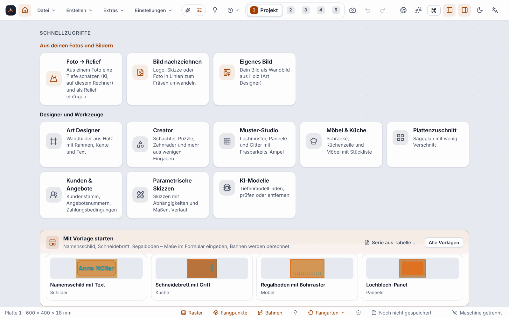

[English](AI-Models-and-Start-Page) | **Deutsch**

# KI-Modelle und Startseite mit Schnellzugriffen (seit 0.13.0)

Zwei Dinge für den schnellen Einstieg: die **Startseite mit Schnellzugriffen** (und der Grundsatz »Eigenes zuerst«) und der Dialog **KI-Modelle**, in dem du das Tiefenmodell für »Foto → Relief« herunterlädst, prüfst oder entfernst.

> **Ehrlich zum Stand:** Beides ist nur mit Vitest-Tests und Chromium gegen die echte Engine geprüft, mit einem **Ersatzmodell** (396 Byte) und einem **Ersatz für das Portal**. **Der Download des echten Tiefenmodells (47,3 MB) vom echten Portal wurde nicht geprüft.** Nichts davon wurde unter Windows (WebView2) bedient. Ob das Tastenkürzel `Alt+Pos1` dort ankommt, ist offen: Browser belegen die Taste mit »Startseite«; die Oberfläche fängt sie ab, aber ob WebView2 sie vorher selbst behandelt, ist nicht erprobt. Die Schaltfläche und die Befehlspalette gehen in jedem Fall.

## Startseite und Home-Schaltfläche

Die Startseite ist der Schritt **Projekt** mit der Willkommensansicht. Bei einem leeren Startprojekt erscheint sie von selbst. Zurück zu ihr kommst du **immer**:

* mit der **Home-Schaltfläche** (Haus-Symbol links neben dem Datei-Menü in der Kopfleiste),
* mit `Alt+Pos1` (englische Oberfläche: `Alt+Home`),
* mit der Befehlspalette (`Strg+K`: »Zur Startseite«).

Hast du schon ein Projekt in Arbeit, steht oben die Karte **»Dein Projekt«**: Name, Zahl der Formen und Bearbeitungen, gespeichert oder ungespeichert, dazu »Weiterarbeiten« und »Projekteinstellungen«. Die Leiste zum Wiederherstellen fehlt dann (sie würde dein Projekt ersetzen).

**Die Startseite ist nur eine Ansicht.** Am Projekt ändert sich nichts, und ein Wechsel in einen anderen Schritt beendet sie. »Neues Projekt«, »Öffnen« und die Beispiele fragen bei ungespeicherten Änderungen wie bisher nach.

### Schnellzugriffe

Kacheln in zwei Gruppen. Jede Kachel ist ein Knopf (Tab, `Enter` oder Leertaste) und öffnet dasselbe wie der gleichnamige Befehl der Befehlspalette:

| Gruppe | Kacheln |
|---|---|
| **Aus deinen Fotos und Bildern** | Foto → Relief · Bild nachzeichnen · Eigenes Bild (Art Designer) |
| **Designer und Werkzeuge** | Art Designer · [Creator](Creator) · Muster-Studio · Möbel & Küche · [Plattenzuschnitt](Plattenzuschnitt) · [Kunden & Angebote](Kunden-und-Angebote) · Parametrische Skizzen · KI-Modelle |

Gehört ein Dialog nur in den Schritt »Design«, wechselt die Kachel vorher dorthin. Ohne geöffnetes Projekt meldet sie, was fehlt, und nennt die Lösung. Im Web-Designer des Portals gibt es nur die Kacheln, deren Funktion es dort gibt.

### Eigenes zuerst

Überall, wo du eine **Quelle** wählst, stehen deine eigenen Quellen **vor** den Generatoren, Mustern und mitgelieferten Vorlagen: ein Foto, ein Bild, ein Höhenbild, eigene Formen oder Text, ein eigenes Bild im Art Designer, ein eigener Baustein, eine eigene Vorlage. Die Gruppen tragen Zwischenüberschriften wie »Eigenes« und »Vorlagen«, »Muster« oder »Generatoren« (nur, wo es beide Gruppen gibt). Das betrifft zum Beispiel die Galerie des Relief-Studios, das Muster-Studio, den Art Designer, das Menü **Erstellen** (dort steht die Gruppe »Eigenes« mit Foto → Relief, Bild nachzeichnen und Eigenes Bild vor »Designer und Werkzeuge«), das Datei-Menü, die Befehlspalette und den Möbel-Designer.

Geändert wird **nur die Reihenfolge der Anzeige**: nicht die Standardauswahl (das erste Muster bleibt das erste), nicht gespeicherte Einstellungen und nicht der Inhalt deiner Projekte.

## KI-Modelle

Das Tiefenmodell für [Foto → Relief](Foto-zu-Relief) und für das eigene Bild im [Art Designer](Art-Designer) (»Tiefe schätzen (KI)«) rechnet **auf deinem Rechner**. Es liegt nicht im Installer und wird erst geladen, wenn du es willst.

Öffnen:

* Menü **Extras ▸ KI-Modelle …**
* Befehlspalette `Strg+K`: »KI-Modelle«
* **Einstellungen ▸ Allgemein ▸ KI-Modelle verwalten …**
* Kachel **KI-Modelle** auf der Startseite

Der Dialog ist eine **Liste**; heute steht darin das Tiefenmodell (Depth Anything V2 Small). Die Karte zeigt:

| Angabe | Inhalt |
|---|---|
| Wofür | Tiefenschätzung für Foto → Relief und für das eigene Bild im Art Designer |
| Größe, Lizenz, Herkunft | Größe (47,3 MB); Gewichte unter Apache-2.0, die Trainingsdaten teils unter Forschungslizenzen (rechtlich nicht geklärt); der Host des Portals, von dem die Datei kommt |
| Zustand | *Nicht geladen* (auch »Download unterbrochen«, wenn schon ein Teil da ist), *Geladen (noch nicht geprüft)*, *Geladen und geprüft*, *Beschädigt* |
| Portal | *verfügbar*, *noch nicht veröffentlicht*, *andere Fassung*, *keine Verbindung* oder *Fehler des Portals*, mit der Erklärung und einer Lösung |
| Speicherort | der volle Pfad (unter Windows im Ordner `%LOCALAPPDATA%\ortino.CAM\models`), mit dem Knopf »Pfad kopieren« |

**Knöpfe:** *Herunterladen* (mit Fortschritt, MB/s und Restzeit), *Abbrechen*, *Fortsetzen* (aus der Teildatei), *Erneut herunterladen* (bei einer beschädigten Datei), *Erneut prüfen* (liest die Datei und prüft Größe und Prüfsumme), *Modelldatei einspielen …* (ohne Netz, zum Beispiel vom USB-Stick) und *Entfernen* (mit Rückfrage, auch für eine Teildatei). Vorhandene Reliefs bleiben beim Entfernen unverändert, denn das Höhenbild steht im Projekt.

**Nie ein Download ohne Klick.** Beim Öffnen fragt der Dialog nur, und nur wenn das Modell fehlt, **einmal** bei deinem Portal an, ob es dort liegt (eine kleine Anfrage ohne Foto, höchstens etwa 5 Sekunden). Heruntergeladen wird erst nach deinem Klick auf »Herunterladen«, und jede Datei wird vor dem Benutzen gegen eine feste Prüfsumme geprüft. Dein Foto verlässt den Rechner nie.

**Im Art Designer** ersetzt der Knopf **»Modell laden …«** (unter »Tiefe schätzen (KI)«) den früheren Umweg über das Relief-Studio: Er klappt dieselbe Karte im selben Dialog auf, damit Bild und Entwurf nicht verloren gehen. In »Foto → Relief« ist es dieselbe Karte.

## Grenzen

* Der Download des echten Modells vom echten Portal ist **nicht geprüft** (siehe oben). Liegt das Modell noch nicht auf dem Portal, steht im Dialog »noch nicht veröffentlicht«; dann bleibt das Einspielen von Hand.
* Ein Programmbau ohne Portal kennt keinen Download (»Dieser Programmbau kennt kein Portal«), nur das Einspielen.
* Es gibt heute nur **ein** Modell; weitere erscheinen in der Liste, sobald es sie gibt (ohne Zusage). Größere Modelle sind nicht vorgesehen.
* Das Ergebnis von »Foto → Relief« bleibt eine Schätzung, keine echte Geometrie; die Einschränkungen stehen unter [Foto → Relief](Foto-zu-Relief).
* Im Web-Designer des Portals gibt es den Dialog »KI-Modelle« nicht, und es erscheinen dort nur Kacheln, deren Funktion es im Web gibt.

## Weiter

* [Foto → Relief](Foto-zu-Relief)
* [Art Designer](Art-Designer)
* [Creator](Creator)
* [Tastenkürzel](Tastenkürzel)
