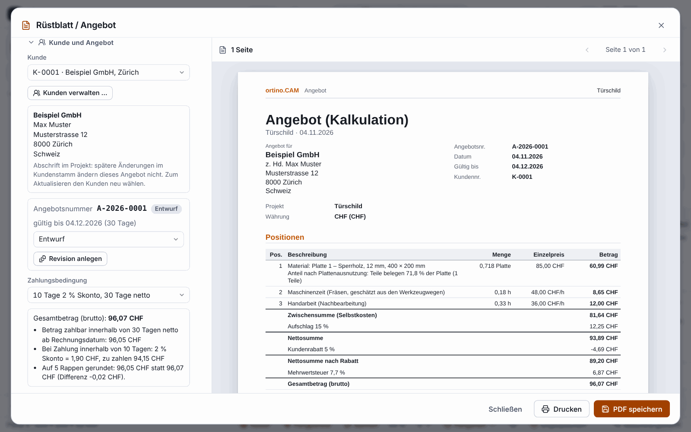

[English](Customers-and-Quotes) | **Deutsch**

# Kunden und Angebote (seit 0.11.0)

Das Angebot aus [Rüstblatt und Angebot](Rüstblatt-und-Angebot) kennt neben dem Freitext »Kunde« auch einen **Kundenstamm**, **fortlaufende Angebotsnummern** mit Revisionen und **Zahlungsbedingungen**. Das alles liegt **lokal im Datenordner deines Programms**: keine Cloud, nichts davon geht ins Portal oder an Claude.

Namen und Beträge sind erfunden.

> **Ehrlich zum Stand:** Geprüft mit Tests, im Browser (Chromium) gegen das Programm mit dem echten Kern und mit zwei PDF-Prüfwerkzeugen. **Nicht geprüft:** Acrobat und die PDF-Betrachter von Windows, das Drucken, der Dateidialog unter Windows, Excel (die CSV-Dateien sind nach den Regeln für Excel gebaut, aber nie in Excel geöffnet worden).
>
> **Das Programm gibt keine Rechts- oder Steuerberatung.** Ob eine Angabe, Nummer, Frist, Zahlungsbedingung oder ein Mehrwertsteuersatz für deinen Betrieb passt und zulässig ist, einschließlich der Pflichtangaben auf Angeboten und Rechnungen, prüfst du selbst. Nichts hier ist als »rechtskonform« geprüft.

## Öffnen

* Datei-Menü **Kunden & Angebote …**
* Befehlspalette `Strg+K`: »Kunden«, »Angebote«, »Zahlungsbedingungen«
* im Dialog Rüstblatt / Angebot der Knopf **»Kunden verwalten …«**
* Seit 0.13.0: Kachel **Kunden & Angebote** auf der [Startseite](KI-Modelle-und-Startseite)

Der Dialog hat vier Reiter: **Kunden**, **Angebote**, **Zahlungsbedingungen** und **Nummernkreis**.

## Der Kundenstamm

1. Reiter **Kunden**, neuen Kunden anlegen: Name oder Firma (Pflicht), Ansprechperson, Anschrift, E-Mail, Telefon, MWST-Nummer, interne Notiz, Standard-Zahlungsbedingung, Standard-Rabatt und die Sprache der Unterlagen (Deutsch oder Englisch).
2. Jeder Kunde bekommt eine **Nummer** (`K-0001`, `K-0002` …). Eine Nummer wird **nie wieder vergeben**, auch nicht nach dem Löschen.
3. Die **Suche** findet Wörter in allen Feldern; Umlaute zählen auch ohne Umlaut (»muller« findet »Müller«).
4. Hat ein Kunde schon ein Angebot, wird er beim Löschen **archiviert** statt gelöscht: Er verschwindet aus der Auswahl, bleibt aber für die alten Angebote erhalten. Endgültig löschen musst du ausdrücklich verlangen. Vor jedem Löschen legt das Programm eine Sicherung an.
5. Ein neuer Kunde mit gleichem Namen, gleicher PLZ und gleichem Ort wie ein vorhandener wird angelegt, aber mit einer Warnung.

**Die MWST-Nummer wird nur auf ihre Form geprüft** (zum Beispiel `CHE-123.456.789 MWST`, `DE` und neun Ziffern), nicht auf Gültigkeit und nicht gegen ein Register.

### Import und Export

* **Export** als CSV (Semikolon, UTF-8 mit BOM, für Excel gebaut) oder JSON. Zellen, die wie eine Formel beginnen (`=`, `+`, `-`, `@`), bekommen ein Hochkomma davor, damit Excel sie nicht ausführt.
* **Import** liest CSV und JSON mit erkanntem Trennzeichen und erkannter Zeichenkodierung; die Spalten dürfen deutsch oder englisch heißen (»Firma«, »Strasse«, »Postleitzahl« …), mindestens die Spalte »Name / Firma« muss da sein. Zuerst gibt es eine **Vorschau**, dann **Zusammenführen** (Standard) oder **Ersetzen** (mit Sicherung davor). Ein zweiter Import derselben Datei verdoppelt nichts. Fehler in einzelnen Zeilen überspringen nur diese Zeile; die Meldung nennt Zeile und Feld, nie den Inhalt.

## Angebot mit Nummer

1. Öffne den Dialog **Rüstblatt / Angebot** (siehe [Rüstblatt und Angebot](Rüstblatt-und-Angebot)) und suche im Abschnitt **»Kunde und Angebot«** den Kunden aus dem Stamm. Sein Adressblock steht danach im Angebots-PDF. Ohne gewählten Kunden bleibt das Freitextfeld wie bisher.
2. **Angebot erstellen** vergibt die Nummer. Sie entsteht **nur auf diesen Knopf**, nicht beim Anschauen der Vorschau, beim Drucken oder beim Speichern des PDFs. Ohne Nummer steht auf dem Blatt »noch nicht vergeben«.
3. Ein geändertes Angebot behält seine Nummer und bekommt über **»Revision anlegen«** den Zusatz `-R2`, `-R3` … Die älteren Revisionen bleiben mit ihrem Status in der Liste und zählen in den Summen nicht doppelt.
4. Der **Status** ist Entwurf, versendet, angenommen, abgelehnt oder verfallen. Die **Gültigkeit** beträgt standardmäßig 30 Tage (einstellbar); ein Entwurf oder ein versendetes Angebot nach Ablauf gilt als verfallen. Ein Entwurf folgt Änderungen am Projekt. Ist ein Angebot versendet, hält die Liste die gedruckten Zahlen fest; weicht das Projekt später davon ab, zeigt der Dialog »Das Projekt weicht vom Angebot ab – Revision anlegen«.
5. Angebote werden **nicht gelöscht**, damit die Nummern lückenlos bleiben; nicht mehr gewollte setzt du auf »abgelehnt« oder »verfallen«.

Der Reiter **Angebote** listet alle Angebote mit Nummer, Datum, Kunde, Projekt, Gültigkeit, Status und Brutto, mit Filter nach Status, Suche und der **Summe je Währung** (nur die jeweils letzte Revision; Summen über Währungen hinweg gibt es nicht).

### Nummernkreis

Im Reiter **Nummernkreis** legst du ein Muster fest, zum Beispiel `A-{JJJJ}-{NNNN}` (ergibt `A-2026-0007`): `{JJJJ}` oder `{JJ}` für das Jahr, `{MM}` für den Monat, `{N}` bis `{NNNNNNNNN}` für den Zähler mit führenden Nullen. Genau ein Zähler ist Pflicht. Dazu kommen Startwert, **Neubeginn** (jährlich, monatlich oder nie) und die Standard-Gültigkeit; der Dialog zeigt die nächste Nummer als Beispiel. Bei jährlichem Neubeginn muss das Muster das Jahr enthalten, sonst würden Nummern doppelt vergeben, und der Dialog sagt es dir.

Die Nummern sind **eindeutig und lückenlos je Rechner und Datenordner**. Ein gemeinsamer Nummernkreis über mehrere Rechner ist **nicht gewährleistet**. Eine Nummer wird nie wiederverwendet, auch nicht nach »Rückgängig«.

## Zahlungsbedingungen

Vier Vorlagen sind mitgeliefert: **»30 Tage netto«**, **»10 Tage 2 % Skonto, 30 Tage netto«**, **»Anzahlung 50 % bei Auftrag, Rest bei Lieferung«** und **»Vorkasse«**. Du kannst sie ändern, löschen und eigene anlegen (höchstens 50). Eine Bedingung kennt Zahlungsziel, Skonto mit Frist, Anzahlung, Vorkasse, Fälligkeit am Monatsende und einen Zusatztext. Das Angebot rechnet daraus Anzahlung, Rest, Skonto und Fälligkeit aus. Nur in der Währung CHF wird auf 5 Rappen gerundet; die Differenz steht gesondert auf dem Blatt. Ob diese Rundung für deine Rechnung gelten muss, prüfst du selbst. Im Reiter gibt es eine **Probe-Rechnung** auf einem Beispielbetrag.

## Wo die Daten liegen

Im Datenordner des Programms (Dialog »Über«), unter Windows in `%APPDATA%\ortino.CAM`: `kunden.json`, `angebote.json` und `zahlungsbedingungen.json`. Vor dem Löschen, Ersetzen und Wiederherstellen entstehen Sicherungen (die letzten zehn). Eine beschädigte Datei **verändert das Programm nicht** und vergibt keine Nummer, bis du eine Sicherung zurückspielst oder die Datei ausdrücklich beiseitelegst. Sonst begänne der Nummernkreis stillschweigend bei null.

Das Werkstatt-Dashboard (siehe [Werkstatt und Team](Werkstatt-und-Team)) zeigt von den Angeboten nur Zahl und Summe der offenen, ohne Kundendaten.

## Grenzen

* **Kein Absender:** Die Angebotsseite druckt keinen Briefkopf, keine Anschrift deines Betriebs, keine Bankverbindung, keine eigene MWST-Nummer und kein Logo. Das Programm kennt die Betriebsdaten nicht.
* **Keine Rechnung,** kein Mahnwesen, keine Buchhaltung, keine Anbindung an Programme dafür.
* Höchstens 20 000 Kunden. Alles nur im Programm, **nicht im Web-Designer** des Portals.
* Gibst du eine `.ocam`-Projektdatei weiter, gehören Anschrift und Preise im Angebot mit dazu. Beim Teilen eines Designs im Portal lässt das Programm diese Eingaben weg.
* Die Angaben prüft der Betrieb selbst; die Preise im Bild sind erfunden.

## Weiter

* [Rüstblatt und Angebot](Rüstblatt-und-Angebot)
* [Werkstatt und Team](Werkstatt-und-Team)
* [Platten und Möbel](Platten-und-Möbel)
