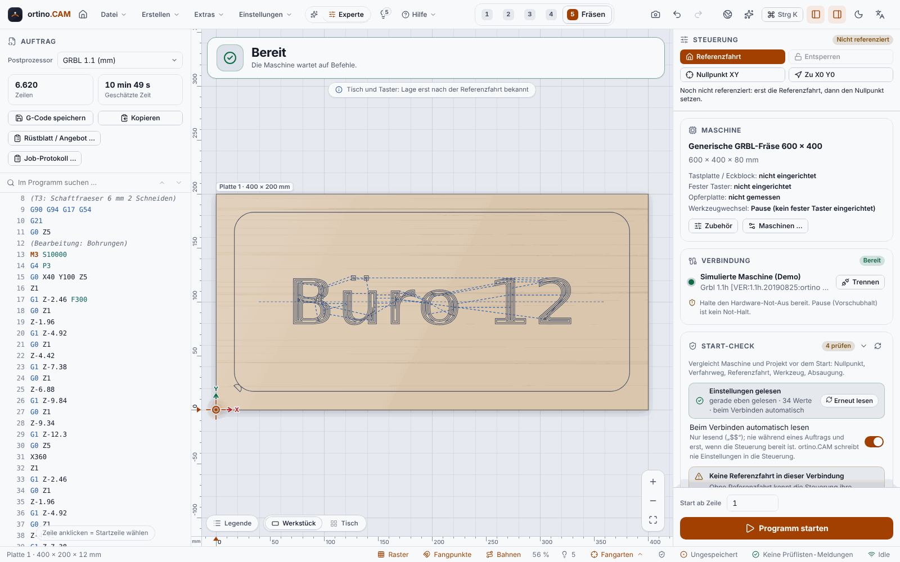

**English** | [Deutsch](Fräsen-an-der-Maschine)

# Milling on the Machine

In the **Cut** step you connect ortino.CAM to your GRBL controller, set the work zero, check everything and start the program. The program sends the G-code line by line to the controller (streaming), shows the tool position live and lets you pause and stop.

> **Honest about the status:** Confirmed in real operation so far is only what the operator milled with version 0.3.3 on an **Ultimate Bee with xPRO V5**: **pockets, V-carving, profile cuts, homing and tool change with renewed probing on the touch plate**. In addition there is the feedback on version 0.12.0 further down. Not confirmed individually are running the frame, the air cut, pause and start at line. **Checked only against the simulator and tests** are the length sensor, the corner block, the dust extraction, “Move to position”, the tool change with the fixed probe in the program (setting up and measuring on the fixed probe are confirmed on a real machine according to the operator, version 0.3.10), the spoilboard with height map and the remaining parts of the [phone remote control](Phone-Remote-Control) (pause, display; stop, jogging and setting the work zeros are confirmed on a real machine, according to the operator). Controllers other than the xPRO V5 have not been tested.
>
> **Feedback on version 0.12.0 (operator, a single test run):** On the same machine (Ultimate Bee with xPRO V5) the operator milled a **pocket and a profile cut in birch** in a **normal run of about an hour**, **without pause, feed rate change or tool change**, and observed everything. The **live animation** in the “Cut” step, that is the display of the tool position during the run, matched the milling “perfectly”, according to the operator. This is **one observation during one run, not a measurement and not an endurance test.** It confirms neither pause and resume nor overrides, tool changes in the middle of a program, alarms, other machines, materials or controllers.
>
> **Safety:** CNC machines are dangerous. Test first **without a bit and without material**, keep the **hardware emergency stop** within reach and never leave the machine running unattended. The buttons in the program do not replace the emergency stop. See the [disclaimer](https://github.com/KlapSC/ortino-cam/blob/main/README.en.md#disclaimer).

## The sequence at a glance

1. **Connect** to the machine.
2. Carry out **homing**.
3. With **manual control**, move to the workpiece corner and set the **work zero** (X, Y, Z).
4. Read the **start check** and work through the items.
5. **Run the frame** and do an **air cut**.
6. **Start the program**, watch it, pause if necessary.

## Practising without a machine: the demo

In the **Connection** card there is the type **Demo**: a simulated GRBL machine, without hardware and without risk. Connect to it, open the example project (see [Getting Started](Getting-Started)) and run through the whole sequence once. The pictures in this documentation show this simulator. It does not replace a test on the real machine, however: movement times are idealised, and quirks of real hardware (for example limit switch bounce or USB dropouts) are not reproduced.

## 1. Connect

| Type | Input | Note |
|---|---|---|
| **USB** | Port from the list (under Windows `COM3` or similar), baud rate 115200 | The USB driver of the controller must be installed (for the xPRO V5 the CP210x, for others often CH340 or FTDI). |
| **Network** | `address:port`, for example `192.168.1.50:23` | For example FluidNC over Wi-Fi. |
| **Demo** | nothing | Simulator for trying things out. |

After connecting, the program queries the firmware and reads the controller settings (read-only, see [Setting Up the Machine](Setting-Up-the-Machine)). If the controller does not answer for a longer time, the status bar shows “No response”.

**Not meant for streaming** are controllers without the GRBL protocol (Mach3/4, LinuxCNC, UCCNC, Centroid, ShopBot, MASSO, PlanetCNC). For them you export G-code with the matching [post-processor](Post-Processors-and-Controllers).

## 2. Homing

During **homing** (German *Referenzfahrt*) the machine moves to the limit switches and knows its position afterwards. Without homing the program cannot check the travel. The start check then warns. Homing needs limit switches and `$22=1` in the controller. The work area must be clear; the program asks beforehand.

**Always at hand:** At the top of the right-hand column is the bar **“Controls”**. It stays in place when you scroll and offers **Home**, **Unlock**, **Set XY zero** and **Go to X0 Y0**, not only the first time. Next to it it says whether the machine is **homed** in this connection; as long as it is not, Home is highlighted. Locked buttons stay visible, and the sentence below names the reason (for example “not connected”, “alarm”, “program running”). Homing asks beforehand as always. *Simulator and Chromium only.*

**Home first, then set the work zero.** Homing redefines the machine coordinates; a work zero set beforehand lies somewhere else afterwards, and the start check demands it again. The same applies after an alarm in which the position is lost, or after a restart of the controller: until the next homing (or until you set it again) the work zero counts as not set. *Simulator only.*

## 3. Manual control and work zero

* **Manual control (jog):** Arrow keys move X and Y, Page Up and Page Down move Z, with Shift the step is ten times as large. You set the step size. In the “Cont.” mode (continuous) the machine moves as long as you hold the key. While a program is running, manual control is locked.
* **Work zero XY:** Move the bit over the desired corner and set **X0 Y0** there.
* **Work zero Z:** Probe the workpiece surface (see below). Which height counts as Z zero you set in the project: **Top of sheet** (default) or **Table (spoilboard)**. With the second choice all depths count from the spoilboard. You need this for the [fixed probe](Fixed-Probe-and-Spoilboard).
* **Move to position:** Tap in the machine view, and after a confirmation the card first moves Z to the safe height, then X and Y. This works only after homing. *Simulator only.*

### Probing with a touch plate

A **touch plate** is a flat metal plate of known thickness, connected through a clip on the bit and a cable to the probe input of the controller. When the bit touches it, the controller reports contact.

1. Put the touch plate on the workpiece, clip on the bit.
2. With manual control, move to the middle above the plate, **spindle off**.
3. In the card “Z probing” check the **touch plate thickness** and start **Probe Z**. The bit moves down slowly, sets Z0 and lifts off again.
4. Remove the touch plate.

If Z zero is set to “Table (spoilboard)” in the project, the card asks whether the plate lies on the workpiece or on the spoilboard, and includes the material thickness in the calculation. If the thickness is unknown, probing stays locked. The program does not guess. It is more precise to put the touch plate on the spoilboard: then the entered material thickness does not count. *Simulator only* (table zero and the question about the position of the touch plate came after version 0.3.3 and have not been tested on any real machine).

When probing and zeroing, the program remembers for which project, which sheet and which Z zero type Z was set. If you then open another project or change the Z zero type of the sheet, the start check demands new probing. Before **“Z=0”** in the position display the program asks once where the bit tip must be for it (top of the sheet or spoilboard). *Simulator only.*

### Probing with the XYZ corner block

A **corner block** is an L-shaped aluminium block with which you probe X, Y and Z in one go. You set it up in the **Accessories** dialog (card “Machine”, button “Accessories”): choose the type “XYZ corner block”, measure the **wall dimensions** with calipers and enter them (there is deliberately no default value) and choose the default corner. With “Test probe input” you check cable and contact. Measuring is done with the side surface of the bit, so only with cylindrical bits (end mills).

> **Checked only against the simulator.** Whether the block sits flush at the workpiece corner and the probe faces are right, only you can check: with calipers and an air test. First attempt without material.

## 4. The start check

The **start check** compares the state of the controller with your project. Each item has a traffic light, an explanation, usually a suggested solution and sometimes a one-click action.

* **Errors block the start.** They cannot be clicked away, not even through the interface.
* **Warnings** you confirm one by one in the start dialog with “Understood”.
* **Notes** only inform.

| Checks, for example | Why |
|---|---|
| Connected, idle, no alarm | Only then does the controller accept commands. |
| Homing in this connection | Otherwise the machine coordinates and the travel check are not right. |
| Program fits within the travel (X, Y, Z reserve) | Otherwise the controller would abort with an alarm. An error only if the travel comes from the controller, otherwise a warning. |
| Work zero set in this connection | A work zero from the controller's memory can be outdated. |
| Z zero matches project, sheet, Z zero type, material thickness and (with the change assistant) tool | A Z zero for another sheet, another project, or on the table instead of the top would be off by the material thickness. This is an error; “Set Z zero again” solves it. *Simulator only.* |
| Checklist of the project | Errors in the [checklist](Checking-and-Simulation) also block the start. |
| Coordinate system, unit, distance mode (G54, mm, absolute) | The program reads the state of the controller with `$G` and offers “Select G54”, “Select G21 (mm)”, “Select G90 (absolute)”. |
| Feed, rapid and spindle override at 100% | GRBL keeps them beyond the end of the program. |
| Tool, tool change, dust extraction | See below. |
| Tool life and maintenance | See [Tools and Cutting Data](Tools-and-Cutting-Data). |

The start check is an aid, **not a safety function**. It runs continuously in the card and once more immediately before sending. The behaviour of real firmware has only been checked against the simulator.

## 5. Trial run: frame and air cut

* **Run frame:** With the **spindle off** the machine traces the outline of your job at a safe height (1500 mm/min). You see whether the workpiece fits underneath. The shape is **Rectangle** or **Contour** (convex hull of the cutting moves, at most 64 corners). The path of the tool centre is shown. The bit extends beyond it by its radius.
* **Air cut:** The whole program runs **raised** and **without spindle** (choose it in the start dialog under “Run”). The sequence is the same as when milling, just without contact with the material. Ideal for the first test of work zero, direction and travel. A striped band “AIR CUT running” shows the mode.

## 6. Tool change

If your project has several tools, the program stops at the change. In the start dialog (or in the accessories) you choose the mode:

| Mode | Procedure | Status |
|---|---|---|
| **Automatic** | With a fixed probe set up it works like “Fixed probe”, otherwise like “Pause”. The start check shows what applies. | Default since 0.3.12; the way it resolves has only been checked against the simulator and tests |
| **Pause (M0)** | The program stops, you change. The bits must be clamped to the same length. | Without a fixed probe the behaviour of “Automatic” |
| **Touch plate** | After the change you probe Z again with the touch plate. The assistant guides you: stop, change, probe, continue. | **Confirmed in real operation** (Ultimate Bee, version 0.3.3, Z zero = top of the sheet). With Z zero = table (material thickness added to the touch plate thickness), with a change position and the check in the start check that Z zero belongs to the first tool of the next run: **simulator only**. |
| **Length sensor** | A permanently mounted sensor measures the length of the new tool. | **Never tested on a real machine.** A wrong sensor position means: the bit moves to the wrong place. First attempt without material and with a low override. |
| **Fixed probe** | The machine measures each tool and puts Z zero on the spoilboard. | Set-up and measuring confirmed on a real machine according to the operator (0.3.10); **change within the program simulator only**, see [Fixed Probe and Spoilboard](Fixed-Probe-and-Spoilboard). |

During the change manual control is allowed, nothing else. You set a **change position** and a safe height in the accessories. An automatic tool changer (`M6`) is not supported.

## 7. During the run

* **Pause** stops the feed. **The spindle keeps running**, it is not an emergency stop. **Resume** carries on.
* **Stop** halts and switches the spindle off. Afterwards the program resets the controller. Depending on the setting you have to home again.
* **Overrides** change feed rate, rapid and spindle speed live. “Reset to 100 %” puts them back.
* **Errors and alarms:** On an error the job stops and names the line and the reason. An alarm empties the queue, and the controller switches off the spindle and the dust extraction. Continuing is then not possible, only cancelling and “Start at line”.
* **Notifications:** On request, a sound, a flashing taskbar and a system message report when the job is finished, an error occurs, a tool change is waiting or the program is paused. *Not checked under Windows.*
* **Connection watchdog:** If the controller does not answer for 8 seconds, the program stops the feed and reports an incident. The note stays visible even after reconnecting.
* **Sleep mode:** During a job the program prevents Windows from going to sleep. *Not tested under Windows.*

> **Tip for dropped connections:** The most common cause is the USB power saving of Windows. In the power options switch off the “USB selective suspend setting”, in the Device Manager remove the tick “Allow the computer to turn off this device …” for the USB hubs and the COM port, and keep the USB cable short and apart from motor and spindle cables.

## 8. Start at line

After an interruption (power failure, bit breakage, alarm) you can carry on from any line: click the line in the G-code view. The program reconstructs the state from the lines before it (units, tool, **dust extraction**, spindle with direction of rotation, feed rate, position), moves safely to the spot (first Z up, then XY, then plunging at no more than 600 mm/min) and shows you in the start check exactly what it sends. It refuses states that cannot be restored (for example relative coordinates or active drilling cycles). Check homing, work zero and tool beforehand. *Never tested on a real controller.*

## 9. Dust extraction

In the accessories you set which output your dust extraction is connected to (`M8`, `M7`, `M62` or `M64`), with run-up (default 2 s) and run-on (5 s). The output only supplies a control signal. The dust extraction needs a suitable relay or contactor; mains voltage belongs in the hands of a qualified electrician. Which outputs your firmware knows is stated in its documentation. The table in the program comes from that, **not from tests**.

<!-- videos:start -->
## Videos (English)

*   
**Save the G-code** · 12 s

*   
**Connect the machine** · 10 s

*   
**Home the machine and set the zero point** · 14 s

*   
**Move the machine by hand** · 15 s

*   
**Run the program: start, pause, stop** · 17 s

*   
**Probe Z with the touch plate** · 18 s

All videos: [Videos](Videos-en).
<!-- videos:end -->

## Next

* [Fixed Probe and Spoilboard](Fixed-Probe-and-Spoilboard)
* [Phone Remote Control](Phone-Remote-Control)
* [Camera on the Worktable](Camera-on-the-Worktable)
* If something does not work: [Troubleshooting](Troubleshooting)
