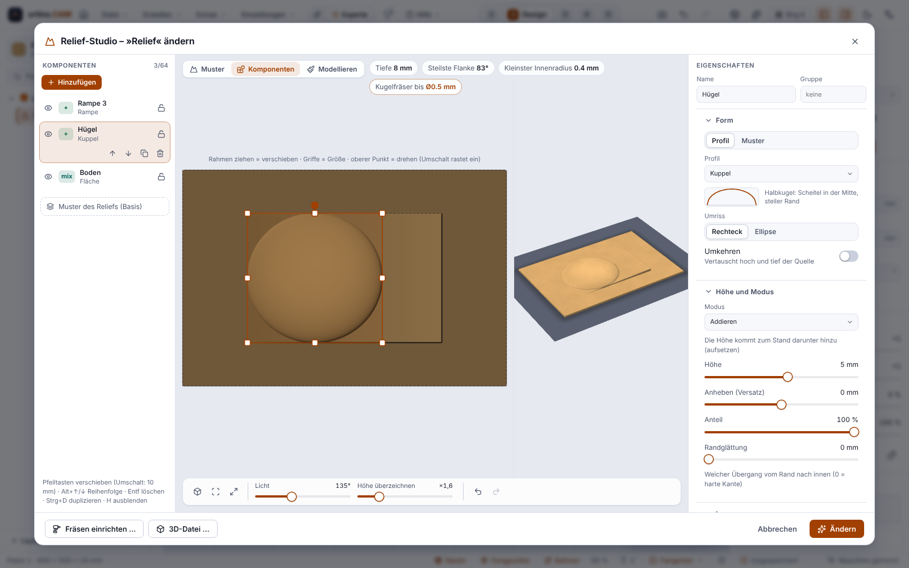

# Reliefs modellieren (Pinsel im Relief-Studio, seit 0.7.0)

> **Ehrlich zum Stand:** Das Modellieren ist nur gegen Tests, den eingebauten Maschinensimulator und Chromium geprüft. **Es wurde nie gefräst** und nicht unter Windows (WebView2) bedient.

Im **Relief-Studio** gibt es den Modus **»Modellieren«**: Du formst ein erzeugtes Relief (aus Mustern, Bildern oder Foto → Relief) von Hand nach. Das Relief bleibt dabei **parametrisch**: Deine Pinselstriche liegen als **Modellier-Ebenen** darüber. Änderst du danach eine Vorlage oder einen Regler, wird das Relief neu berechnet und die Ebenen bleiben darüber liegen.

## Pinsel

* Fünf Werkzeuge: **Aufbauen**, **Abtragen**, **Glätten**, **Einebnen** (auf die Höhe am Startpunkt oder eine feste Zielhöhe) und **Schärfen**; Radius, Stärke und Härte sind einstellbar. Kürzel: `[` `]` Radius, `1`–`5` Werkzeug, Umschalt beim Ansetzen = Glätten, Alt = Aufbauen ↔ Abtragen.
* **Spiegelung** (links ↔ rechts, oben ↔ unten oder beide) zeichnet symmetrisch mit. **Grenzen** (Mindest- und Höchsthöhe unter der Oberfläche) und ein **Schutzbereich** (Rechteck, Ellipse oder geschlossene Form der Platte; »Innen schützen« kehrt um) halten den Pinsel von Stellen fern.
* Bis zu **8 Ebenen** mit Mischmodi; eine Ebene lässt sich ausblenden, leeren und löschen. **Rückgängig** nimmt einen Strich zurück.
* **Einbacken** macht aus Relief und Ebenen eine feste Höhenkarte (danach reagiert sie nicht mehr auf die Regler).

## Komponenten (seit 0.12.0)

Im Relief-Studio gibt es neben **Muster** und **Modellieren** den Modus **Komponenten**. Ein Relief besteht dann aus einer geordneten Liste von Ebenen. Jede Komponente hat eine **Quelle** (Profil: Fläche, Kuppel, Kegel, Pyramide, Rampe, Welle, Rundstab; ein Muster; ein Bild), einen **Modus** (addieren, abziehen, Maximum, Minimum, überblenden, multiplizieren), eine **Lage** (verschieben, skalieren, drehen – auch mit der Maus), **Höhe**, **Anheben**, **Anteil** und **Randglättung**; dazu Gruppen, Sichtbarkeit und Sperre. Vorschau, Prüfliste, Werkzeugwege und Export sehen dasselbe Höhenraster. Bis zu 64 Komponenten je Relief. Das Ergebnis lässt sich auch als [STL oder 3MF exportieren](Export-STL-3MF). Die Pinselebenen liegen weiter über den Komponenten; die Pinsel-Ebene ist keine Quelle. *Nur gegen Tests und Chromium geprüft, nie gefräst.*

## Fräsen

Gefräst wird wie jedes Relief: Schruppen, Schlichten, Simulation und Soll-Ist-Vergleich laufen über dieselbe Pipeline und kennen die Ebenen. Im **Web-Designer des Portals** ist das Modellieren gesperrt.

## Gut zu wissen

* Die Karte kennt Maus und Stift (Druck, wenn »Stiftdruck nutzen« an ist) und Finger; beides ist nur in Chromium gesehen, nicht mit echten Geräten.
* Zurück auf **»Muster«** wirken Vorlagen und Regler weiter; die Ebenen liegen darüber.
* Vor dem ersten Einsatz an der Maschine in der Simulation ansehen, ohne Werkzeug und ohne Material fahren und mit einem Reststück beginnen.

Weiter: [Foto → Relief](Foto-zu-Relief), [Bearbeitungen](Bearbeitungen), [Prüfen und Simulation](Prüfen-und-Simulation).

<!-- videos:start -->
## Videos (English)

*   
**Create a relief and sculpt it with the brush** · 15 s

Alle Videos: [Videos](Videos).
<!-- videos:end -->
