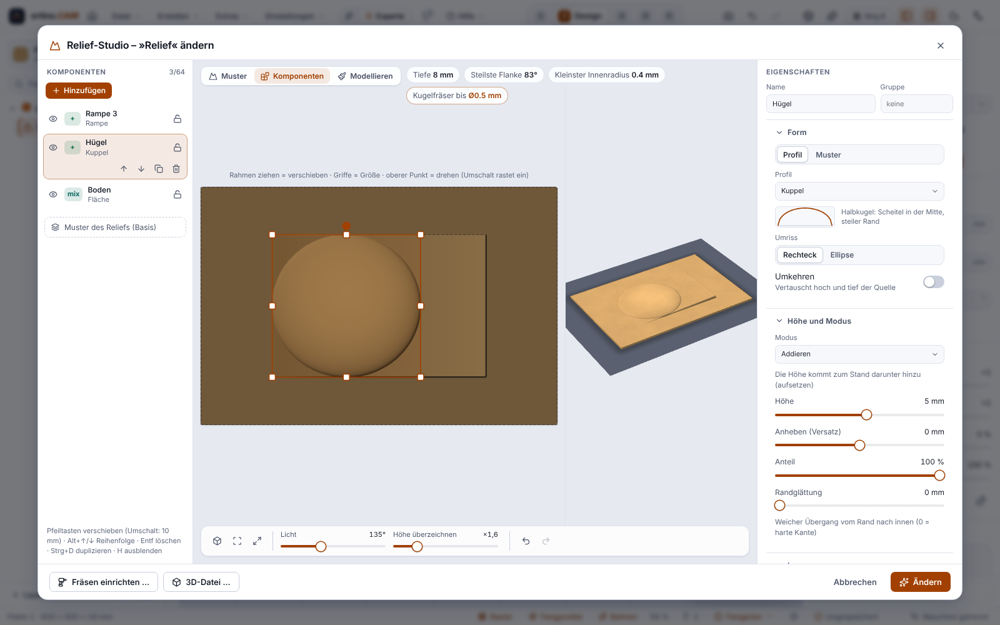

**English** | [Deutsch](Modellieren-von-Reliefs)

# Modelling reliefs (brush in the Relief Studio, since 0.7.0)

> **Honest about the status:** Sculpting has only been checked against tests, the built-in machine simulator and Chromium. **It has never been milled** and has not been operated on Windows (WebView2).

In the **Relief Studio** there is the mode **“Sculpt”**: You reshape a generated relief (made from patterns, images or Photo → relief) by hand. The relief stays **parametric** while you do this: Your brush strokes lie above it as **sculpt layers**. If you then change a template or a slider, the relief is recalculated and the layers stay on top.

## Brush

* Five tools: **Raise**, **Lower**, **Smooth**, **Flatten** (to the height at the start point or to a fixed target height) and **Sharpen**; radius, strength and hardness are adjustable. Shortcuts: `[` `]` radius, `1`–`5` tool, Shift when starting a stroke = smooth, Alt = raise ↔ lower.
* **Mirroring** (left ↔ right, top ↔ bottom, or both) paints symmetrically as well. **Limits** (minimum and maximum height below the surface) and a **protected area** (rectangle, ellipse or closed shape of the sheet; “Protect the inside (paint outside only)” reverses it) keep the brush away from certain places.
* Up to **8 layers** with blend modes; a layer can be hidden, cleared and deleted. **Undo** takes back one stroke.
* **Bake** turns the relief and layers into a fixed height map (after that it no longer reacts to the sliders).

## Components (since 0.12.0)

In the Relief Studio, next to **Pattern** and **Sculpt** there is the mode **Components**. A relief then consists of an ordered list of layers. Each component has a **source** (profile: flat, dome, cone, pyramid, ramp, wave, rod; a pattern; an image), a **mode** (add, subtract, maximum, minimum, blend, multiply), a **placement** (move, scale, rotate – also with the mouse), **height**, **raise**, **share** and **edge softening**; plus groups, visibility and lock. Preview, checklist, toolpaths and export see the same height grid. Up to 64 components per relief. The result can also be [exported as STL or 3MF](Export-STL-3MF-en). The brush layers still lie above the components; the brush layer is not a source. *Only checked against tests and Chromium, never milled.*

## Milling

It is milled like any relief: Roughing, finishing, simulation and target-versus-result comparison run through the same pipeline and know the layers. Sculpting is locked in the **Web Designer of the portal**.

## Good to know

* The map accepts mouse and pen (pressure, if “Use pen pressure” is on) and finger; both have only been seen in Chromium, not with real devices.
* Back in **“Pattern”** mode, templates and sliders keep working; the layers lie above.
* The relief you reshape can come from one of the **62 templates** of the Relief Studio (since 0.14.0; 0.13.0: 40), see [Operations](Operations#3d-relief-and-patterns). Reliefs that were already saved calculate unchanged; none of it has been milled.
* **Custom templates (since 0.15.0):** You save an adjusted relief as a custom template in the gallery of the Relief Studio (tab **“Own”**). What is stored: size, depth, sliders, post-processing, edge and the layers from **generators**. **Cannot be saved** are reliefs with **brush strokes** (sculpting), with **components**, with a photo, height image, 3D model or mask: the button is then locked and names the cause. If you want to keep a sculpted relief, save the project. See [Custom templates](Custom-Templates).
* Before the first use on the machine, look at it in the simulation, run it without tool and without material, and start with an offcut.

Next: [Photo → relief](Photo-to-Relief), [Operations](Operations), [Checking and simulation](Checking-and-Simulation).

<!-- videos:start -->
## Videos (English)

*   
**Create a relief and sculpt it with the brush** · 15 s

All videos: [Videos](Videos-en).
<!-- videos:end -->
