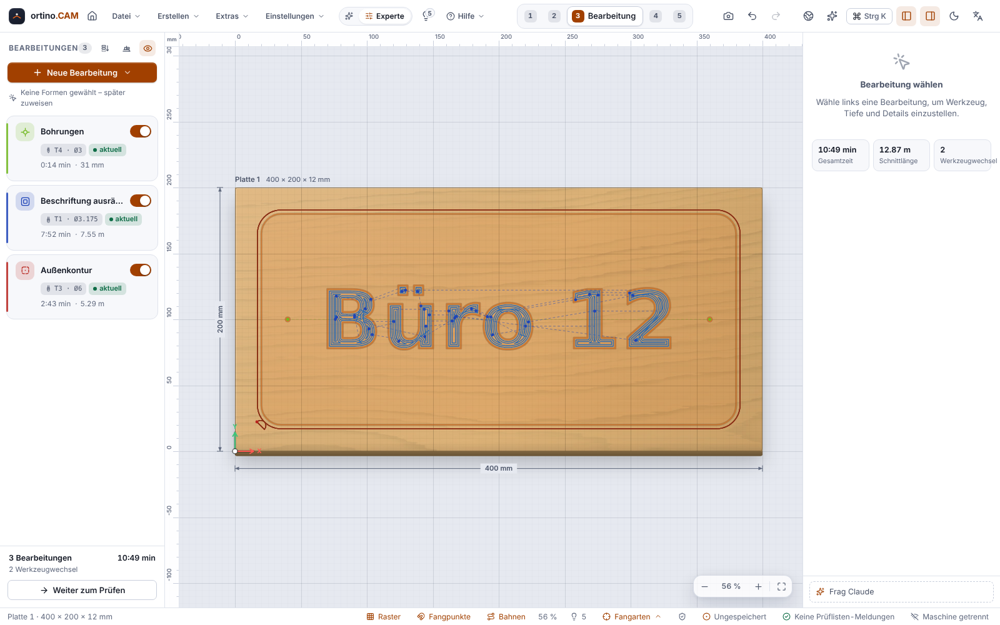
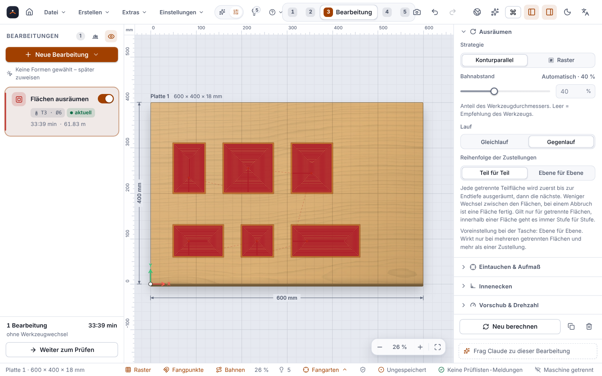

**English** | [Deutsch](Bearbeitungen)

# Operations

An **operation** tells ortino.CAM what should happen to a shape: cut out, clear out, drill, engrave. From the operation, the tool and the material the program calculates the **toolpath**. This page explains the types, their most important settings and the difference between **climb milling** and **conventional milling**.

> **Honest about the status:** Tested on a real machine so far are only **pockets, V-carving and profile cuts** (version 0.3.3, Ultimate Bee) and, according to the operator, a one-hour run with a **pocket and a profile cut in birch** with version 0.12.0 (see [Milling on the Machine](Milling-on-the-Machine)). Everything else on this page is **only calculated and simulated**: adaptive clearing, thread milling, inlay, engraving, 3D relief, surfacing, dogbone, patterns. Times and cutting values are guide values. Test every new operation first **without a tool and material** (air cut) and then in offcut material.

## How to add an operation

1. In the **Design** step, select the shapes.
2. Switch to the **Machining** step and click **New operation**. The program recommends a type to choose (“Recommended”): small circles for drilling, text as a pocket, open lines as profile “On line”.
3. Choose the tool, the depth and the settings in the properties on the right.
4. Check the time and messages in the list. Paths are recalculated automatically as soon as you change something.

Alternatively, the **Quick start** “What would you like to cut?” creates complete operations with a few questions, including the tool and a justification (see [Getting Started](Getting-Started)).

**Easy mode and Expert mode:** In Easy mode (switch in the header bar) you see only the most important sections of each operation. Everything else is under **More settings**. Switching never changes the project.

**Depths as a formula:** Instead of a fixed number you can enter `Dicke + 0,3mm`. Then the operation always cuts all the way through, even if you change the sheet thickness.

## Climb and conventional milling

A bit rotates. Depending on whether the rotation at the cutting edge runs with the feed direction or against it, it cuts differently:

| | Climb milling | Conventional milling |
|---|---|---|
| The chip starts … | thick and ends thin | thin and ends thick |
| Edge | usually **cleaner** in wood and plastic | somewhat rougher |
| Good for | a rigid machine and a securely clamped part, because it **pulls the bit into the material** | wobbly mechanics and thin parts with tabs, because it runs more calmly |

**What it is called in ortino.CAM:** In the **Direction** section you choose between “Climb” and “Conventional”. The **default is Conventional.** For cleaner edges in wood and plastic choose **Climb**. The program points this out when you mill wood or plastic in conventional mode (note “Climb milling gives cleaner edges”; in the hint rules the rule is called “Conventional milling in wood/plastic”), and switches over on a click.

With a spindle turning clockwise (`M3`, seen from above), the tool cuts in climb mode when the **material is to the right of the direction of travel**. Around the outside of a part that means: clockwise. In a pocket: anticlockwise.

> **Important for users of older versions:** Up to version 0.3.7 the default was wrongly called “Climb” although the machine moved in conventional milling. Since 0.3.8 the names are right. **The G-code is unchanged**, only the names were swapped. Anyone who had chosen “Conventional” earlier now mills in “Climb” (same path, correct name). Whether climb milling should become the default is for practice at the machine to decide.

For **threads**, “Climb” has meant true climb milling from the start, and it is the default there.

## Profile

The **profile** follows the contour of a shape. It is the operation for cutting out.

* **Side:** **Outside** (the tool runs outside, the part inside the contour keeps its size), **Inside** (cuts a hole the size of the contour) or **On line** (tool centre on the line, also for open lines, i.e. engraving).
* **Inside contours first:** Holes are cut while the part is still held firmly.
* **Tabs:** small bridges that hold a cut-out part to the rest so that it does not fly away or jam the tool. Placed automatically or by hand, with ramps. You separate them after milling with a saw or knife. For through cuts (depth beyond the sheet thickness) the program reports missing tabs, but not for small waste pieces and slots. With the **onion skin** (usually 0.2 to 0.5 mm) a thin layer stays at the bottom, which a last pass cuts through. For very small parts there is a **small-parts analysis** with a recommendation.
* **Lead-in:** lead-in arc or line, so that no mark is left on the contour at the plunge point.
* **Entry:** ramp (angle adjustable) or plunge. The ramp is easier on the tool.
* **Allowance** with a finishing pass for a better surface.

## Pocket

A **pocket** clears out an area. The standard strategy is **contour-parallel** from the inside out, with islands, ramp or vertical plunging and wall finishing. In addition there are:

* **Raster:** parallel passes at an adjustable angle, zigzag or one-way, optionally with an edge pass.
* **Helix entry:** The tool screws itself into the material if there is room (otherwise a ramp).
* **Rest machining:** A smaller tool clears what the first one has not reached.

## Order of the depth passes: part by part or level by level (since 0.13.0)

If an operation has **several parts** (several contours, holes and outer contours, separate areas of a pocket) and **more than one depth pass**, the question arises in which order the depth steps are run. The switch **“Order of the depth passes”** is found for profile and pocket under **Advanced** (in Easy mode behind “More settings”) and has two values:

| Value | Procedure |
|---|---|
| **Part by part** | Each part gets all depth passes down to the final depth, then the next one follows. |
| **Level by level** | First the first depth pass on all parts, then the second, and so on. |

**The default is the previous behaviour:** **part by part** for the **profile**, **level by level** for the **pocket**. The default value is not written to the file. Your existing projects load and save unchanged, and their **G-code stays byte for byte the same**; a test checks this on the eleven supplied examples and on the example project `tuerschild.ocam`. With only one part or only one depth pass both values are the same.

**What is level by level for?** Until the last step all parts stay attached to the material. Together with **tabs** or an **onion skin** the sheet stays stable until the last cut; otherwise a part that is already cut out can come loose while the others are still to follow, and be caught by the bit. Cutting through the onion skin then comes as the last step for all parts.

**What it costs, honestly:**

* More empty travel: after each contour the tool retracts to the safe height. **Measured** on three parts of 40 × 30 mm at a distance of 150 to 250 mm, four depth passes, bit Ø 6 mm: the rapid travel in the G-code grows from **1053 to 2006 mm**, the estimated time from **70 to 89 seconds** (part by part versus level by level). The further apart the parts are and the more depth passes there are, the greater the difference; with tightly packed parts it is small. This is a calculation in the program, **not a milled run**.
* If the job is **aborted**, with level by level **no** part is finished; with part by part at least the first one is.

**For the profile** (inside, outside, on line, also open lines) the tool makes the same cutting moves, just ordered differently; ramps, lead-in arcs, tabs, reliefs and finishing allowance remain. Between the parts it retracts to the safe height; back into an already milled groove it goes at rapid only vertically and only down to 0.5 mm above its bottom, the rest at plunge feed rate. The order of the parts alternates between forwards and backwards from step to step, depending on what gives the shorter rapid travel. The **material removal in the simulation is the same in the end** (compared cell by cell).

**For the pocket**, “part by part” means: each **separate sub-area** is first cleared completely down to the final depth (including the finishing pass on the wall), then the next one. Within a connected area it always goes step by step.

**Limits:** Checked only against Rust tests, the program's own simulation and a browser test (Chromium), **not on a real machine**; whether a sheet holds better in the end with level by level depends on material, tabs and clamping and has not been measured. The **preview in the drawing area** looks the same for both values (it shows paths without depth); you see the difference in the simulation in the “Check” step and in the G-code. In combination with tiling and double-sided milling, level by level is covered only by review, not by a test of its own. Claude also knows the switch (`pass_order`).

## Adaptive clearing

With **adaptive clearing** (New operation → More strategies) the program regulates the engagement of the bit so that it is loaded similarly everywhere. This allows deep depth passes with the full cutting length at narrow lateral engagement. For deep pockets this can be faster and easier on the bit. Important settings: **Optimal load** (5 to 40%), cutting direction, “Cut in both directions”, entry by helix or ramp, allowance and feed adjustment. A **time comparison with the standard pocket** is in the properties panel. The power check needs the **spindle power** (field in the machine dialog, for catalogue machines taken from the selected spindle).

Limits: Sharp inside corners and very narrow places (narrower than the bit) are left as residue and belong in a rest machining operation. Time figures are estimates. **Tested only in the simulation.**

## Drilling

**Drilling** places holes at the centres of selected circles. Modes: **peck drilling** (with retract to break chips), chip breaking, single pass, dwell. **Helix drilling** mills round holes from Ø D to just under 2 × D with an end mill on a helical path. If the drill does not match the circle, the program suggests the suitable method (drill, helix or inside contour).

## Thread milling

New operation **Thread** with the tool type **Thread mill** (60° profile): metric ISO thread **M3 to M12** and custom sizes, **internal** in an existing core hole or **external** on a stud, right-hand or left-hand thread, several radial depth passes with a finishing pass, lead-in arc. The path is a helix. The selected circles only give the centres.

* The **core hole** must already exist (drilling on the same circles); an external thread needs the stud cleared of surrounding material.
* The program checks: bit does not fit in the hole, cutting edge shorter than the thread, length not a whole number of turns, too few turns, pitch implausible.
* The simulation does not show thread flanks: an internal thread appears as a hole at nominal diameter.
* Not implemented: inch, trapezoidal, pipe and multi-start threads, multi-profile cutters with fixed pitch.

> **Only calculated and simulated, never milled on a machine.** Whether a thread milled this way fits and holds has not been tested. First mill a **test thread in offcut material** and check it with a gauge or a matching screw.

## V-carving, inlay and engraving

* **V-carving:** With a V-bit (also a ball-nose bit) the cutting depth follows the width of the shape: narrow places become shallow, wide ones deep. This gives signs and lettering with sharp edges. If the shape becomes wider than the maximum depth, a **flat bottom** is created. A second tool (end mill, operation “Clearing”) clears it out, and the V-bit reworks the corners. If the clearing bit fits nowhere, the program names a depth as a way out. *Confirmed in real operation (version 0.3.3).*
* **Inlay:** Two parts that belong together: the **female** (the pocket) and the mirrored **male** (the insert) on a second sheet. You set the pocket depth, **glue gap** (default 0.5 mm), protrusion and gap at the bottom or at the flanks. Once inserted, the insert stands proud and is sawn off after gluing. The fit has been re-measured in the simulation (gap and protrusion to about 0.1 mm). Ball-nose bits are not allowed for inlay. **Not milled.** Before the first inlay make a test cut in offcut wood and adjust the glue gap.
* **Engraving:** profile “On line” with a pointed V-bit (preferably 30° or less) and about 0.5 mm depth. The program shows the line width at the surface and converts a desired width into depth. Single-line fonts for engraving are described under [Drawing and Importing](Drawing-and-Importing). **Never engraved.**

## 3D relief and patterns

* **Relief Studio:** creates 3D reliefs from templates, from shapes (doming) or from a greyscale image. With a few controls: size, depth, density, softness, variation, randomness. Since 0.15.0 **“Own”** is the first tab of the gallery: save your own templates, back them up as a file and import them, see [Custom Templates](Custom-Templates). There are **62 templates in 9 categories** (since 0.14.0; 0.13.0: 40 in 7): Waves, Tiles, Weaves, Flowers & leaves, Nature & texture, **Ornaments**, **Panels & fronts**, Shapes & images and Art. **22 templates are new since 0.14.0:** Waves with foam crests, Bamboo, Reeds, Growth rings, Contour terraces, Ashlar wall, Rubble wall, Mandala, Wooden rosette, Star facets, Snowflake, Snowflake field, Drop wreath, Cassette panelling, Pillow panels, Diamond points and the six new wall-picture motifs of the [Art Designer](Art-Designer-en) (category Art, now 14). For these there are six new generators and two new leaf styles (rosette, growth rings and contour terraces, masonry, panelling, bamboo and reeds, landscapes, as well as olive branch and grasses as leaf styles). **Existing reliefs calculate unchanged**; only the starting values of five templates (Rolling hills, Mountains, Bloom, Pillows, Scales) that a newly inserted relief gets have changed. The steepest flank of the new templates is below 70°; a ball-nose bit of Ø 3 mm just reaches the narrowest throats (mortar joints, reeds, wooden rosette, star notches), larger ones round them off. This is calculated, **none of it was milled**. Weaknesses: The ashlar wall looks more like brick, the foam crests are cells on the waves and not real foam, and some large star facets are too flat at 10 mm depth over 480 mm.
* **Carve 3D relief:** creates roughing and finishing with one click (rest machining and a step for flat areas if needed). You decide only the **quality** (Draft, Standard, Fine, Ultra), and the program chooses ball-nose bit, depth per pass, stepover and feed rate and shows the time for each. A **target vs. result comparison** shows where the path deviates from the relief.
* **Pattern Studio:** perforated panels from **40 types with 80 templates in six categories** (0.14.0: 39 types, 76 templates; 0.13.0: 25 types, 37 templates): honeycomb, stars, grid, Voronoi, leaves, halftone, text and image as hole grid, since 0.14.0 chevron slats, fish scales, kagome, quatrefoil tracery, spirals, snowflakes and more, plus a search field, and since 0.16.0 the word and logo collage. Which types exist and what applies is described under [Drawing and Importing](Drawing-and-Importing#pattern-studio-40-types-and-80-templates). The **manufacturability** is measured (minimum web, opening width, islands, corners), shown as a traffic light and can be corrected with one click. The minimum web of 1.5 mm is a preset, not a material guarantee. 75 of the 80 templates are green according to the traffic light with the presets, **measured, not milled**; not green are the four templates of the word and logo collage (islands), and “Image as hole grid” needs an image from you.

Limits for the relief: Height fields only (no undercuts). A 3D model from an STL or STEP file is mapped from above onto a height field, see [Importing 3D Models](Importing-3D-Models). On vertical walls the ball-nose bit leaves a fillet the size of its radius. **Not milled.**

## Surfacing, dogbone, order

* **Surfacing:** levels the workpiece or the **spoilboard** (New operation → Surfacing). An assistant calculates on a copy and shows bit, time and warnings. The surfacing depth becomes a project variable, and the other operations adapt.
* **Inside corners (dogbone, T-bone, minimal):** For profile and pocket the program relieves inside corners so that a square counterpart fits in. The program checks bit diameter, corner angle and neighbouring edges and reports blocked corners.
* **Order of the depth passes** (since 0.13.0): part by part or level by level, see the section further up.
* **Optimize order:** suggests an order with fewer tool changes and less rapid travel. You see before and after and adopt it with a click (one undo step). Through cuts come after everything that lies within the shape of their part.

This too is **not tested on a real machine**.

<!-- videos:start -->
## Videos (English)

*   
**Cut out a shape with a Profile** · 16 s

*   
**Clear out lettering with a Pocket** · 13 s

*   
**Drill holes at the centre of circles** · 11 s

*   
**Carve lettering with a V-bit** · 12 s

All videos: [Videos](Videos-en).
<!-- videos:end -->

## Next

* [Tools and Cutting Data](Tools-and-Cutting-Data): choosing a bit, feed rate and spindle speed
* [Checking and Simulation](Checking-and-Simulation)
* [Sheets and Furniture](Sheets-and-Furniture): fits and finger joints
