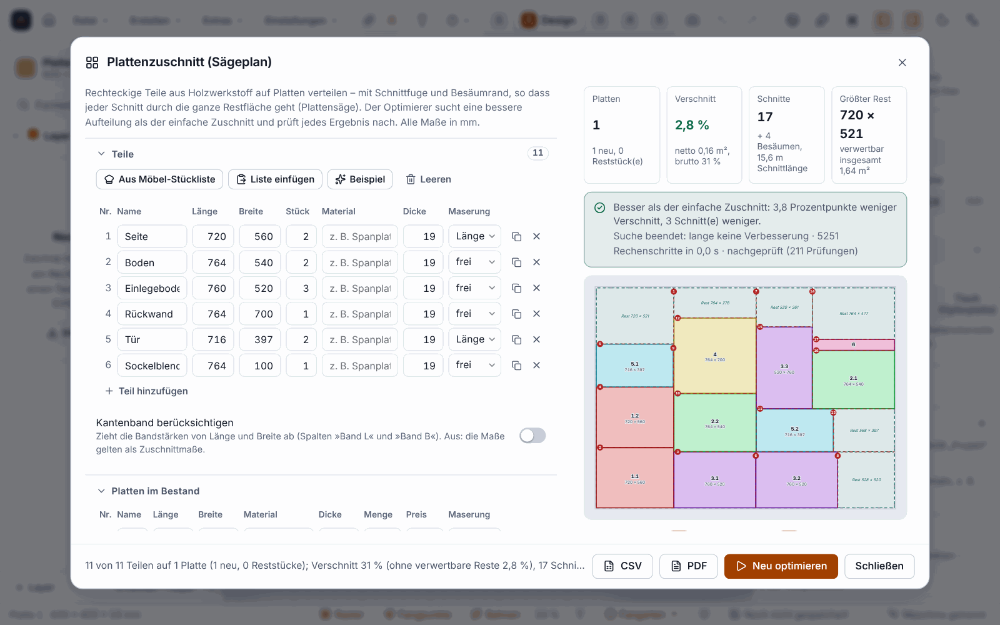

# Plattenzuschnitt: der Sägeplan mit Optimierer (seit 0.11.0)

Der **Plattenzuschnitt** verteilt rechteckige Teile so auf Platten, dass sie sich an einer **Plattensäge** (Formatkreissäge) mit **durchgehenden Schnitten** abtrennen lassen, also jeder Schnitt durch die ganze Restfläche (»Guillotine-Zuschnitt«). Das Ergebnis ist ein Sägeplan mit Skizze je Platte, Schnittfolge, Schnittliste und Reststücken. Ein **Optimierer** sucht dafür nach weniger Platten, weniger Verschnitt, weniger Schnitten, einem größeren Rest oder geringeren Kosten.

Die Teile im Bild sind erfunden.

> **Ehrlich zum Stand:** Alles ist am Rechner gerechnet und mit Tests (Rust, Vitest) und im Browser (Chromium) geprüft. **Nie an einer echten Säge erprobt, nie gesägt.** Die Maße in der Schnittanleitung sind Rechenergebnisse: Prüfe vor dem ersten Schnitt mit einem Probestück die Sägeblattbreite, den Anschlag und ob deine Säge das Besäumen in dieser Reihenfolge erlaubt. CSV nicht in Excel, PDF nicht in Acrobat geprüft.

## Wie unterscheidet sich das vom Plattenplaner?

| | **Teile auf Platte anordnen** (siehe [Platten und Möbel](Platten-und-Möbel)) | **Plattenzuschnitt** (diese Seite) |
|---|---|---|
| Teile | gezeichnete Formen im Projekt, beliebige Konturen | Liste aus Länge × Breite × Stückzahl |
| Ziel | Teile **fräsen**, Abstand mindestens der Fräserdurchmesser | Teile **sägen**, Abstand ist die Schnittfuge |
| Anordnung | Rechtecke, Freiform | nur Guillotine (durchgehende Schnitte) |
| Ergebnis | Formen werden verschoben, Bearbeitungen folgen | Sägeplan, Schnittfolge, Reste; **das Projekt bleibt unverändert** (außer dem Reststück-Lager auf Wunsch) |

Beide benutzen dasselbe **Reststück-Lager** des Projekts.

## So gehst du vor

1. Öffne **Erstellen ▸ Plattenzuschnitt (Sägeplan) …**, die Befehlspalette (`Strg+K`: »Plattenzuschnitt«) oder, im Möbel-Designer unter *Zuschnitt*, den Knopf **»Sägeplan …«** (bis 0.14.0 hieß er »Zuschnitt optimieren …«; seit 0.15.0 gehört der Knopf »Zuschnitt optimieren« zum Zuschnittverfahren »Optimiert« im Designer, siehe [Möbel-Designer](Moebel-Designer#zuschnitt-optimiert-und-sägeplan-seit-0150)): Er lädt die Stückliste (Zuschnittmaße, Maserung, Plattenformate je Werkstoff) und rechnet gleich. Seit 0.13.0: Kachel **Plattenzuschnitt** auf der [Startseite](KI-Modelle-und-Startseite). Seit 0.15.0 führt das Schließen des Dialogs zurück in den Möbel-Designer, wenn du ihn von dort geöffnet hast.
2. **Teile** eintragen: Name, Länge, Breite, Stückzahl, Material, Dicke und Maserung (*frei drehbar*, *Länge ∥ Maserung*, *Breite ∥ Maserung*). `Enter` springt in die nächste Zeile. Hilfen: **Aus Möbel-Stückliste**, **Liste einfügen** (aus Excel oder einem Text), **Beispiel**, **Leeren**. Auf Wunsch zieht »Kantenband berücksichtigen« die Bandstärke von den Maßen ab.
3. **Platten im Bestand** eintragen: Format, Material, Dicke, Menge (leer heißt beliebig viele), Preis je Platte und Maserung (*keine*, *längs*, *quer*). »Reststücke aus dem Lager verwenden« nimmt rechteckige Reststücke gleichen Materials und gleicher Dicke dazu; »Reststücke zuerst verwenden« gibt ihnen Vorrang.
4. **Säge und Reste** einstellen: Schnittfuge (Sägeblattbreite), Besäumrand je Seite einer neuen Platte, Mindestgröße eines verwertbaren Rests.
5. **Optimierung** wählen: das Ziel (wenige Platten, geringster Verschnitt, wenige Schnitte, großer Rest oder geringste Kosten) und die Suchzeit (0,5 bis 30 Sekunden), dann **Optimieren** (`Strg+Eingabe`). In der Fußzeile siehst du den Fortschritt; **Stoppen** beendet die Suche und behält das bisher beste, geprüfte Ergebnis.
6. **Ergebnis lesen:** Kennzahlen (Platten, Verschnitt, Schnitte, Kosten oder größter Rest), der **ehrliche Vergleich mit dem einfachen Zuschnitt** (»1 Platte weniger« oder »gleich gut, nichts Besseres gefunden«), je Platte eine Skizze mit Teilen, nummerierten Schnitten und grün markierten Resten, die **Schnittfolge** nach Stufen mit dem Maß am Anschlag, die Teile jeder Platte, neue Reststücke und nicht untergebrachte Teile mit Grund **und** Lösungsvorschlag. Änderst du danach etwas, gilt das Ergebnis als veraltet und die Ausgabe ist gesperrt, bis du neu rechnest.
7. **Ausgeben:** **CSV** (Schnittliste, Schnittfolge, Reststücke; deutsch mit Semikolon und Dezimalkomma) und **PDF** (Zusammenfassung, je Platte Skizze, Teileliste und Schnittfolge). **»In das Lager übernehmen«** trägt die Reste ein und entfernt die verbrauchten Reststücke (ein Rückgängig-Schritt).

## Regeln

* **Material und Dicke bilden die Gruppe.** Teile liegen nur auf Platten mit gleichem Material und gleicher Dicke. Gibt es für eine Gruppe keine Platte, nennt der Plan die vorhandenen Paare.
* **Maserung:** Ein Teil mit fester Maserung wird nur so gelegt, dass seine Maserungsachse mit der der Platte läuft. Passt es nur gedreht und die Maserung verbietet es, steht es als »nicht untergebracht« mit Lösung im Plan. »Maserung ignorieren« hebt das auf.
* **Schnittfuge:** Zwischen zwei Teilen liegt mindestens eine Fuge. Ein Rest, der schmaler als die Fuge ist, verschwindet im Schnitt.
* **Besäumrand:** vier Besäumschnitte vor dem ersten Schnitt einer neuen Platte; sie stehen nicht in der Schnittliste.
* **Nachgeprüft:** Der Plan wird vor der Ausgabe **unabhängig vom Packer** nachgerechnet (jedes Teil vollständig in der nutzbaren Fläche, Maße, Maserung, jede Fuge, jeder Schnitt trifft ein vorhandenes Stück ganz durch, die Flächenbilanz). Fällt etwas durch, gibt es den Plan nicht.
* **Nie schlechter als der einfache Zuschnitt:** Der Optimierer startet von den vier üblichen einfachen Sortierungen und behält immer das beste Ergebnis, das er je gesehen hat.

## Was der Optimierer bringt: eine Messung

In einer Rechnung mit **24 zufälligen Aufgaben** (nur Rechnung, keine Säge) sparte er von zusammen 97 Platten 7 ein (90 statt 97), der Verschnitt sank von 32,8 auf 22,0 m², die Zahl der Schnitte von 1908 auf 1670. Bei einer einzelnen, einfachen Aufgabe kann das Ergebnis gleich gut sein wie der einfache Zuschnitt; dann sagt das Programm es. Die Zahlen stammen aus erfundenen Zufallsaufgaben, nicht aus deinem Werkstattalltag.

## Grenzen

* **Nur Rechtecke** und nur Guillotine-Schnitte. Teile mit Ausschnitten oder Rundungen gehören in den Plattenplaner zum Fräsen.
* **Nie an einer Säge erprobt** (siehe oben). Die Reihenfolge der Schnitte nimmt Rücksicht auf die Geometrie, nicht auf die Eigenheiten deiner Säge.
* Höchstens 500 Teilezeilen, 300 Zeilen Plattenbestand, 1000 Stück je Zeile, 3000 Teile insgesamt. Reststücke mit freier Kontur werden mit Hinweis übersprungen.
* Die **Plattenkosten** stehen im Plan und im PDF, fließen aber nicht in die Kostenrechnung des Rüstblatts ein.
* Gleiche Eingabe und gleicher Startwert ergeben dasselbe Ergebnis, **solange nicht das Zeitlimit die Suche beendet**; dann hängt es von der Geschwindigkeit deines Rechners ab.
* Nicht im Web-Designer des Portals.

## Weiter

* [Platten und Möbel](Platten-und-Möbel)
* [Rüstblatt und Angebot](Rüstblatt-und-Angebot)
