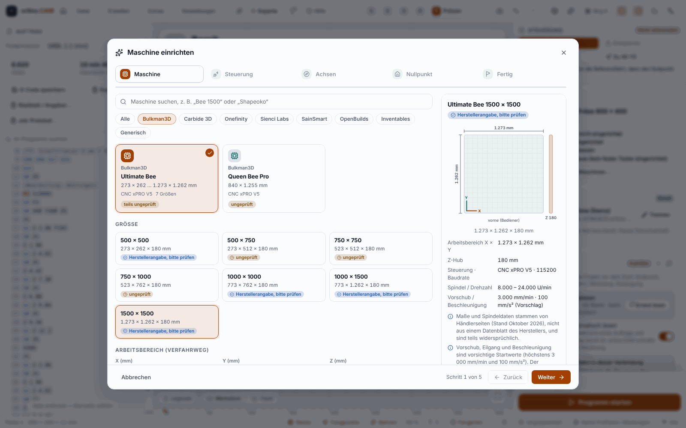

**English** | [Deutsch](Maschine-einrichten)

# Setting Up the Machine

So that ortino.CAM knows how large your CNC router is and how fast it may move, it needs a **machine profile**. This is a small file with the travel, the spindle speed range, the feed rates and the post-processor (see [Post-Processors and Controllers](Post-Processors-and-Controllers)). From the profile the program calculates the time estimate, the checklist and the pre-flight check.

> **Honest about the status:** Tested on a real machine so far is only the **Ultimate Bee with CNC xPRO V5** (version 0.3.3). The dimensions in the catalogue come from manufacturer pages, dealer tables and user reports (as of October 2026) and are **not checked on hardware**. Measure your machine once, even if a value is marked “Manufacturer data”. Test the first run **without bit and material**, with the emergency stop within reach.

## The most important rule: ortino.CAM never writes to the controller

* The program **reads** the settings of your controller (the so-called `$` values such as `$130` for the travel in X). It **never writes them**, not even through the interface for Claude or scripts.
* If something differs, the program shows you the line (for example `$20=1`) **to copy**. You have to send it yourself, in the console in the “Cut” step.
* “Adopt” copies values **from the controller into the profile of ortino.CAM**, never the other way round.

## Where do you start the assistant?

The “Set up machine” assistant guides you through everything in five steps. You find it:

* in the **Project** step,
* in the **Machines** dialog,
* in the command palette (`Ctrl+K`),
* in the **New project** dialog,
* on the welcome page at the first start. There “Later” hides the offer permanently.

## The catalogue

The catalogue knows common CNC routers with their sizes. Each machine is marked:

| Label | Meaning |
|---|---|
| **Manufacturer data, please check** | The dimensions come from manufacturer data or dealer tables, several sources agree, and they are plausible. |
| **unverified** | The dimensions are derived, nominal or contradictory. The program says why. |
| Custom machine | Never “verified”. You enter the dimensions yourself. |

Feed rate, rapid and acceleration in the catalogue are **cautious starting values** (at most 3,000 mm/min and 100 mm/s²), not manufacturer data. If the assistant reads the real values from your controller, you can adopt them.

| Manufacturer | Families in the catalogue | Controller |
|---|---|---|
| Bulkman3D | Ultimate Bee (500 to 1500), Queen Bee Pro | CNC xPRO V5 (GRBL compatible) |
| Carbide 3D | Shapeoko 4, Shapeoko 5 Pro, Nomad 3 | GRBL 1.1 |
| Sienci Labs | LongMill MK2 and MK3 | grblHAL |
| SainSmart | Genmitsu PROVerXL, 3018-PROVer | GRBL 1.1 |
| OpenBuilds | LEAD CNC, WorkBee | GRBL (BlackBox, xPro) |
| Inventables | X-Carve | GRBL (X-Controller) |
| Onefinity | Elite Gen 1 and 2, Pro, Original | MASSO, Redline, Buildbotics: **no GRBL**, G-code export only |
| Generic | 3018, 6040, “Custom GRBL machine” | freely selectable |

If your machine is missing, choose “Custom GRBL machine” and enter the dimensions yourself. For controllers without the GRBL protocol (Onefinity) the assistant skips connecting and the axis test and explains why.

## The five steps

1. **Machine:** Choose manufacturer, family and size, for the Ultimate Bee also the spindle (1.5 or 2.2 kW).
2. **Controller:** connect by USB or network and “Read settings”. The table shows travel, feed rate, acceleration, spindle speed, homing and soft limits. Deviations from the profile can be adopted into the profile.
3. **Axes:** remove the bit, emergency stop within reach, move each axis 5 mm and confirm the direction. Correct is: **+X to the right, +Y to the back (away from the operator), +Z up.** If a direction is wrong, the assistant calculates the new mask for `$3`. You send it yourself.
4. **Work zero:** reference corner, origin of the sheet, Z zero (“Top of sheet” or “Table (spoilboard)”), safe height and post-processor.
5. **Done:** give it a name, save it in the machine list, use it for the project and/or set it as the default for new projects.

Without a connection the set-up continues with “Skip”. For every error the step shows a solution, and “Back” keeps everything entered.

## Example: Ultimate Bee with xPRO V5

1. **Cable and driver:** Use a USB-A to USB-C cable. According to the manufacturer USB-C to USB-C does not work (not checked by us). Under Windows the **CP210x driver** (Silicon Labs) must be installed. Afterwards the controller appears in the Device Manager as `COMx`.
2. **Baud rate:** 115200.
3. **Restart when connecting:** When the port is opened, the controller restarts. The message `Grbl …` in the console is normal.
4. Continue as above: start the assistant, “Ultimate Bee”, frame size, spindle, read settings, check axes, work zero.

The frame sizes 500 × 750, 750 × 750 and 750 × 1000 are not stated by the dealer. Their travel is derived from the other sizes and therefore marked “unverified”.

## Typical pitfalls

| Problem | Cause and solution |
|---|---|
| No COM port in the list | USB driver missing or wrong cable. Install the driver, refresh the ports. |
| No reply after connecting | Wrong baud rate or the controller is still restarting. Read again. |
| Travel 300 × 300 × 300 | Factory setting (`$130` to `$132`). Measure and set it, otherwise the soft limits trigger wrongly. |
| `$30 = 1000` | Factory setting: spindle speeds above 1000 are silently capped. Set `$30` to the maximum spindle speed, for example `$30=24000`. |
| Homing to the wrong corner | Check `$23` (direction) and `$3` (axis direction). |
| An axis moves the wrong way round | Change the `$3` mask or reverse the motor cable of the axis. |
| Soft limits off | They then do not protect against moves beyond the travel. First `$22=1` (homing, limit switches needed), then `$20=1`. |
| Laser mode on (`$32=1`) | Wrong for a CNC router: `$32=0`. |
| Reports in inches (`$13=1`) | Positions would be wrong by a factor of 25.4: `$13=0`. |

## Measuring the travel

For catalogue machines the travel values are suggestions. The **travel assistant** (“Machines” dialog → Travel → “Measure travel …”) measures them on your machine.

> **According to feedback from the operator, tried on a real machine, worked** (Ultimate Bee with xPRO V5; which axes were measured is not recorded). Otherwise checked against the simulator and tests; other controllers have not been tested. First measurement without material, spindle off, hand on the emergency stop.

1. **Prepare:** connected, **homing** done (the machine moves to the limit switches and knows its position afterwards), settings read, display in millimetres. The assistant checks this and explains what is missing.
2. **Soft limits off for the measurement:** Otherwise the controller limits every move to the old value. The assistant shows the line `$20=0` to copy. You enter it yourself in the console. Without soft limits only small steps, attention and the emergency stop protect you.
3. **Measure:** For each axis (X and Y) you move away from the reference point in small steps with “Further”. The steps get smaller towards the end. When the axis is just short of the stop, “This is the end” takes the position. Z is skipped by default, because the table or spoilboard may be in the way.
4. **Result:** Travel = measured path minus safety margin (default 2 mm). You get the lines `$130=…`, `$131=…`, `$132=…` to copy and can enter the values in the profile. The open project changes only when you choose “Apply to the open project”.
5. **Test move:** switch `$20=1` on again and check that the controller stops shortly before the end.

Measuring starts from the position after homing. The result is therefore on the safe side.

## Reading the controller settings

After connecting, ortino.CAM reads the settings (`$$`) **by itself** as soon as the controller is ready: idle, without an alarm, never during a job. You can switch this off in the pre-flight check with “Read automatically on connect” and read again at any time with a click. The result flows into the pre-flight check ([Milling on the Machine](Milling-on-the-Machine)). If reading does not work, the program says so and goes on calculating with the profile. The behaviour of real firmware is **checked only against the simulator**.

## Backing up, exporting and restoring the profile

* Your profile is in a file in the data folder (under Windows `%APPDATA%\ortino.CAM`, the path is shown in the “About ortino.CAM” dialog), **not** in the program folder. An update replaces only program files. This is **not tested with a real Windows update**.
* Before deleting, replacing and restoring, the program backs up the list automatically (the last 10 backups).
* In the “Machines” dialog you can **export** and **import** a profile. The import shows a preview first and by default creates a copy. The file contains only numbers, switches and text, no paths and no connection data.
* If you have used a machine on a real controller, we would be glad to receive your profile (without personal notes) as a contribution. More on this on the page [Contributing and Testing](Contributing-and-Testing).

## Project, list and default machine

Every project carries a **copy** of its machine; besides that there is the **machine list** with your own machines. If the two differ, the “Machines” dialog shows this and lets you choose which state applies. The program never overwrites supplied templates. You can set a machine from the list as the **default machine for new projects**. Existing projects never change because of it.

### My machine (from 0.3.12)

Fixed probe, spoilboard, camera calibration and accessories (dust extraction, touch plate, tool change) describe the **machine**, not a project. If the machine is **in your list** and is the default machine, **every new project** gets this set-up. For a **supplied template** or a machine only from the project file the program shows the note “This set-up only applies to this project so far. Have it in every new project?” with the button **“Save as my machine”**: it creates a copy in your list (never over an existing one), makes it the default machine, and **Ctrl+Z** brings the template back in the project. For an older project there is **“Adopt the machine’s set-up from the list”**; the program forgets the Z reference in doing so and says so. *Checked only against tests, simulator and Chromium.*

Your machine profiles can also be [backed up in the portal](Backup-in-the-Portal) and retrieved on another computer.

<!-- videos:start -->
## Videos

*   
**Choose the machine and the post-processor** · 11 s

All videos: [Videos](Videos-en).
<!-- videos:end -->

## Next

* Next step: [Drawing and Importing](Drawing-and-Importing)
* Later at the machine: [Milling on the Machine](Milling-on-the-Machine)
* Problems: [Troubleshooting](Troubleshooting)
