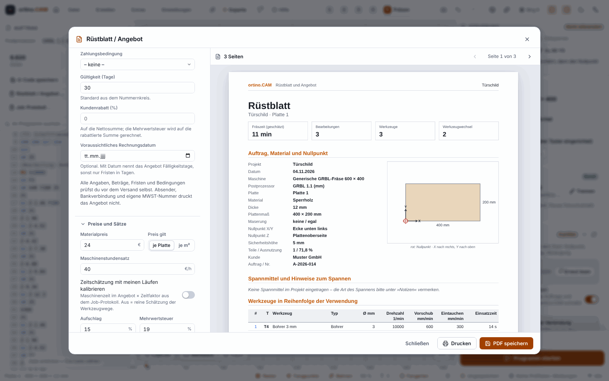
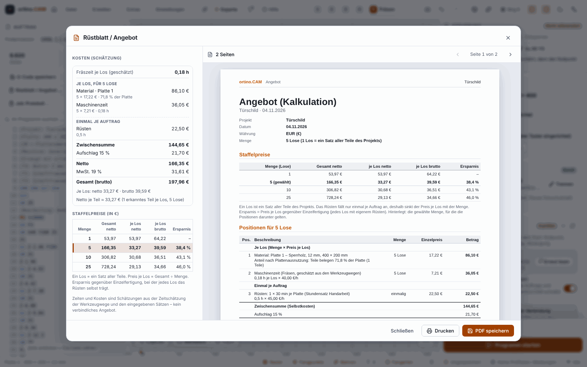

**English** | [Deutsch](Rüstblatt-und-Angebot)

# Setup sheet and quote

With one click, ortino.CAM produces a **PDF** for the machine table (the **setup sheet**, called “Job sheet” in the program) and for the customer (the **cost calculation** or the **quote**, called “Quotation” in the program). Both parts can be in one file or separate. Both are available in German and English, depending on the program language.

> **Honest about the status:**
>
> * **Times and costs are approximations.** The milling time is the time estimate of the toolpaths (with acceleration at corners, but without tool changes, spindle spin-up, setup and finishing work). The estimate has not been compared with real run times. This is **not a binding quote**; it also says so on every quote page.
> * The PDF files were viewed with several checking tools and in the browser. **Not checked** are Acrobat, the preview on macOS, the PDF viewers of Edge and Chrome on Windows, printing and the file dialog on Windows.
> * The amounts in the picture are invented.

## How it works

1. Create your operations in the step **Machining**. The better the toolpaths are calculated, the better the time is.
2. Open the dialog: the button **“Job sheet / quotation …”** in the step “Cut” (below “Save G-code”) or in the step “Check”, in the File menu (“Job sheet / quotation (PDF) …”) or via the command palette (`Ctrl+K`: “job sheet”, “quotation”).
3. On the left, choose the **document type** (*Both*, *Job sheet*, *Quotation*), with several sheets the sheet, and enter customer, job number and notes on clamping.
4. Enter prices and rates (see below). On the right you see the pages as a preview, below them the cost breakdown.
5. **Save PDF** or **Print**. The suggested file name is `<Projekt>_Ruestblatt_Angebot.pdf` (without umlauts).

Your entries are **saved in the project** and are there again the next time you open it (one undo step). In easy mode you see only document type, customer, material price, machine hourly rate, markup and VAT. The rest is under “More settings”.

## What is on the setup sheet

One to a few A4 pages per sheet:

| Section | Content |
|---|---|
| Header | Project, sheet, estimated milling time, number of operations, tools and tool changes |
| Job, material, work zero | Machine, post-processor, material, thickness, sheet size, grain, work zero X/Y/Z, safe height, customer, job number, plus a sketch of the sheet with work zero mark and axes |
| Clamps and notes | Clamps and keep-out zones, your text “Clamping notes”, project notes |
| Tools | In order of first use: number, name, type, diameter, spindle speed, feed rate, **time in use** |
| Order of operations | Name, type, tool, depth, estimated time, bands for the tool changes |
| Checklist and notes | Checklist messages with solution (at most 30), warnings of the post-processor |
| Before starting | Six checkboxes to tick: clamping, work zero, tool, dust extraction and protection, frame or air cut, emergency stop |
| Toolpath preview | True-to-scale top view: cutting paths per tool in one colour, line width equal to tool diameter, work zero and scale |
| Notes and sign-off | Lines for notes, three signature fields (set up, checked, approved) |

The preview shows paths, no depths, no rapids, and paths run several times only once. With very many points the program simplifies the paths and says so below the preview. The machine's start check depends on the connection and does not run offline. The setup sheet therefore takes over only the checklist and post-processor warnings and reproduces the rest as a tick list. A **spoilboard** gets a setup sheet with a note but is not counted in the quote.

## The cost calculation

All entries are optional. The presets are VAT 19 % and the euro as currency (selectable: EUR, CHF, USD, GBP).

| Entry | Meaning |
|---|---|
| Material price | per sheet or per square metre |
| Charge material by | proportionally by **part area** (the sheet utilisation from the sheet planner), by the **used area** or the **whole sheet** |
| Machine hourly rate | Price per hour of milling time |
| Setup time per sheet | in minutes |
| Tool wear per hour | as an amount of money |
| Hand labour hourly rate | also applies to setup |
| Hand labour in total | in minutes |
| Markup | in percent |
| VAT | in percent |

**How it is calculated:** Material (sheet price times share) plus machine time (hours times hourly rate) plus tool wear plus setup plus hand labour gives the **subtotal**. The markup is added to it, which gives the **net total**, then the VAT and the **total amount**. Calculation is in whole cents, and each item is rounded the commercial way. The printed total is therefore exactly the sum of the printed items. In addition, the net price per detected part is given on the page as a guide value.

**Example (invented values):** Sheet 2500 × 1250 mm, parts fill 48 %, sheet €85.00, milling time 1.25 h, machine €48/h, wear €2.40/h, setup 30 min and hand labour 20 min at €36/h, markup 15 %, VAT 19 %:

| Item | Amount |
|---|---:|
| Material (€85.00 × 0.48) | €40.80 |
| Machine time (1.25 h × €48.00) | €60.00 |
| Tool wear (1.25 h × €2.40) | €3.00 |
| Setup (0.5 h × €36.00) | €18.00 |
| Hand labour (⅓ h × €36.00) | €12.00 |
| Subtotal | €133.80 |
| Markup 15 % | €20.07 |
| Net total | €153.87 |
| VAT 19 % | €29.24 |
| **Total amount** | **€183.11** |

**Not included** are: offcuts and leftover sheets (the markup is meant for that), time for tool changes and spindle spin-up, setting up the program, energy, dust extraction and transport. Without a quantity, the quote calculates **one job with one run per sheet**. For several copies there is the **quantity** (see below). Customer records, quote numbers and payment terms exist since 0.11.0, see [Customers and quotes](Customers-and-Quotes); the quote still does not print a sender (letterhead, bank details, own VAT number). Material from the remnant stock is valued at the sheet price entered; you enter a lower price yourself. Fonts in the PDF are the standard fonts (Helvetica); characters outside Windows-1252 appear as a substitute or `?`.

### Quantity and price breaks

In the section **“Quantity and price breaks”** you set how many **lots** you offer. **One lot is one set of all parts of the project**, that is, all sheets milled once (if you choose only one sheet in the dialog, the quote calculates only that one).

* **Quantity (lots):** always visible.
* **Price breaks:** further quantities for the table, for example 1, 5, 10, 25. You type them as chips (separated by comma, semicolon, space or Enter) and remove them with × or Backspace. At most 8 tiers. In easy mode the price breaks are under “More settings”.
* **Scrap allowance:** in percent, at most 50 %. It applies only to the items per lot, **not to setup**. The milling time shown remains the real one.

**What grows with the quantity:** **Setup** occurs **once per job**. Material (proportionally by sheet utilisation), machine time, tool wear and hand labour occur **per lot**. The price per lot therefore falls with the quantity if a setup time is entered; without setup time it stays the same. For a quantity above 1 or with price breaks, the quote shows the table **Price breaks** (total price, price per lot net and gross, **saving**) with the chosen quantity highlighted and the items in the groups “Per lot” and “Once per job”. The saving compares with single-lot production, where each lot has its own setup.

Calculation example with the values of the table above (per lot €115.80, setup once €18.00, markup 15 %, VAT 19 %):

| Quantity | Net | Net per lot | Gross per lot | Saving |
|---:|---:|---:|---:|---:|
| 1 | €153.87 | €153.87 | €183.11 | – |
| 5 | €686.55 | €137.31 | €163.40 | 10.8 % |
| 10 | €1,352.40 | €135.24 | €160.94 | 12.1 % |
| 50 | €6,679.20 | €133.58 | €158.97 | 13.2 % |

* The **price per lot** is an **average** rounded to the cent: quantity times price per lot can differ from the total amount by a few cents. With very small setup costs and large quantities, rounding can make the price per lot fluctuate by 1 cent.
* **Programming** is not an item. If you want to spread it over the lots, enter it in the setup time.
* With quantity 1, an empty price break list and no scrap, the quote is **unchanged** compared with earlier versions (checked with a comparison against the old state).
* Times and costs are **approximations** and not a binding quote.

## Calibrating the time estimate with your runs

Because the time estimate has not been compared with real run times, the program logs your real runs (see [Tools and cutting data](Tools-and-Cutting-Data), the section on the job log). The switch **“Calibrate time estimate with my runs”** (off by default) multiplies the machine time by the time factor from your previous runs. This is possible only after at least three completed runs of five minutes each. The quote page states the factor and the number of runs. So far only checked against the simulator.

## Privacy

Customer, job number, clamping notes and above all **prices and hourly rates are private**. When you create a design package for the [community portal](Community-Portal-en), the program leaves these entries out. But if you pass on an `.ocam` project file, they go with it.

<!-- videos:start -->
## Videos (English)

*   
**Create a job sheet and quotation** · 15 s

*   
**Review your past jobs** · 12 s

All videos: [Videos](Videos-en).
<!-- videos:end -->

## Next

* [Customers and quotes](Customers-and-Quotes)
* [Checking and simulation](Checking-and-Simulation)
* [Sheets and furniture](Sheets-and-Furniture)
