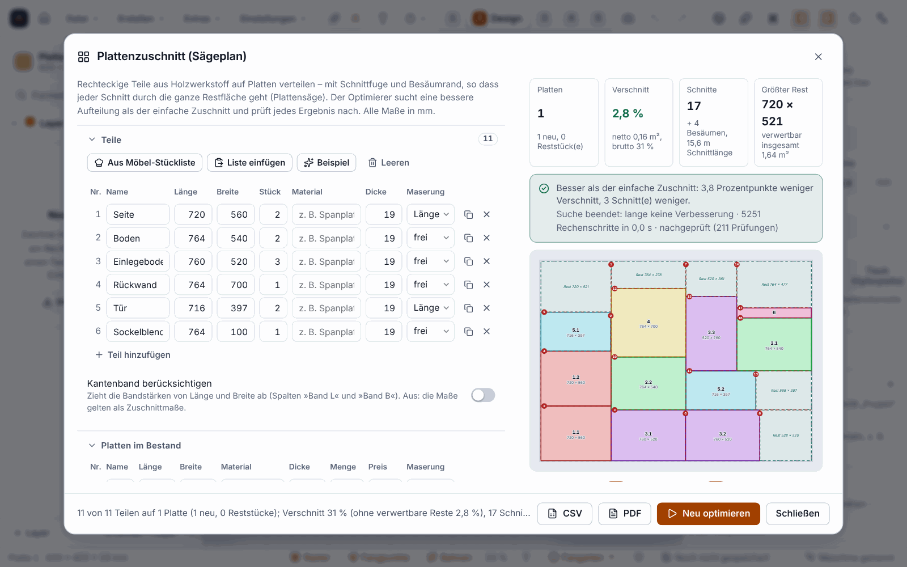

**English** | [Deutsch](Plattenzuschnitt)

# Sheet cutting: the saw plan with optimiser (since 0.11.0)

**Sheet cutting** distributes rectangular parts over sheets so that they can be separated on a **panel saw** (sliding table saw) with **through cuts**, that is, every cut goes through the whole remaining area (“guillotine cutting”). The result is a saw plan with a sketch per sheet, cutting sequence, cut list and remnants. An **optimiser** searches for fewer sheets, less waste, fewer cuts, a larger offcut or lower costs.

The parts in the picture are invented.

> **Honest about the status:** Everything is calculated on the computer and checked with tests (Rust, Vitest) and in the browser (Chromium). **Never tested on a real saw, never sawn.** The dimensions in the cutting instructions are calculation results: before the first cut, check the saw blade width, the fence and whether your saw allows the trimming in this order, using a test piece. CSV not checked in Excel, PDF not in Acrobat.

## How does this differ from the sheet planner?

| | **Arrange parts on sheet** (see [Sheets and furniture](Sheets-and-Furniture)) | **Sheet cutting** (this page) |
|---|---|---|
| Parts | drawn shapes in the project, any outlines | list of length × width × quantity |
| Aim | **milling** parts, spacing at least the bit diameter | **sawing** parts, spacing is the saw kerf |
| Arrangement | rectangles, free-form | guillotine only (through cuts) |
| Result | shapes are moved, operations follow | saw plan, cutting sequence, offcuts; **the project stays unchanged** (except the remnant stock, if you wish) |

Both use the same **remnant stock** of the project.

## How to proceed

1. Open **Create ▸ Panel cutting (saw plan) …**, the command palette (`Ctrl+K`: “Panel cutting”) or, in the Furniture Designer under *Nesting*, the button **“Saw plan …”** (until 0.14.0 it was called “Optimise cutting …”; since 0.15.0 the button “Optimise cutting” belongs to the nesting method “Optimised” in the designer, see [Furniture Designer](Furniture-Designer#nesting-optimised-and-saw-plan-since-0150)): it loads the parts list (cut sizes, grain, sheet formats per material) and calculates straight away. Since 0.13.0: the **Sheet cutting** tile on the [start page](AI-Models-and-Start-Page). Since 0.15.0, closing the dialog leads back to the Furniture Designer if you opened it from there.
2. Enter the **parts**: name, length, width, quantity, material, thickness and grain (*free* (can be rotated), *length ∥ grain*, *width ∥ grain*). `Enter` jumps to the next row. Aids: **From furniture parts list**, **Paste list** (from Excel or a text), **Example**, **Clear**. On request, “Take edge banding into account” deducts the band thickness from the sizes.
3. Enter the **sheets in stock**: format, material, thickness, quantity (empty means any number), price per sheet and grain (*none*, *lengthwise*, *crosswise*). “Use remnants from stock” adds rectangular remnants of the same material and thickness; “Use remnants first” gives them priority.
4. Set the **saw and offcuts**: saw kerf (saw blade width), trim margin per side of a new sheet, minimum size of a usable offcut.
5. Choose the **optimisation**: the goal (few sheets, least waste, few cuts, large offcut or lowest cost) and the search time (0.5 to 30 seconds), then **Optimise** (`Ctrl+Enter`). In the footer you see the progress; **Stop** ends the search and keeps the best verified result so far.
6. **Read the result:** key figures (sheets, waste, cuts, costs or largest offcut), the **honest comparison with the simple cutting plan** (“1 sheet fewer” or “as good, nothing better found”), a sketch per sheet with parts, numbered cuts and offcuts marked in green, the **cutting sequence** by stages with the measure at the fence, the parts of each sheet, new remnants and parts not placed, with the reason **and** a suggested fix. If you change anything afterwards, the result counts as outdated and the output is locked until you recalculate.
7. **Output:** **CSV** (cut list, cutting sequence, remnants; the separator and decimal mark follow the program language: with English, commas and decimal points; with German, semicolons and decimal commas) and **PDF** (summary, per sheet a sketch, parts list and cutting sequence). **“Add to stock”** enters the offcuts and removes the used remnants (one undo step).

## Rules

* **Material and thickness form the group.** Parts only go on sheets of the same material and thickness. If there is no sheet for a group, the plan names the existing pairs.
* **Grain:** A part with fixed grain is only placed so that its grain axis runs along that of the sheet. If it only fits rotated and the grain forbids that, it appears in the plan as “not placed” with a fix. “Ignore grain” lifts this.
* **Saw kerf:** There is at least one kerf between two parts. An offcut narrower than the kerf disappears in the cut.
* **Trim margin:** four trimming cuts before the first cut of a new sheet; they are not in the cut list.
* **Verified:** Before output the plan is recalculated **independently of the packer** (every part completely within the usable area, sizes, grain, every kerf, every cut goes completely through an existing piece, the area balance). If anything fails, there is no plan.
* **Never worse than the simple cutting plan:** The optimiser starts from the four usual simple sortings and always keeps the best result it has ever seen.

## What the optimiser achieves: a measurement

In a calculation with **24 random tasks** (calculation only, no saw) it saved 7 of a total of 97 sheets (90 instead of 97), the waste fell from 32.8 to 22.0 m², the number of cuts from 1,908 to 1,670. For a single, simple task the result can be as good as the simple cutting plan; then the program says so. The figures come from invented random tasks, not from your everyday workshop.

## Limits

* **Rectangles only** and only guillotine cuts. Parts with cut-outs or curves belong in the sheet planner for milling.
* **Never tested on a saw** (see above). The order of the cuts takes the geometry into account, not the quirks of your saw.
* At most 500 part rows, 300 rows of sheet stock, 1,000 pieces per row, 3,000 parts in total. Remnants with a free-form outline are skipped with a note.
* The **sheet costs** are in the plan and in the PDF, but do not flow into the cost calculation of the setup sheet.
* The same input and the same seed give the same result, **as long as the time limit does not end the search**; then it depends on the speed of your computer.
* Not in the Web Designer of the portal.

## Next

* [Sheets and furniture](Sheets-and-Furniture)
* [Setup sheet and quote](Setup-Sheet-and-Quote)
