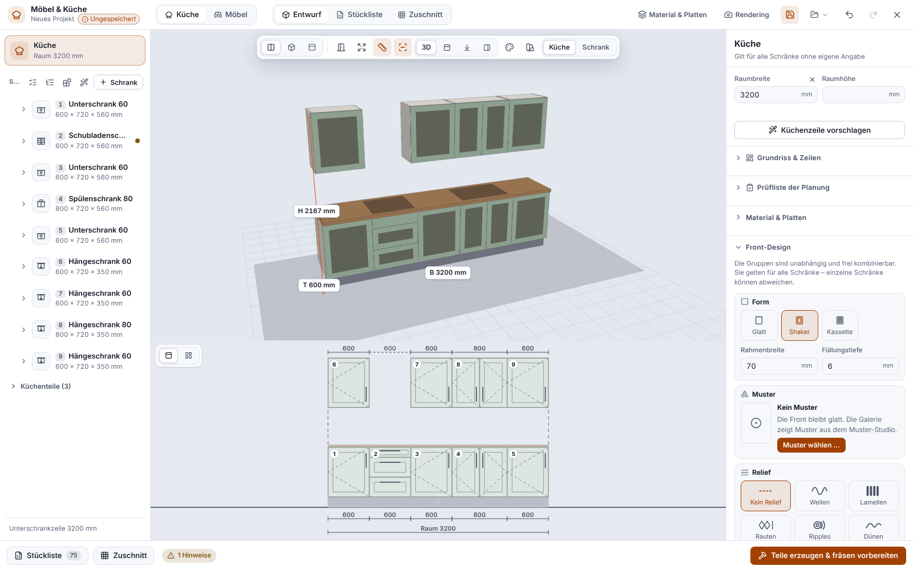

**English** | [Deutsch](Platten-und-Möbel)

# Sheets and Furniture

This page describes how to distribute many parts over sheets (**sheet planner**), create wood joints (**fits and finger joints**), design cabinets and kitchens (**Kitchen Designer**; tables, shelves and seating are in the [Furniture Designer](Furniture-Designer)) and produce projects as **templates** and as **series from a table**.

> **Honest about the status:** Everything on this page is **checked by calculation, in the simulation and in the browser test, but never milled on a machine and never tested in real wood.** Dimensions of fittings and joints come partly from retailer data, partly from workshop practice, and are partly unconfirmed. Before the first series, mill a test piece and compare it with the real fitting or the manufacturer's drilling template.

## Sheet planner

The sheet planner places parts on one or more sheets so as to save space and creates a waste report. You find it in the properties panel under “Arrange” (button **Arrange on sheet**) and in the command palette (`Ctrl+K`: “Open sheet planner …”). In Easy mode one click is enough. If something does not fit, the dialog with the preview opens instead; nothing is ever done halfway in silence. The dialog shows you **exactly the plan that “Apply” then carries out**, as a single undo step.

* **What is a part?** The program groups what belongs together: a shape inside another one (drilling, pocket, label) belongs to that one's part, so inner contours stay with the part. Overlapping shapes form one part.
* **Settings:** quantity per part (0 to 1000), spacing (at least the bit diameter, automatically diameter plus 2 mm), margin (at least 10 mm), rotation (none, 90° or any), respect the grain.
* **Two methods:** **Rectangular** (default) packs parts by their bounding rectangle. **Free-form** nests the real contours (arcs, holes) and saves clearly more material with round, slanted and L-shaped parts. With pure rectangles, Free-form gains nothing. Free-form is greedy and **not an optimiser**: it delivers valid, mostly good, not optimal arrangements. At most 500 parts per plan.
* **Operations follow the parts:** If the shapes of an operation end up on several sheets, one operation is created per sheet.
* **Waste report:** per sheet the utilisation, the waste, the largest usable remaining rectangle, and a list of unplaced parts with reason and solution.
* **Remnant stock:** Remnants (with dimensions, thickness, material, grain, optionally an outline) belong to the project. With “Fill remnants first” the plan fills suitable remnants first. “Keep the largest leftover of each sheet” enters the largest free area after arranging. Nothing is entered automatically after milling. The remnant stock also does **not** flow into the costs.

For **panel saw cutting** with through cuts, a cutting sequence and an optimiser there is a separate dialog: [Sheet cutting (saw plan)](Sheet-Cutting), since 0.11.0.

Limits: The sheet planner does not know keep-out zones for clamps. Parts made of more than 300 contours are arranged by their convex hull (with gaps). Because of the grid, the gaps between parts are up to about two cells wider than the minimum spacing. Look at the simulation before the first cut.

## Fit assistant: How much clearance does your material need?

Whether fingers fit in *your* plywood depends on the real thickness and on your bit. The **fit assistant** (Create menu, command palette or the card “Fit & joints” in the Project step) finds this out with a **test coupon**:

1. **Measure the thickness:** Enter the thickness measured with calipers (average).
2. **Create the test coupon:** A small sheet with several slots, each a little wider or narrower (default: 9 stages in steps of 0.05 mm). The clearances are engraved above each slot. Mill the coupon.
3. **Apply the result:** Push an offcut strip into each slot, choose the stage that fits and click “Apply value”. The project variables `Dicke` and `Spiel` are set, and **all joints recalculate**.

“Probe the thickness” reads a probing result from the controller. This is **only checked against the simulator**.

## Joints: finger joints, tenons, groove and tongue

The **joint generator** (“Insert joint”) creates contours and operations for:

| Type | Use |
|---|---|
| **Finger joint** | Corner joint: odd, symmetric number of fingers, both parts end flush |
| **Mortise & tenon** | T joint, through or blind |
| **Groove & tongue** | T joint with a groove in one of the parts |

Thickness and clearance are formulas and pre-filled with the variables. **Dogbones** (small reliefs in inner corners) make sure the square counterpart fits into the corner that the round bit has rounded. You choose them in the contour, on the toolpath or not at all. The parts lie on their own layers with finished operations (inside before outside). If thickness, clearance or tool change, **the joints recalculate within the same undo step**. The program does not overwrite parts you changed by hand.

Not built: dovetails, mitres, tongues thinner than the board, joints with more than two parts. There is no 3D preview of the assembled state, and the fingers are not connected to the Furniture Designer. The calculation model does not know material swelling, moisture or bit wear, and the clearance is a single value for all joints.

## Furniture and Kitchen Designer

Open: Create → *Furniture & Kitchen …*, `Ctrl+Shift+M` or the card in the Project step. The designer designs cabinets and kitchen runs with a few inputs and derives from them all parts with drillings, grooves and pockets. It creates the parts list and the cutting plan and finally creates ordinary sheets, shapes and operations in the project. From there the usual path applies: Machining → Check → Cut.

* **Start in three steps:** Choose material and sheets (carcass, fronts, back panel, sheet size, edge band), add cabinets or let the program propose the kitchen run from the room width, then change what does not fit.
* **Cabinet types:** base cabinet, drawer cabinet, sink cabinet, wall cabinet, tall cabinet and corner cabinets (L-shape, blind corner cabinet, also wall-hung). Not implemented: diagonal corner cabinet, carousel, pull-out hardware, folding door, 90° angle hinge.
* **Views:** 3D preview (open doors `O`, explosion `E`, dimensions `M`, drillings `B`, colour per cabinet `C`) and elevation with dimension chains.
* **Rules in the background:** System 32 (hole rows Ø 5, 32 mm grid), cup hinges (Ø 35), dowels, cam connectors, confirmat screws, grooved or applied back panel, finger recesses and handle drillings. The number of hinges depends on door height and weight.
* **Hinge side:** left or right; for **tall cabinets** separately for the lower and the upper door (“Hinge side, lower / upper”). This affects the cup drillings, the pivot axis in the 3D preview and the parts list.
* **Colours and gloss** (display and order data only, no effect on milling): colour and gloss level (matt, satin, high gloss) for the whole kitchen or for one or more marked cabinets; thirteen colour swatches with dark tones, free hex colour. The “True colours” view (`V`) shows them; the finish appears in the parts list, the cutting plan and the setup sheet.
* **Handles:** bar handle, rail handle, knob, cup pull and profile handle with orientation, position and finish. They appear as solids in the 3D preview and as bought-in parts in the parts list; the program places the drillings as before. Handle dimensions are catalogue values – always mill a test piece.
* **3D reliefs on fronts:** parametric **waves** (direction, wavelength, depth, profile, phase, meander, cross waves), **slats, diamonds, ripples, dunes** – only on smooth fronts. “Pattern across selection” lays a relief across several fronts (for example three tall cabinets) as one continuous surface including the gaps. The checklist knows the remaining thickness, the cup hinge area, ribs that are too fine and handles in the relief. It is milled as a normal 3D operation. **Never milled;** the preview shows the relief only shaded.
* **Rendering:** an image of the kitchen with light, shadows, gloss and sink, see [Kitchen Rendering](Kitchen-Rendering).
* **Edge band:** standard band, matrix of all parts and edges, cut size with band thickness and milling allowance.
* **Appliance niches** (since 0.4.1): dishwasher 45/60, oven in a base or tall cabinet, fridge in a tall cabinet (sliding or fixed door), microwave and compact appliance, extractor hood. The niche has no carcass parts where the appliance stands, but an appliance base, ventilation and a split back panel instead. **Appliance dimensions are workshop values (assumptions):** each dimension can be replaced with your own, and the appliance's installation manual applies.
* **Room & survey** (since 0.4.1): walls (rectangle or corner points), room height, windows, doors with swing, water, drain, power, cooker connection, gas and light switches, with a floor plan as a second view; missing dimensions are marked “placeholder, not measured”. 3D preview and rendering show the walls with openings.
* **L- and U-shaped kitchens and island** (since 0.4.1): several runs in the room (position, rotation in 90° steps), island with overhang, worktop corner butt-jointed or mitred; all runs appear in the parts list, the cutting plan and “Create parts”. The plinth of the island is manual work all round.
* **Checklist for appliances and room** (since 0.4.1), each message with a suggested solution and assumptions, not a proof of compliance with any standard: appliance fits the niche, hood above the hob, distances of the hob to wall, tall cabinet, window and door, door swing, passage width, work triangle (note), working and reaching height, wall cabinet in front of a window, door or switch, sink and hob at the connections, wall fixing (note).
* **Own modules:** You save a cabinet or a group as a module and insert it again. With `Ctrl+C` and `Ctrl+V` you also copy cabinets into another project, and the **whole kitchen** (with room width, sink, hob and pattern groups) can be saved as a template.
* **Saving, opening, continuing:** The file name and save state are shown in the designer; *Save* (`Ctrl+S`), *Save as* and *Open* are in the designer's File menu; the window title shows “●” for unsaved changes. Anyone who opens a file with a kitchen (File ▸ Open, Recently opened, double click, dragging into the window, Restore) lands **back in the designer**, and the start page offers “Continue”.
* **Variants:** Several designs of the same kitchen in **one** file (for example “A black matt” and “B oak”), up to twelve. Generated parts belong to the variant they were generated for; after switching they count as outdated until you generate again.
* **Customer sheet:** File menu ▸ *Print customer sheet*: plan view of the run with front colours, handles, dimension chain, heights, cabinet list, finishes and fittings, marked as a non-binding planning sketch. It is printed through the Windows print dialog, which also offers *Save as PDF*. Only the view of the run, no floor plan, no appliances, no room.
* **Fittings library:** 41 entries (handles, knobs, cup hinges, drawer runners, flap stays, shelf supports, plinth legs, connectors) with source and link at Jumbo, Bauhaus.ch and Hettich. *Use* sets the hole spacing, length, drilling-pattern profile or connector of the kitchen; the parts list gives designation and source, with your own price and total if you wish. Your own entries are possible. **They are product details and search results, not a data-sheet comparison:** only the Hettich entries carry “per data sheet” (details from the Hettich shop), everything from Jumbo and Bauhaus is **unchecked**. No prices, texts or images of the shops, no partnership. The hinge profile “48/6 (e.g. Hettich)” could not be verified at Hettich (there TB 45 × 9.5 and TH 52 × 5.5): compare it with the data sheet before drilling.
* **Parts list and cutting plan:** Parts list by cabinet or material, export as CSV (Excel-compatible) and printable HTML. The cutting plan distributes the parts over sheets (MaxRects, saw-ready as guillotine or, since 0.15.0, **Optimised**: both methods with many sequences, few sheets and one large leftover piece; the gain is usually small, calculated only) with grain, spacing and margin. The button “Optimise cutting” stays in the designer, while the button “Saw plan …” opens the saw plan; details and the limits are in the [Furniture Designer](Furniture-Designer#nesting-optimised-and-saw-plan-since-0150).
* **“Create parts & prepare milling”** turns everything into ordinary sheets and operations.

What does **not** happen on the CNC is listed as “Manual work” in the parts list and the checklist: edge drillings, drawer runners, flap fittings and the worktop. Handles appear as bought-in parts in the parts list; their dimensions are catalogue values.

> **Check the fitting dimensions.** Only a few values are backed by a source: the cup of the cup hinge Ø 35 mm with a depth of 13 mm, the drilling dimension of the cam connector and the System 32 grid. All dimensions of Hettich hinges, dowels and confirmat screws come from workshop practice, and the hinge arms (overlay, cranking) are assumptions. Corner cabinets and edge band are **internally consistent, but not checked against manufacturer standards**. Compare with the data sheet before milling and build a test piece.

## Templates with an input form

A project can become a **template**: anyone who opens it sees a form with dimensions, texts, material and switches. The program recalculates shapes and toolpaths and shows the preview and checklist next to it.

* **Create:** Project step → card “Template & series” → “Create template” (or command palette: “Save as template …”). Input types: size, number, text, choice, yes/no, material.
* **Open:** Create → “New from template …” or the strip “Templates with a form” in the dialog “New project”. Supplied are a name plate, a cutting board with handle, a shelf with a drilling grid and a perforated-sheet panel. Their cutting values are guide values.
* **Form:** live preview and checklist, errors at the field with a solution, formulas possible in every dimension field. `Ctrl+Enter` creates the project.
* You can share templates as a design in the [Community Portal](Community-Portal-en).

## Series from a table (CSV)

The same template can be produced as a **series** with a table: one part per row. The series wizard (form → “Series from table …”) has three steps:

1. **Data:** choose a CSV file, paste from Excel or load an example table. The program detects the separator and the decimal mark.
2. **Mapping:** Each column belongs to an input of the template, to the part number, to the quantity or to the file name. The **row check** shows for each row “fine”, a note or an error with row, column and solution.
3. **Result:** output type, target folder, post-processor, labelling of the parts (part number as text or engraving). Then “Make series”.

The output type is either **one G-code file per row** or **all parts distributed over sheets** (the sheet planner arranges them by material and thickness), with one file per sheet. There is also a **log** as CSV and HTML with the result of each row. The open project stays unchanged, existing files are never overwritten without confirmation, and faulty rows do not hold up the others. On the command line this works with `ortino series` (see [Claude, MCP and API](Claude-MCP-and-API)).

Limits: at most 2000 rows per run, 20 MB per table. In sheet mode only the first sheet of the template applies, Inlay and 3D relief do not work there, and the label sits at the bottom centre of the part. Folder selection and paths under Windows as well as the milling are **not tested**.

<!-- videos:start -->
## Videos (English)

*   
**Arrange parts on a sheet with the sheet planner** · 12 s

All videos: [Videos](Videos-en).
<!-- videos:end -->

## Next

* [Sheet cutting (saw plan)](Sheet-Cutting)
* [Creators](Creators) (since 0.13.0: box with finger joints and other workpieces from a few inputs)
* [Furniture Designer](Furniture-Designer) (tables, sideboards, shelves, seating)
* [Importing 3D Models](Importing-3D-Models)
* [Operations](Operations)
* [Setup Sheet and Quote](Setup-Sheet-and-Quote)
