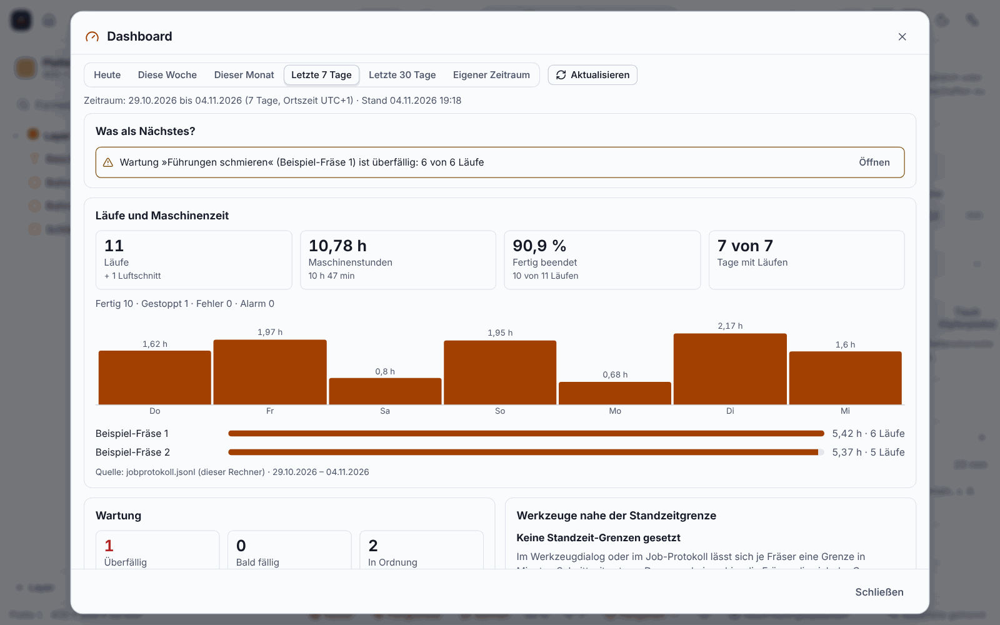

# Werkstatt-Ordner, Rollen und Dashboard (seit 0.12.0)

> **Ehrlich zum Stand:** Nur gegen Tests und Chromium geprüft. **Ein echtes Netzlaufwerk (NAS, SMB/NFS) und Windows sind nicht erprobt.** Rollen schützen vor **Fehlbedienung, nicht vor Zugriff auf die Dateien**; die optionale PIN ist kein Schutz dagegen. Alles bleibt auf den Rechnern der Werkstatt, **nichts geht ins Portal** oder an Claude.

Für eine kleine Werkstatt mit mehreren Leuten und Rechnern.

Die Zahlen im Bild sind erfunden.

## Werkstatt-Ordner

Menü **Extras ▸ Werkstatt**: Ordner anlegen oder beitreten (zum Beispiel ein Ordner auf dem NAS). Darin liegen `werkstatt.json`, `personen.json` und die gemeinsame Bibliothek. Mehrere Rechner dürfen gleichzeitig schreiben: Eine Sperrdatei und eine Revisionsnummer sorgen dafür, dass nichts verloren geht; bei einem Konflikt zeigt das Programm eine Meldung. Ohne Werkstatt-Ordner verhält sich das Programm wie bisher.

## Personen und Rollen

Jede Person hat einen Namen, ein Kürzel und eine **Rolle**: **Ansehen** (nur ansehen), **Bedienen** (zusätzlich die Maschine bedienen: Job starten, Fahren, Nullpunkt, Spindel, Werkzeugwechsel) oder **Verwalten** (zusätzlich Bibliothek, Wartung und Personen verwalten). Stopp, Pause und Reset sind nie gesperrt. Welche Person an diesem Rechner arbeitet, wählst du im Dialog; die Statusleiste zeigt Kürzel und Rolle.

## Gemeinsame Bibliothek

Du kannst **bewährte Schnittdaten**, **Fräser** und **Reststücke** veröffentlichen (Rolle *Verwalten*) und übernehmen (Rolle *Bedienen*). Weicht ein Eintrag vom vorhandenen ab, zeigt das Programm zuerst die Änderungen und verlangt eine Bestätigung. Nicht dabei sind Vorlagen, Postprozessoren, Maschinenprofile, Wartungspläne und Standzeit-Grenzen.

## Dashboard

Menü **Extras ▸ Dashboard**: für Heute, Woche, Monat, 7 oder 30 Tage oder einen eigenen Zeitraum die Läufe, Maschinenstunden, Erfolg und Abbruch (je Maschine und Tag), Wartung und Standzeit, das Reststück-Lager und offene Angebote (nur Zahl und Summe, ohne Kundendaten). Jede Karte nennt Quelle und Zeitraum. Das Job-Protokoll liegt je Rechner und enthält keine Personen; das Dashboard zeigt deshalb den eigenen Rechner und keine Auswertung je Person und keine Auslastung in Prozent.

## Weiter

* [Rüstblatt und Angebot](Rüstblatt-und-Angebot)
* [Kunden und Angebote](Kunden-und-Angebote) (die offenen Angebote im Dashboard)
* [Werkzeuge und Schnittdaten](Werkzeuge-und-Schnittdaten)
* [Platten und Möbel](Platten-und-Möbel)
