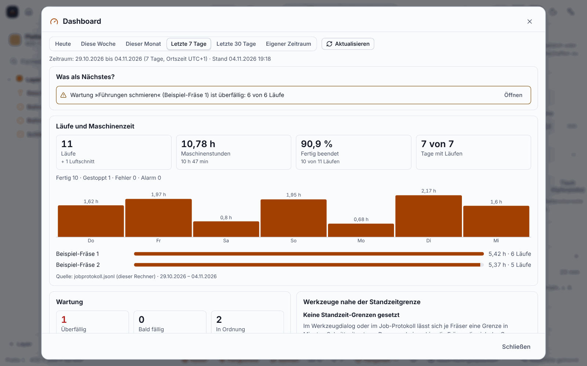

**English** | [Deutsch](Werkstatt-und-Team)

# Workshop folder, roles and dashboard (since 0.12.0)

> **Honest about the status:** Checked only against tests and Chromium. **A real network drive (NAS, SMB/NFS) and Windows are not tested.** Roles protect against **operating mistakes, not against access to the files**; the optional PIN gives no protection against that. Everything stays on the workshop's computers, **nothing goes to the portal** or to Claude.

For a small workshop with several people and computers.

The numbers in the picture are invented.

## Workshop folder

Menu **Extras ▸ Workshop (team) …**: create or join a folder (for example a folder on the NAS). It holds `werkstatt.json`, `personen.json` and the shared library. Several computers may write at the same time: a lock file and a revision number make sure nothing is lost; if there is a conflict, the program shows a message. Without a workshop folder the program behaves as before.

## People and roles

Each person has a name, initials and a **role**: **View** (look only), **Operate** (in addition operate the machine: start a job, jog, work zero, spindle, tool change) or **Manage** (in addition manage the library, maintenance and people). Stop, pause and reset are never locked. You choose in the dialog which person is working at this computer; the status bar shows the initials and role.

## Shared library

You can publish (role *Manage*) and adopt (role *Operate*) **proven cutting data**, **cutters** and **remnants**. If an entry differs from the existing one, the program first shows the changes and asks for confirmation. Not included are templates, post-processors, machine profiles, maintenance plans and tool-life limits.

## Dashboard

Menu **Extras ▸ Dashboard (workshop) …**: for Today, This week, This month, the last 7 or 30 days or a custom period, it shows the runs, machine hours, success and abort (per machine and day), maintenance and tool life, the remnant stock and open quotes (number and total only, without customer data). Each card names its source and period. The job log is kept per computer and contains no people; the dashboard therefore shows your own computer, no evaluation per person and no utilisation in percent.

## Next

* [Setup Sheet and Quote](Setup-Sheet-and-Quote)
* [Customers and Quotes](Customers-and-Quotes) (the open quotes in the dashboard)
* [Tools and Cutting Data](Tools-and-Cutting-Data)
* [Sheets and Furniture](Sheets-and-Furniture)
